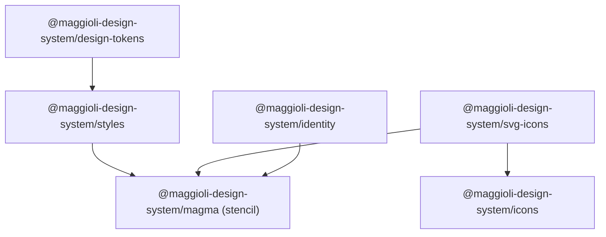
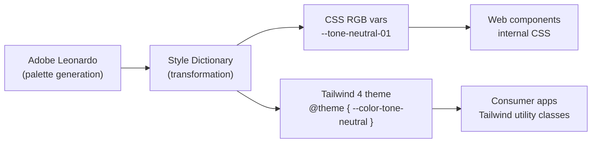

# ARCHITECTURE.md

## 1. System Overview

Magma is a monorepo managed with NX and npm workspaces. It is composed of six independent sub-projects, each published as a separate npm package under the `@maggioli-design-system` scope. Sub-projects have a strict one-directional dependency graph: no circular dependencies are allowed.



**Required build order**: `design-tokens` → `styles`, and `svg-icons` → `icons`, before `stencil`

> `svg-icons` ships the SVG artwork; `icons` turns a curated selection of it — plus third-party
> icons — into a font. `icons` is the only sub-project the web components do not depend on: they
> read the SVGs directly.

---

## 2. Sub-projects

### 2.1 `design-tokens`

Generates design tokens for colors, typography, spacing, borders and other platform-agnostic values.

- Built on **Adobe Leonardo** (color palette generation with WCAG contrast ratios) and **Style Dictionary** (token transformation and output)
- Outputs tokens in multiple formats: CSS custom properties, Tailwind 4 theme, Flutter/Dart, JSON
- Describes every global token, the semantic layer included, as DTCG 2025.10 JSON in `dist/dtcg/` (sets per mode, theme and contrast, plus a resolver document). The semantic layer comes from `semantic.model.ts`, which both this export and the styles generator read
- Color palette categories: `tone` (neutrals), `status` (info/success/warning/error), `label` (semantic accent colors), `variant` (primary/secondary/ai), `brand`
- Token levels: **primitive** (raw values) → **semantic** (role-based) → **component** (component-scoped CSS vars)
- Exposes a CLI (`npx magma-design-tokens`) to generate custom palettes from a config file

Key output files consumed by other sub-projects:
```
dist/css/colors-rgb-*.css           # RGB color vars (required by Tailwind and web components)
dist/css/colors-hex-*.css           # HEX color vars (plain CSS usage)
dist/css/tailwind-theme-color.css
dist/css/tailwind-theme-typography.css
```

### 2.2 `identity`

Static brand assets: logos, avatars, and brand imagery for all Maggioli Group products. Read-only from consumer projects — never modify these assets directly.

Asset categories:
- `resources/brand/` — logos per brand (gruppo-maggioli, maggioli-editore, rnd, magma)
- `resources/avatar/` — avatar illustrations per brand

### 2.3 `svg-icons`

The full SVG icon library. Icons are referenced by filename slug inside components via the `icon` prop. The `mds-icon` component fetches them at runtime from a path configured via `sessionStorage`.

```javascript
// Required setup in every consumer application
window.sessionStorage.setItem('mdsIconSvgPath', 'assets/img/svg/');
```

Icons follow a semantic slug naming convention (e.g. `action-email-send`, `status-warning`). See `projects/svg-icons/svg/` for the full list.

### 2.4 `icons`

The icon **font** (`mgg-icons`) and its CSS/SCSS/LESS companions, for consumers that want
`<i class="mgg-icons-action-send">` instead of an SVG element. It owns no artwork: every glyph is
declared in [`projects/icons/dictionary.json`](../projects/icons/dictionary.json), which maps a font
class name to a source icon in one of four groups.

| Group | Source package |
| --- | --- |
| `maggioli` | `@maggioli-design-system/svg-icons` |
| `material` | `material-design-icons-updated` |
| `material-icons-svg` | `@material-icons/svg` |
| `mdi` | `@mdi/svg` |

Only the icons listed in the dictionary reach the font, so this package is a **curated subset** of
`svg-icons` plus third-party icons: plenty of sources exist for `mds-icon` alone and are
deliberately kept out. Because nothing signals the difference, every source must be either mapped
here or declared in `projects/icons/unmapped-icons.json`; `nx run icons:check.dictionary` enforces
that in CI.

Adding or changing an icon is documented in [`projects/icons/SPEC.md`](../projects/icons/SPEC.md).

### 2.5 `styles`

CSS and Tailwind 4 styles consumed by the web component library and consumer applications.

| Output file | Purpose |
|---|---|
| `dist/css/globals.css` | Global CSS custom properties (`--magma-*` design decisions) |
| `dist/css/reset.css` | Opinionated CSS reset |
| `dist/css/colors-rgb-*.css` | RGB color tokens (required for Tailwind and web components) |
| `dist/css/hydrated.css` | FOUC prevention for StencilJS, and the box of the hydrated components kept against page resets (Tailwind's preflight) |
| `dist/css/animations.css` | Shared animations |
| `dist/tailwind/` | Tailwind 4 layers: base, typography, utilities |
| `dist/tailwind/consumption.json` | How each global token is consumed through Tailwind 4, keyed by its DTCG `css` name, with the token's DTCG `$description` when it has one; generated from Tailwind's design system |
| `dist/dtcg/` | The styles globals as DTCG 2025.10 (corner and depth sets), with a resolver that adds them to the design-tokens sets |

CSS cascade layer order (consumer apps must respect this):
```
reset → vendor → theme → base → components → utilities → overrides
```

Dark mode is handled via palette-level CSS custom properties. Activation classes on `<html>`:
- `dark-mode` — manual dark mode
- `system-mode` — follows OS preference
- `pref-theme-scheme-dark / light / all` — fine-grained control

Global design decisions overridable via CSS custom properties on `:root`:
- `data-corner-shape` — corner geometry: the shape AND the `--magma-radius-*` scale tuned for it,
  moved together (default: `squircle`, on a bare `:root`). Works on any element, so a subtree can
  deviate. `--magma-corner-shape` alone changes the shape WITHOUT the scale. A browser without
  `corner-shape` gets the round shape and scale from a `@supports not` block, and
  `--magma-corner-cap` (0.5, 0.2915 there) caps the controls whose radius is past half their height
- `--magma-disabled-opacity` — default: `0.5`
- `--magma-outline-focus` — focus ring style
- Z-index scale: header `1000` → notification `2000` → modal `3000` → backdrop `4000` → dropdown `5000` → tooltip `6000` → theme-overlay `7000` → context-menu `8000`

### 2.6 `stencil`

The web component library. 115 components built with StencilJS, compiled to standard Custom Elements. Also outputs framework-specific wrappers:

- `@maggioli-design-system/magma` — vanilla JS / HTML
- `@maggioli-design-system/magma-react` — React wrapper
- `@maggioli-design-system/magma-angular` — Angular wrapper

The wrappers are separate npm workspaces, `projects/stencil-react` and `projects/stencil-angular` (nx projects of the same name), siblings of `projects/stencil`. The Stencil build generates their sources (`projects/stencil-react/src`, `projects/stencil-angular/magma-angular/src/stencil-generated`) and their agent install docs; they only compile what `stencil` emitted. They live outside `projects/stencil` because npm never materializes the `node_modules` of a workspace nested inside another workspace (#666, #672). Each wrapper has its own tests against the stencil build (`nx run stencil-react:test`: Vitest, browser and node projects; `nx run stencil-angular:test`: Vitest in jsdom, through the Angular unit-test builder), run in CI by the `magma-react` and `magma-angular` jobs of the stencil workflow.

### 2.7 `lint`

`@maggioli-design-system/lint` (`projects/lint`, #1102): the ESLint and Stylelint rules that hold a consumer's code to the installed version of Magma, the executable form of the prose rules of `docs/agents/` (conventions, color, theming). One core reads the data of the installed packages, never a list written by hand: the props and their values from `documentation.json` (`stencil`), the raw palette steps from the DTCG base set (`design-tokens`) and the colour utilities from `consumption.json` (`styles`). On top of it:

- `./eslint`: the template rules (`valid-attribute-values`, `no-false-boolean`, `accessible-name`, `no-raw-palette-classes`), with one adapter per parser: HTML (`@html-eslint/parser`), JSX (`<mds-*>` and the React wrappers), Angular templates (`@angular-eslint/template-parser`);
- `./stylelint`: the CSS rules (`no-raw-color`, `no-color-scheme-override`), the consumer side of the `magma/token-values` rule of the component sheets;
- `recommended` and `strict` presets for both (DIRECTION of the docs site, "Lint rules": broken or not accessible is an error, token discipline a warning in an existing product).

It depends on no other project at build time: its tests run on fixtures cut from the real data (`projects/lint/test/fixtures`), and its CI is `magma-lint-ci.yml`. How to set it up and what each rule catches: [`projects/lint/README.md`](../projects/lint/README.md).

---

## 3. Component Architecture

### 3.1 Shadow DOM vs Scoped

Most components use `shadow: true` (full Shadow DOM encapsulation), the form-associated ones (`formAssociated: true`, e.g. `mds-input`, `mds-input-select`) included: a native control inside a shadow root does not belong to the outer `<form>`, so these components take part in it through `ElementInternals` (`@AttachInternals()`). They submit their value with `setFormValue` and report their validity with `setValidity` (`@common/validity`, which also holds the localized messages), so an invalid one stops the submit like a native control.

### 3.2 Component categories

| Category | Description | Examples |
|---|---|---|
| **Primitive** | Atomic building blocks, used internally by other components | `mds-text`, `mds-icon`, `mds-spinner` |
| **Atom** | Single-purpose UI element | `mds-button`, `mds-badge`, `mds-avatar` |
| **Molecule** | Composed of atoms, single concern | `mds-input`, `mds-chip`, `mds-breadcrumb` |
| **Compound** | Parent + required child component pair | `mds-accordion` + `mds-accordion-item`, `mds-card` + `mds-card-header/content/footer/media` |
| **Organism** | Complex layout component | `mds-table`, `mds-modal`, `mds-header` |
| **Preference** | User preference controls (mode, theme, contrast, animation) | `mds-pref`, `mds-pref-mode`, `mds-pref-theme`, `mds-pref-contrast` |

### 3.3 Compound component pattern

Several components work exclusively as parent/child pairs. The child must always be a direct slot child of the parent:

```html
<!-- correct -->
<mds-accordion>
  <mds-accordion-item>...</mds-accordion-item>
</mds-accordion>

<!-- correct -->
<mds-card>
  <mds-card-header slot="header">...</mds-card-header>
  <mds-card-content slot="content">...</mds-card-content>
  <mds-card-footer slot="footer">...</mds-card-footer>
</mds-card>

<!-- incorrect — never wrap compound children in arbitrary elements -->
<mds-accordion>
  <div>
    <mds-accordion-item>...</mds-accordion-item>
  </div>
</mds-accordion>
```

### 3.4 Tone system

Components that carry visual weight expose both a `variant` (color role) and a `tone` (visual intensity) prop. These two axes are independent:

| Tone | Description |
|---|---|
| `strong` | Filled, high contrast (default) |
| `weak` | Tinted background, lower contrast |
| `outline` | Border only, transparent background |
| `text` | No background or border, text-only |

> ⚠️ Magma 2.0 breaking rename: `ghost` → `outline`, `quiet` → `text`. Old names are not supported.

### 3.5 CSS custom properties per component

Every component exposes scoped CSS custom properties for controlled overrides (e.g. `--mds-button-radius`, `--mds-button-background`). These are the **only supported way** to style components from the outside. Never write CSS that targets internal shadow DOM nodes directly.

---

## 4. Token Flow



Color values in CSS must always use the RGB format with the `rgb()` wrapper:

```css
/* correct — supports opacity modifiers */
color: rgb(var(--tone-neutral-03));

/* incorrect — hex vars cannot be used with opacity */
color: var(--tone-neutral-03);
```

---

## 5. Consumer Application Setup

Installing Magma into a consumer application (styles, fonts, icons, and component
registration for plain web components / React / Angular) is documented in its own
canonical set of specs:

- `docs/agents/SPEC.md` - entry point: pick a target, version compatibility matrix
- `docs/agents/assets.md` - shared asset setup (styles import order, fonts, icons, identity)
- `docs/agents/web-components.md`, `docs/agents/react.md`, `docs/agents/angular.md` - per-target install tracks
- `docs/agents/{conventions,variants,anti-patterns,color,typography,theming}.md` - using components and styles after install, one topic per file

Each component's own docs (API, patterns, anti-patterns) are generated by the stencil build
into `dist/collection/components/<tag>/` (`scripts/component-docs.ts`), and the shipped
`agents/components.md` catalogue links them.

Do not duplicate import lists here - `docs/agents/assets.md` is the single source of
truth for the required CSS imports and cascade-layer order.

---

## 6. Branches, CI and release

One long-lived branch, `main`, carries everything: it is the trunk, the integration branch, the
source of the published Storybook and the branch every package releases from. The rules that
govern it are in [`docs/WORKFLOW.md`](./WORKFLOW.md) rule 1; this section is the map of the
machinery.

```
feature branch ──PR──▶ merge queue of main ──merge commit──▶ main
                                                               │
          ┌────────────────────────────────────────────────────┼─────────────────────────┐
          ▼                                                    ▼                         ▼
   CI of the commit                              publish.yml, push trigger            deploy storybook
   (design-tokens, icons, identity, styles,      (icons and svg-icons, automatic:      (GitHub Pages)
    svg-icons, stencil, lint)                     chore(release) commit pushed to main
                                                  with a rebase-retry, tags, GitHub
                                                  releases, build ──▶ npm)

maintainer: "Run workflow" publish.yml on main (package: all or one, channel, dry-run, tag)
   ──▶ the CI of the dispatched commit is green ──▶ the plan in the job summary
   ──▶ approval (environment `release`)
   channel stable: chore(release) commit pushed to main (no rebase: a moved main fails the run
                   before any tag) ──▶ tags, GitHub releases ──▶ checkout of that commit, build of
                   the selected packages ──▶ npm (the versions not on the registry yet)
   channel beta:   magma@x.y.z-beta.N tag on the dispatched commit, nothing committed ──▶ build of
                   the magma lockstep, the tag version written into its manifests ──▶ npm, dist-tag beta
   dry-run:        the plan in the job summary, no approval needed, on any branch
   tag:            an existing release published again (e.g. magma@2.4.1, once main moved past it):
                   nothing released, approval, checkout of the commit of the tag, build ──▶ npm (the
                   versions of the tag not on the registry yet)
```

| Piece | Where | What it does |
|---|---|---|
| Package CI | `.github/workflows/{design-tokens,icons,identity,styles,svg-icons,stencil}.yml` over `_package-pipeline.yml` | change detection (path filter, everything on `merge_group`) → build (artifact kept one day) → test, on pull requests, in the merge queue and on every push to `main` |
| Lint | `lint.yml` | `npm run lint` on the whole monorepo, same triggers |
| Review level | `pr-risk.yml` + `projects/stencil/scripts/pr-risk.ts` | `risk-*` label, the semver check of `magma.api.txt` against the commits' declared release |
| Release and publish | `publish.yml` over `semantic-release.yml` + `scripts/release/*` + `scripts/set-release-version.sh` | `workflow_dispatch` on `main`: `package` (`all` or one), `channel` (`stable`/`beta`), `dry-run`, `tag` (an existing release published again); the CI of the commit checked, the plan before the approval, versions from the conventional commits of each package's scopes (semantic-release dry-run), pins, lock, `CHANGELOG.md` (git-cliff), tags, GitHub releases, then the build of the selected packages and one `npm publish` per package with OIDC trusted publishing (a package is skipped when its version is already on npm) |
| Automatic icon releases | the `push` trigger of `publish.yml` | on every push to `main`: the same chain for `icons` and `svg-icons`, without approval; a rejected push is rebased and retried |
| Storybook | `deploy-storybook.yml` | the static Storybook of `main` to GitHub Pages, after the `magma / test` job of the same commit; also dispatched by `publish.yml` after a release of `svg-icons` (the `mds-icon` story shows its version; the `chore(release)` commit runs no workflow of its own) |
| Local rehearsal | `scripts/test-release.sh` | the release plan of a commit on either channel, in a throwaway clone, nothing pushed |

Protections, set on GitHub and documented here because they shape the flow:

- ruleset `main`: pull request required, the 23 CI checks required, merge queue (merge commits
  only), no force push; the organisation admins bypass it, which is what lets the release token
  push the `chore(release)` commits;
- ruleset `no-deletion`: `main` cannot be deleted, by anybody (no bypass). The repository deletes
  the head branch of every merged pull request, so a pull request opened from `main` would
  otherwise delete it on merge (it happened, #954);
- environment `release`: required reviewers for a real release (the dry-run needs none);
  deployments from `main` only;
- environment `github-pages`: deployments from `main` only.

Two consequences of the tags: semantic-release computes the next version of a package from the
tags reachable from `main`, so a release tag must stay in its history (merge commits only, no
rebase of the release commits); and a beta counts from the last stable tag of the package
(`2.1.0` → `2.2.0-beta.1`, `2.2.0-beta.2` … → `2.2.0` → `2.3.0-beta.1`), with the channel note
in `refs/notes/semantic-release` that lets it continue the counter.

`support/v1.x` is the maintenance line of the previous major, with its own CI and a manual
publish of its own (`publish v1.x`): nothing above runs there.