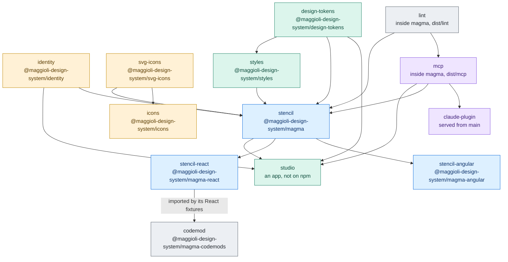
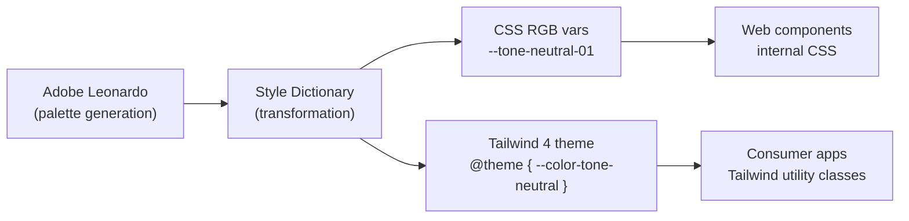

# ARCHITECTURE.md

## 1. System Overview

Magma is a monorepo managed with NX and npm workspaces. It is composed of thirteen projects: eight are published as npm packages under the `@maggioli-design-system` scope, `lint` and `mcp` ship inside `magma`, `claude-plugin` is served from `main` and `studio` is an app of this repository. The projects have a strict one-directional dependency graph: no circular dependencies are allowed. The overview draws that graph as Nx computes it (`nx graph`), with an arrow from each project to the projects that depend on it.



**Required build order**: `design-tokens` → `styles`, and `svg-icons`, before `stencil` → `stencil-react`, `stencil-angular`

> `svg-icons` ships the SVG artwork; `icons` turns a curated selection of it — plus third-party
> icons — into a font. `icons` is the only sub-project the web components do not depend on: they
> read the SVGs directly.

### Magma as an external vendor

Wherever the system uses the Magma components (a tool, a preview, an app), it takes them, with
the stylesheets they need ([`agents/assets.md`](agents/assets.md)), from the Magma installed where
it runs, as the docs site does, and never bundles a copy (decided on #695):

- **No cycle.** A bundle that holds no component does not need `stencil` built first, so the tool
  can ship inside the `magma` package, as the lint does, and `stencil` is a dependency only of the
  page that hosts it in this repository.
- **The version of the reader.** Inside a project the tool runs on the Magma the project has
  installed, so what it shows is that version's.
- **One module.** The docs site, a project and an internal page mount the same code; only where
  Magma comes from changes.

The MCP server follows it already: `render_preview` loads the lazy loader of the installed
`magma`, and the previews of the patterns run on the version the reader has. The studio (2.10)
follows it too.

### Diagrams of the projects

The README of every project draws, in its `Architecture` section, the parts of the project and
what it reads from and gives to the others:
[`claude-plugin`](../projects/claude-plugin/README.md#architecture),
[`codemod`](../projects/codemod/README.md#architecture),
[`design-tokens`](../projects/design-tokens/README.md#architecture),
[`icons`](../projects/icons/README.md#architecture),
[`identity`](../projects/identity/README.md#architecture),
[`lint`](../projects/lint/README.md#architecture),
[`mcp`](../projects/mcp/README.md#architecture),
[`stencil`](../projects/stencil/README.md#architecture),
[`stencil-angular`](../projects/stencil-angular/README.md#architecture),
[`stencil-react`](../projects/stencil-react/README.md#architecture),
[`studio`](../projects/studio/README.md#architecture),
[`styles`](../projects/styles/README.md#architecture),
[`svg-icons`](../projects/svg-icons/README.md#architecture).

They follow one convention, so they read alike:

- A Mermaid `flowchart`, where a subgraph titled with the name of the project holds its parts,
  at the level of modules and folders, not functions.
- Rectangles are this repository: the parts of the project, the other projects, folders such as
  `docs/agents`. Rounded boxes are outside it: the consumer project, the agent's client, the docs
  site, third-party packages.
- Arrows follow the data. Solid ones run inside the repository (a build, an import, a contract
  that one project follows); dashed ones run where the package is installed (the lint reading
  `documentation.json` in a consumer project, the agent's client calling the MCP server).
- The label of an arrow is the API that crosses: the file, the export or the command, as
  [`CONTRACTS.md`](CONTRACTS.md) names it.
- A node that stands for another project starts its label with the name of the project
  (`stencil<br/>build-lint.ts`): that is how the check tells it.
- The colour of a box is its axis, given by a `class` line at the end of the diagram; the
  subgraph of the project is `area`, a grey outline. A box that mixes two axes takes the one it
  mostly serves.

  | Axis | Colour | What it covers |
  | --- | --- | --- |
  | `ai` | purple | what serves agents: the MCP server, the skills, the guides for agents, an agent's client |
  | `assets` | amber | the icons and the brand: `svg-icons`, `icons`, `identity`, third-party icon sets |
  | `visual` | teal | the tokens and the CSS: `design-tokens`, `styles`, the Tailwind theme, palettes, Figma variables |
  | `components` | blue | the web components and their wrappers: `stencil`, `stencil-react`, `stencil-angular` |
  | `tooling` | grey | the checks and the migration: lint rules, `check.*`, the codemod, editor support |
  | `outside` | white | what has no axis: an app, a site, a product |

  A project declares its axis as the Nx tag `axis:<name>` in its `project.json`, and the box that
  stands for it takes that axis in every diagram. The styles are `PALETTE` of
  [`scripts/diagrams.ts`](../scripts/diagrams.ts), written whole at the end of every diagram: a
  light fill, dark text and a strong stroke read the same on the light and the dark themes of
  GitHub.

Keeping them current:

- When a project starts or stops reading what another produces, or reads it through another
  file, export or command, update the diagram in the README of both, in the same branch, and the
  entry of [`CONTRACTS.md`](CONTRACTS.md) when the artifact has one. A change of the build graph
  (a dependency, an implicit dependency) updates the overview above too.
- `nx run magma:check.diagrams` (`scripts/diagrams.ts`, run by the `lint` workflow) holds the
  diagrams to the project graph of Nx: every project has its diagram, every diagram draws the
  projects the graph links to it, and the overview draws exactly the arrows of the graph. It also
  holds the colours: every box has an axis, a project's box has the axis of its tag, every
  diagram has the palette, and a project without an `axis:` tag fails. What a project reads at
  runtime is not in the graph, so a missing dashed arrow is for the review to see.
- A new project declares its `axis:` tag, draws its diagram and joins the overview; a change of
  `PALETTE` is written in every diagram (the check prints the line it expects).

---

## 2. Sub-projects

### 2.1 `design-tokens`

Generates design tokens for colors, typography, spacing, borders and other platform-agnostic values.

- Built on **Adobe Leonardo** (color palette generation with WCAG contrast ratios) and **Style Dictionary** (token transformation and output)
- Outputs tokens in multiple formats: CSS custom properties, Tailwind 4 theme, Flutter/Dart, JSON
- Describes every global token, the semantic layer included, as DTCG 2025.10 JSON in `dist/dtcg/` (sets per mode, theme and contrast, plus a resolver document). The semantic layer comes from `semantic.model.ts`, which both this export and the styles generator read
- Color palette categories: `tone` (neutrals), `status` (info/success/warning/error), `label` (semantic accent colors), `variant` (primary/secondary/ai), `brand`
- Token levels: **primitive** (raw values) → **semantic** (role-based) → **component** (component-scoped CSS vars)
- The roles of the design language (#1189): the rhythm (`--magma-rhythm-*`), the widths (`--magma-width-*`) and the titles by role (`--text-size-title-<role>`) in `typography.css`, bridged to Tailwind as `--spacing-<id>` and `--container-form`; `--spacing-text` (`max-w-text`, the cap of the reset and of `mds-text` on `p`, `li` and `figcaption`) points at the reading measure, `56ch` (#1204)
- Exposes a CLI (`npx magma-design-tokens`) to generate custom palettes from a config file

Key output files consumed by other sub-projects:
```
dist/css/colors-rgb-*.css           # RGB color vars (required by Tailwind and web components)
dist/css/colors-hex-*.css           # HEX color vars (plain CSS usage)
dist/css/tailwind-theme-color.css
dist/css/tailwind-theme-typography.css
```

### 2.2 `identity`

Static brand assets: logos, avatars, and brand imagery for all Maggioli Group products. Read-only from consumer projects — never modify these assets directly.

Asset categories:
- `resources/brand/` — logos per brand (gruppo-maggioli, maggioli-editore, rnd, magma)
- `resources/avatar/` — avatar illustrations per brand

### 2.3 `svg-icons`

The full SVG icon library. Icons are referenced by filename slug inside components via the `icon` prop. The `mds-icon` component fetches them at runtime from a path configured via `sessionStorage`.

```javascript
// Required setup in every consumer application
window.sessionStorage.setItem('mdsIconSvgPath', 'assets/img/svg/');
```

Icons follow a semantic slug naming convention (e.g. `action-email-send`, `status-warning`). See `projects/svg-icons/svg/` for the full list.

### 2.4 `icons`

The icon **font** (`mgg-icons`) and its CSS/SCSS/LESS companions, for consumers that want
`<i class="mgg-icons-action-send">` instead of an SVG element. It owns no artwork: every glyph is
declared in [`projects/icons/dictionary.json`](../projects/icons/dictionary.json), which maps a font
class name to a source icon in one of four groups.

| Group | Source package |
| --- | --- |
| `maggioli` | `@maggioli-design-system/svg-icons` |
| `material` | `material-design-icons-updated` |
| `material-icons-svg` | `@material-icons/svg` |
| `mdi` | `@mdi/svg` |

Only the icons listed in the dictionary reach the font, so this package is a **curated subset** of
`svg-icons` plus third-party icons: plenty of sources exist for `mds-icon` alone and are
deliberately kept out. Because nothing signals the difference, every source must be either mapped
here or declared in `projects/icons/unmapped-icons.json`; `nx run icons:check.dictionary` enforces
that in CI.

Adding or changing an icon is documented in [`projects/icons/SPEC.md`](../projects/icons/SPEC.md).

### 2.5 `styles`

CSS and Tailwind 4 styles consumed by the web component library and consumer applications.

| Output file | Purpose |
|---|---|
| `dist/css/globals.css` | Global CSS custom properties (`--magma-*` design decisions) |
| `dist/css/reset.css` | Opinionated CSS reset |
| `dist/css/colors-rgb-*.css` | RGB color tokens (required for Tailwind and web components) |
| `dist/css/hydrated.css` | FOUC prevention for StencilJS, and the box of the hydrated components kept against page resets (Tailwind's preflight) |
| `dist/css/animations.css` | Shared animations |
| `dist/tailwind/` | Tailwind 4 layers: base, typography, utilities (the titles by role and the composition utilities `page-frame` and `field-group` of #1189 included) |
| `dist/tailwind/dark-mode.css` | The `dark:` variant on the Magma mode, imported by `dist/tailwind/theme.css`; generated from the selectors the palette turns dark on |
| `dist/tailwind/consumption.json` | How each global token is consumed through Tailwind 4, keyed by its DTCG `css` name, with the token's DTCG `$description` when it has one; generated from Tailwind's design system |
| `dist/dtcg/` | The styles globals as DTCG 2025.10 (corner and depth sets), with a resolver that adds them to the design-tokens sets |

CSS cascade layer order (consumer apps must respect this):
```
reset → vendor → theme → base → components → utilities → overrides
```

Dark mode is handled via palette-level CSS custom properties. Activation classes on `<html>`:
- `pref-mode-light / dark` - manual mode
- `pref-mode-system` - follows OS preference (as a page with no `mds-pref` controller does)
- `pref-theme-scheme-dark / light / all` - a named theme locked to one scheme wins over the mode;
  `mds-pref-theme` writes it from the mode the theme declares in its block
  (`--magma-color-modes`, from `color.modes` of the theme file), or else from the item's `scheme`

The selectors the palette turns dark on are one list (`darkScheme`,
`projects/design-tokens/src/formats/dark-scheme.ts`), printed by the palette templates, the
dark block of the semantic layer and the Tailwind `dark:` variant, so a `dark:` utility
flips exactly when the roles do (light DOM only).

Global design decisions overridable via CSS custom properties on `:root`:
- `data-corner-shape` — corner geometry: the shape AND the `--magma-radius-*` scale tuned for it,
  moved together (default: `squircle`, on a bare `:root`). Works on any element, so a subtree can
  deviate. `--magma-corner-shape` alone changes the shape WITHOUT the scale. A browser without
  `corner-shape` gets the round shape and scale from a `@supports not` block, and
  `--magma-corner-cap` (0.5, 0.2915 there) caps the controls whose radius is past half their height
- `--magma-disabled-opacity` — default: `0.5`
- `--magma-outline-focus` — focus ring style
- Z-index scale: header `1000` → notification `2000` → modal `3000` → backdrop `4000` → dropdown `5000` → tooltip `6000` → theme-overlay `7000` → context-menu `8000`

### 2.6 `stencil`

The web component library. 117 components built with StencilJS, compiled to standard Custom Elements. Also outputs framework-specific wrappers:

- `@maggioli-design-system/magma` — vanilla JS / HTML
- `@maggioli-design-system/magma-react` — React wrapper
- `@maggioli-design-system/magma-angular` — Angular wrapper

The wrappers are separate npm workspaces, `projects/stencil-react` and `projects/stencil-angular` (nx projects of the same name), siblings of `projects/stencil`. The Stencil build generates their sources (`projects/stencil-react/src`, `projects/stencil-angular/magma-angular/src/stencil-generated`) and their agent install docs; they only compile what `stencil` emitted. They live outside `projects/stencil` because npm never materializes the `node_modules` of a workspace nested inside another workspace (#666, #672). Each wrapper has its own tests against the stencil build (`nx run stencil-react:test`: Vitest, browser and node projects; `nx run stencil-angular:test`: Vitest in jsdom, through the Angular unit-test builder), run in CI by the `magma-react` and `magma-angular` jobs of the stencil workflow.

### 2.7 `lint`

The consumer lint (`projects/lint`, #1102): the ESLint and Stylelint rules that hold a consumer's code to the installed version of Magma, the executable form of the prose rules of `docs/agents/` (conventions, color, theming). It is not a package of its own: the stencil build compiles it into `@maggioli-design-system/magma` (`dist/lint`, `scripts/build-lint.ts`), which exports `./eslint`, `./stylelint` (with `./stylelint/recommended` and `./stylelint/strict`) and `./lint` (the core). So the rules arrive with the components and always match their release; `stencil` lists `lint` as an implicit dependency, so its build follows a change of the rules.

One core reads the data of the installed packages, never a list written by hand: the props and their values from the `documentation.json` beside it, the raw palette steps from the DTCG base set (`design-tokens`) and the colour utilities from `consumption.json` (`styles`), both resolved from where magma is installed. On top of it, the template rules (`valid-attribute-values`, `no-false-boolean`, `accessible-name`, `no-deprecated`, `no-raw-palette-classes`, `no-internal-tokens`) with one adapter per parser (HTML, JSX, Angular templates), which reads a class in every form the codemod migrates, the CSS rules (`no-raw-color`, `no-color-scheme-override`, the consumer side of the `magma/token-values` rule of the component sheets; `no-internal-tokens` and `no-raw-palette-classes` on declarations and the classes of `@apply`), and `recommended` / `strict` presets.

Its tests run on fixtures cut from the real data, in the `consumer-lint` job of the stencil
workflow (on the `lint:build` of the same run). The consumer guide is [`docs/agents/lint.md`](agents/lint.md), shipped as `agents/lint.md`, which the packages' `AGENTS.md` sets up at bootstrap; the contributor notes are [`projects/lint/README.md`](../projects/lint/README.md). The MCP server reads the same data through this core, and runs these rules: section 2.8.

### 2.8 `mcp`

The MCP server (`projects/mcp`, #1107, a project of its own since #1244): the `magma-mcp` command of magma
(`dist/mcp/cli.js`), which answers an agent's questions from the data of the installed version (twelve
tools: components, usage per framework, tokens and roles, classes, icon slugs, guide
sections, patterns, the lint on a snippet, the integration of the project, an image of the markup; all read-only but the render). It is not a package of its own either: the stencil build compiles it into `@maggioli-design-system/magma` (`dist/mcp`, `scripts/build-lint.ts`), with nothing beside the compiled modules but the files it reads (its icon, `tools.json`); `stencil` lists `mcp` as an implicit dependency, as it does `lint`. It reads the data and runs the rules through the lint, as any other tool does, by the exports of magma (`./lint`, `./eslint`, `./stylelint/*`), which `mcp` depends on and which never imports it. Its protocol, JSON-RPC over
stdio, is written in the project, so magma carries no MCP SDK; its icon is the Magma mark of
identity, which `stencil` therefore also builds after. The tools are also written as data, `dist/mcp/tools.json` (and at `dist/lint/mcp/tools.json`, where the docs site reads them, until it reads the new path).

Its tests run on fixtures cut from the real data, the ones the lint reads too and the ones only the server reads, in the `consumer-lint` job of the stencil workflow after those of the lint, through the official MCP client, and on the build artifact (a render of the built components, the server as the package ships it). The consumer guide is [`docs/agents/mcp.md`](agents/mcp.md), shipped as `agents/mcp.md`; the contributor notes are [`projects/mcp/README.md`](../projects/mcp/README.md).

### 2.9 `claude-plugin`

The Claude Code plugin of Magma (`projects/claude-plugin`, #1114): the skills that run a whole job (`/magma:setup`, `/magma:review`, `/magma:migrate`, `/magma:pattern-layer`, and `ui`, which Claude loads by itself for UI work) and the entry that starts the MCP server of section 2.8. It is not an npm package: `.claude-plugin/marketplace.json` at the repository root is the marketplace `magma`, whose plugin is this folder, so Claude Code reads it from `main`. A consumer project registers it for its team in its `.claude/settings.json`, which the bootstrap of the packages' `AGENTS.md` writes.

The skills are procedures that defer to the installed version (the MCP server, the shipped guides), so the plugin follows `main` with no version of its own. They are generated from `templates/` with what they list taken from the code and the guides (the packages per target, the tools of the server, the rules of the lint, the codemod), and the `claude-plugin-ci` workflow fails when one is out of date or breaks the Agent Skills format. How to change one: [`projects/claude-plugin/README.md`](../projects/claude-plugin/README.md).

### 2.10 `codemod`

The `@maggioli-design-system/magma-codemods` package (`projects/codemod`): it migrates consumer code from v1 to v2, rewriting HTML, React, Angular templates (external and inline) and CSS/SCSS, and reports what needs a human decision. Its rules are a manifest (`src/manifest/manifest.ts`), drafted from the `documentation.json` of the two versions; one module per surface (`src/surfaces/`) decides where an attribute or a class is written, the forms the class rules of the lint read too ([`docs/CONTRACTS.md`](CONTRACTS.md)). The contributor notes are [`projects/codemod/README.md`](../projects/codemod/README.md).

### 2.10 `studio`

The studio of Magma (`projects/studio`, epic #693): an app where whoever installs Magma defines a
theme from a UI, and later the rest of a product's definition (Foundation, Patterns, Blocks). It
is not an npm package. It began as the tokens playground of `design-tokens`, moved here whole
(#695): `nx run studio:serve` on port 5177, `build`, `test`; the `studio` workflow builds and
tests it when it or `design-tokens` changes.

- **The engine stays in `design-tokens`.** The studio imports the sources of the generator
  (`createColorTokens`, the surface and text engines, the contrast gate), `semantic.config.ts`,
  `semantic.model.ts` and the theme files (`design-tokens/themes/`) and runs them in the browser.
  They stay there because the builds of `design-tokens` and `styles` read them: moving them would
  make `design-tokens` depend on the studio.
- **No copy of the engine's data.** What the studio shows comes from `design-tokens`: the default
  balances from `.magma-design-tokensrc.json`, the text floors from `DEFAULT_TARGETS` of the
  contrast gate, the CSS of a theme from `namedThemeCss` of `semantic.model.ts`, the same function
  the styles generator prints `themes.css` with.
- **Magma as an external vendor** (section 1): the studio never bundles the Magma components nor
  their stylesheets. Its pages load them as a render of the MCP server does, with the code of the
  render (`stylesheetImports`, `loaderOf`, `fileOf` of `projects/mcp/src/render.ts`), from
  the installed magma: in this repository the build of `stencil`, an implicit dependency.
- **The shell** follows the app-shell block: three sections, Colors (the pages of the playground,
  from a menu that opens with the verdict of the contrast gate), Theme (the theme full screen in an
  iframe, its controls over it) and Behavior (design language, patterns, blocks, from a menu). A
  section that opens its pages from a menu is a case the app-shell block does not have yet.
- **Two hosts, one app** (#695): the docs site mounts it with nothing to install, and a command of
  the `magma` package serves it inside a project, on its `magma/` folder.
- **Published beside the Storybook**: the studio of `main` is on GitHub Pages at
  `magma-design-system.github.io/magma/studio/`, built by `deploy-site.yml` with the Storybook
  (section 6), and the docs site links to it (decided on #693, 2026-11-06; mounting it in a page
  of the docs site is a later step). `studio:build.site` writes beside its pages, as files, the
  installed Magma that `fileOf` serves to the dev server; there is no API there, so the studio
  edits in memory and its work leaves by download.

The views and how to run it: [`projects/studio/README.md`](../projects/studio/README.md).

---

## 3. Component Architecture

### 3.1 Shadow DOM vs Scoped

Most components use `shadow: true` (full Shadow DOM encapsulation), the form-associated ones (`formAssociated: true`, e.g. `mds-input`, `mds-input-select`) included: a native control inside a shadow root does not belong to the outer `<form>`, so these components take part in it through `ElementInternals` (`@AttachInternals()`). They submit their value with `setFormValue` and report their validity with `setValidity` (`@common/validity`, which also holds the localized messages), so an invalid one stops the submit like a native control.

### 3.2 Component categories

| Category | Description | Examples |
|---|---|---|
| **Primitive** | Atomic building blocks, used internally by other components | `mds-text`, `mds-icon`, `mds-spinner` |
| **Atom** | Single-purpose UI element | `mds-button`, `mds-badge`, `mds-avatar` |
| **Molecule** | Composed of atoms, single concern | `mds-input`, `mds-chip`, `mds-breadcrumb` |
| **Compound** | Parent + required child component pair | `mds-accordion` + `mds-accordion-item`, `mds-card` + `mds-card-header/content/footer/media` |
| **Organism** | Complex layout component | `mds-table`, `mds-modal`, `mds-header` |
| **Preference** | User preference controls (mode, theme, contrast, animation) | `mds-pref`, `mds-pref-mode`, `mds-pref-theme`, `mds-pref-contrast` |

### 3.3 Compound component pattern

Several components work exclusively as parent/child pairs. The child must always be a direct slot child of the parent:

```html
<!-- correct -->
<mds-accordion>
  <mds-accordion-item>...</mds-accordion-item>
</mds-accordion>

<!-- correct -->
<mds-card>
  <mds-card-header slot="header">...</mds-card-header>
  <mds-card-content slot="content">...</mds-card-content>
  <mds-card-footer slot="footer">...</mds-card-footer>
</mds-card>

<!-- incorrect — never wrap compound children in arbitrary elements -->
<mds-accordion>
  <div>
    <mds-accordion-item>...</mds-accordion-item>
  </div>
</mds-accordion>
```

### 3.4 Tone system

Components that carry visual weight expose both a `variant` (color role) and a `tone` (visual intensity) prop. These two axes are independent:

| Tone | Description |
|---|---|
| `strong` | Filled, high contrast (default) |
| `weak` | Tinted background, lower contrast |
| `outline` | Border only, transparent background |
| `text` | No background or border, text-only |

> ⚠️ Magma 2.0 breaking rename: `ghost` → `outline`, `quiet` → `text`. Old names are not supported.

### 3.5 CSS custom properties per component

Every component exposes scoped CSS custom properties for controlled overrides (e.g. `--mds-button-radius`, `--mds-button-background`). Its **public** ones (the `@prop` whose description starts with `Public.`) are the **only supported way** to style components from the outside, with the documented parts; the others are internal and may change in any release (#1095). The mark reaches `documentation.json` (`visibility`, `static`), `magma.api.txt` (`INTERNAL`, `[static]`), the shipped `AGENTS.md` (public ones only), `check.usage-docs` and the consumer lint (`magma/no-internal-tokens`): see `projects/stencil/SPEC.md`. Never write CSS that targets internal shadow DOM nodes directly.

---

## 4. Token Flow



Color values in CSS must always use the RGB format with the `rgb()` wrapper:

```css
/* correct — supports opacity modifiers */
color: var(--tone-neutral-03);

/* incorrect — hex vars cannot be used with opacity */
color: var(--tone-neutral-03);
```

---

## 5. Consumer Application Setup

Installing Magma into a consumer application (styles, fonts, icons, and component
registration for plain web components / React / Angular) is documented in its own
canonical set of specs:

- `docs/agents/SPEC.md` - entry point: pick a target, version compatibility matrix
- `docs/agents/assets.md` - shared asset setup (styles import order, fonts, icons, identity)
- `docs/agents/web-components.md`, `docs/agents/react.md`, `docs/agents/angular.md` - per-target install tracks
- `docs/agents/{conventions,variants,mistakes,color,typography,theming}.md` - using components and styles after install, one topic per file

Each component's own docs (API, examples, mistakes) are generated by the stencil build
into `dist/collection/components/<tag>/` (`scripts/component-docs.ts`), and the shipped
`agents/components.md` catalogue links them.

Do not duplicate import lists here - `docs/agents/assets.md` is the single source of
truth for the required CSS imports and cascade-layer order.

---

## 6. Branches, CI and release

One long-lived branch, `main`, carries everything: it is the trunk, the integration branch, the
source of the published Storybook and the branch every package releases from. The rules that
govern it are in [`docs/WORKFLOW.md`](./WORKFLOW.md) rule 1; this section is the map of the
machinery.

```
feature branch ──PR──▶ merge queue of main ──merge commit──▶ main
                              │                                 │
                              ▼                    ┌────────────┴──────────────┐
                       CI of the commit            ▼                           ▼
                       (design-tokens, icons,   publish.yml, push trigger   deploy site
                        identity, styles,       (icons and svg-icons,       (GitHub Pages: Storybook
                        svg-icons, stencil,      automatic: chore(release)   and studio, from the
                        lint: the merge-group    commit pushed to main       stencil-build artifact
                        run, on the SHA that     with a rebase-retry, tags,  of the merge-group run)
                        then lands on main)      GitHub releases, build ──▶ npm)

maintainer: "Run workflow" publish.yml on main (package: all or one, channel, dry-run, tag)
   ──▶ the CI of the dispatched commit is green ──▶ the plan in the job summary
   ──▶ approval (environment `release`)
   channel stable: chore(release) commit pushed to main (no rebase: a moved main fails the run
                   before any tag) ──▶ tags, GitHub releases ──▶ checkout of that commit, build of
                   the selected packages ──▶ npm (the versions not on the registry yet)
   channel beta:   magma@x.y.z-beta.N tag on the dispatched commit, nothing committed ──▶ build of
                   the magma lockstep, the tag version written into its manifests ──▶ npm, dist-tag beta
   dry-run:        the plan in the job summary, no approval needed, on any branch
   tag:            an existing release published again (e.g. magma@2.4.1, once main moved past it):
                   nothing released, approval, checkout of the commit of the tag, build ──▶ npm (the
                   versions of the tag not on the registry yet)
```

| Piece | Where | What it does |
|---|---|---|
| Package CI | `.github/workflows/{design-tokens,icons,identity,styles,svg-icons,stencil}.yml` over `_package-pipeline.yml` | change detection (path filter, everything on `merge_group`) → build (artifact kept one day) → test, on pull requests and in the merge queue: the merge-group run is the CI of the commit that lands on `main`. The build job keeps the Nx cache under `.nx` with one key per Nx project and commit; `stencil.yml` adds the wrapper builds and tests (on that cache), the `check.*` guards and `consumer-lint`, the tests of `projects/lint` and `projects/mcp` |
| Lint | `lint.yml` | `npm run lint` on the whole monorepo, then `nx run magma:check.diagrams` (the README diagrams against the project graph), same triggers |
| Review level | `pr-risk.yml` + `projects/stencil/scripts/pr-risk.ts` | `risk-*` label, the semver check of `magma.api.txt` against the commits' declared release |
| Release and publish | `publish.yml` over `semantic-release.yml` + `scripts/release/*` + `scripts/set-release-version.sh` | `workflow_dispatch` on `main`: `package` (`all` or one), `channel` (`stable`/`beta`), `dry-run`, `tag` (an existing release published again); the CI of the commit checked, the plan before the approval, versions from the conventional commits of each package's scopes (semantic-release dry-run), pins, lock, `CHANGELOG.md` (git-cliff), tags, GitHub releases, then the build of the selected packages and one `npm publish` per package with OIDC trusted publishing (a package is skipped when its version is already on npm) |
| Automatic icon releases | the `push` trigger of `publish.yml` | on every push to `main`: the same chain for `icons` and `svg-icons`, without approval; a rejected push is rebased and retried |
| Pages site | `deploy-site.yml` | the site of `main` to GitHub Pages, whole at every deploy: the static Storybook in `storybook/` (the root redirects to it) and the studio in `studio/` (`studio:build.site`, the app with the Magma its pages load beside them); from the merge-group `stencil` run of the same commit (its `magma / test` verdict, its `stencil-build` artifact; a commit without one is built and tested there); also dispatched by `publish.yml` after a release of `svg-icons` (the `mds-icon` story shows its version and the studio serves its icons; the `chore(release)` commit runs no workflow of its own) |
| Local rehearsal | `scripts/test-release.sh` | the release plan of a commit on either channel, in a throwaway clone, nothing pushed |

Protections, set on GitHub and documented here because they shape the flow:

- ruleset `main`: pull request required, the 23 CI checks required, merge queue (merge commits
  only), no force push; the organisation admins bypass it, which is what lets the release token
  push the `chore(release)` commits;
- ruleset `no-deletion`: `main` cannot be deleted, by anybody (no bypass). The repository deletes
  the head branch of every merged pull request, so a pull request opened from `main` would
  otherwise delete it on merge (it happened, #954);
- environment `release`: required reviewers for a real release (the dry-run needs none);
  deployments from `main` only;
- environment `github-pages`: deployments from `main` only.

Two consequences of the tags: semantic-release computes the next version of a package from the
tags reachable from `main`, so a release tag must stay in its history (merge commits only, no
rebase of the release commits); and a beta counts from the last stable tag of the package
(`2.1.0` → `2.2.0-beta.1`, `2.2.0-beta.2` … → `2.2.0` → `2.3.0-beta.1`), with the channel note
in `refs/notes/semantic-release` that lets it continue the counter.

`support/v1.x` is the maintenance line of the previous major, with its own CI and a manual
publish of its own (`publish v1.x`): nothing above runs there.