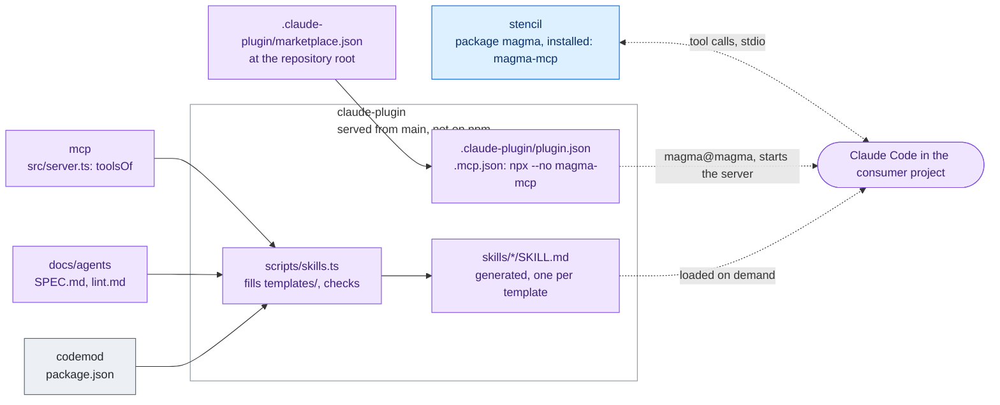

# claude-plugin

The Claude Code plugin of Magma (#1114): the skills that run a whole job with Magma, and the
entry that starts the Magma MCP server (`.mcp.json`, `npx --no magma-mcp`). It is served
from this repository, not from npm: `.claude-plugin/marketplace.json` at the repository root
is the marketplace `magma`, whose plugin `magma` is this folder.

| Skill | Started by | Does |
| --- | --- | --- |
| `/magma:setup` | the person, or Claude on "install Magma" | brings Magma into a project: the package of its target, then the bootstrap of the installed `AGENTS.md`, ending with `check_setup` |
| `/magma:review` | the person, or Claude after UI work | checks the changed files: the lint, `check_markup`, the rules of the guides |
| `/magma:migrate` | the person | Magma 2 (or 1) to 3 with the codemod: dry run, report, write, lint |
| `/magma:pattern-layer` | the person, or Claude when a product wants a pattern narrowed | writes the layer of a Magma pattern for the product (`magma/patterns/<id>.md`: its open choices, its situations) and checks it with `get_pattern` until it is applied |
| `/magma:ui` | Claude, on UI work in a Magma project | the procedure for writing UI with the tools of the server |

The skills are procedures, not data: the API, the tokens and the rules come from the MCP
server and the guides of the version installed in the project. So the plugin carries no
`version` and follows the commits of `main` (the validator warns about it, on purpose), and
it stays right for a project on any release.

## Architecture

The generator fills each template with what it lists, read from where it is decided. Claude Code
gets the plugin from the marketplace of this repository, loads the skills when a job comes up and
starts the server of the magma version installed in the project.

Rectangles: this repository; rounded boxes: outside it. Solid arrows: inside the repository;
dashed: where the package is installed. Labels: the file, export or command that crosses.
Colours: purple ai, amber assets, teal visual, blue components, grey tooling, white outside
([convention](../../docs/ARCHITECTURE.md#diagrams-of-the-projects)).

## Why an MCP server and skills

They are not alternatives: they answer different questions, and the skills call the server.

- **A skill is a procedure**: what to do, and in which order, for a whole job (setting Magma
  up, reviewing, migrating, writing UI). It is Markdown that Claude Code loads when the job
  comes up, by itself (`ui`) or on a command (`/magma:setup`).
- **The server is data and computation**: what is true in the version of Magma installed in the
  project. The skills call its tools; without it, they fall back to the guides installed with
  the package.

Why the data is not in the skills:

1. **The version.** The plugin follows `main` and serves projects on any release, while the
   API, the tokens and the icon slugs change from one release to the next. The server is a
   command of the magma package (`magma-mcp`), so it answers from the `documentation.json`, the
   DTCG data and the consumption map of the version the project installed (#1083).
2. **Computation, not text.** `check_markup` runs the project's ESLint and Stylelint on a
   snippet, `suggest_role` finds the role nearest to a colour, `check_setup` reads the files of
   the project, `explain_class` resolves a class with the Magma theme. A skill could carry
   scripts, but they would be code at the version of `main`, not at the project's.
3. **Other clients.** MCP is a standard: VS Code (GitHub Copilot) and Cursor start the same
   server ([`docs/agents/mcp.md`](../../docs/agents/mcp.md)); the plugin is for Claude Code.
4. **Fewer tokens.** A tool answers one question, where the agent would otherwise read the
   catalogue, the `AGENTS.md` of a component or a whole guide (the "Instead of" column of
   `agents/mcp.md`).

The server is not a remote service: the agent's client starts it from `node_modules` with
`npx --no magma-mcp` and speaks JSON-RPC to it on stdio, with no network. The order was decided
in #1083: the lint first (deterministic), then the server on the same data core, then the skills
on top.

## How people get it

A project registers it for the whole team in its committed `.claude/settings.json`, as
`agents/mcp.md` shows (`extraKnownMarketplaces` with `autoUpdate`, `enabledPlugins`); the
bootstrap of the packages' `AGENTS.md` writes that entry. Claude Code loads the plugin once
the folder is trusted, in the terminal and in the desktop app. One person alone adds it in a
terminal session with `/plugin marketplace add magma-design-system/magma`, then
`/plugin install magma@magma`.

## Layout

| Path | What |
| --- | --- |
| `.claude-plugin/plugin.json` | the manifest of the plugin `magma` |
| `.mcp.json` | the Magma MCP server, started with `npx --no magma-mcp` (#1112) |
| `templates/<name>.md` | the source of each skill |
| `skills/<name>/SKILL.md` | the skills, generated from the templates: do not edit them |
| `scripts/skills.ts` | the generator and its check |

## Changing a skill

1. Edit its template. What a skill lists is filled in by the generator, never copied: the
   package of each target (`docs/agents/SPEC.md`), the tools of the MCP server
   (`projects/mcp/src`), the rules of the lint (`docs/agents/lint.md`), the codemod
   (`projects/codemod/package.json`). `$ARGUMENTS` is what the person wrote after the command.
2. `nx run claude-plugin:build` writes the skills; commit them with the template.
3. `nx run claude-plugin:check` fails when a skill is out of date or breaks the Agent Skills
   format (portable frontmatter keys only, `name` equal to its folder, a description of at most
   1024 characters, ASCII); the `claude-plugin-ci` workflow runs it when the plugin, the server,
   the guides or the codemod change.
4. With Claude Code installed, `claude plugin validate projects/claude-plugin` and
   `claude plugin validate .` check the manifests as Claude Code reads them.

A new skill is a new template: the generator picks it up. Keep the descriptions precise,
since Claude decides from them when to load a skill on its own.
