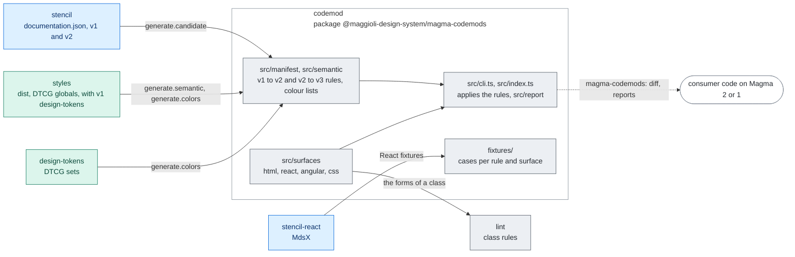

# @maggioli-design-system/magma-codemods

Codemods to migrate consumer code of [`@maggioli-design-system/magma`](https://www.npmjs.com/package/@maggioli-design-system/magma)
to its next major: without options from **v2** to **v3**, and with `--from 1` from **v1**, through v2 (see
[Which jump](#which-jump)). They rewrite HTML, React (JSX/TSX), Angular templates (external `.html` and inline
`@Component({ template })`) and CSS/SCSS, applying the breaking changes automatically and reporting the cases that
need a human decision.

ESM package, Node ≥ 22.

## Architecture

The rules are one manifest per jump: v1 to v2, drafted from the `documentation.json` of a v1 and
a v2 build and reviewed by hand, with a table from raw colours to roles; v2 to v3, written by
hand, with the list of the custom properties Magma publishes as colours, generated from the DTCG
sets of design-tokens and styles. One module per surface finds where an attribute, a class or a
declaration is written. The lint reads classes in the same forms.



Rectangles: this repository; rounded boxes: outside it. Solid arrows: inside the repository;
dashed: where the package is installed. Labels: the file, export or command that crosses.
Colours: purple ai, amber assets, teal visual, blue components, grey tooling, white outside
([convention](../../docs/ARCHITECTURE.md#diagrams-of-the-projects)).

## Usage

```bash
npx @maggioli-design-system/magma-codemods --path ./src
```

By default the tool runs in **dry-run** (prints a coloured diff + a summary, writes nothing). Pass `--write` to
apply the changes in place.

```
--from <1|2>                                 the major the code is on (default: 2), see Which jump
--framework <react|angular|html|css|auto>   surface (default: auto, inferred from the extension)
--path <file|dir>                            file or directory to scan (repeatable; positional args also work)
--dry-run                                    print a diff and report, write nothing (DEFAULT)
--write                                      apply changes in place
--force                                      allow --write on a dirty git working tree
--ignore <glob>                              extra ignore globs (repeatable)
--report <path>                              write the JSON report
--report-md <path>                           write a Markdown worklist: decisions by token, suggestions, checklist per file
--only <ruleId,...> / --skip <ruleId,...>    run/skip specific rules (see the ids in the report)
--manifest <path>                            replace the bundled jumps with one manifest (JSON)
--accept-semantic <exact|near>               v1 -> v2: write the raw palette -> semantic role matches (L) up to this tier
--keep-dark-overrides                        v1 -> v2, L: match on light AND dark instead of dropping the dark: overrides
-h, --help
```

Notes:

- `auto` maps `.css/.scss -> css`, `.tsx/.jsx/.js/.mjs/.cjs -> react`, `.ts -> Angular inline templates and
  styles`, `.html/.astro -> html`. For **Angular external templates** (`.html`), pass `--framework angular`. The
  `.js` files are read for their JSX and for the strings category N reports (a Tailwind 3 config, a colour built in
  code). An Astro component is read as HTML: its markup, its `style` attributes and its `<style>` elements
  (`lang="scss"` with the SCSS parser); its frontmatter and its `{...}` expressions are text.
- `--write` refuses to run on a dirty git working tree unless `--force`, so the undo is always `git checkout`.
- `node_modules`, `dist`, `.git`, `build`, `.next` and `coverage` are ignored by default.
- A file the design-tokens CLI generated into the project (`magma-design-tokens --outDir`, recognised by the banner
  `@magma-design-system/design-tokens vX ... Do not edit directly` its templates write) is reported once and left as
  it is: regenerate it with the design-tokens of the target major instead.

### Which jump

| The code is on | Run                                  | Applies             |
| -------------- | ------------------------------------ | ------------------- |
| Magma 2        | `magma-codemods --path ./src`        | v2 -> v3            |
| Magma 1        | `magma-codemods --path ./src --from 1` | v1 -> v2, then v2 -> v3 |
| Magma 1, to stop at Magma 2 | `npx @maggioli-design-system/magma-codemods@2 --path ./src` | v1 -> v2 |

The jump is chosen, never guessed: the version of magma installed in the project cannot tell where the code
stands (a product may upgrade the packages before or after the rewrite), and the v1 -> v2 rules are not harmless
on Magma 2 code, since the behaviour guards add attributes that keep the Magma 1 defaults. Never pass `--from 1`
on code already on Magma 2.

With `--from 1` each jump reads what the previous one wrote, in memory: a file gets one diff, from what it was to
what Magma 3 needs, and every finding of the report names its jump (`[2 -> 3 global/colorToken]`, and `(2 -> 3)`
in the Markdown worklist). A v1 -> v2 flag that the second jump makes moot is dropped: the v1 -> v2 rename of an
input colour to its `-rgb` name asks for a conversion to channels, which Magma 3 takes back.

### Markdown worklist (`--report-md`)

A report to work through what the codemod left for you, written for a human rather than a machine:

1. **Decisions by token**: each class token that needs a choice appears once, however many files use it, with
   _how to decide_ (e.g. seed as a background: page -> `surface-default`, card -> `surface-raised`, popover ->
   `surface-overlay`), its ready-to-paste alternatives with their distance in light and dark, and a checkbox per
   file that uses it: the file's path, an `Open file` link, and its occurrences, each linked to the line.
   Each alternative says what the role is for in the system (`Alternative meaning`). For a background the markup
   can often tell which surface the element is, so the places are batched under a **Likely** answer with its
   evidence (on `<body>`, inside `<MdsModal>`, with `shadow-xs`, `role="dialog"`...), the rest under **No hint**.
   Every occurrence also says where it sits and, when the markup tells, the role it could be with how close it is
   (on `<div>` inside `<MdsModal>` it could be a `bg-surface-overlay` plus its dE mark), in the decisions and in
   the per-file checklist. A hint is never written: it only groups the places you confirm together. React only for
   now. Every dE carries its category L tier, from the manifest's thresholds: identical (up to `exact`, 0.5),
   acceptable (up to `near`, 2), far.
2. **Suggestions**: the value matches a rerun with `--accept-semantic` would write, to review before accepting.
3. **Files**: a checklist per file (path and `Open file` link, every item linked to its line); the automatic
   changes are folded under each file.

Each file row is a line of inline HTML: the path takes the whole row (cut with an ellipsis when too long) and
`Open file` sits on the right. Viewers that strip inline styles, like GitHub, show the path and the link side by
side instead.

Links are relative to the report's location, so write it inside the project:

```bash
npx @maggioli-design-system/magma-codemods --path ./src --report-md ./magma-migration.md
```

## Migration matrix: Magma 2 -> 3

The breaking changes of Magma 3 (epic #1292), one category per part; each part adds its rules to
`src/manifest/manifest-v3.ts` in its own pull request.

| #   | Category                      | What it does                                                                                                                                                                      | Confidence |
| --- | ----------------------------- | --------------------------------------------------------------------------------------------------------------------------------------------------------------------------------- | ---------- |
| N   | Colour tokens (#918)          | a colour token is a full colour, no longer three channels: its reads through `rgb()` become `var()` or `color-mix()`, its channel definitions `rgb()`, and the input properties that took channels lose their `-rgb`. See below | safe; strings and unread values: report |
| O   | Title of an accordion item (#1218) | the title of `mds-accordion-item` and `mds-accordion-timer-item` is `h6` by default, no longer `h5`: an item that leaves `typography` out is reported, nothing is written. See below | report |
| P   | Spacing steps (#1061)         | a t-shirt name is a container size, spacing a numeric step: a spacing utility with a t-shirt name becomes the step of the same value (`p-md` -> `p-400`), under every variant; `var(--spacing-prose)` becomes `var(--container-prose)`. See below | safe; a class whose value changes: report |

### Colour tokens (N)

Magma 3 writes every colour token as a colour (`--magma-accent-fg: rgb(0 85 204)`), where Magma 2 wrote its three
channels (`0 85 204`) to be read with `rgb(var(--x))`. Around a colour, that read is `rgb(rgb(...))`, invalid at
computed-value time: no error, the background turns transparent, the text inherits its colour. The codemod
rewrites the reads and the definitions:

| Magma 2                                  | Magma 3                                                              |
| ---------------------------------------- | -------------------------------------------------------------------- |
| `rgb(var(--x))`, `rgb(var(--x) / 1)`     | `var(--x)`                                                           |
| `rgb(var(--x) / 0.15)`, `/ 15%`          | `color-mix(in srgb, var(--x) 15%, transparent)`                      |
| `rgb(var(--x) / var(--a))`               | `color-mix(in srgb, var(--x) calc(var(--a) * 100%), transparent)`    |
| `rgb(var(--x) / calc(E))`                | `color-mix(in srgb, var(--x) calc(E * 100%), transparent)`           |
| `rgb(var(--x, 0 0 0))`                   | `var(--x, rgb(0 0 0))`, along the whole fallback chain               |
| `--x: 0 0 0` (a Magma colour set by you) | `--x: rgb(0 0 0)`; `var(--magma-*)` and a colour stay as written     |
| `--mds-input-variant-color-rgb: 0 85 204` | `--mds-input-variant-color: rgb(0 85 204)`                          |

Mixing with transparent in srgb scales only the alpha, so each rewrite paints what the triplet painted: the same
rewrite ran on the sources of this repository in #918 (2751 rewrites, no difference in the rendered colours).

- **Only Magma's colours.** `--x` is one of the custom properties Magma publishes as colours: every colour token of
  the DTCG sets of design-tokens and styles (`src/manifest/color-tokens.generated.ts`, 530 names, the backdrop
  globals `--magma-backdrop-color`, `--magma-overlay-color`, `--magma-on-backdrop` included), plus the component
  properties that took channels. A variable of your own read with `rgb(var(--my-color))` is left as it is.
- **The renamed properties**, as the API snapshot of #918 records them: `--mds-input-variant-color-rgb`,
  `--mds-input-date-variant-color-rgb`, `--mds-input-date-range-variant-color-rgb`,
  `--mds-input-select-variant-color-rgb` (public) and `--mds-button-border-color-rgb`,
  `--mds-dropdown-drop-shadow-color-rgb` (internal: renamed and flagged, since the v1 -> v2 codemod wrote them into
  products) lose their `-rgb`, at their definitions and in their `var()` references. `--mds-modal-overlay-color`
  and `--magma-field-fill` (the fill a surface passes down to its fields) keep their name and take a colour too.
  `--mds-input-date-icon-color-rgb`, deprecated and read by nothing, is gone: reported.
- **Where.** CSS and SCSS (declarations, Sass variables, the arguments of a mixin), a `<style>` element, inline
  styles (HTML and Angular `style`, React style objects and strings, Angular `[style.x]`, `[style.--x]`,
  `[ngStyle]`, `[style]`), Angular `@Component({ styles })`, and Tailwind arbitrary values wherever the class rules
  read a class (`bg-[rgb(var(--magma-surface-raised))]` -> `bg-[var(--magma-surface-raised)]`, with `_` for the
  spaces: `color-mix(in_srgb,var(--x)_50%,transparent)`). The inline styles also get the custom-property renames
  of category G, on every jump.
- **Tailwind arbitrary values**, the type of the result, checked on the compiler of each Tailwind (4.3.4 and
  3.4.17): `color-mix()` is a colour on every colour utility; a bare `var()` is a colour on all of them except, in
  Tailwind 4, `shadow`, `inset-shadow`, `drop-shadow` and `text-shadow`, which read it as the whole shadow. There
  the codemod writes the type hint, `shadow-[color:var(--magma-shadow-ink)]`; a hint already written stays.

Reported, not rewritten:

- `rgba(var(--x), a)`: the comma syntax around channels painted nothing in Magma 2 already; the report gives the
  `color-mix()` to write.
- An alpha the codemod cannot read (a Sass variable, `attr()`), and a definition whose value may hold channels of
  your own (`--magma-backdrop-color: var(--brand-rgb)`, a Sass value, an expression of the script).
- A fallback that may hold channels (`rgb(var(--magma-accent, var(--brand-rgb)))` is rewritten, the fallback is
  flagged), and a variable of yours whose fallback is a Magma colour (`rgb(var(--brand-rgb, var(--magma-accent)))`).
- A colour built in a string of the script (`.ts`, `.tsx`, `.js`: a style computed in code, `setProperty`, a
  Tailwind 3 config), and an attribute other than `class` and `style` (`fill`, a component prop): the report gives
  the rewrite when it can read the whole string (`'rgb(var(--magma-accent) / <alpha-value>)'` ->
  `'color-mix(in srgb, var(--magma-accent) calc(<alpha-value> * 100%), transparent)'`, the form the Magma 3
  preset writes).

### Title of an accordion item (O)

An item of an accordion is a part of the page, and the title of a part is `h6` (`titles/part` of the design
language, #1189): in Magma 3 the default `typography` of `mds-accordion-item` and `mds-accordion-timer-item` moves
from `h5` (20px, weight 900, the style of a section) to `h6` (16px, weight 700). The new default is the point of
the change, so the codemod writes nothing: each item that leaves `typography` out is flagged, with
`typography="h5"` as the attribute that keeps the look of Magma 2; an item that writes it, as an attribute or a
binding (`typography={level}`, `[typography]="level"`), is left alone.

| Magma 2 (in your code)                   | After the codemod   | In Magma 3                          |
| ---------------------------------------- | ------------------- | ----------------------------------- |
| `<mds-accordion-item label="...">`       | the same, flagged   | title `h6`                          |
| `<mds-accordion-item typography="h6">`   | the same            | title `h6`                          |
| `<mds-accordion-item typography="h5">`   | the same            | title `h5`, the Magma 2 look        |

Unlike the guards of the visual defaults of v1 -> v2 (`mds-banner variant="light"`, `mds-label truncate="none"`),
writing `h5` into every item would keep each migrated product off the decision (chosen on #1218). Skip the
reports with `--skip mds-accordion-item/ensureAttr/typography` and
`--skip mds-accordion-timer-item/ensureAttr/typography`.

### Spacing steps (P)

Magma 3 publishes no named step of spacing in its Tailwind theme: a t-shirt name (`xs` ... `4xl`) is always a
container size, spacing always a numeric step, the step times `--spacing` (0.0025rem). In Magma 2 `2xl` was the 48px
spacing step on `p-2xl` and `inline-2xl` and the 640px container on `max-w-2xl`. The codemod rewrites a spacing
utility to the step of the same value, under any variant and important marker, on every root that reads spacing
(`p`, `m`, `gap`, `space`, `inset`, `translate`, `scroll-m`, `h`, `size`, `block`, ..., the negative ones too):

| Magma 2 | `none` | `xs`  | `sm`  | `md`  | `lg`  | `xl`  | `2xl`  | `3xl`  | `4xl`  |
| ------- | ------ | ----- | ----- | ----- | ----- | ----- | ------ | ------ | ------ |
| Magma 3 | `0`    | `100` | `200` | `400` | `600` | `800` | `1200` | `1600` | `2400` |

`gap-lg` -> `gap-600`, `hover:-mt-xs` -> `hover:-mt-100`, `w-none` -> `w-0`. The step is the primitive the name
pointed at (`md` is `size.400`, 16px, and `p-400` is 400 times 0.0025rem, the same 16px), so a rewrite paints what
the old class painted.

- **Left as they are.** `w-*`, `min-w-*`, `max-w-*` and `basis-*` with a t-shirt name were container sizes already
  (#1060: `max-w-2xl` is 640px in both); `max-w-none` sets no limit in both; `leading-*` reads its own scale of line
  heights.
- **The measures of text** (`phrase`, `prose`, `text`, `title`) are container widths: `max-w-text` and `w-prose`
  keep their class and their value, and their custom properties are renamed (`var(--spacing-text)` ->
  `var(--container-text)`) in CSS, SCSS and inline styles.
- **The named steps as custom properties** (`var(--spacing-md)`) stay: `typography.css` still declares them.
- **Where the rules come from.** The roots are the `namespaces["--spacing"].utilities` of the consumption map of
  styles, and the classes left alone those where the Magma 2 map says another variable wins; the test holds them to
  the built map.

Reported, not rewritten:

- A logical size with a t-shirt name, `inline-*`, `min-inline-*`, `max-inline-*`: it read the spacing step, it reads
  the container (`inline-2xl` was 48px and is 640px). Keep it for the container, or write the step (`inline-1200`).
- `leading-none` and `max-inline-none`: in Magma 2 the spacing step `none` won over Tailwind's own class, so they
  were 0; in Magma 3 they are `line-height: 1` and no limit.
- A measure on a spacing utility (`p-prose`, `gap-text`): no class in Magma 3. The report gives
  `p-(--container-prose)`, which keeps the value.

## Migration matrix: Magma 1 -> 2

| #   | Category                        | What it does                                                                                                                                                                                                                                                                                                                                                                                                                                                                                                                                                                                                                                                                                                                                  | Confidence                    |
| --- | ------------------------------- | --------------------------------------------------------------------------------------------------------------------------------------------------------------------------------------------------------------------------------------------------------------------------------------------------------------------------------------------------------------------------------------------------------------------------------------------------------------------------------------------------------------------------------------------------------------------------------------------------------------------------------------------------------------------------------------------------------------------------------------------- | ----------------------------- |
| A   | Enum remap (`tone`)             | `ghost → outline`, `quiet → weak`; on the three components whose v2 tone set gained `text` (`mds-button`, `mds-radial-menu`, `mds-radial-menu-item`) the documented intent applies instead: `quiet → text`. Validated against each component's v2 set                                                                                                                                                                                                                                                                                                                                                                                                                                                                                         | safe with validation          |
| B   | Boolean inversion               | rename + negate value: `arrow → hideArrow` (dropdown **and tooltip**), `autoPlacement → disableAutoPlacement`, `backdrop → hideBackdrop`, `cockade → hideCockade`, `showDownloadedIcon → hideDownloadedIcon`, … plus the curated pairs the name heuristic cannot see: `closable → disableClose`, `visible → dismissed`, and the `mds-calendar` set inverted after the docs snapshot (#685): `rangePicker → singlePicker`, `showPreviousButton → hidePreviousButton`, `showNextButton → hideNextButton`, `showPreselection → hidePreselection`                                                                                                                                                                                                 | safe                          |
| C   | Prop removal                    | warn + inline comment (HTML) / report (JSX, Angular): e.g. `mds-button hasText`, `mds-modal animating`                                                                                                                                                                                                                                                                                                                                                                                                                                                                                                                                                                                                                                        | report                        |
| D   | Prop rename                     | `mds-label labelAction → label`                                                                                                                                                                                                                                                                                                                                                                                                                                                                                                                                                                                                                                                                                                               | curated                       |
| E   | Misc enum shifts                | remap or flag                                                                                                                                                                                                                                                                                                                                                                                                                                                                                                                                                                                                                                                                                                                                 | mixed                         |
| F   | `slot="default"` removal        | drop the attribute (v2 uses the unnamed default slot)                                                                                                                                                                                                                                                                                                                                                                                                                                                                                                                                                                                                                                                                                         | safe                          |
| F2  | Slot → attribute                | lift slotted text into an attribute: `Save` → `label="Save"` (`label={expr}` / `[label]="expr"` for dynamic). Preferred form on `mds-button` (v2 still reads slotted text); **mandatory** on `mds-breadcrumb-item` and `mds-tab-item`, whose v2 render dropped the slot entirely. Element/mixed content → reported                                                                                                                                                                                                                                                                                                                                                                                                                            | text: safe · markup: manual   |
| F3  | Removed named slot              | report children using a slot dropped in v2: `mds-push-notification` `slot="top"` / `slot="bottom"`                                                                                                                                                                                                                                                                                                                                                                                                                                                                                                                                                                                                                                            | report                        |
| G   | CSS custom property rename      | `--mds-*-ghost-* → --mds-*-outline-*`, `--mds-*-color → --mds-*-color-rgb` (value hex → `R G B` flagged), plus the curated renames the docs diff saw as removals: `--mds-banner-gap → --mds-banner-content-gap`, `--mds-header-backdrop-filter → --mds-header-backdrop-blur-strength` (both value-flagged), the `shodow → shadow` / triple-dash typo fixes on `mds-filter(-item)`, `--mds-tab-item-transition-* → --mds-tab-transition-*`, and the v1 typo'd names corrected in v2 (#566, plus #328's property registration): `--mds-video-wall-noise-fitler → --mds-video-wall-noise-filter`, `--mds-file-preview-icon-bacground → --mds-file-preview-icon-background`, `--mds-stepper-bar-item-duaration → --mds-stepper-bar-item-duration` | name: safe · value: manual    |
| G2  | CSS custom property removal     | warn on definitions/`var()` references of the ~11 properties removed with no replacement (e.g. `--mds-entity-shadow`, `--mds-table-cell-*`)                                                                                                                                                                                                                                                                                                                                                                                                                                                                                                                                                                                                   | report                        |
| G3  | Semantic color migration (#576) | seed rename `--tone-<family> → --tone-<family>-seed` (A2), rewritten; plus report-only surface candidates: a neutral tone (bare token or any scale step) used as a _background_ (a `background`/`background-color` property, or a `--mds-*-background*` token) is reported for manual migration to a `--magma-surface-*` role (the exact role, default/raised/overlay, is contextual)                                                                                                                                                                                                                                                                                                                                                         | seed: safe · surface: report  |
| H   | Shadow part rename              | rename in `::part()` selectors                                                                                                                                                                                                                                                                                                                                                                                                                                                                                                                                                                                                                                                                                                                | safe                          |
| I   | Event rename                    | declared in the manifest schema, but **not implemented by any surface yet** — no event was renamed between v1.12 and v2.0.0-beta, so no rule currently exists                                                                                                                                                                                                                                                                                                                                                                                                                                                                                                                                                                                 | n/a                           |
| J   | Utility-class migration         | the styles-package Tailwind contract that changed between v1 and v2: the `shadow-outline-*` ring family → `shadow-ring-*`, the retuned `rounded-*` / `border-*` / named `gap-*` scales. Value-exact renames are rewritten; combos with no v2 token are reported (see below)                                                                                                                                                                                                                                                                                                                                                                                                                                                                   | rename: safe · report: manual |
| K   | Tag rename (mode vs theme)      | the light / dark / system control `mds-pref-theme` becomes `mds-pref-mode` (#702): the tag in HTML / Angular (start and end tag) and in CSS type selectors, the React component in JSX and in the named import from `magma-react` (with its other references, e.g. `typeof MdsPrefTheme`), the mode classes `pref-theme-{light,dark,system}` -> `pref-mode-*` in markup AND in CSS selectors, `--magma-pref-theme` -> `--magma-pref-mode`, the overlay properties and class `--mds-pref-theme-overlay-*` / `.mds-pref-theme-overlay` -> `mds-pref-mode-overlay`. Code written against a v2 beta also gets `mds-pref-theme-variant(-item)` -> `mds-pref-theme(-item)` and `--magma-pref-theme-name` -> `--magma-pref-theme`, applied in the same pass| safe (run once)               |
| L   | Semantic utility migration      | raw palette utilities move to the semantic layer: the bare seed class `bg-tone-neutral` -> `bg-tone-neutral-seed` (L1, always), then each raw colour of a family with a semantic hue (`tone-neutral`, `status-*`, `variant-primary`, `variant-ai`) is matched BY VALUE to a role of its channel and hue (`bg-tone-neutral-09` -> `bg-wash-base`, `text-tone-neutral-01` -> `text-fg-default`), dropping the `dark:` override the role makes redundant (L2, written with `--accept-semantic`); contextual and unmatched sites, removed v1 colours and never-existing steps are reported (L3). See below | seed: safe · role: opt-in · rest: report |
| M   | Responsive variant rename       | the v1 screens whose name changed meaning: `mobile:` (v1 `max-width: 767px`, v2 a 480px min-width) -> `max-tablet:`, and the v1 `-max` screens -> Tailwind 4 `max-*` (`tablet-max:` -> `max-desktop:`, `desktop-max:` -> `max-wide:`, `wide-max:` -> `max-large:`, `large-max:` -> `max-xlarge:`, `xlarge-max:` -> `max-tv:`), in every variant position. `@screen mobile`, `screen(mobile)` and `theme(screens.mobile)` in CSS are reported | safe (run once) · CSS: report |

The bundled manifest is built by diffing the two `documentation.json` builds (`manifest.generated.ts`) with curated
corrections layered on top in `src/manifest/manifest.ts`.

### Behaviour guards (preserving v1 defaults)

Some inversions also flip the _default_ behaviour. On `mds-dropdown`, v1 had auto-placement **off** by default
(`auto-placement` opt-in) while v2 has it **on** (`disable-auto-placement` opt-out). To keep the v1 behaviour, the
codemod adds `disable-auto-placement` to dropdowns that set neither prop:

| Input                                     | Output                                              |
| ----------------------------------------- | --------------------------------------------------- |
| `<mds-dropdown>` (auto-placement was off) | `<mds-dropdown disable-auto-placement>` (stays off) |
| `<mds-dropdown auto-placement>` (was on)  | `<mds-dropdown>` (stays on — v2 default)            |

(`mds-tooltip`'s auto-placement default did not change, so no guard is applied there. Likewise `mds-calendar`'s
`show-preselection → hide-preselection`: the preselection area already appeared automatically whenever the slot had
content, and still does, so dropping the v1 opt-in flips nothing.)

The same guard covers other default flips (same prop, new default — invisible to the docs diff):

| Component                    | v1 default        | v2 default        | Guard                  |
| ---------------------------- | ----------------- | ----------------- | ---------------------- |
| `mds-push-notification-item` | `deletable` on    | off               | adds `deletable`       |
| `mds-banner`                 | `variant="light"` | `primary`         | adds `variant="light"` |
| `mds-label`                  | no truncation     | `truncate="word"` | adds `truncate="none"` |

(`mds-emoji`'s default `name` changed `hexabot → mia`; deliberately not guarded — treat it as branding.)

### Utility-class migration (J)

The styles package's Tailwind token contract changed between v1 and v2; the codemod rewrites the classes whose
**value survives under a new name** (verified value-by-value against the two token sets) and reports the rest. It
runs on `class` attributes of **any** element (HTML, Angular templates, inline templates), `className`/`class` in
JSX — including string literals inside `clsx()`/ternaries — `[class.x]`/`[ngClass]`/`[class]` bindings in Angular,
and `@apply` in CSS/SCSS. Variant prefixes (`hover:`, `md:`, arbitrary variants) and important markers are
preserved; only the utility segment is rewritten.

| Family             | Renames (value-exact)                                                                                                                                                                                     | Reported (no exact v2 token)                                                                                                                                                      | Unchanged                                                              |
| ------------------ | --------------------------------------------------------------------------------------------------------------------------------------------------------------------------------------------------------- | --------------------------------------------------------------------------------------------------------------------------------------------------------------------------------- | ---------------------------------------------------------------------- |
| Shadows            | `shadow-sm → shadow-xs`, `shadow-sm-sharp → shadow-xs-sharp`, `shadow-inner → shadow-inset-sm` (near-exact, flagged)                                                                                      | —                                                                                                                                                                                 | `shadow`, `shadow-sharp`, `shadow-md/lg/xl/2xl(-sharp)`, `shadow-none` |
| Ring family (#641) | `shadow-outline → shadow-ring`, `-outline-50 → -ring-2`, `-outline-light → -ring-weak`, `-outline-light-50 → -ring-weak-2`, `-outline-strong-50 → -ring-strong-2`, `-outline-strong-100 → -ring-strong-4` | `-outline-75/-100`, `-outline-light-75/-100`, `-outline-strong(-75)` — ⚠ v2 reuses the name `shadow-outline-strong` for a **different** shadow, so leaving it is a silent restyle | —                                                                      |
| Radius             | `rounded → rounded-3xs`, `md → 2xs`, `lg → xs`, `xl → md`, `2xl → lg`, `3xl → 2xl` — expanded over every corner/side variant (`rounded-t-*`, `rounded-tl-*`, …)                                           | `rounded-sm` (2px; the v2 scale starts at 4px, and v2 reuses `rounded-sm` for 10px)                                                                                               | `rounded-none`, `rounded-full`                                         |
| Border width       | `border-md → border-sm`, `border-lg → border-200`, `border-xl → border-800` (side variants included)                                                                                                      | —                                                                                                                                                                                 | bare `border`, numeric steps                                           |
| Gap                | bare `gap`(`-x`/`-y`) `→ gap-lg` (flagged: skippable if it is a hand-written class), `gap-3xl → gap-2000`                                                                                                 | —                                                                                                                                                                                 | `gap-xs`…`gap-2xl`, numeric steps                                      |
| Fractions          | v1 spacing fractions (`1/2` … `11/12`) on margin, padding, gap, `space-*`, `scroll-m/p` and `indent`, negatives included, to the exact v1 percentage: `mx-2/12 → mx-[16.666667%]`                       | —                                                                                                                                                                                 | `w-*`, `h-*`, `size-*`, `min/max-*`, `inset`/`top`/…, `basis-*`, `translate-*` (Tailwind 4 resolves the fraction natively, same value) |

Caveats:

- **Run it once.** The radius scale shift is a chain (`rounded-xl → rounded-md` while `rounded-md → rounded-2xs`):
  a single run is single-pass and never cascades, but a second run over already-migrated code double-shifts it.
  The `--write` dirty-git-tree guard is your friend here.
- Numeric steps (`p-400`, `gap-200`, `border-50`, `h-*`, `w-*`, typography, screens) kept their values everywhere
  — no rules, nothing to do.
- The **generic Tailwind 3 → 4 migration** (config → CSS-first `@theme`, renamed core utilities like `shadow-sm`'s
  own TW-default meaning, `outline-none`, …) is Tailwind's own upgrade guide's business, not this codemod's: only
  the magma token contract is covered.

### Semantic utility migration (L)

v2 publishes semantic roles (`bg-surface-raised`, `text-fg-muted`, `border-border-default`, `bg-danger-wash-base`,
...) that follow the mode, the named themes and `pref-contrast-more` by themselves. Code written against v1 paints
raw palette steps instead, often with a hand-tuned `dark:` override per element. Category L moves those classes to
the roles, wherever category J rewrites classes (markup, `clsx()` literals, Angular bindings, `@apply`).

| Level | What                                                                                                    | Written                       |
| ----- | ------------------------------------------------------------------------------------------------------- | ----------------------------- |
| L1    | seed rename: `{bg,text,border(-side),fill,stroke,shadow,...}-tone-<family>` -> `...-tone-<family>-seed` | always (value-exact, like A2) |
| L2    | raw colour -> semantic role, chosen by value; the redundant `dark:` override is dropped                 | with `--accept-semantic`      |
| L3    | the cases a value cannot decide (below)                                                                 | never: reported               |

**How a role is chosen (L2).** Candidates are the roles of the utility's channel (background: `bg`/`from`/`via`/`to`;
foreground: `text`/`fill`/`stroke`/...; border: `border*`/`divide`/`outline`/`ring`) and of the colour's own hue
(`tone-neutral` -> neutral, `status-error` -> danger, `variant-primary` -> accent, ...). So `text-status-error-04`
is never offered `danger-emphasis`, although the two share a value: that is a fill, and the text roles are darker
on purpose. Candidates are ranked by OKLab deltaE (x100, about 2 = just noticeable) against the class's **light**
value, as the default theme paints it:

- `exact` (dE <= 0.5) and `near` (dE <= 2): a match. `--accept-semantic=exact` writes the exact ones,
  `--accept-semantic=near` both; without the flag each match is reported as a suggestion.
- otherwise: reported with the best three candidates (none farther than dE 10).

**Dark overrides are dropped.** A v1 `dark:` override emulated a colour that follows the mode; the role does that by
itself, so a written match removes the override on the same utility and variants (`hover:dark:` and `dark:hover:`
pair with `hover:`). The report states how far the role's dark lands from what the override painted. Pass
`--keep-dark-overrides` when your overrides are deliberate: the match is then judged on light AND dark, and a pair
that no single role reproduces is reported instead.

**Reported (L3).**

- The seed as a background (`bg-tone-neutral-seed`): page, card and popover are `surface-default`, `-raised` and
  `-overlay`, which the colour alone cannot tell.
- Two roles the light value cannot tell apart that differ in dark (`bg-tone-neutral-10` is `wash-soft` exactly and
  `surface-muted` within dE 0.6).
- A `dark:` override with no light class of its utility: dropped by `--accept-semantic` when the list is the whole
  class value; left (and reported) inside a `clsx()` argument or an `[ngClass]` key, whose light class may be in the
  next fragment. An override next to another light class (`bg-white dark:bg-tone-neutral-09`) is never touched.
- A colour v2 removed (`tone-slate-*`, `tone-grey-*`, `brand-mindy-*`, the `-v1` families, ...), with its nearest v2
  ramp steps and role. In Tailwind 4 an unknown class is silently ignored, so these paint nothing today. If your app
  defines the colour itself, ignore the warning.
- A step that never existed (`text-tone-neutral-600`): it has never painted anything.

Caveats:

- **Import the semantic layer.** The role utilities are `rgb(var(--magma-*))`: next to `dist/tailwind/theme.css`
  (the utilities) the app needs `@maggioli-design-system/styles/dist/css/semantic.css` (the values), or every role
  paints no colour. The summary repeats this whenever L rewrites something.
- **Run it once**, as for J and K: L1 is a rename, and a second run re-measures the classes the first one left.
- The other tone families (`kaolin`, `porcelain`, ...), the labels and the brands are still valid v2 colours and
  are left as they are; so are the `shadow-*` colours (the shadow ink is composed, not a utility role).
- A role picked by value is a proposal, not a judgement on intent: `fill-status-warning-05` matches
  `fill-warning-fg-disabled` exactly, which may or may not be what the icon means. Review the diff.
- The colour table is generated (`src/semantic/semantic.generated.ts`, see Development) from the default theme.

### Responsive variants (M)

v1 paired each min-width screen with a `-max` one and named the bottom range `mobile` (`max-width: 767px`).
v2 keeps the min-width names (`tablet` 768px ... `tv` 1920px), Tailwind 4 derives `max-*` from them, and
`mobile` became a **480px min-width**: an unmigrated `mobile:hidden` hides the element on every screen wider
than a phone instead of on phones. The codemod renames the variant wherever it sits in the prefix
(`md:mobile:hover:` -> `md:max-tablet:hover:`); arbitrary variants and lookalikes (`max-mobile:`, `group-hover/mobile:`)
are left alone.

| v1            | v2            | Range                    |
| ------------- | ------------- | ------------------------ |
| `mobile:`     | `max-tablet:` | below 768px              |
| `tablet-max:` | `max-desktop:`| below 1024px             |
| `desktop-max:`| `max-wide:`   | below 1280px             |
| `wide-max:`   | `max-large:`  | below 1440px             |
| `large-max:`  | `max-xlarge:` | below 1600px             |
| `xlarge-max:` | `max-tv:`     | below 1920px             |

Caveats:

- **Run it once.** A second run would turn a deliberate v2 `mobile:` (480px and up) into `max-tablet:`.
- `max-<next>` is `width < next`, v1 was `max-width: next - 1px`: identical except at fractional widths.
- CSS written with the Tailwind 3 forms (`@screen mobile`, `@media screen(mobile)`, `theme(screens.mobile)`) is
  reported, not rewritten: Tailwind 4 has no `@screen`; the report gives the `@variant` to use. The forms of the
  screens that kept their meaning (`@screen tablet`) are the generic Tailwind 3 -> 4 upgrade.
- An app that redefines its own screens in its Tailwind config should skip the category: `--skip
  global/variantRename/mobile,...`.

### Mode vs theme (K)

v1 had one colour-preference control, `mds-pref-theme`, and it set the **mode** (light / dark / system). v2 calls
it `mds-pref-mode` and gives the name `mds-pref-theme` to the **named theme** chooser (`default`, `business`, ...),
which v1 never had. The swap is silent: a v1 page upgraded without the codemod renders the theme chooser where the
mode control was, with no error.

- **Run it once.** Every rename is looked up by the name as written, so one run is safe even on code that mixes a
  v1 `<mds-pref-theme>` with a beta `<mds-pref-theme-variant>`. A second run over migrated code turns the v2 theme
  chooser into a mode control.
- **The stored preference needs no codemod**: v2 moves a v1 `localStorage.mdsPrefTheme` (`light` / `dark` /
  `system`) to `mdsPrefMode` on first load, before any control reads it.
- **Imperative code is not rewritten** (as everywhere): `querySelector('mds-pref-theme')`,
  `classList.contains('pref-theme-dark')`, `getPropertyValue('--magma-pref-theme')`, a `mdsPrefChange` listener
  that compares `detail.preference` with `'theme-mode'` (v2: `'mode'`). Search your scripts for `pref-theme`.
- **Beta only, not covered**: the events `mdsPrefThemeVariantChange` / `mdsPrefThemeVariantItemSelect` (v2:
  `mdsPrefThemeChange` / `mdsPrefThemeItemSelect`), the `pref-theme-name-<name>` class (v2: `pref-theme-<name>`)
  and `'theme-variant'` in `mdsPrefChange` (v2: `'theme'`).

## What it cannot rewrite (reported, not changed)

These are surfaced under the **dynamic / manual** category in the report (for category N, see its own list
above):

- React **spread props** (`<MdsButton {...props} />`), aliased components, computed prop names.
- Dynamic enum values (`tone={expr}` / `[tone]="expr"`).
- **Dynamic class lists**: a `className` template literal with `${…}` holes that mentions a migrated utility class
  is reported (a hole can split a token), and an `[ngClass]="expr"` whose expression carries no string literals is
  silently out of reach — only the quoted class strings inside the expression are rewritten.
- Slot content that contains **markup** (e.g. `<mds-icon>` inside `mds-button`), including a single JSX expression
  that renders elements (`{selected ? <b>{label}</b> : label}`): `label` takes a string.
- A light class and its `dark:` override in **different fragments** of a class expression (two `clsx()` arguments,
  two `[ngClass]` keys): category L decides one string at a time.
- Inline templates / HTML in template literals that contain `${...}` interpolation, when they hold an element the
  jump has markup rules on: any `mds-*` element from Magma 1, the items of an accordion from Magma 2 (O).
- Angular `@Component({ host })` bindings are intentionally left untouched (rewriting a consumer component's own
  host with `mds-*` rules is rarely correct).

Not seen at all:

- A variable of yours that holds a Magma colour and is read through `rgb()`: `--brand: var(--magma-accent)` then
  `rgb(var(--brand) / 0.5)`. In Magma 2 `--brand` held channels, in Magma 3 a colour, and the read paints nothing;
  the codemod does not follow your variables. Search your sheets for `rgb(var(` once the run is done.
- A renamed property inside a Tailwind arbitrary value (`bg-[rgb(var(--mds-input-variant-color-rgb))]`,
  `max-w-(--spacing-prose)`): the renames of category G apply to declarations only.
- A named step of spacing read through Tailwind's theme functions in a sheet of yours, `--theme(--spacing-md)` or
  `theme(spacing.md)`: Tailwind stops the build on it ("Could not resolve value for theme function"), so it shows
  up by itself; write `--spacing(400)`.
- The files of other formats: `.vue`, `.svelte`, `.mdx`, data files (`.json`), and the frontmatter of an Astro
  component. Search them for `rgb(var(--` by hand.

Out of scope entirely (all surfaces work on markup/templates and styles only):

- **Imperative code**: `el.backdrop = false`, `setAttribute('cockade', …)`, `addEventListener('mdsX', …)`
  in plain JS/TS is never rewritten or reported; the one exception is a string that reads a Magma colour through
  `rgb()` (category N), reported with the rewrite to make.
- **`updateLang()` removal**: v2 removed the public `updateLang()` method from every localized component —
  components now react automatically when `<html lang>` changes (or via `mds-pref-language`). Calls like
  `el.updateLang()` live in imperative code, which these codemods do not scan: delete them by hand, no
  replacement is needed. Likewise, per-element `lang` overrides on `mds-*` hosts are no longer honored
  (the language is page-wide, driven by `<html lang>`), but flagging every `lang` attribute in templates
  would be noise, so no rule reports it.
- **`eventRename`** exists in the manifest schema but no surface implements it — no event was renamed
  between v1.12 and v2.0.0-beta, so no rule exists today. Implement it before the first real event rename.

## Development

```bash
npx nx run codemod:build      # tsc → dist/
npx nx run codemod:test       # jest (ESM)
```

### Regenerating the colour list (N)

```bash
# build design-tokens and styles first
npx nx run codemod:generate.colors
```

It reads every `*.tokens.json` of `projects/design-tokens/dist/dtcg` and `projects/styles/dist/dtcg`, keeps the
tokens typed `color` (their own `$type` or their group's) and writes their custom properties into
`src/manifest/color-tokens.generated.ts` (`src/manifest/color-token-source.ts` holds the criterion). The names are
the same in Magma 2 and 3, so either build works. When the sets are built, `manifest-v3.test.ts` fails until the
committed list matches them: re-run the command after a tokens change and review the diff.

### Regenerating the semantic colour table (L)

```bash
# build design-tokens and styles first; V1_TOKENS points at a v1 (13.x) design-tokens dist
V1_TOKENS=<path>/node_modules/@maggioli-design-system/design-tokens/dist npx nx run codemod:generate.semantic
```

It resolves every v2 raw colour and every role of the Tailwind bridge in light and dark from `projects/styles/dist`,
plus the v1 values of the colours v2 removed, into `src/semantic/semantic.generated.ts`. Re-run it when the tokens
move, and review the diff.

### Regenerating the manifest from the docs

```bash
# v2 docs come from a `main` build; v1 docs from a one-off build of `support/v1.x` in a worktree.
FROM_VERSION=1.12.0 TO_VERSION=2.0.0 \
  npm run generate.candidate -- <v1 documentation.json> <v2 documentation.json> src/manifest/manifest.candidate.json
```

Review the candidate and merge confirmed rules into `src/manifest/manifest.ts`.

Caveats when producing the two `documentation.json`:

- A docs-only build (`stencil docs`) on `support/v1.x` does **not** extract the `styles` section (the CSS
  `@prop` annotations), so every `cssVarRename` would silently drop from the candidate. Use a full
  `npm run build`, or inject the `styles` arrays from the `@prop` comments before diffing.
- Both builds need the generated fixtures first: `npm run build.icons` (v1 also needs
  `npm run storybook.version`).

## Release

Two dedicated, independent GitHub Actions workflows (not part of the shared semantic-release flow):

- **`codemods-ci.yml`** — build + test, on push to `main` and on pull requests touching `projects/codemod/**`.
- **`codemods-publish.yml`** — manual (`workflow_dispatch`): build + test → bump (`patch|minor|major|pre*`,
  with a selectable prerelease id) → `npm publish` via OIDC trusted publishing → push the tag
  `magma-codemods@<version>`. No commit is pushed to `main` (tag-only). Run it with `dry-run: true` first.

**The major follows the Magma it migrates to**: `2.x` migrates to Magma 2 (2.0.0, published on 2026-10-01 with
the v1 -> v2 manifest), `3.x` to Magma 3. A release that adds a jump is a `major` bump, which the workflow takes
from the highest version on npm. The `version` of `package.json` is not the published one, since the workflow
pushes a tag and no commit: read it with `npm view @maggioli-design-system/magma-codemods versions`.
