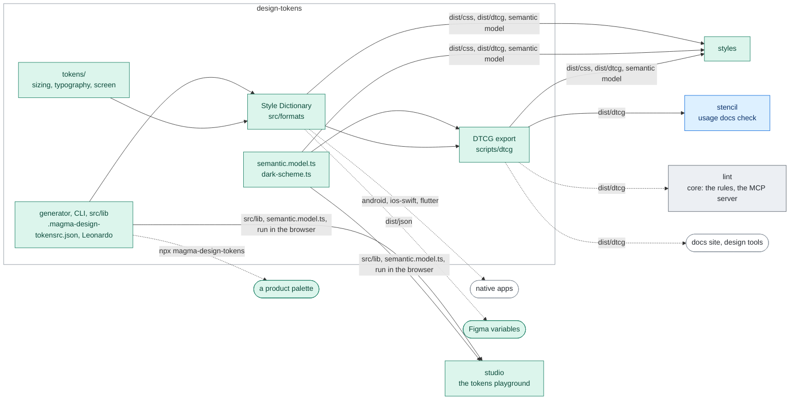

# @maggioli-design-system/design-tokens

Generates design tokens for colors and other type of agnostic tokens targeted on specific platforms, like web, Dart, Android or iOS formats (see [Native platforms](#native-platforms)).

This library is based on [Adobe Leonardo][adobe-leonardo] and [Amazon Style Dictionary][style-dictionary].

# Architecture

One configuration generates the palette; Style Dictionary writes it, with the other tokens, in
every format, and the DTCG export describes the whole set, the semantic layer included. `styles`
builds on the CSS and on the semantic model; the tools read the DTCG data where the package is
installed.



Rectangles: this repository; rounded boxes: outside it. Solid arrows: inside the repository;
dashed: where the package is installed. Labels: the file, export or command that crosses.
Colours: purple ai, amber assets, teal visual, blue components, grey tooling, white outside
([convention](../../docs/ARCHITECTURE.md#diagrams-of-the-projects)).

# Compatibility

Use the version of this package matching the major version of [`@maggioli-design-system/magma`](https://www.npmjs.com/package/@maggioli-design-system/magma) you are using:

| magma | design-tokens | styles |
| :--- | :--- | :--- |
| `1.x` (before Magma 2) | `13.x` (latest `13.7.2`) | `15.x` (latest `15.11.1`) |
| `2.0.0-alpha.0` to `2.0.0-beta.3` (prereleases) | `14.x` | `16.x` |
| `2.x` and later | `>= 15` | `>= 17` |

# Installation

Install the component via `npm` by running the following command:

```bash
npm i @maggioli-design-system/design-tokens
```

This package works also with yarn:

```bash
yarn add @maggioli-design-system/design-tokens
```

# Token data (DTCG)

`dist/dtcg/` describes every global token of Magma in the [Design Tokens Community Group format, version 2025.10](https://www.designtokens.org/TR/2025.10/): the primitives of this package, the semantic layer (`--magma-*`) that `@maggioli-design-system/styles` publishes, and what changes in dark mode, under a named theme and under `prefers-contrast: more`. Read it to show, document or transform the tokens (a documentation site, a design tool, another platform). To style a page, use the stylesheets: the JSON describes them, it does not replace them.

| File | Content |
| :--- | :--- |
| `magma.resolver.json` | Which sets to merge, and in which order, for one mode and one theme ([resolver module](https://www.designtokens.org/TR/2025.10/resolver/)) |
| `base.tokens.json` | Every token, in light mode and in the default theme |
| `mode-dark.tokens.json` | What dark mode changes: the palette, the ring shadows, the ink on solid fills |
| `contrast-more.tokens.json` | The `pref-contrast-more` promotions of the default theme |
| `theme-<name>.tokens.json` | What a named theme (`data-theme-name`) repoints |
| `theme-<name>-contrast-more.tokens.json` | The contrast promotions of that theme, in its own family |

Each set lists only what it changes. To get the tokens of one condition, merge the files that `resolutionOrder` names (the `base` set, then the `mode` context, then the `theme` context), let a later file replace a token of an earlier one, and resolve the aliases last. The result has the values the stylesheets give in the same condition, and a test checks it at every build.

| Modifier | Contexts |
| :--- | :--- |
| `mode` | `light` (default), `dark` |
| `theme` | `business` (default), `editorial`, the deprecated `default`, `cool` and `warm`, and each of them with `-contrast-more` |

The theme and the contrast preference are one modifier because they are not independent: under a named theme, the stylesheets restate the contrast promotions in the theme's own family. Dark mode with the `cool` theme and more contrast, for example, merges `base`, `mode-dark`, `contrast-more`, `theme-cool` and `theme-cool-contrast-more`.

## Token tree

| Path | Custom property | Content |
| :--- | :--- | :--- |
| `palette.<group>.<family>.<step>` | `--tone-neutral-08` | The color primitives. The family's own color is `$root` (`--status-info`), the paper of the mode is `seed`. Aliased families (`variant`) are aliases of the family they name. |
| `magma.<group>.<key>` | `--magma-surface-default` | The semantic roles, as aliases of the primitive they point at. `magma.tint` holds the internal `--magma-tint-*` pointers that themes and contrast repoint; an accent with an infix is a group of its own (`magma.accent-ai`). |
| `magma.rhythm.<id>`, `magma.width.<id>` | `--magma-rhythm-between-fields` | The roles of the design language (#1189): the space of each relation of the rhythm, an alias of its size step, and the widths. |
| `font.<family>` | `--font-title` | Font families. |
| `text-size.<family>.<style>` | `--text-size-title-h1` | The size of a style (`$root`) and its `font-weight`, `letter-spacing`, `line-height`. |
| `typography.<family>.<style>` | none | The same style as one `typography` token. The titles by role (`typography.title.page`, `section`, `dialog`, `part`, `group`) are aliases of the level they are styled as, and so are their `text-size` parts. |
| `leading`, `spacing`, `container`, `breakpoint`, `aspect`, `border`, `radius`, `shadow`, `duration`, `ease` | `--leading-md`, `--spacing-xs`, ... | One group per CSS prefix. `spacing.$root` is `--spacing`, the multiplier of the numeric utilities. |
| `size.<step>` | none | The primitive sizing scale that spacing, container, border and radius name. |

Every group of `base.tokens.json` has a `$description` that says what it is for, and so do the semantic roles and the typography styles; a primitive is described by its group (a ramp by its family). The other sets restate values, without descriptions.

Every token carries `$extensions["it.maggioli.magma"]`:

- `css`: the custom property it is published as;
- `tier`: `primitive` (a raw value or scale), `semantic` (a `--magma-*` role, what UI code paints with) or `internal` (a `--magma-tint-*` pointer, not an API);
- `cssValue`: the CSS value, only where the CSS writes the same quantity differently.

Where the JSON and the CSS write a value differently:

- **Colors**: the CSS publishes channels (`--tone-neutral-08: 208 208 208`, read as `rgb(var(--tone-neutral-08))`); the JSON gives sRGB components and the hex.
- **Letter spacing**: the CSS writes it in `em`, which DTCG does not allow; the JSON gives it in `rem` at the style's own font size, and keeps the `em` in `cssValue`.
- **Line height** of a `typography` token: a multiplier of the font size, as DTCG defines it. The `line-height` token of the style keeps the length.
- **Aspect ratios**: a `number` (`5/3` becomes `1.6666666666666667`); `cssValue` keeps the ratio.
- **Ring shadows** (`--shadow-ring*`): the CSS draws them with `--tone-neutral-01`; the JSON resolves that color, so `mode-dark` restates them.
- **No DTCG type**: the text measures `--spacing-phrase`, `-prose`, `-title` (in `ch`) and `-text` (`var()` of the reading measure), the widths `--magma-width-reading` (in `ch`), `-form` and `-dialog` (written from other roles), and the `--transition-property-*` lists are listed in the `cssOnly` extension of their group, each `{ css, value }`, with its `description` where it has one.
- **Titles by role**: the CSS points at the custom property of the level (`--text-size-title-page: var(--text-size-title-h3)`), kept in `cssValue`; the JSON is an alias of the level.

Component tokens (`--mds-*`) are not in this data: they belong to each component.

The globals `@maggioli-design-system/styles` declares on top of these (the `--magma-*` of its `globals.css`, the corner and depth axes) are in its own `dist/dtcg/`, with a resolver that adds them to these sets, and how each token is consumed through Tailwind is its `dist/tailwind/consumption.json`, keyed by the same `css` names (its README, "Token data").

# Native platforms

Besides the web, the package publishes the colors of Magma for Android, iOS and Flutter, generated at every build from the same sources as the CSS. They are plain files to copy into the app, which needs neither npm nor this package at runtime.

| Platform | File | Content |
| :--- | :--- | :--- |
| Android | `dist/android/colors.xml` | `<color>` resources: `@color/color_surface_neutral_light_default` |
| iOS | `dist/ios-swift/StyleDictionaryColor.swift` | `UIColor` constants of an enum: `StyleDictionaryColor.surfaceNeutralLightDefault` |
| iOS | `dist/ios-swift/StyleDictionary.swift` | The same colors in a class, the group kept in the name: `StyleDictionary.colorSurfaceNeutralLightDefault` (add one of the two files, not both) |
| Flutter | `dist/flutter/colors.dart` | `Color` constants, one class per mode: `MagmaColorPaletteLight.surfaceNeutralDefault`, `MagmaColorPaletteDark.surfaceNeutralDefault` |

What the files hold:

- **Colors only**: no type, spacing, radius, shadow or motion tokens.
- **Both modes side by side**, nothing switches by itself. Android and Swift name the mode in each color (`_light_` / `_dark_`, `Light` / `Dark`), Flutter has one class per mode. The app picks the mode: on Android, give the colors it uses names of its own in `res/values/` (pointing at `_light_`) and `res/values-night/` (pointing at `_dark_`); in UIKit, a dynamic color, `UIColor { traits in traits.userInterfaceStyle == .dark ? ... : ... }`; in Flutter, the class by `Theme.of(context).brightness`.
- **The palettes**: `tone`, `label`, `status`, `brand` (`maggioli`, `maggioli_editore`, `rnd`) and `variant`, with the steps `1` to `10`, plus `seed` for a tone (the paper of the mode) and `color` for the other families (their own color, `--status-error` on the web). Flutter writes the steps with two digits (`toneNeutral08`) and the family's own color under its bare name (`statusError`).
- **The roles of each family**: `surface` (`sunken`, `muted`, `default`, `raised`, `overlay`), `border` (`muted`, `default`, `strong`) and `text` (`default`, `muted`, `subtle`, `disabled`), for `neutral`, `porcelain`, `bisque`, `info`, `success`, `warning` and `error`.
- **Not the semantic layer** (`--magma-*`), nor the named themes or the contrast preference. On the web the surface, border and text roles read one family, which the theme picks: `neutral` by default, `porcelain` for `cool`, `bisque` for `warm`. Paint a native app with the family of its theme, `neutral` unless it has one. For the other roles (accents, washes, inverse, ...), resolve the role in the [DTCG data](#token-data-dtcg) down to `palette.<group>.<family>.<step>`, in light and in dark mode: the native color has the same group, family and step.

Do not use:

- `dist/ios/` (Objective-C): it does not compile, its enumeration has no name (`typedef NS_ENUM(NSInteger, )`).
- `dist/flutter/fonts.dart`: it does not compile (`fontSize: 48px`, a `height` in pixels where Flutter takes a multiplier, the fallback fonts unquoted and HTML-escaped). The type styles are in the DTCG data (`typography.*`).
- The `dist/flutter/colors-*.dart` files together: they split `colors.dart` by group under the same two class names, so only one of them, or `colors.dart`, can be imported.

# Generate Custom Palette

you can generate custom palettes via cli command, it takes a configuration file to create palettes

## Usage

```bash
npx magma-design-tokens
```

## Options

| Option                       | Alias | Description                                                                     |
| :--------------------------- | :---- | :------------------------------------------------------------------------------ |
| `--config [configFile]`      | `-c`  | Path to configuration file if not respect default naming                        |
| `--outDir [dirPath]`         | `-d`  | Path destination for generated palettes                                         |
| `--generate [platform]`      | `-g`  | Output format for palette, choose one or more between `css`, `tailwind`, `dart` |
| `--export-tokens`            | `-t`  | export palette as JSON design tokens format                                     |
| `--outTokensDir [tokensDir]` |       | Directory path for JSON tokens, required if `--export-tokens` is presents       |
| `--dry-run`                  |       | With `--export-tokens`: print the JSON tokens to stdout instead of writing them  |

The CLI has no subcommands: `npx magma-design-tokens ui`, which served the tokens playground, was
removed in version 16 (see [Playground](#playground)).

## Configuration file

You can include configuration in a configuration file or a field in `package.json` named `magma-design-tokens`

### Naming convention

Naming standard for configuration file:

- `.magma-design-tokensrc.json`
- `.magma-design-tokensrc.js`
- `.magma-design-tokensrc.cjs`
- `.magma-design-tokensrc.mjs`
- `.config/magma-design-tokensrc`
- `.config/magma-design-tokensrc.json`
- `.config/magma-design-tokensrc.js`
- `.config/magma-design-tokensrc.cjs`
- `.config/magma-design-tokensrc.mjs`
- `magma-design-tokens.config.js`
- `magma-design-tokens.config.cjs`
- .`magma-design-tokens.config.mjs`

If you change configuration file name you need to set with `--config` option

### Editor autocomplete and validation

The package ships a JSON Schema for the configuration at `dist/config/magma-design-tokensrc.schema.json`. Point your config at it with a `$schema` key to get autocomplete and inline validation in editors like VS Code:

```json
{
  "$schema": "./node_modules/@maggioli-design-system/design-tokens/dist/config/magma-design-tokensrc.schema.json",
  "colors": [{ "color": "#94a3b8", "name": "tone.porcelain" }]
}
```

The same schema is the single source of truth for runtime validation: the Magma studio, which edits this configuration, refuses to load a config that does not match it.

### Configuration

Basic config

```json
{
  "colors": [
    { "color": "#94a3b8", "name": "tone.porcelain" },
    { "color": "#EA3464", "name": "label.amaranth" }
  ]
}
```

You can export different color in different output file defining export field

```json
{
  "colors": [
    { "color": "#94a3b8", "name": "tone.porcelain", "export": ["tones"] },
    { "color": "#EA3464", "name": "label.amaranth", "export": ["label"] }
  ]
}
```

You can choose the ratio with which to generate the color scale with `ratios` field

```json
{
  "colors": [
    { "color": "#94a3b8", "name": "tone.porcelain", "ratios": "tone" },
    { "color": "#EA3464", "name": "label.amaranth", "ratios": "v1" }
  ]
}
```

The built-in ratio scales, per contrast `formula` (the default formula is `wcag3`, so a
`ratios` name resolves against the `wcag3` scales unless the color sets `"formula":
"wcag2"`):

```json
{
  "wcag3": {
    "default": [8, 16, 23, 34, 45, 66, 74, 84, 92, 100],
    "tint": [8, 16, 23, 34, 45, 66, 74, 84, 92, 100],
    "tone": [8, 15, 25, 36, 48, 71, 80, 91, 101, 106]
  },
  "wcag2": {
    "v1": [
      1.05, 1.1, 1.17, 1.24, 1.32, 1.41, 1.51, 1.65, 1.9, 2.25, 2.7, 3.3,
      4, 4.8, 5.75, 7, 8.5, 10.3, 12.45, 15
    ],
    "v2": [1.09, 1.22, 1.42, 1.82, 2.57, 3.71, 5.13, 6.71, 8.75, 10.29],
    "default": [1.09, 1.22, 1.42, 1.82, 3.29, 5.13, 6.71, 8.45, 10.29, 17.22],
    "tone": [1.05, 1.1, 1.24, 1.47, 2.54, 4.83, 7.56, 10.31, 14.68, 16]
  }
}
```

### How generation works

For every entry in `colors`, [Adobe Leonardo](https://leonardocolor.io/) builds a full lightness scale from the base `color` (interpolating from black to white through it in the chosen `colorspace`) and then picks one swatch per target contrast ratio, measured against the theme background: white for the light theme, black for the dark theme. The steps of a palette are therefore defined by their contrast, not by fixed lightness values: step `1` is always the highest-contrast step (the darkest in light mode, the lightest in dark mode) and the last step is the closest to the background.

Each color produces this token structure (here with the 10-step `default` scale):

```
color.<group>.<name>.light.1 .. 10   contrast-picked values against white
color.<group>.<name>.dark.1  .. 10   contrast-picked values against black
color.<group>.<name>.light.seed      seed.light, when the color declares a `seed`
color.<group>.<name>.dark.seed       seed.dark, when the color declares a `seed`
color.<group>.<name>.light.color     otherwise: the base color itself
color.<group>.<name>.dark.color      otherwise: the base color itself
```

In CSS these become `--<group>-<name>-01` ... `-10`, plus `--<group>-<name>-seed` (e.g.
`--tone-neutral-seed`) or the bare `--<group>-<name>` (e.g. `--brand-maggioli`).

A color can also opt into the **surface engine** (`surface`, below). Surfaces are not
contrast-solved: they are placed by a direct OKLCH lightness per mode and role, from the
root `theme` block, and each opted-in family additionally emits
`--surface-<name>-{sunken,muted,default,raised,overlay}`,
`--border-<name>-{muted,default,strong}` and `--text-<name>-{default,muted,subtle,disabled}`
(text roles solved by APCA target against that family's own surfaces). These families are
what the semantic color layer of `@maggioli-design-system/styles` points at.

### Configuration reference

Root fields:

| Field        | Type                     | Default  | Description                                                                                              |
| :----------- | :----------------------- | :------- | :-------------------------------------------------------------------------------------------------------- |
| `colors`     | `ColorConfig[]`          | required | The palette definitions, one per generated color scale                                                    |
| `colorspace` | `string`                 | `"HSL"`  | Interpolation colorspace used by Leonardo to build the scales (`HSL`, `OKLCH`, `LCH`, `CAM02`, ...)        |
| `smooth`     | `boolean`                | `false`  | Applies bezier smoothing to the scale interpolation                                                       |
| `formula`    | `"wcag2"` \| `"wcag3"`   | `"wcag3"` | Contrast formula used to pick the steps: WCAG 2.x contrast ratios or WCAG 3 (APCA) Lc values             |
| `ratios`     | `object`                 | built-in | Named ratio scales per formula; merged over the built-in ones shown above                                 |
| `groups`     | `object`                 | none     | Per-group defaults for `ratios` and `formula`, keyed by token group (see below)                            |
| `hueShift`   | `object`                 | none     | Default hue shifting applied to all colors (see the Hue shifting section)                                 |
| `theme`      | `object`                 | none     | The surface engine: `surfaces` and `borders` (OKLCH lightness per mode and role, e.g. `"96%"`), `text` (APCA target per text role, or `{ "step": N }`), `colorspace`. Without it a `surface` opt-in is skipped with a warning |

Fields of each entry in `colors` (per-color values override the root defaults):

| Field        | Type              | Default        | Description                                                                                                    |
| :----------- | :---------------- | :------------- | :--------------------------------------------------------------------------------------------------------------- |
| `color`      | `#RRGGBB`         | required       | Base (key) color the scale is generated from                                                                     |
| `name`       | `string`          | required       | Dot-separated token path in the form `<group>.<name>`, e.g. `tone.neutral` or `brand.maggioli`                   |
| `export`     | `string[]`        | none           | Output groups this color belongs to; each group becomes a separate file (e.g. `tones`, `status`, `default`)      |
| `ratios`     | `string`          | `"default"`    | Name of the ratio scale to use, resolved against the `ratios` of the active `formula`                            |
| `formula`    | `string`          | root `formula` | Contrast formula for this color only                                                                             |
| `colorspace` | `string`          | root value     | Interpolation colorspace for this color only                                                                     |
| `smooth`     | `boolean`         | root value     | Bezier smoothing for this color only                                                                             |
| `seed`       | `object`          | none           | `{ "light": "#RRGGBB", "dark": "#RRGGBB" }`: emits the off-scale `seed` token instead of `color`. Used by tones for the pure extreme of the mode (white in light, black in dark): `--tone-neutral-seed`. It is not a surface |
| `surface`    | `boolean` \| `object` | `false`   | Opts the family into the surface engine (see How generation works): `true` uses the root `theme` levels, `{ "surfaces": {...}, "borders": {...} }` overrides them for this family. Also settable per group |
| `hueShift`   | `object`          | root value     | Hue shifting for this color only; set angles to `0` to opt a color out of a root-level default                   |
| `disabled`   | `boolean`         | `false`        | Skips the color entirely: no tokens are generated for it                                                          |
| `title`      | `string`          | none           | Reserved for exporters; not used by the generator                                                                 |
| `alias`      | `string`          | none           | `<group>.<name>` of another color: this entry carries no `color` and re-exports the source family's generated scale under its own name (`variant.primary` -> `brand.maggioli`) |

Ratios, formula, export targets and `surface` can also be set once per token group instead of repeating them on every color:

```json
{
  "groups": {
    "tone": { "ratios": "tone", "export": ["tones", "default"] },
    "brand": { "formula": "wcag3" }
  },
  "colors": [
    { "color": "#94a3b8", "name": "tone.porcelain" },
    { "color": "#9ca3af", "name": "tone.kaolin" }
  ]
}
```

The resolution order is: the color's own field, then its group entry, then the root default. A per-color `export` (like `ratios` and `formula`) replaces the group's value entirely, it is not merged. This makes master-palette / sub-palette setups easy: give a whole group a default export and override only the colors that differ.

Notes:

- Root options and each color are merged with the built-in defaults, so you only declare what differs.
- The `formula` decides how the numbers in the ratio scales are interpreted: as WCAG 2.x contrast ratios (`1.05`-`21`) or as WCAG 3 APCA Lc values (`0`-`106`). Do not mix scales across formulas: a `wcag3` color must reference a ratio scale defined under `wcag3`.
- Every step keeps its target contrast against the theme background by construction, whatever `colorspace`, `smooth` or `hueShift` you set.

### Hue shifting

You can rotate the hue of the darkest and lightest steps of a scale with the `hueShift` field, producing richer palettes in the classic hue shifting style (shadows toward one hue, highlights toward another). The shift is applied to the seed color before scale generation, one Leonardo scale per distinct angle, so every step is still contrast-solved on its own scale and the target ratios are preserved by construction.

```json
{
  "colors": [
    {
      "color": "#0da2e7",
      "name": "brand.blue",
      "hueShift": { "dark": -18, "light": 10, "curve": "smooth" }
    }
  ]
}
```

- `dark` and `light` are rotations in OKLCH degrees (range -180 to 180) applied at full intensity to the physically darkest and lightest steps of the scale, in both light and dark theme mode. Small angles (10-45) refine the shades in the classic hue shifting style; large ones deliberately bend the ends of the scale toward another color family.
- `curve` controls the intensity of the shift across the scale. Each step gets a weight from 0 (no shift) to 100 (full angle). It accepts:
  - a preset: `"smooth"` (default, every step shifts, linearly from nothing at the centre to the full angle at the ends, so the turn of the hue runs soft across the scale; the same as `{ "deadZone": 0, "easing": "linear" }`) or `"hard"` (full shift outside the central third);
  - parameters: `{ "deadZone": 0.5, "easing": "linear" }` where `deadZone` is the fraction of the center-to-edge distance left untouched and `easing` is `"linear"`, `"step"` (the full shift outside the dead zone) or a named easing: a family (`sine`, `quad`, `cubic`, `quart`, `quint`, `expo`, `circ`) as `-in` (the shift gathers at the ends), `-out` (it rises at once) or `-in-out`, for example `"quad-in"`;
  - an explicit array of weights, resampled to the scale length when needed, for example `[100, 66, 33, 0, 0, 0, 0, 33, 66, 100]`.

With 10 steps the presets resolve to:

```
smooth: [100, 78, 56, 33, 11, 11, 33, 56, 78, 100]
hard:   [100, 100, 100, 0, 0, 0, 0, 100, 100, 100]
```

`hueShift` can also be set at the root of the configuration as a default for all colors; a per-color `hueShift` overrides it. Colors without `hueShift` are generated exactly as before.

### Figma export (DTCG)

The build emits the color palette in the [W3C DTCG](https://tr.designtokens.org/format/) standard format (`$type` / `$value` / `$description`), ready to import as Figma Variables. Since DTCG has no concept of modes, light and dark are written as separate files under `dist/json/`:

```
figma-magma-colors-light.tokens.json
figma-magma-colors-dark.tokens.json
```

In Figma, create a variable collection and import each file into its own mode (Light / Dark). Steps keep their numeric keys (`1`..`10`) and the base color is exposed as `seed`. The Magma studio offers the same pair as a zip via **download > Figma tokens (DTCG)**, generated in the browser from the same mapping so it matches the build output.

The non-color sizing/number tokens are still exported in the legacy Figma "Import/Export Variables" plugin format (`dist/json/figma-magma-tokens.json`); moving them to DTCG is tracked separately.

These files follow an earlier DTCG draft (colors as hex strings) and cover the palette only. Every global token, the semantic layer included, is in [`dist/dtcg/`](#token-data-dtcg).

### Playground

The tokens playground left this package in version 16: it is now the Magma studio, an app of the
[Magma repository](https://github.com/magma-design-system/magma/tree/main/projects/studio) that
runs the generator of this package in the browser (`nx run studio:serve`). The `ui` command,
which served the playground from this package and saved the configuration on disk, went with it.

### Cli example

- takes `./color.js` as configuration file
```bash
npx magma-design-tokens --config ./color.js
```

- export palette only on css format
```bash
npx magma-design-tokens --generate css
```

- export palette on css and tailwind format
```bash
npx magma-design-tokens --generate 'css, tailwind'
```


[adobe-leonardo]: https://leonardocolor.io/
[style-dictionary]: https://amzn.github.io/style-dictionary/
