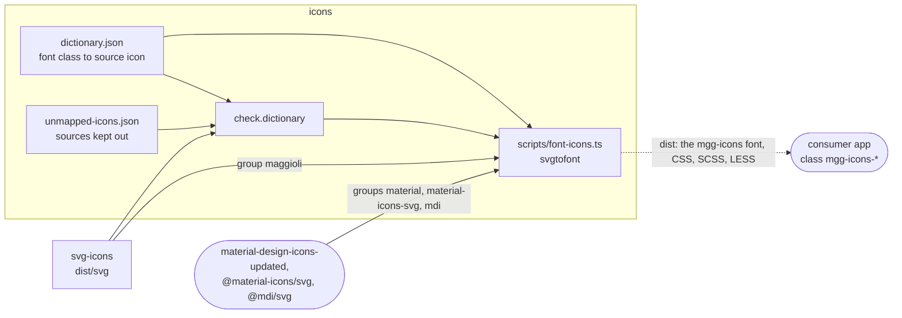

# Maggioli Design System

### icons

The icon **font** of the Maggioli Design System (`mgg-icons`), built from Maggioli artwork plus
Google Material and Material Design Icons community sets.

##### Architecture

The dictionary maps each class of the font to a source icon in one of four groups; the check
holds it to the sources before every build, so an icon is either in the font or declared out of
it.



Rectangles: this repository; rounded boxes: outside it. Solid arrows: inside the repository;
dashed: where the package is installed. Labels: the file, export or command that crosses
([convention](../../docs/ARCHITECTURE.md#diagrams-of-the-projects)).

##### Installation

```
npm i @maggioli-design-system/icons@latest
```

##### Usage

```html
<link rel="stylesheet" href="node_modules/@maggioli-design-system/icons/dist/mgg-icons.css" />
<i class="mgg-icons-action-send"></i>
```

##### Adding an icon

Every glyph is declared in [`dictionary.json`](dictionary.json), which maps a font class name to a
source icon:

```bash
nx run icons:add.icons --auto          # map new Maggioli SVG sources
nx run icons:check.dictionary          # verify the dictionary matches the sources
nx run icons:build                     # build the font
```

Dictionary format, source groups, validation rules and release conventions are documented in
[`SPEC.md`](SPEC.md). Read it before editing `dictionary.json` by hand.
