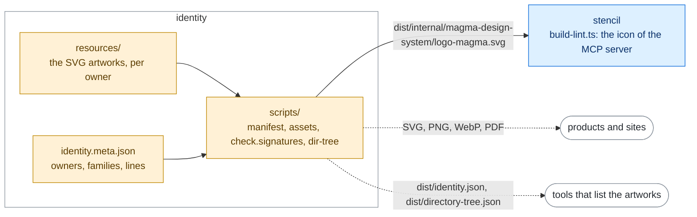

# Maggioli Design System

#### identity


This repo holds Maggioli identity assets in various formats: **SVG**, **PNG**, **WebP** and **PDF**.
The rasters come in several widths (`-256w`, `-512w`, `-1024w`); the WebP files are lossless,
so they show the same pixels as the PNG files at about half the size. `dist/directory-tree.json`
lists every file.

##### Architecture

The artworks and the facts written next to them (`identity.meta.json`) make the build: the
rasters, the PDF and the catalogue, with checks that every file belongs to a family. The stencil
build takes the Magma mark from it, as the icon of the MCP server.



Rectangles: this repository; rounded boxes: outside it. Solid arrows: inside the repository;
dashed: where the package is installed. Labels: the file, export or command that crosses.
Colours: purple ai, amber assets, teal visual, blue components, grey tooling, white outside
([convention](../../docs/ARCHITECTURE.md#diagrams-of-the-projects)).

##### Installation

```
npm install @maggioli-design-system/identity@latest
```

##### What each artwork is: `dist/identity.json`

The file names lose accents, case and punctuation, and say nothing about which files belong
together. `dist/identity.json` says it, with one entry per family of artworks (all the variants
of one brand):

```json
{
  "assets": [
    {
      "id": "argo",
      "name": "Argo",
      "kind": "logo",
      "group": "products",
      "owner": { "id": "maggioli-informatica", "name": "Maggioli Informatica" },
      "variants": [
        {
          "path": "products/maggioli-informatica/argo/logo-argo-icon-white",
          "form": "symbol",
          "color": "white",
          "background": "dark",
          "width": 61,
          "height": 60
        }
      ],
      "formats": { "svg": true, "pdf": true, "png": [256, 512, 1024], "webp": [256, 512, 1024] }
    }
  ]
}
```

- `name`: as the artwork writes it (`L'Ufficio Tecnico`, `ilpersonale.it`, `R&D Days`).
- `kind`: `logo`, `avatar` or `illustration`. `group` is the folder of `dist/`.
- `line`: the product line, when the family belongs to one (`{ "id": "city-mat", "name": "City MAT" }`).
- `variants[].path`: the file in `dist/` without its extension: add `.svg`, `.pdf`,
  `-<width>w.png` or `-<width>w.webp` with a width of `formats`.
- `variants[].form`, for logos only: `logo`, `bordered` or `symbol` (without the name).
- `variants[].background`: the background the variant is drawn for, `light`, `dark` or `any`.
- `variants[].width` / `height`: from the `viewBox`, to reserve the space before the image loads.

Descriptions and usage rules (clear space, minimum size) are not in it yet: they have to come
from the brand guidelines.

##### Adding an artwork

The facts no file name carries are written by hand next to the artworks, one
`identity.meta.json` per owner folder of `resources/` (and one in `resources/avatar/`): the
owner, the families with their names and their files, the product lines. Add the new SVG to
the `files` of its family, or a new family, in the meta file of its folder. A file whose name
does not say its form, colour or background can be listed as
`{ "file": "...", "form": "...", "color": "...", "background": "..." }`.

The build (`nx run identity:build`) fails on an SVG that no family lists, on a listed file that
does not exist, on a family id used twice and on an owner or a line nobody defines.

