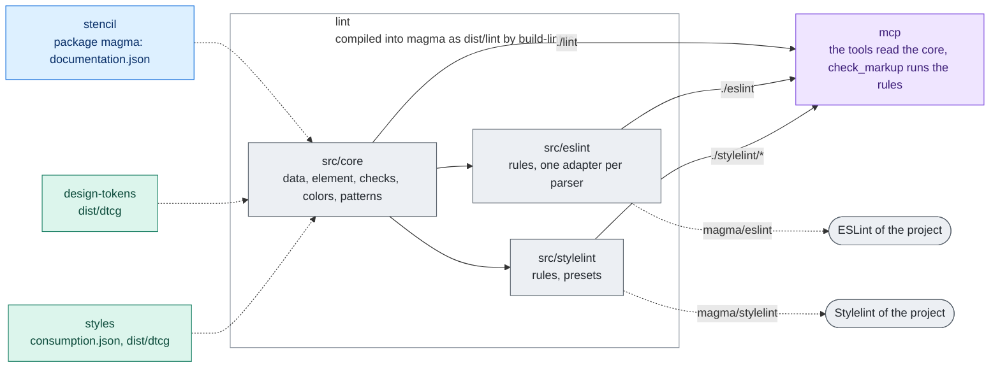

# lint

The consumer lint of Magma: the ESLint and Stylelint rules that check a project's code
against the installed version of Magma, and the core they share, which reads the data of that
version. It is not published on its own: the stencil build compiles it into
`@maggioli-design-system/magma` (`dist/lint`, by `projects/stencil/scripts/build-lint.ts`),
which exports it:

| Export of `@maggioli-design-system/magma` | What |
| --- | --- |
| `./eslint` | the ESLint plugin, with `configs.recommended` and `configs.strict` |
| `./stylelint` | the Stylelint plugins |
| `./stylelint/recommended`, `./stylelint/strict` | the Stylelint presets |
| `./lint` | the core, for tools that run the same checks |

So the rules arrive with the components, at the same version, with nothing for a project to
install or keep aligned. How a project sets them up is in the consumer guide,
[`docs/agents/lint.md`](../../docs/agents/lint.md), shipped in the packages as `agents/lint.md`;
the packages' `AGENTS.md` sets them up at bootstrap. The MCP server of magma is one of the
tools that run the same checks: [`projects/mcp`](../mcp/README.md) reads the data through the
core and runs the rules for `check_markup`, through these same exports.

## Architecture

One core reads the data of the version installed in the project; the ESLint and Stylelint rules
sit on it, and the MCP server reads both through the exports of magma. The stencil build
compiles the whole project into magma, so the rules always match the components.



Rectangles: this repository; rounded boxes: outside it. Solid arrows: inside the repository;
dashed: where the package is installed. Labels: the file, export or command that crosses.
Colours: purple ai, amber assets, teal visual, blue components, grey tooling, white outside
([convention](../../docs/ARCHITECTURE.md#diagrams-of-the-projects)).

## Layout

| Folder | What |
| --- | --- |
| `src/core/data.ts` | the data of the installed version: props and values from `documentation.json`, raw palette steps and the custom properties of the tokens from the DTCG of design-tokens, colour utilities from the consumption map of styles |
| `src/core/element.ts` | the element the template rules check, whatever the template language |
| `src/core/checks.ts` | one check per template rule, pure |
| `src/core/colors.ts` | the colour literals of a CSS value |
| `src/core/patterns.ts` | the patterns (#1174) and the domains of the design language (#1196): reading a pattern or a product layer, the checks of its format, cases, carriers, links and layer, the case for a situation, the sections written from the frontmatter ([`docs/PATTERNS.md`](../../docs/PATTERNS.md)) |
| `src/eslint/adapters.ts` | one adapter per parser: HTML (`@html-eslint/parser`), JSX, Angular templates (`@angular-eslint/template-parser`) |
| `src/eslint/index.ts` | the ESLint rules and presets |
| `src/stylelint/` | the Stylelint rules and presets |

The data is never a list written by hand. Inside magma, the core reads the
`documentation.json` beside it (`dist/documentation.json`) and resolves design-tokens and
styles from where magma is installed, so a rule always checks against the release it ships
in; `settings.magma` points elsewhere.

## Where each answer comes from

The rules answer what an agent would otherwise guess, so they must not guess either. Wherever
the code has to choose (a spelling, a default, the forms of input a check accepts), the choice
is read from the source that decides it: the guide the check enforces, the installed data, the
upstream package that does the work, the specification. Each choice and its source is written
below and next to the code. An input the source does not cover answers that it is unknown (no
match, no value, an error that says why), never a default that looks right. A new rule adds its
line here, and its test runs on the real data or on the guide it enforces, not only on fixtures
picked by hand. The tools of the MCP server, which answer from this core, have their lines in
[`projects/mcp/README.md`](../mcp/README.md).

- **Where a rule looks** (`no-internal-tokens`, `no-raw-palette-classes`): everywhere a
  project writes the thing it checks, with the stack Magma ships, not only the first form that
  comes to mind. A custom property is written in an inline style, in a framework binding, in a
  Tailwind class (an arbitrary property or value, behind variants and `!`, read with
  `utilityOf` like the palette classes) and in `@apply`; the tests cover each form on each
  parser. The forms a class is written in, and what in each is a class, are those of the
  codemod, which migrates the same classes (`projects/codemod/src/surfaces`), and both rules
  read them all: the static `class`; every string literal of a JSX `className` or `class`
  expression, so the arguments and object keys of `clsx()` and `classnames()`, both branches
  of a ternary and a `||` fallback (`react.ts`), and every template literal by its fixed parts
  (the codemod reports one with `${}` instead of rewriting it); the key of an Angular
  `[class.x]` and the quoted strings of `[ngClass]`, `[class]` and `[attr.class]`, matched
  with the expression of `angular.ts`; the classes of `@apply` (`css.ts`). As in the codemod,
  a string compared in a condition is read too (it is reported only when it is itself a class
  the rule rejects) and an unquoted `[ngClass]` key is not (a single word, never such a
  class). The palette check of `@apply` is a Stylelint rule named as the ESLint one, as
  `no-internal-tokens` is, not a case of `no-raw-color`: the codemod migrates the palette
  classes of `@apply` as those of markup
  (`projects/codemod/fixtures/css/apply-semantic-utility-classes`), to a role class, the fix
  `no-raw-palette-classes` gives and `no-raw-color` (a colour literal, fixed with
  `rgb(var(--magma-*))`) does not; one name also keeps one switch for one finding. Of
  `inline-templates.ts`, the inline `template` of an Angular component is read through the
  inline-template processor of angular-eslint (`agents/lint.md`); HTML written as a string in
  a script (`el.innerHTML`) is not, since ESLint parses a script with a script parser, which
  sees that HTML as a string.
- **The patterns** (`src/core/patterns.ts`, which `get_pattern` of the MCP server answers from):
  the format is [`docs/PATTERNS.md`](../../docs/PATTERNS.md), decided on #1174. A case holds for
  a combination when every variable it gives has that value (a list, any of its values) and a
  variable it leaves out means any value, except `decision`, which means `none`, as the cases
  were written; a question that leaves `decision` out means `none` too, for the same reason.
  What answers a combination is its case; with none, its first gap; else its first
  not-applicable entry, since two reasons for the same "not applicable" make no difference to
  the agent. With some variables unknown, `get_pattern` returns the cases still possible and the
  variables that tell them apart (a variable is missing when, the others equal, two of its
  values lead to a different answer), never a guess among them. A product layer is read from
  `magma/patterns/` of the project, the folder decided on #1174, and applied only when it holds
  to the rules of a layer (`projectErrors`); otherwise the answer is the Magma default. The
  files are read one by one, so a file that does not parse is named and the others answer; of
  two layers of one pattern the first by file name is applied, as the folder lists it; a pattern
  of the product under an id Magma has is reported and never replaces Magma's, since Magma's id
  is the contract the products cite. A pattern of the product's own is held to the format, the
  cases and the components, not to the lint rules (its lint may have rules of its own) nor to
  the generated body (the generator does not ship). A candidate is a gap: Magma knows the need
  and has no default. The preview of a case (#1186) is the file `previews/<pattern>/<case>.html`
  beside the patterns, matched by its path only, so a renamed case moves its file and the check
  says so. More examples of a case are `<case>.<n>.html` from 2, with no gap (the choice of the
  maintainer on #1221, beside the first rather than in a folder of their own, so the folder of a
  pattern stays one level). Only Magma's cases have previews: a product layer adds situations,
  never a case to show. What `get_pattern` makes of them (the search by need, the errors of a
  layer, the stage and the images of an answer) is in
  [`projects/mcp/README.md`](../mcp/README.md).
- **The domains of the design language** (`kind: design-language`, `src/core/patterns.ts`,
  #1196; `foundation` in magma 2.11 and before, #1253): the domains decided on #1189, in the
  same format, so they are listed, searched and answered as the patterns are, first in the list
  as the rail of the docs site puts Foundation, which holds the design language, before Building
  blocks and Patterns. The kind is named after what the files are, not after the Foundation item
  of the docs site, the umbrella that holds them as one of its groups. `serves` takes the four
  principles of the docs site's Principles page, the principles behind every decision of Magma,
  each of which names the one it serves. A carrier is read from its form, as a `use` is (the
  choice of the maintainer on #1196): `mds-*` a component and its attributes, checked as a
  `use`; `--*` a custom property, which exists when the consumption map of styles lists it as a
  token or as the theme name a token publishes, when the DTCG data of design-tokens has it as a
  token that is not internal or as a `cssOnly` entry of a group (a role no Tailwind theme variable publishes, `--magma-width-page`, `--magma-width-dialog`:
  `loadTokenNames`), or when a component documents it as public; `magma/*` a rule of the lint; any other name a class, which exists when it is a
  Magma utility of the consumption map or `<utility>-<key>` of a namespace and a token or a
  keyword of it, as `explain_class` reads a class (`loadThemeNames` of `src/core/data.ts`). A
  planned carrier must not exist yet, as a planned lint rule; the release that has it makes the
  check ask to move it, so the files follow the carriers as they are built. A pattern cites a
  domain by a rule or by a case, `{ id, from: rhythm }`, since the relations of a domain are its
  rules too; a domain gives a case and a rule the same id never, or one citation would name
  both. A relation of a domain has a preview as a case of a pattern does, and a rule of its own
  may have one too, `previews/<domain>/<rule>.html` (the choice of the maintainer on #1221), never
  a rule it cites, which its own domain shows (what the tools answer of them:
  [`projects/mcp/README.md`](../mcp/README.md)).
- **The building blocks** (`kind: block`, `src/core/patterns.ts`, #1210): a section of a page
  that comes back in two patterns or more, the threshold of the docs site (`plan/DIRECTION.md`,
  "Building blocks section"), with `regions` in place of cases, as decided on #1174 (the page
  header as cases would be eight near copies). A region shows for a combination when every
  variable of its `when` has one of its values, as a case reads them, a `when` left out
  meaning every combination; `decision` means nothing special here, since a block has no case
  to leave it out of. With some variables unknown, `get_pattern` answers the regions that show
  whatever their values and, in `candidates`, those that show for some of them only, with the
  variables of their `when` still to know: what the agent can lay out now, and what it must
  ask. The coverage asks every combination to show a required region, what makes the section
  the block. `used-by` names patterns that are defined (a candidate has no case to use the
  block in) and name the block among their `related`, so the two sides are checked against
  each other. A situation of a block gives a value of every variable, since there is no case
  to name; the regions it shows are computed for the generated table. The rules of the domains
  a block cites in `always-true` come with the regions, as with a case. Blocks have no
  previews yet: whether they get one, and of what, is open.
- **What a rule says about itself** (the documentation site reads it from the installed
  package, magma-design-system/docs#1): the same fields on both plugins, a description and the
  URL of its section of `agents/lint.md` (an ESLint rule in `meta.docs`, a Stylelint rule in
  its `meta`, which Stylelint gives no description field). A link a shipped file prints points
  at the release it ships in, the tag `magma@<version>` (`lintGuideUrl`), so an older project
  reads the rule it runs; only the sources, which belong to no release, link `main`. The tests
  hold every rule to a description, its URL and an existing heading of the guide.

## Tests

```bash
nx run lint:test
```

The tests run on fixtures cut from the real data (`test/fixtures`: a few components of
`documentation.json`, a few palette tokens, the colour utilities), so they need no build of
the other projects: every template rule on HTML, JSX and Angular templates through ESLint's
`RuleTester`, the CSS rules through Stylelint, the patterns core on the patterns Magma ships.
The tests of the MCP server read the same data from here, so a change to it runs both
([`projects/mcp/README.md`](../mcp/README.md), "Tests"). The `consumer-lint` job of the
stencil workflow runs them, on the `lint:build` of the same run; the stencil pipeline builds
the package with the lint inside.

## Adding a rule

1. Write the check: a template rule in `src/core/checks.ts` on the element of
   `src/core/element.ts`, a CSS rule in `src/stylelint/`. Read what it needs from the
   installed data (`src/core/data.ts`), not from a list.
2. Register it in `src/eslint/index.ts` or `src/stylelint/index.ts`, with a one-sentence
   description (`createRule`, `metaOf`: the documentation site prints it), and in the
   presets: `recommended` makes what is broken or not accessible an error and token
   discipline a warning, `strict` makes everything an error.
3. Test it on every parser it supports, valid and invalid cases.
4. Document it in [`docs/agents/lint.md`](../../docs/agents/lint.md), with an INCORRECT and a
   CORRECT example, and check that the guides' own examples pass it: the strict preset run
   on every `html` and `css` block of the usage docs reports nothing outside the INCORRECT
   halves.
