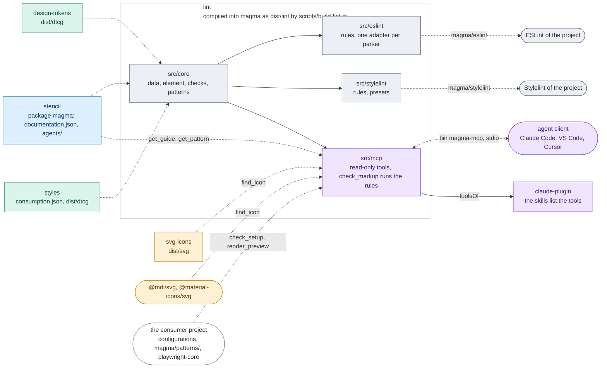

# lint

The source of the agent tooling that ships inside Magma: the consumer lint (the ESLint and
Stylelint rules that check a project's code against the installed version of Magma) and the
MCP server that answers an agent from the same data (`src/mcp`). Neither is published on its
own: the stencil build compiles them into `@maggioli-design-system/magma` (`dist/lint`, by
`projects/stencil/scripts/build-lint.ts`), which exports the lint and runs the server as its
`magma-mcp` command:

| Export of `@maggioli-design-system/magma` | What |
| --- | --- |
| `./eslint` | the ESLint plugin, with `configs.recommended` and `configs.strict` |
| `./stylelint` | the Stylelint plugins |
| `./stylelint/recommended`, `./stylelint/strict` | the Stylelint presets |
| `./lint` | the core, for tools that run the same checks |
| `magma-mcp` (bin) | the MCP server on stdio: `dist/lint/mcp/cli.js` |
| `./dist/lint/mcp/tools.json` | the tools of the server as data, the answer of `tools/list`, for the documentation |

So both arrive with the components, at the same version, with nothing for a project to
install or keep aligned. How a project sets them up is in the consumer guides,
[`docs/agents/lint.md`](../../docs/agents/lint.md) and [`docs/agents/mcp.md`](../../docs/agents/mcp.md),
shipped in the packages as `agents/lint.md` and `agents/mcp.md`; the packages' `AGENTS.md`
sets both up at bootstrap.

## Architecture

One core reads the data of the version installed in the project; the ESLint and Stylelint rules
and the MCP server sit on it, and `check_markup` runs the rules for the server. The stencil build
compiles the whole project into magma, so the rules and the server always match the components.



Rectangles: this repository; rounded boxes: outside it. Solid arrows: inside the repository;
dashed: where the package is installed. Labels: the file, export or command that crosses.
Colours: purple ai, amber assets, teal visual, blue components, grey tooling, white outside
([convention](../../docs/ARCHITECTURE.md#diagrams-of-the-projects)).

## Layout

| Folder | What |
| --- | --- |
| `src/core/data.ts` | the data of the installed version: props and values from `documentation.json`, raw palette steps and the custom properties of the tokens from the DTCG of design-tokens, colour utilities from the consumption map of styles |
| `src/core/element.ts` | the element the template rules check, whatever the template language |
| `src/core/checks.ts` | one check per template rule, pure |
| `src/core/colors.ts` | the colour literals of a CSS value |
| `src/core/patterns.ts` | the patterns (#1174) and the domains of Foundation (#1196): reading a pattern or a product layer, the checks of its format, cases, carriers, links and layer, the case for a situation, the sections written from the frontmatter ([`docs/PATTERNS.md`](../../docs/PATTERNS.md)) |
| `src/eslint/adapters.ts` | one adapter per parser: HTML (`@html-eslint/parser`), JSX, Angular templates (`@angular-eslint/template-parser`) |
| `src/eslint/index.ts` | the ESLint rules and presets |
| `src/stylelint/` | the Stylelint rules and presets |
| `src/mcp/protocol.ts` | the part of the Model Context Protocol the server speaks, written here so magma carries no SDK: JSON-RPC over stdio, `initialize`, `tools/list`, `tools/call` |
| `src/mcp/render.ts`, `src/mcp/render-page.ts` | `render_preview`: the page served from the installed packages and driven by the project's playwright-core, and the part that runs in the page (waiting, then the checks of the image) |
| `src/mcp/*.ts` | the other eleven tools, read-only (components, tokens, icons, guides, patterns, checks), the server and its command |
| `scripts/serve-previews.ts` | `nx run lint:serve.previews`: the previews of the patterns and their drafts, served live on the page of `render_preview` ("Serving the previews"); a tool of this repository, outside `src`, so it does not ship |

The data is never a list written by hand. Inside magma, the core reads the
`documentation.json` beside it (`dist/documentation.json`) and resolves design-tokens and
styles from where magma is installed, so a rule always checks against the release it ships
in; `settings.magma` points elsewhere.

## Where each answer comes from

The rules and the tools answer what an agent would otherwise guess, so they must not guess
either. Wherever the code has to choose (a spelling, a default, the forms of input a check
accepts), the choice is read from the source that decides it: the guide the check enforces,
the installed data, the upstream package that does the work, the specification. Each choice
and its source is written below and next to the code. An input the source does not cover
answers that it is unknown (no match, no value, an error that says why), never a default
that looks right. A new tool or rule adds its line here, and its test runs on the real data
or on the guide it enforces, not only on fixtures picked by hand.

- **Icon slugs** (`find_icon`, the copy script of `agents/assets.md`): the slug is what
  iconsauce writes, as `mds-icon` documents, not the name of the file in the package.
  `@iconsauce/material-icons` turns the underscores of a Material folder into hyphens
  (`check_circle/baseline.svg` is `mi/baseline/check-circle`) and serves the variants
  `baseline`, `outline`, `round` and `sharp` only. The stencil build dumps every slug the
  plugins serve into `projects/stencil/src/fixtures/icons-dictionary.json`
  ([`projects/stencil/SPEC.md`](../stencil/SPEC.md), "Discovering available slugs"): the tests
  hold `find_icon` to it both ways, and run the routes of the guide
  (`projects/stencil/scripts/agent-docs-icons.spec.ts`) on a multi-word slug.
- **What `check_setup` accepts**: every way its guide documents and every file the tool
  itself loads, not one form picked among them, or the agent adds a second setup to a project
  that has one. The icon path is set where `IconsSetService` reads it: its `setSvgPath()` (or
  the one of an `mds-icon`) and the `mdsIconSvgPath` key of `sessionStorage`, and nowhere
  else; the test collects those lines from the code blocks of the guides. The lint
  configuration is the first file the tool loads: ESLint 9 `FLAT_CONFIG_FILENAMES`, then for
  Stylelint 16 the `stylelint` key of `package.json` and the search places of cosmiconfig 9.
  The MCP server is started by the file each client reads in the project: `.mcp.json`
  (`mcpServers`) or the Magma plugin in `.claude/settings.json` for Claude Code,
  `.vscode/mcp.json` (`servers`), `.cursor/mcp.json` (`mcpServers`), and for OpenCode
  `opencode.json` and `opencode.jsonc`, in the root and in `.opencode/` (`names` of its
  `ConfigDiscovery`), these read as JSONC as OpenCode reads them, with the servers where its
  `normalizeMcp` finds them: `mcp.servers` (OpenCode 2) and right under `mcp` (OpenCode 1).
  magma-mcp serves on stdio only, so an OpenCode server counts when `local` and not turned
  off (`disabled`, or `enabled: false` in OpenCode 1).
- **Token values** (`list_tokens`, `explain_class`): the value is what the CSS writes. Where the
  package records a `cssValue` (the CSS writes the quantity differently from the JSON:
  `em` letter spacing, ratios, elevations on `--depth`, design-tokens README, "Token data")
  that is the value; otherwise the DTCG value is serialised by its `$type`, as DTCG 2025.10
  defines each type and composite type (a shadow is one `[inset] x y blur spread color` layer
  per item), aliases resolved inside composites too. A type with no single CSS value
  (`typography`, `gradient`) has none, and so does a part with no serialiser: never
  `[object Object]`. The fixtures hold one token of every `$type` and shape the published
  data has, and a test runs every value of the built data when there is one.
- **What a colour paints** (`suggest_role`): each root of the `--color` namespace of the
  consumption map is classified by the CSS property Tailwind writes for it (text, border,
  background, shadow; the masks read only the alpha, no role), in a table a test holds to the
  map, so a new root fails a test instead of reading as a background. A role is matched in
  its family, `--magma-shadow-ink` for a shadow (or a fill, for a glow), and the class keeps
  the utility and the opacity of the class given.
- **Where a rule looks** (`no-internal-tokens`, `no-raw-palette-classes`): everywhere a
  project writes the thing it checks, with the stack Magma ships, not only the first form that
  comes to mind. A custom property is written in an inline style, in a framework binding, in a
  Tailwind class (an arbitrary property or value, behind variants and `!`, read with
  `utilityOf` like the palette classes) and in `@apply`; the tests cover each form on each
  parser. The forms a class is written in, and what in each is a class, are those of the
  codemod, which migrates the same classes (`projects/codemod/src/surfaces`), and both rules
  read them all: the static `class`; every string literal of a JSX `className` or `class`
  expression, so the arguments and object keys of `clsx()` and `classnames()`, both branches
  of a ternary and a `||` fallback (`react.ts`), and every template literal by its fixed parts
  (the codemod reports one with `${}` instead of rewriting it); the key of an Angular
  `[class.x]` and the quoted strings of `[ngClass]`, `[class]` and `[attr.class]`, matched
  with the expression of `angular.ts`; the classes of `@apply` (`css.ts`). As in the codemod,
  a string compared in a condition is read too (it is reported only when it is itself a class
  the rule rejects) and an unquoted `[ngClass]` key is not (a single word, never such a
  class). The palette check of `@apply` is a Stylelint rule named as the ESLint one, as
  `no-internal-tokens` is, not a case of `no-raw-color`: the codemod migrates the palette
  classes of `@apply` as those of markup
  (`projects/codemod/fixtures/css/apply-semantic-utility-classes`), to a role class, the fix
  `no-raw-palette-classes` gives and `no-raw-color` (a colour literal, fixed with
  `rgb(var(--magma-*))`) does not; one name also keeps one switch for one finding. Of
  `inline-templates.ts`, the inline `template` of an Angular component is read through the
  inline-template processor of angular-eslint (`agents/lint.md`); HTML written as a string in
  a script (`el.innerHTML`) is not, since ESLint parses a script with a script parser, which
  sees that HTML as a string.
- **The patterns** (`get_pattern`, `src/core/patterns.ts`): the format is
  [`docs/PATTERNS.md`](../../docs/PATTERNS.md), decided on #1174. A case holds for a
  combination when every variable it gives has that value (a list, any of its values) and a
  variable it leaves out means any value, except `decision`, which means `none`, as the cases
  were written; a question that leaves `decision` out means `none` too, for the same reason.
  What answers a combination is its case; with none, its first gap; else its first
  not-applicable entry, since two reasons for the same "not applicable" make no difference to
  the agent. With some variables unknown, `get_pattern` returns the cases still possible and
  the variables that tell them apart (a variable is missing when, the others equal, two of its
  values lead to a different answer), never a guess among them. A search by need scores the
  words of the need (`wordsOf`, as `find_component`) against the keywords (3), the title (2),
  the need and the situations (1): the keywords are the words the author chose for that need. A
  product layer is read from `magma/patterns/` of the project, the folder decided on #1174,
  and applied only when it holds to the rules of a layer (`projectErrors`); otherwise the
  answer is the Magma default, with `layerErrors` saying why. Without arguments the list
  carries the `layerErrors` of the whole folder, so a product checks its layer where it has no
  `check.patterns`. The files are read one by one, so a file that does not parse is named and
  the others answer; of two layers of one pattern the first by file name is applied, as the
  folder lists it; a pattern of the product under an id Magma has is reported and never
  replaces Magma's, since Magma's id is the contract the products cite. A pattern of the
  product's own is held to the format, the cases and the components, not to the lint rules
  (its lint may have rules of its own) nor to the generated body (the generator does not
  ship). A candidate is a gap: Magma knows the need and has no default. The preview of a case
  (#1186) is the file `previews/<pattern>/<case>.html` beside the patterns, matched by its path
  only, so a renamed case moves its file and the check says so; each case of a pattern names
  its path, and the answer for a situation carries the stage with what to try, since that is
  the one case the agent builds and its markup is short. More examples of a case are
  `<case>.<n>.html` from 2, with no gap (the choice of the maintainer on #1221, beside the first
  rather than in a folder of their own, so the folder of a pattern stays one level): the pattern
  names their paths in `examples`, the answer too, and `render_preview` takes `example`. Only Magma's cases have previews: a
  product layer adds situations, never a case to show. The preview of an answer names its two
  images in `images` (#1243), `<case>.light.webp` and `<case>.dark.webp` beside it, which the
  build of magma makes with `renderPreviewImages`: the paths only, for a client that cannot run
  the stage, and only the files that exist, since a magma built before them has none and a path
  to nothing would send the client after a file that is not there. The pattern does not repeat
  them on each case: they follow the path of the preview.
- **The domains of Foundation** (`kind: foundation`, `src/core/patterns.ts`, #1196): the
  domains of the design language decided on #1189, in the same format, so they are listed,
  searched and answered as the patterns are, first in the list as the rail of the docs site puts
  Foundation first. `serves` takes the four principles of the docs site's Principles page, which
  asks every decision of Foundation to name the one it serves. A carrier is read from its form,
  as a `use` is (the choice of the maintainer on #1196): `mds-*` a component and its attributes,
  checked as a `use`; `--*` a custom property, which exists when the consumption map of styles
  lists it as a token or as the theme name a token publishes, when the DTCG data of
  design-tokens has it as a token that is not internal or as a `cssOnly` entry of a group (a
  role no Tailwind theme variable publishes, `--magma-width-page`, `--magma-width-dialog`:
  `loadTokenNames`), or when a component documents it as public; `magma/*` a rule of the lint; any other name a class, which exists when it is a
  Magma utility of the consumption map or `<utility>-<key>` of a namespace and a token or a
  keyword of it, as `explain_class` reads a class (`loadThemeNames` of `src/core/data.ts`). A
  planned carrier must not exist yet, as a planned lint rule; the release that has it makes the
  check ask to move it, so the files follow the carriers as they are built. A pattern cites a
  domain by a rule or by a case, `{ id, from: rhythm }`, since the relations of a domain are its
  rules too; a domain gives a case and a rule the same id never, or one citation would name
  both. A relation of a domain has a preview as a case of a pattern does, and a rule of its own
  may have one too, `previews/<domain>/<rule>.html` (the choice of the maintainer on #1221), never
  a rule it cites, which its own domain shows: `get_pattern` names its path on the rule and on
  the rules of an answer, `get_guide` lists the previews of a domain with the kind of each, case
  or rule, and `render_preview` takes `rule`, telling a rule asked as a case apart.
- **The building blocks** (`kind: block`, `src/core/patterns.ts`, #1210): a section of a page
  that comes back in two patterns or more, the threshold of the docs site (`plan/DIRECTION.md`,
  "Building blocks section"), with `regions` in place of cases, as decided on #1174 (the page
  header as cases would be eight near copies). A region shows for a combination when every
  variable of its `when` has one of its values, as a case reads them, a `when` left out
  meaning every combination; `decision` means nothing special here, since a block has no case
  to leave it out of. With some variables unknown, `get_pattern` answers the regions that show
  whatever their values and, in `candidates`, those that show for some of them only, with the
  variables of their `when` still to know: what the agent can lay out now, and what it must
  ask. The coverage asks every combination to show a required region, what makes the section
  the block. `used-by` names patterns that are defined (a candidate has no case to use the
  block in) and name the block among their `related`, so the two sides are checked against
  each other. A situation of a block gives a value of every variable, since there is no case
  to name; the regions it shows are computed for the generated table. The rules of the domains
  a block cites in `always-true` come with the regions, as with a case. Blocks have no
  previews yet: whether they get one, and of what, is open.
- **The rules of the design language in the answers** (`get_guide`, `get_pattern`,
  `get_component`, #1198): found where the agent already looks (#1189, "The context for the
  agents", point 2). `get_guide` serves each domain of `agents/patterns/` as a guide, named by
  its id as the patterns cite it (`rhythm/<id>`), after the guides of `agents/`, read without
  its frontmatter, the data `get_pattern` answers from; a guide of the same name would come
  first, the domain answering as `patterns/<id>`, and a test holds the ids of the domains apart
  from the names of the guides. A case names the rules it and its preview rely on in `rules`,
  `<domain>/<id>`, declared rather than derived from the markup (the choice of the maintainer
  on #1198): a rule checked by review (`step-ratio`) has no carrier a preview could show, and
  most carriers are planned. The answer for a situation gives them with their text (a
  relation's `where`, a rule's `rule`), then the rules its pattern cites from a domain in
  `always-true`, which hold for every case, each once; a citation that names nothing is left
  out, and `check.patterns`, or `layerErrors` for a product's own pattern, says why.
  `get_component` names a relation or a rule of a domain when the component carries it, built
  or planned (`carried-by`, `carried-by-planned`, whatever the attributes of the carrier), or
  when a relation writes it in `use`; not the `components` of a domain, which name what it
  speaks of, a component it says lacks a rule among them (`mds-card` in the rhythm).
- **What a render loads, and when it is ready** (`render_preview`, #1180): the page a consumer
  writes, not one of the tool's own. The stylesheets are the import block of
  `agents/assets.md`, "Import order (mandatory)", in its order and layers (a test holds
  `STYLESHEETS` to the block), each resolved from the project as Node resolves it, and left
  out when the project did not install it; the components, the lazy loader of the dist
  (`dist/magma-components`); the icons, the contract of `agents/assets.md`, served at the path
  set in `sessionStorage`, from the sets `find_icon` reads. The widths a name gives are the
  `--breakpoint-*` of the installed `typography.css`, the default `desktop`; the themes, the
  names of the installed `themes.css`: the previews `--magma-preview-<name>-wash`, which name
  every theme with the base one (`business` emits no rule, #692), then the `data-theme-name`
  values, the only names an older `themes.css` has; the mode, `prefers-color-scheme`,
  which `colors-rgb.css` and `semantic.css` follow on a page with no `data-magma-pref`. The
  classes are the ones of Tailwind (#1220): the Tailwind entry point of `agents/assets.md`,
  "Tailwind (optional)" (`TAILWIND`, held to the block by a test), compiled with the project's
  Tailwind 4 (`compile` of tailwindcss, which its PostCSS and Vite plugins call) on the tokens
  of the markup, as Tailwind scans a source, and put after the stylesheets of the consumer; a
  project without Tailwind 4 gets no rules for them, and an image whose markup has classes and
  no style element of its own reports it. The
  path of the icons and the record of `appload` are the first script of the page
  (`INIT_SCRIPT`), not an init script of the driver, so that `serve.previews` shows the very
  page; it sets the mode in the page instead (`prefMode`), as `mds-pref` does,
  `data-magma-pref` and `pref-mode-<mode>` on `<html>` (`projects/styles/SPEC.md`), since a
  browser gives a frame the `prefers-color-scheme` of the system whatever the `color-scheme`
  of the frame (Chrome 154), and a test proves the image is the one of the emulated mode, pixel
  by pixel, both ways. The page is ready when Stencil has emitted
  `appload` on window, every component defined carries the flag `styles/dist/css/hydrated.css`
  hides it by (`[hydrated]` or `.hydrated`), `document.fonts` is ready and every animation is
  finished (an infinite one paused). The page has 15 s to load and settle, and no call of the
  render waits on it longer: a page whose script never yields answers no call of the driver and
  gives no image (Chrome draws it no frame), so the render ends with an error that says the page
  stopped answering (#1271). An image is not representative when the page reports a
  problem: a tag the loader did not define, a component without the flag, a component or an
  image displayed with no width or height (`display: none` is a choice, not a failure, and so is
  the empty box of an element whose content stands out of it by design: fixed on the viewport,
  as an `mds-toast-region` with no toast, or a dialog or a popover in its light or shadow tree,
  shown in the top layer or closed, as the window of `mds-status-bar`), a
  component with text or media whose whole box is one colour (99.8% of the pixels within 8
  levels of the most frequent one; not judged: a box hidden by `visibility: hidden`, which keeps
  the place of content that shows later, a box with another element painted over its middle
  (the window or the backdrop of an open dialog, a toast), and a box that an ancestor with an
  overflow that is not visible cuts or hides, as the last columns of a table that scrolls at a
  narrow width: the image holds a slice of it at most, and the page where the rest would be), a
  console error or an uncaught exception, a request the page cannot be served, a font family the
  text asks for with no face loaded, a word (the run between two places a line may break: a
  space, a hyphen, a dash, a slash) on more than one line, content taller than the image. An
  image is at most 2000 px a side, the cap of Claude Code (CHANGELOG 2.1.122) and of the
  Anthropic API for a request with many images, and four of them stay under the 25,000 tokens
  Claude Code allows a tool result. The driver is the
  project's playwright-core (else playwright), an optional peer of magma from 1.9, the version
  that has every call the tool makes (playwright.dev/docs/api); the browser, Chrome, then
  Edge, the channels of playwright.dev/docs/browsers, then Playwright's own Chromium. With
  `pattern` and `case` instead of markup it renders the preview Magma ships for that case
  (#1186), with `rule` the preview of a rule of a domain and with `example` another example of
  either (#1221), found under an old id of the pattern too: at the height the preview declares, the
  page an overlay needs, with no inset around a stage that declares `whole-page`, and with
  `lang="it"`, the language of the words of the previews (`docs/PATTERNS.md`), unless the call
  gives its own.
- **What a tool or a rule says about itself** (the documentation site reads it from the
  installed package, magma-design-system/docs#1): the same fields on both plugins, a
  description and the URL of its section of `agents/lint.md` (an ESLint rule in
  `meta.docs`, a Stylelint rule in its `meta`, which Stylelint gives no description field);
  the tools as `tools.json`, the very object `tools/list` answers. A link a shipped file
  prints points at the release it ships in, the tag `magma@<version>` (`lintGuideUrl`), so
  an older project reads the rule it runs; only the sources, which belong to no release,
  link `main`. The tests hold every rule to a description, its URL and an existing heading
  of the guide.

## Tests

```bash
nx run lint:test
```

The tests run on fixtures cut from the real data (`test/fixtures`: a few components of
`documentation.json`, a few palette tokens, the colour utilities), so they need no build of
the other projects: every template rule on HTML, JSX and Angular templates through ESLint's
`RuleTester`, the CSS rules through Stylelint. The `consumer-lint` job of the stencil workflow
runs them, on the `lint:build` of the same run and its build artifact (the render of the built
`mds-button`); the stencil pipeline builds the package with the lint inside.

## Adding a rule

1. Write the check: a template rule in `src/core/checks.ts` on the element of
   `src/core/element.ts`, a CSS rule in `src/stylelint/`. Read what it needs from the
   installed data (`src/core/data.ts`), not from a list.
2. Register it in `src/eslint/index.ts` or `src/stylelint/index.ts`, with a one-sentence
   description (`createRule`, `metaOf`: the documentation site prints it), and in the
   presets: `recommended` makes what is broken or not accessible an error and token
   discipline a warning, `strict` makes everything an error.
3. Test it on every parser it supports, valid and invalid cases.
4. Document it in [`docs/agents/lint.md`](../../docs/agents/lint.md), with an INCORRECT and a
   CORRECT example, and check that the guides' own examples pass it: the strict preset run
   on every `html` and `css` block of the usage docs reports nothing outside the INCORRECT
   halves.

## The MCP server

`src/mcp/server.ts` puts the twelve tools behind the protocol of `src/mcp/protocol.ts`; the
command, `src/mcp/cli.ts`, serves them on stdio from the project it starts in (`--root`
points elsewhere; `--documentation`, `--tokens`, `--consumption`, `--globals`,
`--icons-<set>` and `--loader`, the loader of the components `render_preview` loads, point
the data elsewhere). The server writes only protocol messages to
stdout. The icon it shows its clients is the Magma mark of identity, copied into
`dist/lint/mcp/icon.svg` by the stencil build, which also writes the tools as data into
`dist/lint/mcp/tools.json`: the answer of `tools/list` (`toolsList`), from the compiled server.

A tool answers from data the packages ship and is read-only: one that writes says so in its
`annotations` (`render_preview`, `readOnlyHint: false`), and writes only where nothing is
committed. Add one in the file of its area, give it an `outputSchema` its result matches (the
official client checks it), register it in `toolsOf` of `src/mcp/server.ts`, test it on the
fixtures (`test/mcp-tools.test.ts`) and in the call through the official client
(`test/mcp-stdio.test.ts`), and list it in [`docs/agents/mcp.md`](../../docs/agents/mcp.md).
A result with images returns them through `withImages`: `tools/call` answers them as image
content after the text, and keeps them out of the structured content. A tool that needs a
package magma does not depend on resolves it from the project (`resolvePackage`) and, when it
is missing, says how to install it, as `check_markup` does for ESLint and `render_preview` for
playwright-core. Keep the tools few: an agent picks one by its name and description.

`render_preview` is tested on a stand-in loader (`test/fixtures/components`), whose
components hydrate, never hydrate or throw on purpose, so each problem of the report has a
test without a build; one test renders `mds-button` on the build of this repository. Both
need a Chrome or an Edge on the machine (the runners of GitHub have Chrome).

What the server lacks is learned from the agents that use it (#1137). An answer that finds
nothing for a well-formed question, or a tool that says it does not know, carries `gap`
(`GAP` of `src/mcp/context.ts`), and the instructions of the server tell the agent, then,
to propose an issue on Magma as `agents/reporting.md` describes ("A tool or an answer the
MCP server is missing"), only with the user's agreement. An input error never carries
`gap`, and neither does a weak match: the agent judges that one from the instructions.

## Serving the previews

```bash
nx run lint:serve.previews                     # after nx run stencil:build
nx run lint:serve.previews -- --port 5181 --previews ../another-worktree/docs/agents/patterns/previews
```

A tool of this repository (#1220), in `scripts/serve-previews.ts`, outside `src`, so it does
not ship in magma: it serves the previews of the cases (`docs/agents/patterns/previews`) and
the drafts not chosen yet (`.claude/previews/<folder>/<name>.html`, untracked) at
`http://localhost:5180/`, so that a maintainer edits a stage in the editor and sees it again
on save. What it shows is what the agents compare their markup with:

- **The page is the page of `render_preview`**: `stagePage` calls `pageOf` of
  `src/mcp/render.ts`, and the server answers every other path with `fileOf`, so the
  stylesheets, the loader, the icons and the first script are the ones a render loads, from
  the packages of the workspace (`projects/stencil/dist`, `projects/styles/dist`). The words
  are in `PREVIEW_LANG`, as for a preview a render shows.
- **The view is the one a render takes**: `mode`, `theme` and `width` in the query, checked as
  `render_preview` checks them (a breakpoint or pixels from 320 to 2000); the mode set in the
  page (`prefMode`, "What a render loads"). The frame is the viewport: as wide as the width, as
  tall as the `height` of the preview or else as its content, up to 2000 px; what to try and
  what is wrong in the file (`parsePreview`) are under it. Each stage names its file from the
  root of the checkout that holds it (`repoPath`, the nearest folder with a `.git`), as the
  explorer of the editor shows it, a link that opens it in VS Code (`vscode://file/<path>`);
  the page that shows no stage lists them all with their files.
- **The page around is a page of Magma** too: its chrome is markup with Magma components
  (`mds-link`, `mds-input-select`, `mds-table`, `mds-banner`) and Tailwind classes, served on
  `pageOf` with no inset and the mode of the system, so it has no stylesheet of its own.
- **The editor completes the classes the page compiles**: on start the server writes
  `tailwind.css` beside the drafts (`editorEntryOf`), `TAILWIND` with each import resolved to
  the file the page reads, the entry point Tailwind CSS IntelliSense maps to the stages
  (`docs/EDITOR_TOKENS.md`, "Tailwind classes").
- **A save reloads the stage**: a recursive `fs.watch` on both folders, settled for the writes
  of one save, sends server-sent events on `/events`: `change` with the key of a stage, `list`
  with every key when a stage is added or removed. The page around the stage loads the stage
  again on its own `change`, and itself on a `list`; nothing to install in the editor.

`test/serve-previews.test.ts` holds it: on the fixtures, the page of a stage equals `pageOf`
with the same options, the files are the ones of `fileOf` and nothing outside, the frame
honours the header and the view, and a save, an added and a removed stage are told; on the
build, a mode set in the page gives the image of the emulated mode both ways, and Chrome loads
a saved stage again without reloading the page around it.
