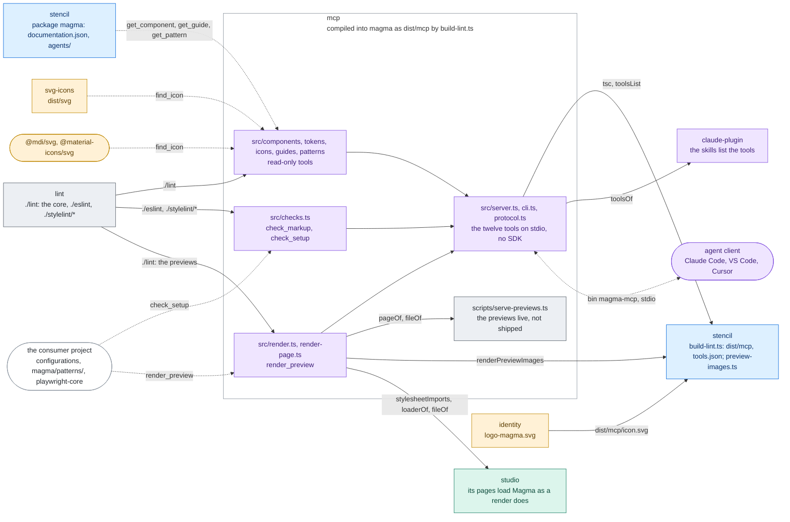

# mcp

The MCP server of Magma (`magma-mcp`, #1107): twelve tools that answer an agent's questions
from the data of the version installed in the project (the components and their usage per
framework, the tokens and the roles, the classes, the icon slugs, the sections of the guides,
the patterns, the lint on a snippet, the integration of the project, an image of the
markup). It is not published on its own: the stencil build compiles it into
`@maggioli-design-system/magma` (`dist/mcp`, by `projects/stencil/scripts/build-lint.ts`),
which runs it as its `magma-mcp` command:

| What `@maggioli-design-system/magma` ships | What |
| --- | --- |
| `magma-mcp` (bin) | the server on stdio: `dist/mcp/cli.js` |
| `./dist/mcp/tools.json` | the tools of the server as data, the answer of `tools/list`, for the documentation |
| `./dist/lint/mcp/tools.json` | the same file where the documentation site reads it today (magma-design-system/docs#1); dropped once the site reads `./dist/mcp/tools.json` |

So the server arrives with the components, at the same version, with nothing for a project
to install or keep aligned. How a project sets it up is in the consumer guide,
[`docs/agents/mcp.md`](../../docs/agents/mcp.md), shipped in the packages as `agents/mcp.md`;
the packages' `AGENTS.md` sets it up at bootstrap.

## Architecture

The tools sit on the consumer lint ([`projects/lint`](../lint/README.md)), which they reach as
any other tool does, through the exports of magma: the core (`./lint`) reads the data of the
installed version, and `check_markup` runs the rules (`./eslint`, `./stylelint/*`). The lint
never imports the server. The stencil build compiles the server into magma, so its answers
always match the components.



Rectangles: this repository; rounded boxes: outside it. Solid arrows: inside the repository;
dashed: where the package is installed. Labels: the file, export or command that crosses.
Colours: purple ai, amber assets, teal visual, blue components, grey tooling, white outside
([convention](../../docs/ARCHITECTURE.md#diagrams-of-the-projects)).

## Layout

| Folder | What |
| --- | --- |
| `src/protocol.ts` | the part of the Model Context Protocol the server speaks, written here so magma carries no SDK: JSON-RPC over stdio, `initialize`, `tools/list`, `tools/call` |
| `src/render.ts`, `src/render-page.ts` | `render_preview`: the page served from the installed packages and driven by the project's playwright-core, and the part that runs in the page (waiting, then the checks of the image) |
| `src/*.ts` | the other eleven tools, read-only (components, tokens, icons, guides, patterns, checks), the server and its command |
| `scripts/serve-previews.ts` | `nx run mcp:serve.previews`: the previews of the patterns and their drafts, served live on the page of `render_preview` ("Serving the previews"); a tool of this repository, outside `src`, so it does not ship |

**How the server reaches the lint.** The modules import `@maggioli-design-system/magma/lint`,
`/eslint` and `/stylelint/{recommended,strict}`, the exports a project uses, never a path into
`projects/lint`. Installed, `dist/mcp` has a `package.json` of its own with no name, so Node
resolves them from the `node_modules` that holds magma: the very package the server ships in,
its `dist/lint`. In this repository the `paths` of `tsconfig.json` take them to the sources
of `projects/lint`, for the tests (`resolve.tsconfigPaths` of Vitest), tsx (the stdio test,
`serve.previews`, the scripts of `claude-plugin` and `stencil` that import the server) and the
type check, so none needs a build of magma; `tsconfig.build.json` takes them to the
declarations `lint:build` writes (`projects/lint/dist`), since `tsc` compiles only what is
under `src`, and the emitted modules keep importing the exports. Nx would read those imports as
a dependency on `stencil`, the project of magma, a cycle with the build: `project.json` drops
it (`!stencil`) and names `lint` instead.

**What ships.** `dist/mcp` holds what the server runs and reads: a module per source,
`package.json` (`type: module`), `icon.svg` and `tools.json`. No declarations (nothing imports
the types of the server), no source maps, no tests, fixtures or scripts: `tsconfig.build.json`
compiles `src` only. Of it, magma exports the bin and `tools.json`.

## Where each answer comes from

The tools answer what an agent would otherwise guess, so they must not guess either.
Wherever the code has to choose (a spelling, a default, the forms of input a check accepts),
the choice is read from the source that decides it: the guide the check enforces, the
installed data, the upstream package that does the work, the specification. Each choice and
its source is written below and next to the code. An input the source does not cover answers
that it is unknown (no match, no value, an error that says why), never a default that looks
right. A new tool adds its line here, and its test runs on the real data or on the guide it
enforces, not only on fixtures picked by hand. The choices of the core the tools read the data
through, and of the patterns, are in [`projects/lint/README.md`](../lint/README.md), "Where each
answer comes from".

- **Icon slugs** (`find_icon`, the copy script of `agents/assets.md`): the slug is what
  iconsauce writes, as `mds-icon` documents, not the name of the file in the package.
  `@iconsauce/material-icons` turns the underscores of a Material folder into hyphens
  (`check_circle/baseline.svg` is `mi/baseline/check-circle`) and serves the variants
  `baseline`, `outline`, `round` and `sharp` only. The stencil build dumps every slug the
  plugins serve into `projects/stencil/src/fixtures/icons-dictionary.json`
  ([`projects/stencil/SPEC.md`](../stencil/SPEC.md), "Discovering available slugs"): the tests
  hold `find_icon` to it both ways, and run the routes of the guide
  (`projects/stencil/scripts/agent-docs-icons.spec.ts`) on a multi-word slug.
- **What `check_setup` accepts**: every way its guide documents and every file the tool
  itself loads, not one form picked among them, or the agent adds a second setup to a project
  that has one. The icon path is set where `IconsSetService` reads it: its `setSvgPath()` (or
  the one of an `mds-icon`) and the `mdsIconSvgPath` key of `sessionStorage`, and nowhere
  else; the test collects those lines from the code blocks of the guides. The lint
  configuration is the first file the tool loads: ESLint 9 `FLAT_CONFIG_FILENAMES`, then for
  Stylelint 16 the `stylelint` key of `package.json` and the search places of cosmiconfig 9.
  The MCP server is started by the file each client reads in the project: `.mcp.json`
  (`mcpServers`) or the Magma plugin in `.claude/settings.json` for Claude Code,
  `.vscode/mcp.json` (`servers`), `.cursor/mcp.json` (`mcpServers`), and for OpenCode
  `opencode.json` and `opencode.jsonc`, in the root and in `.opencode/` (`names` of its
  `ConfigDiscovery`), these read as JSONC as OpenCode reads them, with the servers where its
  `normalizeMcp` finds them: `mcp.servers` (OpenCode 2) and right under `mcp` (OpenCode 1).
  magma-mcp serves on stdio only, so an OpenCode server counts when `local` and not turned
  off (`disabled`, or `enabled: false` in OpenCode 1).
- **Token values** (`list_tokens`, `explain_class`): the value is what the CSS writes. Where the
  package records a `cssValue` (the CSS writes the quantity differently from the JSON:
  `em` letter spacing, ratios, elevations on `--depth`, design-tokens README, "Token data")
  that is the value; otherwise the DTCG value is serialised by its `$type`, as DTCG 2025.10
  defines each type and composite type (a shadow is one `[inset] x y blur spread color` layer
  per item), aliases resolved inside composites too. A type with no single CSS value
  (`typography`, `gradient`) has none, and so does a part with no serialiser: never
  `[object Object]`. The fixtures hold one token of every `$type` and shape the published
  data has, and a test runs every value of the built data when there is one.
- **What a colour paints** (`suggest_role`): each root of the `--color` namespace of the
  consumption map is classified by the CSS property Tailwind writes for it (text, border,
  background, shadow; the masks read only the alpha, no role), in a table a test holds to the
  map, so a new root fails a test instead of reading as a background. A role is matched in
  its family, `--magma-shadow-ink` for a shadow (or a fill, for a glow), and the class keeps
  the utility and the opacity of the class given.
- **The answers of `get_pattern`** (`src/patterns.ts`, on the patterns core of the lint, whose
  choices are in [`projects/lint/README.md`](../lint/README.md): the format, when a case holds,
  the layers, the files of the previews): a search by need scores the words of the need
  (`wordsOf`, as `find_component`) against the keywords (3), the title (2), the need and the
  situations (1): the keywords are the words the author chose for that need. A product layer
  that breaks the rules of a layer leaves the Magma default, with `layerErrors` saying why;
  without arguments the list carries the `layerErrors` of the whole folder, so a product checks
  its layer where it has no `check.patterns`. Each case of a pattern names the path of its
  preview, and the answer for a situation carries the stage with what to try, since that is
  the one case the agent builds and its markup is short; of the other examples of a case the
  pattern names the paths in `examples`, the answer too, and `render_preview` takes `example`.
  The preview of an answer names its two images in `images` (#1243), `<case>.light.webp` and
  `<case>.dark.webp` beside it, which the build of magma makes with `renderPreviewImages`: the
  paths only, for a client that cannot run the stage, and only the files that exist, since a
  magma built before them has none and a path to nothing would send the client after a file
  that is not there. The pattern does not repeat them on each case: they follow the path of the
  preview. The preview of a rule of a domain of the design language: `get_pattern` names its path on the
  rule and on the rules of an answer, `get_guide` lists the previews of a domain with the kind
  of each, case or rule, and `render_preview` takes `rule`, telling a rule asked as a case
  apart.
- **The rules of the design language in the answers** (`get_guide`, `get_pattern`,
  `get_component`, #1198): found where the agent already looks (#1189, "The context for the
  agents", point 2). `get_guide` serves each domain of `agents/patterns/` as a guide, named by
  its id as the patterns cite it (`rhythm/<id>`), after the guides of `agents/`, read without
  its frontmatter, the data `get_pattern` answers from; a guide of the same name would come
  first, the domain answering as `patterns/<id>`, and a test holds the ids of the domains apart
  from the names of the guides. A case names the rules it and its preview rely on in `rules`,
  `<domain>/<id>`, declared rather than derived from the markup (the choice of the maintainer
  on #1198): a rule checked by review (`step-ratio`) has no carrier a preview could show, and
  most carriers are planned. The answer for a situation gives them with their text (a
  relation's `where`, a rule's `rule`), then the rules its pattern cites from a domain in
  `always-true`, which hold for every case, each once; a citation that names nothing is left
  out, and `check.patterns`, or `layerErrors` for a product's own pattern, says why.
  `get_component` names a relation or a rule of a domain when the component carries it, built
  or planned (`carried-by`, `carried-by-planned`, whatever the attributes of the carrier), or
  when a relation writes it in `use`; not the `components` of a domain, which name what it
  speaks of, a component it says lacks a rule among them (`mds-card` in the rhythm).
- **What a render loads, and when it is ready** (`render_preview`, #1180): the page a consumer
  writes, not one of the tool's own. The stylesheets are the import block of
  `agents/assets.md`, "Import order (mandatory)", in its order and layers (a test holds
  `STYLESHEETS` to the block), each resolved from the project as Node resolves it, and left
  out when the project did not install it; the components, the lazy loader of the dist
  (`dist/magma-components`); the icons, the contract of `agents/assets.md`, served at the path
  set in `sessionStorage`, from the sets `find_icon` reads. The widths a name gives are the
  `--breakpoint-*` of the installed `typography.css`, the default `desktop`; the themes, the
  names of the installed `themes.css`: the previews `--magma-preview-<name>-wash`, which name
  every theme with the base one (`business` emits no rule, #692), then the `data-theme-name`
  values, the only names an older `themes.css` has; the mode, `prefers-color-scheme`,
  which `colors-rgb.css` and `semantic.css` follow on a page with no `data-magma-pref`. The
  classes are the ones of Tailwind (#1220): the Tailwind entry point of `agents/assets.md`,
  "Tailwind (optional)" (`TAILWIND`, held to the block by a test), compiled with the project's
  Tailwind 4 (`compile` of tailwindcss, which its PostCSS and Vite plugins call) on the tokens
  of the markup, as Tailwind scans a source, and put after the stylesheets of the consumer; a
  project without Tailwind 4 gets no rules for them, and an image whose markup has classes and
  no style element of its own reports it. The
  path of the icons and the record of `appload` are the first script of the page
  (`INIT_SCRIPT`), not an init script of the driver, so that `serve.previews` shows the very
  page; it sets the mode in the page instead (`prefMode`), as `mds-pref` does,
  `data-magma-pref` and `pref-mode-<mode>` on `<html>` (`projects/styles/SPEC.md`), since a
  browser gives a frame the `prefers-color-scheme` of the system whatever the `color-scheme`
  of the frame (Chrome 154), and a test proves the image is the one of the emulated mode, pixel
  by pixel, both ways. The page is ready when Stencil has emitted
  `appload` on window, every component defined carries the flag `styles/dist/css/hydrated.css`
  hides it by (`[hydrated]` or `.hydrated`), `document.fonts` is ready and every animation is
  finished (an infinite one paused). An image is not representative when the page reports a
  problem: a tag the loader did not define, a component without the flag, a component or an
  image displayed with no width or height (`display: none` is a choice, not a failure, and so is
  the empty box of an element whose content stands out of it by design: fixed on the viewport,
  as an `mds-toast-region` with no toast, or a dialog or a popover in its light or shadow tree,
  shown in the top layer or closed, as the window of `mds-status-bar`), a
  component with text or media whose whole box is one colour (99.8% of the pixels within 8
  levels of the most frequent one; not judged: a box hidden by `visibility: hidden`, which keeps
  the place of content that shows later, a box with another element painted over its middle
  (the window or the backdrop of an open dialog, a toast), and a box that an ancestor with an
  overflow that is not visible cuts or hides, as the last columns of a table that scrolls at a
  narrow width: the image holds a slice of it at most, and the page where the rest would be), a
  console error or an uncaught exception, a request the page cannot be served, a font family the
  text asks for with no face loaded, a word (the run between two places a line may break: a
  space, a hyphen, a dash, a slash) on more than one line, content taller than the image. An
  image is at most 2000 px a side, the cap of Claude Code (CHANGELOG 2.1.122) and of the
  Anthropic API for a request with many images, and four of them stay under the 25,000 tokens
  Claude Code allows a tool result. The driver is the
  project's playwright-core (else playwright), an optional peer of magma from 1.9, the version
  that has every call the tool makes (playwright.dev/docs/api); the browser, Chrome, then
  Edge, the channels of playwright.dev/docs/browsers, then Playwright's own Chromium. With
  `pattern` and `case` instead of markup it renders the preview Magma ships for that case
  (#1186), with `rule` the preview of a rule of a domain and with `example` another example of
  either (#1221), found under an old id of the pattern too: at the height the preview declares, the
  page an overlay needs, with no inset around a stage that declares `whole-page`, and with
  `lang="it"`, the language of the words of the previews (`docs/PATTERNS.md`), unless the call
  gives its own.
- **What the server says about itself** (the documentation site reads it from the installed
  package, magma-design-system/docs#1, #1127): the tools as `tools.json`, the very object
  `tools/list` answers (`toolsList`), which the stencil build writes from the compiled server
  into `dist/mcp/tools.json` and, until the site reads that path, into
  `dist/lint/mcp/tools.json`, where the site has read it since #1127. The tests hold
  `toolsList` to the answer of `tools/list`, and on the build both files to `toolsList` and the
  compiled server to them.

## Tests

```bash
nx run mcp:test
```

The tests run on fixtures cut from the real data, so they need no build of the other
projects. The data the lint reads too (`documentation.json`, the DTCG base set, the
consumption map) is read from `test/fixtures` of `projects/lint` (`lintFixtures` of
`test/mcp-context.ts`), never copied into the repository; the rest is here, in
`test/fixtures`: a fake installed magma (`magma/`: its `package.json`, `AGENTS.md` and
`agents/`), the globals of styles, a fixture project (`check_setup`, a product layer), the mgg
icons and a stand-in loader. The server finds the root of magma two folders above its
`documentation.json` (`magmaRoot` of the core), so `test/mcp-context.ts` puts the fake magma
together in a temporary folder, with the `documentation.json` of the lint in its `data/`, once
per test file (`magma`). `test/mcp-tools.test.ts` calls each tool, `test/mcp-stdio.test.ts` the command through
the official MCP client, which checks each result against the output schema of its tool.

Some tests need more than the fixtures: the render ones a Chrome or an Edge on the machine (the
runners of GitHub have Chrome) and the build of `styles`; the ones on the build of magma
(`render_preview` of the built `mds-button`, every preview of a case, `test/shipped.test.ts`:
the server as magma ships it, started with node from `dist/mcp`) are skipped when there is no
build, and required on CI. The `consumer-lint` job of the stencil workflow runs them, after the
tests of the lint, on the `mcp:build` of the same run and its build artifact.

## The MCP server

`src/server.ts` puts the twelve tools behind the protocol of `src/protocol.ts`; the
command, `src/cli.ts`, serves them on stdio from the project it starts in (`--root`
points elsewhere; `--documentation`, `--tokens`, `--consumption`, `--globals`,
`--icons-<set>` and `--loader`, the loader of the components `render_preview` loads, point
the data elsewhere). The server writes only protocol messages to
stdout. The icon it shows its clients is the Magma mark of identity, copied into
`dist/mcp/icon.svg` by the stencil build, which also writes the tools as data into
`dist/mcp/tools.json` (and, for the documentation site, `dist/lint/mcp/tools.json`): the answer
of `tools/list` (`toolsList`), from the compiled server.

A tool answers from data the packages ship and is read-only: one that writes says so in its
`annotations` (`render_preview`, `readOnlyHint: false`), and writes only where nothing is
committed. Add one in the file of its area, give it an `outputSchema` its result matches (the
official client checks it), register it in `toolsOf` of `src/server.ts`, test it on the
fixtures (`test/mcp-tools.test.ts`) and in the call through the official client
(`test/mcp-stdio.test.ts`), and list it in [`docs/agents/mcp.md`](../../docs/agents/mcp.md).
A result with images returns them through `withImages`: `tools/call` answers them as image
content after the text, and keeps them out of the structured content. A tool that needs a
package magma does not depend on resolves it from the project (`resolvePackage`) and, when it
is missing, says how to install it, as `check_markup` does for ESLint and `render_preview` for
playwright-core. Keep the tools few: an agent picks one by its name and description.

`render_preview` is tested on a stand-in loader (`test/fixtures/components`), whose
components hydrate, never hydrate or throw on purpose, so each problem of the report has a
test without a build; one test renders `mds-button` on the build of this repository. Both
need a Chrome or an Edge on the machine (the runners of GitHub have Chrome).

What the server lacks is learned from the agents that use it (#1137). An answer that finds
nothing for a well-formed question, or a tool that says it does not know, carries `gap`
(`GAP` of `src/context.ts`), and the instructions of the server tell the agent, then,
to propose an issue on Magma as `agents/reporting.md` describes ("A tool or an answer the
MCP server is missing"), only with the user's agreement. An input error never carries
`gap`, and neither does a weak match: the agent judges that one from the instructions.
## Serving the previews

```bash
nx run mcp:serve.previews                     # after nx run stencil:build
nx run mcp:serve.previews -- --port 5181 --previews ../another-worktree/docs/agents/patterns/previews
```

A tool of this repository (#1220), in `scripts/serve-previews.ts`, outside `src`, so it does
not ship in magma: it serves the previews of the cases (`docs/agents/patterns/previews`) and
the drafts not chosen yet (`.claude/previews/<folder>/<name>.html`, untracked) at
`http://localhost:5180/`, so that a maintainer edits a stage in the editor and sees it again
on save. What it shows is what the agents compare their markup with:

- **The page is the page of `render_preview`**: `stagePage` calls `pageOf` of
  `src/render.ts`, and the server answers every other path with `fileOf`, so the
  stylesheets, the loader, the icons and the first script are the ones a render loads, from
  the packages of the workspace (`projects/stencil/dist`, `projects/styles/dist`). The words
  are in `PREVIEW_LANG`, as for a preview a render shows.
- **The view is the one a render takes**: `mode`, `theme` and `width` in the query, checked as
  `render_preview` checks them (a breakpoint or pixels from 320 to 2000); the mode set in the
  page (`prefMode`, "What a render loads"). The frame is the viewport: as wide as the width, as
  tall as the `height` of the preview or else as its content, up to 2000 px; what to try and
  what is wrong in the file (`parsePreview`) are under it. Each stage names its file from the
  root of the checkout that holds it (`repoPath`, the nearest folder with a `.git`), as the
  explorer of the editor shows it, a link that opens it in VS Code (`vscode://file/<path>`);
  the page that shows no stage lists them all with their files.
- **The page around is a page of Magma** too: its chrome is markup with Magma components
  (`mds-link`, `mds-input-select`, `mds-table`, `mds-banner`) and Tailwind classes, served on
  `pageOf` with no inset and the mode of the system, so it has no stylesheet of its own.
- **The editor completes the classes the page compiles**: on start the server writes
  `tailwind.css` beside the drafts (`editorEntryOf`), `TAILWIND` with each import resolved to
  the file the page reads, the entry point Tailwind CSS IntelliSense maps to the stages
  (`docs/EDITOR_TOKENS.md`, "Tailwind classes").
- **A save reloads the stage**: a recursive `fs.watch` on both folders, settled for the writes
  of one save, sends server-sent events on `/events`: `change` with the key of a stage, `list`
  with every key when a stage is added or removed. The page around the stage loads the stage
  again on its own `change`, and itself on a `list`; nothing to install in the editor.

`test/serve-previews.test.ts` holds it: on the fixtures, the page of a stage equals `pageOf`
with the same options, the files are the ones of `fileOf` and nothing outside, the frame
honours the header and the view, and a save, an added and a removed stage are told; on the
build, a mode set in the page gives the image of the emulated mode both ways, and Chrome loads
a saved stage again without reloading the page around it.
