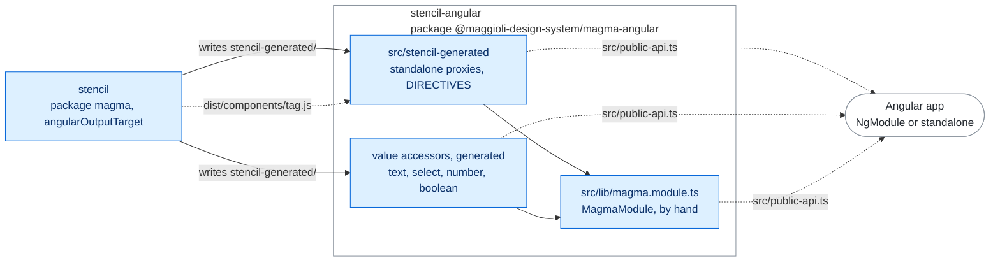

# Angular

This project was generated with [Angular CLI](https://github.com/angular/angular-cli) version 18.2.11.

It is the workspace of `@maggioli-design-system/magma-angular`: the library is `magma-angular/`,
whose README is the one published with the package.

## Architecture

The stencil build writes the proxies and the value accessors; `MagmaModule`, written by hand,
gathers them for the apps that use an NgModule, and a standalone app imports the proxies one by
one. At runtime each proxy loads the custom element of magma.

Rectangles: this repository; rounded boxes: outside it. Solid arrows: inside the repository;
dashed: where the package is installed. Labels: the file, export or command that crosses.
Colours: purple ai, amber assets, teal visual, blue components, grey tooling, white outside
([convention](../../docs/ARCHITECTURE.md#diagrams-of-the-projects)).

## Development server

Run `ng serve` for a dev server. Navigate to `http://localhost:4200/`. The application will automatically reload if you change any of the source files.

## Code scaffolding

Run `ng generate component component-name` to generate a new component. You can also use `ng generate directive|pipe|service|class|guard|interface|enum|module`.

## Build

Run `ng build` to build the project. The build artifacts will be stored in the `dist/` directory.

## Running unit tests

Run `npm test` to execute the unit tests once with [Vitest](https://vitest.dev) in jsdom, through the experimental `@angular/build:unit-test` builder of Angular 20; this is what `nx run stencil-angular:test` runs. Run `npm run test.watch` to keep Vitest in watch mode and re-run the specs on every change. The builder takes the polyfills (`zone.js`) from the `test-build` target of `angular.json`, an application target that exists only for the tests: the library build of ng-packagr has none.

The specs live in `magma-angular/src/lib/*.spec.ts` and exercise the wrapper library (module, generated proxies, `ControlValueAccessor` directives) against the Stencil build in `projects/stencil/dist`, so build `stencil` first.

## Running end-to-end tests

Run `ng e2e` to execute the end-to-end tests via a platform of your choice. To use this command, you need to first add a package that implements end-to-end testing capabilities.

## Further help

To get more help on the Angular CLI use `ng help` or go check out the [Angular CLI Overview and Command Reference](https://angular.dev/tools/cli) page.
