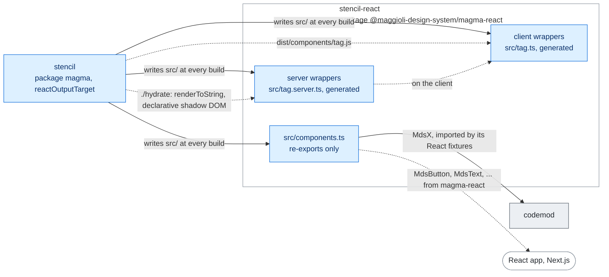

# MagmaReact

Magma React specific building blocks on top of [@maggioli-design-system/magma](https://www.npmjs.com/package/@maggioli-design-system/magma) components.

## Architecture

Every source of this package is written by the stencil build: a client wrapper per component, a
server wrapper that renders it with the hydrate module of magma, and a barrel of re-exports. The
package compiles them; at runtime the wrappers load the custom elements of magma.



Rectangles: this repository; rounded boxes: outside it. Solid arrows: inside the repository;
dashed: where the package is installed. Labels: the file, export or command that crosses.
Colours: purple ai, amber assets, teal visual, blue components, grey tooling, white outside
([convention](../../docs/ARCHITECTURE.md#diagrams-of-the-projects)).

## Install with an AI agent

This package ships an agent-readable install guide, versioned with the package. Point
your coding agent (Claude Code, etc.) at it and let it wire up styles, fonts, icons and
component registration, asking you only for what it cannot detect from your project:

> Read `node_modules/@maggioli-design-system/magma-react/AGENTS.md` and follow it to
> install Magma into this project.

The detailed steps live under `agents/` in this package.

## Compatibility

`magma-react` follows the same major version as `magma`. Use the versions of `@maggioli-design-system/design-tokens` and `@maggioli-design-system/styles` matching your magma major version:

| magma | design-tokens | styles |
| :--- | :--- | :--- |
| `1.x` (before Magma 2) | `13.x` (latest `13.7.2`) | `15.x` (latest `15.11.1`) |
| `2.0.0-alpha.0` to `2.0.0-beta.3` (prereleases) | `14.x` | `16.x` |
| `2.x` and later | `>= 15` | `>= 17` |

## Installation

Install package
```
npm i @maggioli-design-system/magma-react
```

### Icon
Set the path where the `mds-icon` component will get the svg icons inside `useEffect`: on a server `setSvgPath()` stores nothing. `IconsSetService` comes from `@maggioli-design-system/magma`, installed next to this package.

```ts
// app.js
import { useEffect } from "react";
import { IconsSetService } from "@maggioli-design-system/magma";

export default function App({
  children,
}) {
  useEffect(() => {
    IconsSetService.setSvgPath("/svg/");
  }, []);

  return <>{children}</>;
}
```

Example using Nextjs with App Router

```tsx
// client_globals_wrapper.tsx
"use client";
import { useEffect } from "react";
import { IconsSetService } from "@maggioli-design-system/magma";

export default function ClientGlobalsWrapper({
  children,
}: Readonly<{
  children: React.ReactNode;
}>) {
  useEffect(() => {
    IconsSetService.setSvgPath("/svg/");
  }, []);

  return <>{children}</>;
}
```

```ts
// app/layout.tsx

export default function RootLayout({
  children,
}: Readonly<{ children: React.ReactNode }>) {
  return (
    <html>
      <body>
        <ClientGlobalsWrapper>
          <main>{children}</main>
        </ClientGlobalsWrapper>
      </body>
    </html>
  );
}

```

## Usage Example

```tsx
import { MdsText } from '@maggioli-design-system/magma-react'


export default function Component() {
  return (
    <MdsText typography="h3">Hello World</MdsText>
  );
}
```


## Running the tests

For contributors, from the root of the [monorepo](https://github.com/magma-design-system/magma):

```
nx run stencil-react:test
```

It builds `magma` and this package, then runs the Vitest projects of `vitest.config.mts`: `browser`
(`test/*.e2e.tsx`, the client wrappers in a headless Chromium driven by Playwright; the first run
needs `npx playwright install chromium`) and `node` (`test/*.spec.ts(x)`, the `<tag>.server.js`
wrappers and the generated exports). `npm run test.watch` from `projects/stencil-react` keeps Vitest
in watch mode against the last build. Details: `projects/stencil/HOWTO.md`, section "Wrapper tests".
