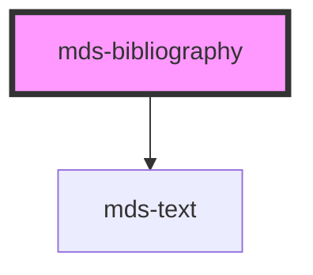

# mds-bibliography


This is a web-component from Maggioli Design System [Magma](https://magma.maggiolicloud.it), built with StencilJS, TypeScript, Storybook. It's based on the web-component standard and it's designed to be agnostic from the JavaScript framework you are using.

<!-- Auto Generated Below -->


## Usage

### 1. Description

The `<mds-bibliography>` web component renders a single citation entry formatted according to a recognized academic style. It is a presentational component that takes structured metadata (author, title, publisher, date, location, URL) and composes it into a styled, correctly-punctuated reference line, replacing the manual assembly of a bibliography string.

#### Semantic Behavior

- **Citation formatting**: The `format` prop drives the entire output - field ordering, punctuation, separators, author-name abbreviation, and date layout. Switching formats re-composes the same metadata rather than just restyling it.
- **Author parsing**: `author` is parsed, not displayed verbatim. Names are split on commas into multiple authors, first/last names are detected by position (first name first: `Mario Rossi`; the spaces around each name are ignored), and composite first or last names can be grouped with single or double quotation marks (e.g. `'Jhon Arthur' Doe`). Each author is then abbreviated per the active format (APA initials, MLA full first name).
- **Date handling**: `date` accepts an ISO string or a numeric timestamp and renders inside a semantic `<time>` element; an invalid date renders as an empty date (APA keeps empty parentheses), and month names are localized in Italian.
- **Link vs. plain title**: When both `name` and `url` are set, the title renders as a link (`target="_blank"`) carrying the `rel` value; with `name` alone it renders as plain emphasized text, and without `name` there is no title at all.
- **No slots**: Content is built entirely from props; the component does not project slotted children.

#### Properties & Visual Configurations

- **`format`** selects the citation standard (`'apa'`, `'mla'`, `'turabian'`) and is the primary behavioral switch; pick it to match the referencing convention required by the document. APA puts the date in parentheses right after the authors, MLA/Turabian place the date at the end, and each applies its own punctuation between location, publisher, and date.
- **`rel`** sets the relationship attribute applied to the generated title link (`'external'` or `'author'`); it only takes effect when the title is rendered as a hyperlink.

#### Other behavioral props

- **`typography`** and **`variant`** set the text role and styling of the rendered citation; they affect appearance only, not the citation structure.


### 2. Examples

Correct and idiomatic ways to use the `<mds-bibliography>` component, ordered from most common to most specialized. The examples assume a working knowledge of the variant / tone ladders documented in [`docs/agents/variants.md`](../../../../../../docs/agents/variants.md) and the shared component rules in [`docs/agents/conventions.md`](../../../../../../docs/agents/conventions.md).

#### Basic APA Citation (Default Format)

The default `format` is `'apa'`. Supply author, date, name, location, and publisher to produce a correctly punctuated APA reference line. APA places the date in parentheses immediately after the author list.

```html
<mds-bibliography
  author="Mario Rossi"
  date="2021-03-15"
  name="Fondamenti di diritto amministrativo"
  location="Milano"
  publisher="Maggioli Editore"
></mds-bibliography>
```

#### APA Citation With a Linked Title

When both `name` and `url` are provided the title renders as a hyperlink opening in a new tab. The `rel` prop defaults to `'external'`; change it to `'author'` only when the URL points to an author profile.

```html
<mds-bibliography
  author="Mario Rossi"
  date="2021-03-15"
  name="Fondamenti di diritto amministrativo"
  location="Milano"
  publisher="Maggioli Editore"
  url="https://www.maggioli.com/catalogo/fondamenti"
></mds-bibliography>
```

#### MLA Format

Set `format="mla"` for Modern Language Association style. The date moves to the end, after the publisher, and author names are formatted with the full first name rather than initials.

```html
<mds-bibliography
  format="mla"
  author="Mario Rossi"
  date="2021-03-15"
  name="Fondamenti di diritto amministrativo"
  location="Milano"
  publisher="Maggioli Editore"
></mds-bibliography>
```

#### Turabian Format

`format="turabian"` follows the Kate Turabian style - same field order and punctuation as MLA when a publisher is given; without a publisher, the location ends with a comma instead of a period.

```html
<mds-bibliography
  format="turabian"
  author="Mario Rossi"
  date="2021-03-15"
  name="Fondamenti di diritto amministrativo"
  location="Milano"
  publisher="Maggioli Editore"
></mds-bibliography>
```

#### Multiple Authors

Separate multiple authors with a comma, writing each name first name first; a space after the comma is fine. Composite first or last names that contain spaces must be wrapped in single or double quotation marks so the parser groups them correctly. The component joins authors with the format-appropriate separator (APA and Turabian: `&`, MLA: `e`).

```html
<!-- Two authors, both single-word first and last names -->
<mds-bibliography
  author="Mario Rossi, Luigi Verdi"
  date="2019-06-01"
  name="Gestione del territorio"
  publisher="Giuffre Editore"
></mds-bibliography>

<!-- Composite first name and composite last name -->
<mds-bibliography
  author="'Maria Grazia' Bianchi, Enrico 'De Luca'"
  date="2020-11-20"
  name="Appalti pubblici"
  publisher="Il Sole 24 Ore"
></mds-bibliography>
```

#### Date From a Numeric Timestamp

`date` accepts either an ISO date string or a numeric Unix timestamp (milliseconds as a string). The component parses both forms identically and renders the result inside a semantic `<time>` element.

```html
<!-- ISO string -->
<mds-bibliography
  author="Luca Ferrari"
  date="2018-09-10"
  name="Intelligenza artificiale e diritto"
  publisher="Giuffre Editore"
></mds-bibliography>

<!-- Numeric timestamp (milliseconds) -->
<mds-bibliography
  author="Luca Ferrari"
  date="1536537600000"
  name="Intelligenza artificiale e diritto"
  publisher="Giuffre Editore"
></mds-bibliography>
```

#### Adjusting Typography

The `typography` prop controls the text role (`'caption'`, `'detail'` [default], `'label'`, `'option'`, `'paragraph'`, `'tip'`). Use `variant` to apply a style variant inside that role. Change these when the citation must match its surrounding body copy.

```html
<!-- Use paragraph size inside a long-form article -->
<mds-bibliography
  format="apa"
  author="Francesca Conti"
  date="2022-05-18"
  name="Sociologia del lavoro pubblico"
  publisher="Laterza"
  typography="paragraph"
  variant="read"
></mds-bibliography>
```

#### Styling Customization

Style the link color through the public `--mds-bibliography-color` CSS custom property; the underline colors are not public and follow the theme. Use semantic color roles via `rgb(var(--magma-<role>))` so dark mode and high-contrast modes keep working.

```css
.riferimenti mds-bibliography {
  --mds-bibliography-color: rgb(var(--magma-accent-fg));
}
```


### 3. Mistakes

Common incorrect uses of `<mds-bibliography>`. Each entry pairs the wrong form with the right one and a one-line reason. System-wide rules (boolean-as-string, shadow piercing, Tailwind color utilities, raw native event listening) live in [`docs/agents/mistakes.md`](../../../../../../docs/agents/mistakes.md) - they apply here too but are not repeated.

#### Do Not Slot Content - The Component Has No Slots

`<mds-bibliography>` builds its output entirely from props; it has no default slot and no named slots. Any children placed inside the tag are ignored.

```html
<!-- INCORRECT -->
<mds-bibliography>
  Rossi, M. (2021). <em>Fondamenti di diritto amministrativo</em>. Maggioli Editore.
</mds-bibliography>

<!-- CORRECT -->
<mds-bibliography
  author="Mario Rossi"
  date="2021-03-15"
  name="Fondamenti di diritto amministrativo"
  publisher="Maggioli Editore"
></mds-bibliography>
```

#### Do Not Use `url` Without `name`

When `name` is absent the component renders no title element, so `url` has nowhere to attach and the hyperlink is never created. Always supply `name` together with `url`.

```html
<!-- INCORRECT -->
<mds-bibliography
  author="Giulia Bianchi"
  date="2020-06-01"
  url="https://www.maggioli.com/catalogo/appalti"
></mds-bibliography>

<!-- CORRECT -->
<mds-bibliography
  author="Giulia Bianchi"
  date="2020-06-01"
  name="Appalti pubblici: guida pratica"
  url="https://www.maggioli.com/catalogo/appalti"
></mds-bibliography>
```

#### Do Not Pass an Author Array as a JavaScript Array Literal in HTML

The `author` prop expects a plain comma-separated string. In HTML the bracket or JSON syntax is not a supported format, even where the parser happens to read it. Set from JavaScript, an array is read as one author per entry, but the prop is typed as a string: prefer the comma-separated form there too.

```html
<!-- INCORRECT -->
<mds-bibliography
  author="['Mario Rossi', 'Luigi Verdi']"
  name="Gestione del territorio"
></mds-bibliography>

<!-- CORRECT -->
<mds-bibliography
  author="Mario Rossi,Luigi Verdi"
  name="Gestione del territorio"
></mds-bibliography>
```

#### Do Not Use `rel` Without a URL

The `rel` attribute only takes effect when the title is rendered as a hyperlink (i.e. when both `name` and `url` are set). Setting `rel="author"` alone has no semantic effect and may confuse automated link checkers that scan for `rel` on anchors.

```html
<!-- INCORRECT -->
<mds-bibliography
  author="Enrico 'De Luca'"
  name="Sociologia delle organizzazioni"
  rel="author"
></mds-bibliography>

<!-- CORRECT -->
<mds-bibliography
  author="Enrico 'De Luca'"
  name="Sociologia delle organizzazioni"
  url="https://www.maggioli.com/catalogo/sociologia"
  rel="author"
></mds-bibliography>
```

#### Do Not Invent a `format` Value Outside the Three Accepted Styles

Only `'apa'`, `'mla'`, and `'turabian'` are valid. Passing an unrecognised string leaves the format branch unmatched and renders only the author portion (no date, title, location, or publisher).

```html
<!-- INCORRECT -->
<mds-bibliography
  format="chicago"
  author="Francesca Conti"
  name="Sociologia del lavoro pubblico"
></mds-bibliography>

<!-- CORRECT -->
<mds-bibliography
  format="turabian"
  author="Francesca Conti"
  name="Sociologia del lavoro pubblico"
></mds-bibliography>
```

#### Customize via Documented CSS Vars, Not Internal Selectors

The supported customization surface is the public `--mds-bibliography-color` CSS custom property. Targeting the `.link` class or other internals via shadow-piercing selectors or undocumented `::part()` names couples your code to the implementation and will break on minor releases.

```css
/* INCORRECT */
mds-bibliography >>> .link {
  color: blue;
}
mds-bibliography::part(link) {
  text-decoration: none;
}

/* CORRECT */
.sezione-riferimenti mds-bibliography {
  --mds-bibliography-color: rgb(var(--magma-accent-fg));
}
```


## Properties

| Property     | Attribute    | Description                                                                                                                                                                                                                                                                                                                                                                             | Type                                                                   | Default      |
| ------------ | ------------ | --------------------------------------------------------------------------------------------------------------------------------------------------------------------------------------------------------------------------------------------------------------------------------------------------------------------------------------------------------------------------------------- | ---------------------------------------------------------------------- | ------------ |
| `author`     | `author`     | Specifies one or more authors, as a string. First name and Last name: "Jhon Doe", you can wrap first name or last name to crop them correctly: "'Jhon Arthur' Doe", "'Jhon Arthur' 'Doe Jhonson'", and for multiple authors, separated by commas, "'Jhon Arthur' 'Doe Jhonson', 'Mike Collins', Erik 'Ross Anderson'", you can use single or double quotation marks for composite names | `string \| undefined`                                                  | `undefined`  |
| `date`       | `date`       | Specifies the date of the bibliography                                                                                                                                                                                                                                                                                                                                                  | `string \| undefined`                                                  | `undefined`  |
| `format`     | `format`     | Specifies the bibliography format to rapresent the bibliography content                                                                                                                                                                                                                                                                                                                 | `"apa" \| "mla" \| "turabian"`                                         | `'apa'`      |
| `location`   | `location`   | Specifies the location of the bibliography                                                                                                                                                                                                                                                                                                                                              | `string \| undefined`                                                  | `undefined`  |
| `name`       | `name`       | Specifies the name of the bibliography                                                                                                                                                                                                                                                                                                                                                  | `string \| undefined`                                                  | `undefined`  |
| `publisher`  | `publisher`  | Specifies the publisher of the bibliography                                                                                                                                                                                                                                                                                                                                             | `string \| undefined`                                                  | `undefined`  |
| `rel`        | `rel`        | Specifies relationship between the current document and the URL                                                                                                                                                                                                                                                                                                                         | `"author" \| "external"`                                               | `'external'` |
| `typography` | `typography` | Specifies the font typography of the element                                                                                                                                                                                                                                                                                                                                            | `"caption" \| "detail" \| "label" \| "option" \| "paragraph" \| "tip"` | `'detail'`   |
| `url`        | `url`        | Specifies the URL of the bibliography                                                                                                                                                                                                                                                                                                                                                   | `string \| undefined`                                                  | `undefined`  |
| `variant`    | `variant`    | Specifies the variant for `typography`                                                                                                                                                                                                                                                                                                                                                  | `"code" \| "info" \| "read" \| "title" \| undefined`                   | `undefined`  |


## CSS Custom Properties

| Name                                       | Description                                                          |
| ------------------------------------------ | -------------------------------------------------------------------- |
| `--mds-bibliography-color`                 | Public. Sets the text color of the component                         |
| `--mds-bibliography-text-decoration`       | Sets the text decoration color of the link                           |
| `--mds-bibliography-text-decoration-hover` | Sets the text decoration color of the link when the mouse is over it |


## Dependencies

### Depends on

- [mds-text](../mds-text)

### Graph


----------------------------------------------

Built with love @ [Gruppo Maggioli](https://www.maggioli.com) from [R&D Department](https://www.maggioli.com/it-it/chi-siamo/ricerca-sviluppo)
