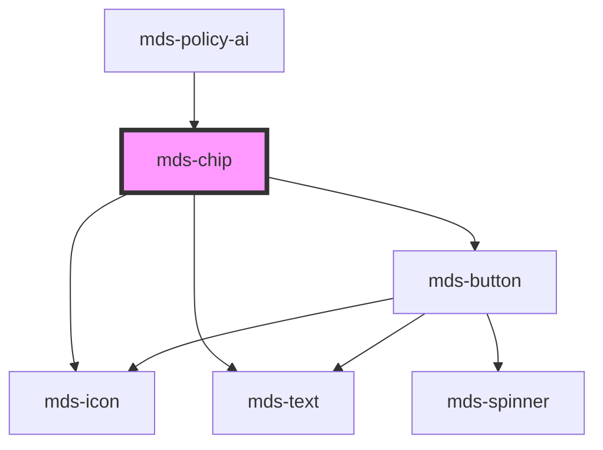

# mds-chip


This is a web-component from Maggioli Design System [Magma](https://magma.maggiolicloud.it), built with StencilJS, TypeScript, Storybook. It's based on the web-component standard and it's designed to be agnostic from the JavaScript framework you are using.

<!-- Auto Generated Below -->


## Usage

### 1. Description

The `<mds-chip>` web component is the Magma Design System's compact element for a short piece of metadata of a record: a tag, a status, a category, the value of a property. It renders the label on one line, with an optional leading icon or colour swatch and an optional delete affordance. Its interactions act on that metadata and only on it: the chip can be removed from the record that holds it (`deletable`), selected as the value of a filter or a choice (`selectable`), or opened to show the content that revolves around what it names (`clickable`), such as the office or the person a record refers to. An action of the application or of an agent (send, ask, a suggestion, a follow-up) is not a chip: it is an [`mds-button`](../../mds-button), with `truncate="none"` for a long label.

#### Semantic Behavior

- **Static by default**: With no interaction props the chip is a passive, non-focusable label; its label becomes focusable and can be activated (pointer, Enter, Space) only when `clickable` is set.
- **Selectable implies clickable**: Setting `selectable` automatically turns on `clickable`, so a selectable chip is always keyboard- and pointer-interactive.
- **Selection toggle**: When `selectable`, activating the chip flips `selected`; an unselected chip carries no `selected` attribute (rather than `selected="false"`).
- **Keyboard activation**: When interactive, Enter and Space activate the chip just like a pointer click.
- **Delete affordance**: When `deletable`, a trailing delete button is rendered with a localized title (el/en/es/it) and emits the delete event on activation.
- **Emitted events**: `mdsChipClickLabel` fires on activation for non-selectable chips, `mdsChipSelect` fires (carrying the new `selected` value) for selectable chips, and `mdsChipDelete` fires from the delete button - all carrying the originating event and host element.
- **Label is text, on one line**: Long labels do not wrap (`truncate="word"` on the inner text). The single line is the shape of the chip, a pill of fixed height, not a default to widen.
- **One leading mark**: `swatch` takes the place of `icon`; when both are set the chip draws the swatch. The swatch is decorative and hidden from assistive technologies, so the label has to name the colour.

#### Properties & Visual Configurations

The shared `variant` / `tone` ladders are defined in [`docs/agents/variants.md`](../../../../../../docs/agents/variants.md); the chip defaults to `variant="primary"` and `tone="strong"`, and accepts only the minimal `'strong'` / `'weak'` tone set. `variant` and `tone` paint the leading icon badge and the border of a selected chip; the body of the chip stays neutral for every variant.

#### Other behavioral props

- **`clickable`** opens the content that revolves around what the chip names (the office, the person, the category a record refers to): the label takes focus, keyboard and click handling and emits `mdsChipClickLabel`, and the chip keeps no state on activation. It is not for an action of the application or of an agent: that is an `mds-button`.
- **`selectable`** makes the chip a toggle whose `selected` state flips on each activation; pick it for a chip that is the value of a filter or a choice, where the visual selected state matters.
- **`selected`** drives the selected visual treatment and can be set externally to pre-select a chip; an unselected chip carries no attribute.
- **`deletable`** adds the trailing cancel button that removes the metadata from the record that holds it (a tag of an entity, an active filter); reserve it for chips the user is meant to remove.
- **`icon`** is an SVG filename slug from the Magma icon library, shown decoratively to the left of the label.
- **`swatch`** is a colour of the product, any CSS colour, drawn as a round swatch where the icon goes: for chips whose label names a colour (a family of colours, a category, a calendar). It is not a role and does not follow `variant` or the mode: the chip draws it as given, inside a ring that keeps it visible on the chip at rest and selected, in light and dark. A value that is not a colour draws the empty ring.


### 2. Examples

Correct and idiomatic ways to use the `<mds-chip>` component, ordered from most common to most specialized. The examples assume a working knowledge of the variant / tone ladders documented in [`docs/agents/variants.md`](../../../../../../docs/agents/variants.md) and the shared component rules in [`docs/agents/conventions.md`](../../../../../../docs/agents/conventions.md).

#### Static Tag (Label Only)

The simplest form. Use the required `label` prop to display a read-only tag. With no interaction props the chip is passive and non-focusable.

```html
<mds-chip label="In lavorazione" variant="warning" tone="strong"></mds-chip>
```

#### Variant and Tone for Semantic Emphasis

Pair the same `variant` with a different `tone` to express importance or category. Do not invent custom colors to dim or saturate. The variant paints the leading icon badge (and the border of a selected chip), not the body of the chip: give the chip an `icon` when its color has to carry meaning.

```html
<!-- Status chips -->
<mds-chip label="Completato" icon="mi/baseline/check-circle" variant="success" tone="strong"></mds-chip>
<mds-chip label="In attesa" icon="mi/baseline/schedule" variant="warning" tone="weak"></mds-chip>
<mds-chip label="Errore" icon="mi/baseline/error" variant="error" tone="strong"></mds-chip>

<!-- Decorative label chips -->
<mds-chip label="Natura" icon="mi/baseline/eco" variant="green" tone="weak"></mds-chip>
<mds-chip label="Tecnologia" icon="mi/baseline/computer" variant="blue" tone="strong"></mds-chip>
```

#### Chip with Leading Icon

Reference icons by their filename slug (no `.svg` extension). The icon is rendered decoratively to the left of the label inside a circular badge.

```html
<mds-chip
  label="Animali"
  icon="mi/baseline/pets"
  variant="primary"
  tone="strong"
></mds-chip>
```

#### Chip with a Colour Swatch

Use `swatch` when the label names a colour of the product: a family of colours to turn on and off, a category, a calendar. The value is the product's own, any CSS colour (`#a89586`, `rgb(47 111 208)`, `oklch(70% 0.19 50)`), not a token: the chip draws it as given in every mode, round and where the icon goes, inside a ring that keeps a colour as light or as dark as the chip visible. The swatch is hidden from assistive technologies, so the label names the colour; it takes the place of `icon`.

```html
<mds-chip label="kaolin" swatch="#9aa3ad" selectable selected></mds-chip>
<mds-chip label="fireclay" swatch="#a89586" selectable></mds-chip>
<mds-chip label="Calendario ferie" swatch="#2f6fd0" clickable></mds-chip>
```

#### Clickable Chip (Opens What It Names, No Toggle)

Use `clickable` when the chip names something that has content of its own, such as the office or the person a record refers to, and activating it opens that content (a panel, a dialog, a page) without a persistent selected state. The component adds `role="button"`, focus handling, and keyboard activation. Listen for `mdsChipClickLabel`. An action of the application or of an agent is an [`mds-button`](../../mds-button), not a clickable chip.

```html
<mds-chip
  label="Ufficio Tributi"
  clickable
  icon="mi/baseline/business"
  variant="primary"
  tone="weak"
></mds-chip>

<script>
  document.querySelector('mds-chip').addEventListener('mdsChipClickLabel', (e) => {
    openOfficePanel(e.detail.element.label);
  });
</script>
```

#### Selectable Chip (Toggle)

Use `selectable` for filter or choice chips where the visual selected state matters. `selectable` implies `clickable` automatically. Activating the chip flips `selected`; the event `mdsChipSelect` carries the new value in `e.detail.selected` (`true`, or `undefined` when deselected).

```html
<mds-chip
  label="Vegetariano"
  selectable
  icon="mi/baseline/eco"
  variant="success"
  tone="weak"
></mds-chip>

<script>
  document.querySelector('mds-chip').addEventListener('mdsChipSelect', (e) => {
    console.log('selezionato:', e.detail.selected);
  });
</script>
```

#### Pre-selected Chip

Set `selected` externally to initialize a selectable chip in the selected state (e.g. when restoring saved filter state). An unselected chip carries no `selected` attribute.

```html
<mds-chip
  label="Urgente"
  selectable
  selected
  variant="error"
  tone="strong"
></mds-chip>
```

#### Deletable Chip (Removable Token)

Use `deletable` for chips the user is meant to remove from the record that holds them - for example tags on an entity or active filters. A trailing cancel button emits `mdsChipDelete` on activation.

```html
<mds-chip
  label="Mario Rossi"
  deletable
  icon="mi/baseline/person"
  variant="primary"
  tone="weak"
></mds-chip>

<script>
  document.querySelector('mds-chip').addEventListener('mdsChipDelete', (e) => {
    e.detail.element.remove();
  });
</script>
```

#### Fully Interactive Chip

Combine `clickable` (or `selectable`) with `deletable` for chips that can both be opened (or selected) and removed independently, such as a tag that opens the records it groups and can be taken off this one.

```html
<mds-chip
  label="Sport invernali"
  clickable
  deletable
  icon="mi/baseline/downhill-skiing"
  variant="info"
  tone="weak"
></mds-chip>
```

#### Disabled Chip

Set `disabled` to dim the chip and block it: a clickable label leaves the tab order and takes `aria-disabled="true"`, the delete button is disabled, and neither the pointer nor the keyboard fires an event. The prop is reflected, so setting it from code styles the chip too. Do not use `disabled="false"` - remove the attribute to re-enable.

```html
<mds-chip
  label="Non disponibile"
  disabled
  variant="dark"
  tone="strong"
></mds-chip>
```

#### Styling Customization

Style the chip only through its public `--mds-chip-*` CSS custom properties. Set them on the host or a parent selector; use the semantic color roles via `rgb(var(--magma-<role>))` so dark mode, named themes and high contrast keep working. When `selected` is set the component swaps each property for a selected value of its own, which is not public. A property set on the host from outside wins over that swap: scope the resting values to `:not([selected])`, and set the same public properties on `[selected]` to restyle the selected state.

```css
.filtri-categoria mds-chip:not([selected]) {
  --mds-chip-background: rgb(var(--magma-accent-surface));
  --mds-chip-color: rgb(var(--magma-accent-fg));
}

.filtri-categoria mds-chip[selected] {
  --mds-chip-background: rgb(var(--magma-accent-emphasis));
  --mds-chip-color: rgb(var(--magma-accent-on-emphasis));
}
```


### 3. Mistakes

Common incorrect uses of `<mds-chip>`. Each entry pairs the wrong form with the right one and a one-line reason. System-wide rules (boolean-as-string, shadow piercing, Tailwind color utilities, raw native event listening) live in [`docs/agents/mistakes.md`](../../../../../../docs/agents/mistakes.md) - they apply here too but are not repeated.

#### Do Not Use a Clickable Chip Without `clickable` or `selectable`

Without `clickable`, the chip has no `role`, no focus management, and no keyboard activation. Listening for click events on a static chip is a silent accessibility failure.

```html
<!-- INCORRECT -->
<mds-chip label="Ufficio Tributi" variant="primary" onclick="openOfficePanel()"></mds-chip>

<!-- CORRECT -->
<mds-chip label="Ufficio Tributi" clickable variant="primary"></mds-chip>
<script>
  document.querySelector('mds-chip').addEventListener('mdsChipClickLabel', openOfficePanel);
</script>
```

#### Do Not Use `selected` Without `selectable`

`selected` only has visual and semantic meaning when `selectable` is also set. On a non-selectable chip the attribute renders the selected style but the selection can never be toggled and no event fires, misleading users.

```html
<!-- INCORRECT -->
<mds-chip label="Attivo" selected variant="success"></mds-chip>

<!-- CORRECT -->
<mds-chip label="Attivo" selectable selected variant="success"></mds-chip>
```

#### Do Not Apply `tone` Values Outside the Minimal Ladder

`mds-chip` accepts only `ToneMinimalVariantType`: `strong` and `weak`. Passing `outline`, `text`, or `box` is invalid: no style matches it, so the chip silently loses its variant colors.

```html
<!-- INCORRECT -->
<mds-chip label="Categoria" tone="outline" variant="primary"></mds-chip>
<mds-chip label="Categoria" tone="text" variant="primary"></mds-chip>

<!-- CORRECT -->
<mds-chip label="Categoria" tone="weak" variant="primary"></mds-chip>
<mds-chip label="Categoria" tone="strong" variant="primary"></mds-chip>
```

#### Do Not Slot Content Into the Chip

`<mds-chip>` has no default or named slots - all content is driven by props (`label`, `icon`, `swatch`, `deletable`). Slotting HTML children is ignored by the Shadow DOM.

```html
<!-- INCORRECT -->
<mds-chip>
  <span>Etichetta</span>
  <mds-icon name="mi/baseline/close"></mds-icon>
</mds-chip>

<!-- CORRECT -->
<mds-chip
  label="Etichetta"
  icon="mi/baseline/pets"
  deletable
  variant="primary"
></mds-chip>
```

#### Do Not Draw a Colour Through the Icon

A circle icon painted with the colour, or the markup of an `<svg>` given to `icon`, sits on the disc of the icon, has no ring to keep a colour as light or as dark as the chip visible, and leans on custom properties that are not public. Give the colour to `swatch`.

```html
<!-- INCORRECT -->
<mds-chip label="fireclay" icon="mdi/circle" style="--mds-chip-icon-color: #a89586"></mds-chip>

<!-- CORRECT -->
<mds-chip label="fireclay" swatch="#a89586"></mds-chip>
```

#### Do Not Say a State With a Swatch

The swatch draws its colour as given: a status painted there does not follow the mode, the named theme or the contrast preference as a variant does, and, hidden from assistive technologies, it adds nothing a screen reader hears. Say a status with `variant` and an icon; keep `swatch` for a colour the label names.

```html
<!-- INCORRECT -->
<mds-chip label="Errore" swatch="#d32f2f"></mds-chip>

<!-- CORRECT -->
<mds-chip label="Errore" icon="mi/baseline/error" variant="error" tone="strong"></mds-chip>
```

#### Do Not Pierce Shadow DOM to Style the Delete Button

The inner `mds-button` used for the delete affordance is a Shadow DOM implementation detail with no styling API of its own: targeting it with `>>>` or undocumented `::part()` names will break on minor releases. Restyle the chip and its leading icon through the public `--mds-chip-*` properties.

```css
/* INCORRECT */
mds-chip >>> .button-delete {
  color: red;
}

/* CORRECT */
mds-chip {
  --mds-chip-icon-background: rgb(var(--magma-danger-emphasis));
}
```

#### Do Not Forget to Remove `await`-Pattern Analogue: Removing `selected` by Setting It to `false`

With `selected="false"` the component reads the prop as `false` and drops the attribute when it renders, but until then the attribute is in the DOM and attribute selectors (`mds-chip[selected]`) match it. Remove the attribute; from JavaScript both `false` and `undefined` deselect the chip (the component turns `false` into `undefined` and drops the attribute).

```html
<!-- INCORRECT -->
<mds-chip label="Filtro" selectable selected="false" variant="primary"></mds-chip>

<!-- CORRECT -->
<mds-chip label="Filtro" selectable variant="primary"></mds-chip>
```

#### Do Not Use a Chip for an Action or a Suggestion

A chip shows a piece of metadata of a record, and its interactions act on that metadata only: removing it, selecting it as the value of a filter, opening the content that revolves around what it names. An action of the application or of an agent - send, ask, a suggested prompt, the follow-up of an AI answer - is not metadata: in a chip it reads as a tag of the record, and its label is cut to the one line of the pill. Use [`mds-button`](../../mds-button); with `truncate="none"` a long label wraps instead of being cut.

```html
<!-- INCORRECT -->
<mds-chip label="Apri dettagli" clickable icon="mi/baseline/open-in-new"></mds-chip>
<mds-chip label="Riassumi la pratica in tre punti" clickable variant="ai"></mds-chip>

<!-- CORRECT -->
<mds-button
  label="Apri dettagli"
  icon="mi/baseline/open-in-new"
  type="button"
  variant="primary"
  tone="weak"
></mds-button>
<mds-button
  label="Riassumi la pratica in tre punti"
  type="button"
  truncate="none"
  variant="ai"
  tone="weak"
></mds-button>
```

#### Do Not Use `<mds-chip>` as a Navigation Link

`<mds-chip>` has no `href` prop. Wrapping it in an `<a>` creates a nested interactive element, breaks keyboard semantics, and fails accessibility audits. Use [`mds-button`](../../mds-button) with `href` instead.

```html
<!-- INCORRECT -->
<a href="/categoria/sport">
  <mds-chip label="Sport" variant="primary"></mds-chip>
</a>

<!-- CORRECT -->
<mds-button
  label="Sport"
  href="/categoria/sport"
  variant="primary"
  tone="weak"
></mds-button>
```


## Properties

| Property             | Attribute    | Description                                                                                                                                                                                                                                                                                                                                                                                                                                                                                                                               | Type                                                                                                                                                                                                                                          | Default     |
| -------------------- | ------------ | ----------------------------------------------------------------------------------------------------------------------------------------------------------------------------------------------------------------------------------------------------------------------------------------------------------------------------------------------------------------------------------------------------------------------------------------------------------------------------------------------------------------------------------------- | --------------------------------------------------------------------------------------------------------------------------------------------------------------------------------------------------------------------------------------------- | ----------- |
| `clickable`          | `clickable`  | Opens the content that revolves around what the chip names, such as the office or the person a record refers to: the label becomes a focusable button that the pointer, Enter and Space activate, and it emits `mdsChipClickLabel`. Not for an action of the application or of an agent (send, ask, a suggestion): that is an `mds-button`.                                                                                                                                                                                               | `boolean \| undefined`                                                                                                                                                                                                                        | `undefined` |
| `deletable`          | `deletable`  | Shows the cross icon to perform cancel/delete action on element                                                                                                                                                                                                                                                                                                                                                                                                                                                                           | `boolean \| undefined`                                                                                                                                                                                                                        | `undefined` |
| `disabled`           | `disabled`   | Sets the component disabled status: neither the label nor the delete button can be focused or activated                                                                                                                                                                                                                                                                                                                                                                                                                                   | `boolean \| undefined`                                                                                                                                                                                                                        | `false`     |
| `icon`               | `icon`       | The icon displayed to the left of the component's label                                                                                                                                                                                                                                                                                                                                                                                                                                                                                   | `string \| undefined`                                                                                                                                                                                                                         | `undefined` |
| `label` _(required)_ | `label`      | The label displayed to the right of the component's icon                                                                                                                                                                                                                                                                                                                                                                                                                                                                                  | `string`                                                                                                                                                                                                                                      | `undefined` |
| `selectable`         | `selectable` | Sets if the component change is status to selected when is clicked                                                                                                                                                                                                                                                                                                                                                                                                                                                                        | `boolean \| undefined`                                                                                                                                                                                                                        | `false`     |
| `selected`           | `selected`   | Sets the component selected                                                                                                                                                                                                                                                                                                                                                                                                                                                                                                               | `boolean \| undefined`                                                                                                                                                                                                                        | `undefined` |
| `swatch`             | `swatch`     | A colour drawn as a round swatch where the icon goes, in place of `icon`: any CSS colour (`#2f6fd0`, `rgb(47 111 208)`, `oklch(55% 0.2 260)`). It is a value of the product, the colour the label names (a family of colours, a category, a calendar), not a role of Magma: the chip draws it as it is given in every mode and theme, inside a ring that keeps it visible on the chip, at rest and selected. Decorative: hidden from assistive technologies, since the label names it. A value that is not a colour draws the empty ring. | `string \| undefined`                                                                                                                                                                                                                         | `undefined` |
| `tone`               | `tone`       | Sets the color variant tone of the component                                                                                                                                                                                                                                                                                                                                                                                                                                                                                              | `"strong" \| "weak" \| undefined`                                                                                                                                                                                                             | `'strong'`  |
| `variant`            | `variant`    | Sets the color variant of the component                                                                                                                                                                                                                                                                                                                                                                                                                                                                                                   | `"ai" \| "amaranth" \| "aqua" \| "blue" \| "dark" \| "error" \| "green" \| "info" \| "lime" \| "orange" \| "orchid" \| "primary" \| "purple" \| "red" \| "secondary" \| "sky" \| "success" \| "violet" \| "warning" \| "yellow" \| undefined` | `'primary'` |


## Events

| Event               | Description                                                                                  | Type                        |
| ------------------- | -------------------------------------------------------------------------------------------- | --------------------------- |
| `mdsChipClickLabel` | Emits when the component's label is clicked                                                  | `CustomEvent<MdsChipEvent>` |
| `mdsChipDelete`     | Emits when the component's delete button is clicked                                          | `CustomEvent<MdsChipEvent>` |
| `mdsChipSelect`     | Emits when the component's label is clicked and when `selectable` attribute is set to `true` | `CustomEvent<MdsChipEvent>` |


## CSS Custom Properties

| Name                                  | Description                                                            |
| ------------------------------------- | ---------------------------------------------------------------------- |
| `--mds-chip-background`               | Public. Sets the `background-color` of the component                   |
| `--mds-chip-background-selected`      | Sets the `background-color` of the component when it's selected        |
| `--mds-chip-border`                   | Sets the `border-color` of the component                               |
| `--mds-chip-border-selected`          | Sets the `border-color` of the component when it's selected            |
| `--mds-chip-color`                    | Public. Sets the `color` of the component                              |
| `--mds-chip-color-selected`           | Sets the `color` of the component when it's selected                   |
| `--mds-chip-icon-background`          | Public. Sets the `background-color` of the icon                        |
| `--mds-chip-icon-background-selected` | Sets the `background-color` of the icon when the component is selected |
| `--mds-chip-icon-color`               | Sets the `fill` color of the icon of the component                     |
| `--mds-chip-icon-color-selected`      | Sets the `fill` color of the icon of the component when it's selected  |
| `--mds-chip-opacity-disabled`         | Sets the `opacity` of the component when it's disabled                 |
| `--mds-chip-shadow`                   | Public. Sets the `box-shadow` of the component                         |
| `--mds-chip-shadow-selected`          | Sets the `box-shadow` of the component when it's selected              |


## Dependencies

### Used by

 - [mds-policy-ai](../mds-policy-ai)

### Depends on

- [mds-icon](../mds-icon)
- [mds-text](../mds-text)
- [mds-button](../mds-button)

### Graph


----------------------------------------------

Built with love @ [Gruppo Maggioli](https://www.maggioli.com) from [R&D Department](https://www.maggioli.com/it-it/chi-siamo/ricerca-sviluppo)
