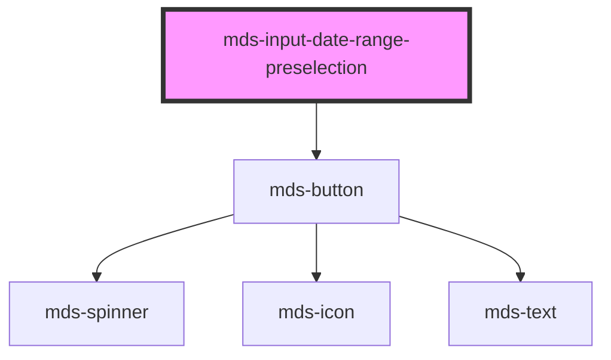

# mds-input-date-range-preselection


<!-- Auto Generated Below -->


## Usage

### 1. Description

The `<mds-input-date-range-preselection>` web component is a compound child of [`<mds-input-date-range>`](../../mds-input-date-range). It renders a clickable shortcut button (a quick range like "Last 7 days" or "This month") that, when activated, fills the parent's date range with a predefined `start`/`end` pair instead of requiring the user to pick dates manually on the calendar.

#### Semantic Behavior

- **Compound child**: Placed as a direct child of `<mds-input-date-range>`, it assigns itself to the parent's `calendar-preselection` slot. A `slot` set by the author is kept, so it can also sit in the `preselection` slot of [`<mds-calendar>`](../../mds-calendar): there it applies nothing itself, and its click reaches the page, which sets the range.
- **Click drives the parent**: On click it applies its `start`/`end` range to the parent, which populates and validates the range, syncs the form value, emits the parent's `mdsInputDateRangeValueChange` if the range changed, and closes the dropdown after the parent's `delay` (unless it is `0`).
- **Selection is parent-managed**: Choosing one preselection clears the active state on its siblings and marks the active one; the parent also re-marks a preselection as selected when the range changes to match its dates (including single-day matches where `end` is undefined); a range set at first load is not matched until it changes or the user leaves the component.

#### Properties & Visual Configurations

- **`start`** (required) and **`end`**: Define the ISO date range this shortcut applies. Provide both for a true range; omit `end` to express a single-day preselection.
- **`selected`**: Reflects whether this preselection is currently the active one. Treat it as read-only in normal use - the parent sets it; do not hand-toggle it to drive selection.

The default slot holds the human-readable label. Visual states (default, hover, selected) follow the theme: the component has no public CSS custom property and does not expose `variant`/`tone` props of its own.


### 2. Examples

Correct and idiomatic ways to use the `<mds-input-date-range-preselection>` component, ordered from most common to most specialized. The examples assume a working knowledge of the shared component rules in [`docs/agents/conventions.md`](../../../../../../docs/agents/conventions.md).

#### Basic Preset Range Shortcuts

Place one or more `<mds-input-date-range-preselection>` elements as direct children of [`<mds-input-date-range>`](../../mds-input-date-range). Each element needs a `start` date (ISO format) and a human-readable label in its default slot. The component auto-assigns itself to the parent's `calendar-preselection` slot.

```html
<mds-input-date-range name="periodo">
  <mds-input-date slot="start"></mds-input-date>
  <mds-input-date slot="end"></mds-input-date>
  <mds-input-date-range-preselection start="2025-06-01" end="2025-06-30">
    Questo mese
  </mds-input-date-range-preselection>
  <mds-input-date-range-preselection start="2025-05-01" end="2025-05-31">
    Mese scorso
  </mds-input-date-range-preselection>
  <mds-input-date-range-preselection start="2025-01-01" end="2025-12-31">
    Anno corrente
  </mds-input-date-range-preselection>
</mds-input-date-range>
```

#### Single-Day Shortcut (omit `end`)

Omit the `end` attribute to create a single-day preselection. The parent matches it as active whenever its current range is a single day equal to `start`.

```html
<mds-input-date-range name="data-singola">
  <mds-input-date slot="start"></mds-input-date>
  <mds-input-date slot="end"></mds-input-date>
  <mds-input-date-range-preselection start="2025-06-05">
    Oggi
  </mds-input-date-range-preselection>
</mds-input-date-range>
```

#### Multiple Preset Windows Together

Group semantically related shortcuts - short-term, medium-term, and long-term - so users can jump to the most common reporting windows without picking the dates on the calendar (the presets sit in the calendar dropdown, next to the calendar). Only one item carries `selected` at a time; the parent manages it automatically.

```html
<mds-input-date-range name="finestra-report">
  <mds-input-date slot="start"></mds-input-date>
  <mds-input-date slot="end"></mds-input-date>
  <mds-input-date-range-preselection start="2025-05-29" end="2025-06-04">
    Ultima settimana
  </mds-input-date-range-preselection>
  <mds-input-date-range-preselection start="2025-05-01" end="2025-05-31">
    Ultimo mese
  </mds-input-date-range-preselection>
  <mds-input-date-range-preselection start="2025-01-01" end="2025-06-30">
    Ultimo semestre
  </mds-input-date-range-preselection>
  <mds-input-date-range-preselection start="2024-01-01" end="2024-12-31">
    Anno precedente
  </mds-input-date-range-preselection>
</mds-input-date-range>
```

#### Reading the Selected Value via Parent Events

Listen to the parent's `mdsInputDateRangeValueChange` event to read the chosen range. The preselection component itself fires no event - the parent owns the value contract.

```html
<mds-input-date-range id="date-range" name="periodo">
  <mds-input-date slot="start"></mds-input-date>
  <mds-input-date slot="end"></mds-input-date>
  <mds-input-date-range-preselection start="2025-06-01" end="2025-06-30">
    Questo mese
  </mds-input-date-range-preselection>
</mds-input-date-range>

<script>
  document.getElementById('date-range').addEventListener('mdsInputDateRangeValueChange', (e) => {
    console.log(e.detail.startDate, e.detail.endDate);
  });
</script>
```

#### Styling Customization

`<mds-input-date-range-preselection>` has no public CSS custom property and no shadow part: it paints its three visual states - default, hover, and selected - from the semantic color roles ([`docs/agents/color.md`](../../../../../../docs/agents/color.md)), so dark mode and themes keep working without overrides. The parent marks the active shortcut with `selected`; do not restyle the states by hand.


### 3. Mistakes

Common incorrect uses of `<mds-input-date-range-preselection>`. Each entry pairs the wrong form with the right one and a one-line reason. System-wide rules (boolean-as-string, shadow piercing, Tailwind color utilities, raw native event listening) live in [`docs/agents/mistakes.md`](../../../../../../docs/agents/mistakes.md) - they apply here too but are not repeated.

#### Do Not Use Outside `<mds-input-date-range>`

The component applies its range only as a direct child of [`<mds-input-date-range>`](../../mds-input-date-range). Used standalone it renders a button that applies nothing: `closest('mds-input-date-range')` returns null, and the click only reaches the listeners of the page.

```html
<!-- INCORRECT -->
<mds-input-date-range-preselection start="2025-06-01" end="2025-06-30">
  Questo mese
</mds-input-date-range-preselection>

<!-- CORRECT -->
<mds-input-date-range name="periodo">
  <mds-input-date slot="start"></mds-input-date>
  <mds-input-date slot="end"></mds-input-date>
  <mds-input-date-range-preselection start="2025-06-01" end="2025-06-30">
    Questo mese
  </mds-input-date-range-preselection>
</mds-input-date-range>
```

#### Do Not Set `selected` Manually to Drive Selection

`selected` is a read-only output attribute managed entirely by the parent. Setting it by hand does not apply the range, does not clear sibling active states, and will be overwritten by the parent on the next range change.

```html
<!-- INCORRECT -->
<mds-input-date-range name="periodo">
  <mds-input-date slot="start"></mds-input-date>
  <mds-input-date slot="end"></mds-input-date>
  <mds-input-date-range-preselection start="2025-06-01" end="2025-06-30" selected>
    Questo mese
  </mds-input-date-range-preselection>
</mds-input-date-range>

<!-- CORRECT: set the range on the parent; it marks the matching preset when the range changes -->
<mds-input-date-range name="periodo" start-date="2025-06-01" end-date="2025-06-30">
  <mds-input-date slot="start"></mds-input-date>
  <mds-input-date slot="end"></mds-input-date>
  <mds-input-date-range-preselection start="2025-06-01" end="2025-06-30">
    Questo mese
  </mds-input-date-range-preselection>
</mds-input-date-range>
```

#### Do Not Set `selected` as a Boolean String

`selected` is a boolean attribute: remove it to deselect the item - but again, prefer letting the parent control it. A string value is fragile: `"false"` is read as `false` on this component, but the attribute stays on the element until the component renders (attribute selectors and scripts reading it see it set). Never write a boolean as a string.

```html
<!-- INCORRECT -->
<mds-input-date-range name="periodo">
  <mds-input-date slot="start"></mds-input-date>
  <mds-input-date slot="end"></mds-input-date>
  <mds-input-date-range-preselection start="2025-06-01" end="2025-06-30" selected="false">
    Questo mese
  </mds-input-date-range-preselection>
</mds-input-date-range>

<!-- CORRECT: remove the attribute entirely -->
<mds-input-date-range name="periodo">
  <mds-input-date slot="start"></mds-input-date>
  <mds-input-date slot="end"></mds-input-date>
  <mds-input-date-range-preselection start="2025-06-01" end="2025-06-30">
    Questo mese
  </mds-input-date-range-preselection>
</mds-input-date-range>
```

#### Do Not Use HTML in the Default Slot

The default slot is the plain-text label read by the internal `<mds-button>`. Placing HTML elements inside it breaks button layout and may be stripped by the shadow DOM projection.

```html
<!-- INCORRECT -->
<mds-input-date-range name="periodo">
  <mds-input-date slot="start"></mds-input-date>
  <mds-input-date slot="end"></mds-input-date>
  <mds-input-date-range-preselection start="2025-06-01" end="2025-06-30">
    <strong>Questo mese</strong>
    <small>(giu)</small>
  </mds-input-date-range-preselection>
</mds-input-date-range>

<!-- CORRECT -->
<mds-input-date-range name="periodo">
  <mds-input-date slot="start"></mds-input-date>
  <mds-input-date slot="end"></mds-input-date>
  <mds-input-date-range-preselection start="2025-06-01" end="2025-06-30">
    Questo mese (giu)
  </mds-input-date-range-preselection>
</mds-input-date-range>
```

#### Do Not Provide Only the `end` Date Without `start`

`start` is a required prop; omitting it leaves the component without a valid range anchor and the parent cannot apply any preselection. `end` is optional and meaningful only together with `start`.

```html
<!-- INCORRECT -->
<mds-input-date-range name="periodo">
  <mds-input-date slot="start"></mds-input-date>
  <mds-input-date slot="end"></mds-input-date>
  <mds-input-date-range-preselection end="2025-06-30">
    Fine mese
  </mds-input-date-range-preselection>
</mds-input-date-range>

<!-- CORRECT -->
<mds-input-date-range name="periodo">
  <mds-input-date slot="start"></mds-input-date>
  <mds-input-date slot="end"></mds-input-date>
  <mds-input-date-range-preselection start="2025-06-01" end="2025-06-30">
    Questo mese
  </mds-input-date-range-preselection>
</mds-input-date-range>
```

#### Do Not Customize via Undocumented Shadow Parts or Internal Selectors

The component has no public CSS custom property and no shadow part: its three visual states come from the semantic color roles and the `selected` state the parent sets. Targeting the inner `mds-button` or its shadow internals couples your code to implementation details that can change without notice.

```css
/* INCORRECT */
mds-input-date-range-preselection .action {
  background: blue;
}
mds-input-date-range-preselection::part(button) {
  border-radius: 0;
}
```

```html
<!-- CORRECT: no override, the states follow the theme and the parent sets selected -->
<mds-input-date-range name="periodo">
  <mds-input-date slot="start"></mds-input-date>
  <mds-input-date slot="end"></mds-input-date>
  <mds-input-date-range-preselection start="2025-06-01" end="2025-06-30">
    Questo mese
  </mds-input-date-range-preselection>
</mds-input-date-range>
```


## Properties

| Property             | Attribute  | Description                             | Type                   | Default     |
| -------------------- | ---------- | --------------------------------------- | ---------------------- | ----------- |
| `end`                | `end`      | Sets the end date of the preselection   | `string \| undefined`  | `undefined` |
| `selected`           | `selected` | Sets the preselection date range        | `boolean \| undefined` | `undefined` |
| `start` _(required)_ | `start`    | Sets the start date of the preselection | `string`               | `undefined` |


## Slots

| Slot | Description                                                                                                                                                                                             |
| ---- | ------------------------------------------------------------------------------------------------------------------------------------------------------------------------------------------------------- |
|      | Add the `text string` of the preselection, as `Last 7 days`: it becomes the label of the button that applies the range. **Avoid** `HTML elements` or `components`, which end up inside an `mds-button`. |


## CSS Custom Properties

| Name                                                | Description                                                     |
| --------------------------------------------------- | --------------------------------------------------------------- |
| `--mds-date-range-preselection-default-background`  | Background used for the default (unselected) preselection state |
| `--mds-date-range-preselection-default-border`      | Border color used for the default preselection state            |
| `--mds-date-range-preselection-default-color`       | Text color used in the default preselection state               |
| `--mds-date-range-preselection-hover-background`    | Background used when a preselection item is hovered             |
| `--mds-date-range-preselection-hover-border`        | Border color used on hover state                                |
| `--mds-date-range-preselection-hover-color`         | Text color used on hover state                                  |
| `--mds-date-range-preselection-selected-background` | Background used for the selected preselection state             |
| `--mds-date-range-preselection-selected-border`     | Border color used for the selected preselection state           |
| `--mds-date-range-preselection-selected-color`      | Text color used in the selected preselection state              |


## Dependencies

### Depends on

- [mds-button](../mds-button)

### Graph


----------------------------------------------

Built with love @ [Gruppo Maggioli](https://www.maggioli.com) from [R&D Department](https://www.maggioli.com/it-it/chi-siamo/ricerca-sviluppo)
