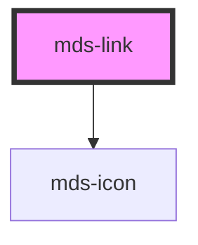

# mds-link

<!-- Auto Generated Below -->


## Usage

### 1. Description

The `<mds-link>` web component is the inline link of Magma: a word or a phrase inside running text, usually inside an `<mds-text>`, that opens a URL or runs an inline action. It replaces a raw `<a>` styled by hand, so links look and behave the same in every app, focus ring included.

#### Semantic Behavior

- **A word of the sentence**: the host is inline and has no typography of its own. It takes the font of the text around it (family, size, weight, line height, letter spacing), whatever the `typography` of the `<mds-text>` it sits in, and wraps across lines with the rest of the text.
- **A real anchor with `href`**: the link is an `<a href>` in the shadow root, and it is the element that takes the focus. The browser gives it what it gives every link: a new tab on a modifier or middle click, the context menu, drag. A click listener on the host can cancel the navigation with `preventDefault()`, and a client-side router registered with `NavigationService.setHandler()` (from `@maggioli-design-system/magma/services`) takes the plain clicks over. A `click()` from a script follows the link too, unless a listener cancels it.
- **An inline button without `href`**: the link becomes an element with `role="button"` in the tab order; a click, Enter and Space each fire one native `click` on the host. It never submits the form it sits in. It is not a native `<button>`, which cannot wrap across lines.
- **New tab**: `target="blank"` opens the URL in a new tab without giving it access to the page (`rel="noopener noreferrer"`) and adds a hidden "(opens in a new tab)", in the language of the page, to the name the assistive technology reads. No icon is added: pick one with `icon` if the design wants it.
- **Icon**: `icon` draws an icon, hidden from the assistive technology, sized on a step of the spacing scale, the same in every typography. It stays on the line of the word next to it: it never wraps to a line of its own.
- **Underline always visible**: the underline is what tells the link from the text without its color (WCAG 1.4.1), so every style keeps one, and its weight never changes. Under the pointer every link fills with a faint background that rises from the bottom, and a `weak` one also gives its line the whole color; under high contrast the tints take the full color.

#### Properties & Visual Configurations

- **`href`** decides what the link is: with it, a link to a page; without it, an inline action that the host's `click` listener runs. Navigation always goes through `href`, never through a click handler that changes the location.
- **`label`** sets the text of the link; without it the link shows its default slot, which is the usual form in running text.
- **`variant`** sets the color: `primary` (the default) paints the link with the accent, the color of links and actions on a neutral surface; `inherit` takes the color of the text around it, for a link on a colored surface (a status message, a filled banner), where the accent would lose contrast.
- **`underline`** sets the style of the underline:
  - `solid` (the default): a thin line;
  - `dotted`: a dotted line;
  - `marker`: a tinted band under the text, lighter with `weak`, which rises under the pointer to fill the line like a highlighter, with the same faint background in both tones.
- **`tone`** sets how much of the color the line takes: `strong` (the default) the whole color; `weak` a light tint of it, which steps back in a text dense with links and takes the whole color under the pointer. The text of the link keeps the whole color in both tones.
- **`icon-position`** puts the icon after the text (`right`, the default: an external link, a download, a forward arrow) or before it (`left`: a back arrow).


### 2. Examples

Correct and idiomatic ways to use the `<mds-link>` component, ordered from most common to most specialized. The examples assume a working knowledge of the shared component rules in [`docs/agents/conventions.md`](../../../../../../docs/agents/conventions.md).

#### A Link Inside a Sentence

The canonical form: the link sits in the default slot of an `<mds-text>`, with its text in its own default slot, and takes the font of the paragraph.

```html
<mds-text typography="paragraph">
  Leggi l'<mds-link href="/privacy">informativa sulla privacy</mds-link> prima di continuare.
</mds-text>
```

#### Any Typography

The link has no typography of its own: the same markup works in a caption, a title or the reading variant.

```html
<mds-text typography="caption">
  Fonte: <mds-link href="/report">rapporto annuale 2025</mds-link>
</mds-text>
<mds-text typography="paragraph" variant="read">
  Il testo completo e' nell'<mds-link href="/regolamento">allegato A</mds-link>.
</mds-text>
```

#### An Inline Action

Without `href` the link is an inline button: listen for `click` on the host, which a click, Enter and Space all fire.

```html
<mds-text typography="paragraph">
  Non trovi quello che cerchi? <mds-link id="help">Chiedi aiuto</mds-link> al supporto.
</mds-text>

<script>
  document.getElementById('help').addEventListener('click', () => openHelp());
</script>
```

#### A Link That Opens a New Tab

With `target="blank"` the component adds `rel="noopener noreferrer"` and tells the assistive technology the link opens a new tab; the icon is a choice of the design.

```html
<mds-text typography="detail">
  Consulta il
  <mds-link href="https://example.com/report.pdf" target="blank" icon="mi/baseline/open-in-new">rapporto completo</mds-link>.
</mds-text>
```

#### An Icon Before the Text

Use `icon-position="left"` for an icon that leads, such as a back arrow.

```html
<mds-text typography="paragraph">
  <mds-link href="/indice" icon="mi/baseline/arrow-back" icon-position="left">Torna all'indice</mds-link>
</mds-text>
```

#### A Link on a Colored Surface

On a status or filled surface the accent loses contrast: `variant="inherit"` takes the color of the text, and the underline still marks the link.

```html
<mds-banner variant="error" headline="Pagamento rifiutato">
  <mds-text typography="detail">
    <mds-link href="/carta" variant="inherit">Aggiorna la carta</mds-link> per riprovare.
  </mds-text>
</mds-banner>
```

#### Routing in a Single-Page App

Register the router once: plain clicks on every `mds-link` (and `mds-button` with `href`) go to it, with the browser navigation already cancelled; modifier clicks, other origins and `target="blank"` stay with the browser.

```javascript
import { NavigationService } from '@maggioli-design-system/magma/services';

NavigationService.setHandler((href) => router.push(href));
```

#### Styling Customization

Change the color through `--mds-link-color`, with a semantic role, so dark mode, named themes and high contrast keep working - see [`docs/agents/color.md`](../../../../../../docs/agents/color.md).

```css
.legal-note mds-link {
  --mds-link-color: rgb(var(--magma-text-muted));
}
```


### 3. Mistakes

Common incorrect uses of `<mds-link>`. Each entry pairs the wrong form with the right one and a one-line reason. System-wide rules (boolean-as-string, shadow piercing, Tailwind color utilities, raw native event listening) live in [`docs/agents/mistakes.md`](../../../../../../docs/agents/mistakes.md) - they apply here too but are not repeated.

#### Do Not Use `mds-button` for a Link Inside a Sentence

`mds-button` is a block-level control with its own typography and padding: inside a sentence it breaks the line and the font. A word that links belongs to `mds-link`.

```html
<!-- INCORRECT -->
<mds-text typography="paragraph">
  Leggi l'<mds-button href="/privacy" tone="text" label="informativa"></mds-button> prima di continuare.
</mds-text>

<!-- CORRECT -->
<mds-text typography="paragraph">
  Leggi l'<mds-link href="/privacy">informativa</mds-link> prima di continuare.
</mds-text>
```

#### Do Not Use `mds-link` for a Standalone Action

A call to action, a form submit or a step of a flow is a control, not a word of a sentence: it needs the size, the variants and the form participation of `mds-button`.

```html
<!-- INCORRECT -->
<form>
  <mds-link>Invia la richiesta</mds-link>
</form>

<!-- CORRECT -->
<form>
  <mds-button type="submit" label="Invia la richiesta"></mds-button>
</form>
```

#### Do Not Navigate From a Click Handler

A link without `href` is a button for the browser: no new tab on a modifier click, no context menu, no address to copy, and the assistive technology announces a button. Give the URL to `href`.

```html
<!-- INCORRECT -->
<mds-link onclick="location.href = '/privacy'">informativa</mds-link>

<!-- CORRECT -->
<mds-link href="/privacy">informativa</mds-link>
```

#### Do Not Style a Raw Anchor Inside `mds-text`

A hand-styled `<a>` drifts from app to app in color, underline and hover, and usually loses the focus ring.

```html
<!-- INCORRECT -->
<mds-text typography="paragraph">
  Leggi l'<a href="/privacy" class="text-accent-fg underline">informativa</a>.
</mds-text>

<!-- CORRECT -->
<mds-text typography="paragraph">
  Leggi l'<mds-link href="/privacy">informativa</mds-link>.
</mds-text>
```

#### Do Not Write the New-Tab Notice Yourself

With `target="blank"` the component already tells the assistive technology the link opens a new tab, in the language of the page: a notice in the text is read twice.

```html
<!-- INCORRECT -->
<mds-link href="/report.pdf" target="blank">Rapporto (si apre in una nuova scheda)</mds-link>

<!-- CORRECT -->
<mds-link href="/report.pdf" target="blank">Rapporto</mds-link>
```

#### Do Not Remove the Underline

Without the underline the link is told from the text only by its color, which fails users who cannot see it (WCAG 1.4.1). For a quieter line, lower the `tone`.

```css
/* INCORRECT */
mds-link::part(link) {
  text-decoration: none;
}

/* CORRECT */
/* <mds-link href="/privacy" tone="weak">informativa</mds-link> */
```


## Properties

| Property       | Attribute       | Description                                                                                                                                                                                                                                                                                                                                                                                                                                                                                                                                                          | Type                                           | Default     |
| -------------- | --------------- | -------------------------------------------------------------------------------------------------------------------------------------------------------------------------------------------------------------------------------------------------------------------------------------------------------------------------------------------------------------------------------------------------------------------------------------------------------------------------------------------------------------------------------------------------------------------- | ---------------------------------------------- | ----------- |
| `href`         | `href`          | The URL of the link: a real anchor in its shadow root, so the browser gives it what it gives every link (new tab on a modifier or middle click, the context menu, drag). A client-side router takes the plain clicks over once registered with `NavigationService.setHandler()` (from `@maggioli-design-system/magma/services`); without one, a click listener on the host can still cancel the navigation with `preventDefault()`. Without `href` the link is an inline button: it answers to click, Enter and Space with a `click` event and never submits a form. | `string \| undefined`                          | `undefined` |
| `icon`         | `icon`          | The icon displayed in the link                                                                                                                                                                                                                                                                                                                                                                                                                                                                                                                                       | `string \| undefined`                          | `undefined` |
| `iconPosition` | `icon-position` | Specifies the horizontal position of the icon, which never wraps to a line of its own                                                                                                                                                                                                                                                                                                                                                                                                                                                                                | `"left" \| "right" \| undefined`               | `'right'`   |
| `label`        | `label`         | The text of the link; without it, the text of the default slot                                                                                                                                                                                                                                                                                                                                                                                                                                                                                                       | `string \| undefined`                          | `undefined` |
| `target`       | `target`        | Specifies the target of the URL, if self or blank: blank opens a new tab, without giving it access to the page (`rel="noopener noreferrer"`), and tells the assistive technology so                                                                                                                                                                                                                                                                                                                                                                                  | `"blank" \| "self"`                            | `'self'`    |
| `tone`         | `tone`          | Specifies the tone of the underline: `strong` draws it in the color of the link, `weak` in a tint of it, which takes the full color under the pointer                                                                                                                                                                                                                                                                                                                                                                                                                | `"strong" \| "weak" \| undefined`              | `'strong'`  |
| `underline`    | `underline`     | Specifies the style of the underline, which is always visible                                                                                                                                                                                                                                                                                                                                                                                                                                                                                                        | `"dotted" \| "marker" \| "solid" \| undefined` | `'solid'`   |
| `variant`      | `variant`       | Specifies the color of the link: `primary` paints it with the accent, `inherit` takes the color of the text around it, for a link on a colored surface                                                                                                                                                                                                                                                                                                                                                                                                               | `"inherit" \| "primary" \| undefined`          | `'primary'` |


## Slots

| Slot | Description                                                                                                                          |
| ---- | ------------------------------------------------------------------------------------------------------------------------------------ |
|      | Add `text string` to this slot, the text of the link when `label` is not set; **avoid** to add `HTML elements` or `components` here. |


## Shadow Parts

| Part     | Description                                                                                         |
| -------- | --------------------------------------------------------------------------------------------------- |
| `"icon"` | The icon of the link                                                                                |
| `"link"` | The element that carries the link and the focus: an anchor with `href`, an inline button without it |


## CSS Custom Properties

| Name                             | Description                                                                                                     |
| -------------------------------- | --------------------------------------------------------------------------------------------------------------- |
| `--mds-link-background-hover`    | The background that fills the link from the bottom under the pointer.                                           |
| `--mds-link-color`               | Public. The color of the text, the underline and the icon of the link.                                          |
| `--mds-link-icon-gap`            | The distance between the icon and the text.                                                                     |
| `--mds-link-icon-size`           | The size of the icon.                                                                                           |
| `--mds-link-transition-duration` | The duration of the background filling the link under the pointer, and of the focus ring closing in on it.      |
| `--mds-link-underline-color`     | The color of the underline, of which tone `weak` takes a tint; the tint of the band with the `marker` style.    |
| `--mds-link-underline-offset`    | The distance between the text and the underline.                                                                |
| `--mds-link-underline-thickness` | The thickness of the underline, thicker for the `dotted` style, the height of the band with the `marker` style. |


## Dependencies

### Depends on

- [mds-icon](../mds-icon)

### Graph


----------------------------------------------

Built with love @ [Gruppo Maggioli](https://www.maggioli.com) from [R&D Department](https://www.maggioli.com/it-it/chi-siamo/ricerca-sviluppo)
