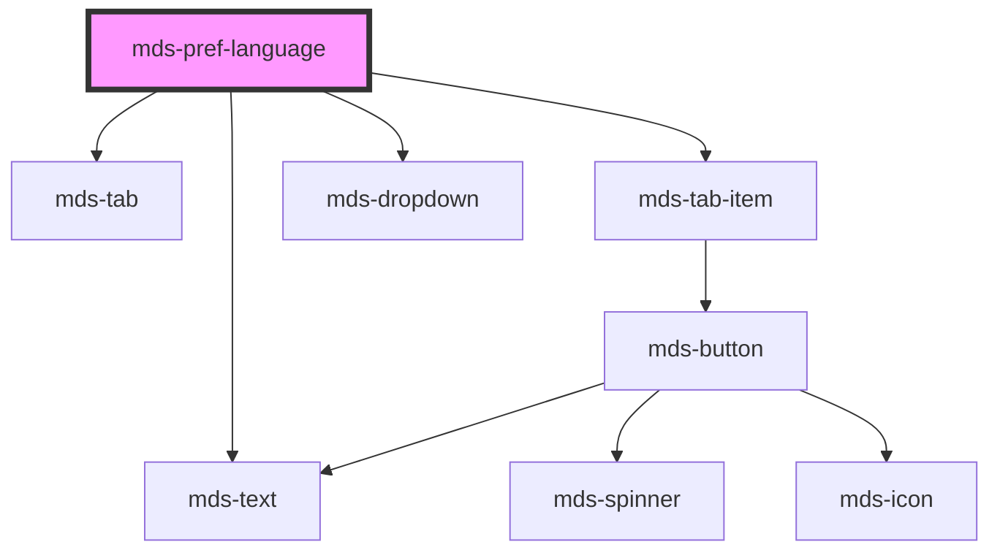

# mds-pref-language


<!-- Auto Generated Below -->


## Usage

### 1. Description

The `<mds-pref-language>` web component is the language-preference control of the Magma Design System, usually slotted inside the [`<mds-pref>`](../../mds-pref) panel alongside the other preference children. It renders a labelled tab trigger that opens a dropdown of `<mds-pref-language-item>` entries, letting users switch the active document language and persisting that choice.

#### Semantic Behavior

- **Usually inside `<mds-pref>`**: Placed as a direct slot child of `<mds-pref>`, alongside the other `mds-pref-*` controls; it also works on its own, since it applies and stores the language by itself. What it gives up on its own is in the antipattern docs. In turn it hosts its own `<mds-pref-language-item>` children, supplied via its default slot.
- **Default slot hosts the items**: The default slot accepts one or more `<mds-pref-language-item>` elements; when the control loads, and whenever its items change, the item whose `code` matches the resolved language is marked selected; an item added after load is picked like the others (a later change of `set` does not move the selection).
- **Selection orchestration**: Selecting an item clears the others, closes the dropdown, and resolves the new language - the children report up to this component, which centralizes the single-selection state.
- **Language resolution & persistence**: When `set` is `auto` the active language is resolved in priority order from the persisted value, then the `<html lang>` attribute, then `navigator.language`. The resolved value is persisted and written to `<html lang>` - the single page-wide source of truth for the language. Every localized Magma component (including ones nested in shadow DOM) reacts automatically through a shared reactive store; there is no per-element `lang` override and no imperative refresh method. Applications that manage the language themselves can simply set `<html lang>`: the store observes it.
- **Events bubbled to the parent**: Emits `mdsPrefLanguageChange` on every item pick, also when the picked language is already active (detail carries the selected `language` code; it fires just before the language is applied), and `mdsPrefChange` (detail `{ preference: 'language' }`), fired only when the resolved language actually changes, from a pick or from a new `set` value (the initial application on load does not emit). The latter is the event `<mds-pref>` listens to for its "reload required" notice, since application-level content may still need a reload.
- **Invalid codes are ignored**: A `set` value that is neither `auto` nor a language tag (a primary subtag of two or three letters, such as `it` or `haw`, optionally followed by others, such as `it-IT`) is ignored with a console warning: the language in place stays, and on load the one `auto` resolves. A stored value that is no language tag is dropped.
- **Default-language hint**: When the resolved language differs from the built-in default (`en`), a caption noting the default language is rendered.

#### Properties & Visual Configurations

- **`set`**: The desired language as a BCP 47 short tag (e.g. `it`, `en`, `es-ES`); the special value `auto` (default) defers to the persisted/page/system resolution chain described above. Region subtags are sanitized down to the two-letter language. Set an explicit value only to force a starting language regardless of the user's environment. Supported display languages are Italiano, English, Español and ελληνικά.
- **`size`**: Sizes the nested tab trigger (`sm` / `md`). Inside `<mds-pref>`, the parent's `size` reaches this control on load and when it changes, and overwrites its own: set it on the parent.


### 2. Pattern

Correct and idiomatic ways to use the `<mds-pref-language>` component, ordered from most common to most specialized. Patterns assume a working knowledge of the shared component rules in [`docs/agents/conventions.md`](../../../../../../docs/agents/conventions.md).

#### Basic Language Selector Inside `mds-pref`

The canonical usage. Nest `<mds-pref-language>` as a direct child of [`<mds-pref>`](../../mds-pref) and populate its default slot with one [`<mds-pref-language-item>`](../../mds-pref-language-item) per supported locale. The `code` attribute on each item must be a valid BCP 47 short tag.

```html
<mds-pref>
  <mds-pref-language>
    <mds-pref-language-item code="it"></mds-pref-language-item>
    <mds-pref-language-item code="en"></mds-pref-language-item>
    <mds-pref-language-item code="el"></mds-pref-language-item>
  </mds-pref-language>
</mds-pref>
```

#### Forcing a Starting Language with `set`

Pass an explicit BCP 47 tag to `set` to override the automatic resolution chain. Use this when the application dictates an initial language regardless of the user's browser setting or persisted preference.

```html
<mds-pref>
  <mds-pref-language set="it">
    <mds-pref-language-item code="it"></mds-pref-language-item>
    <mds-pref-language-item code="en"></mds-pref-language-item>
    <mds-pref-language-item code="es"></mds-pref-language-item>
  </mds-pref-language>
</mds-pref>
```

#### Automatic Language Resolution (default)

Omit `set` (or pass `set="auto"`) to let the component resolve the active language in priority order: persisted user choice, then the page `<html lang>` attribute, then `navigator.language`. This is the right choice for most applications.

```html
<mds-pref>
  <mds-pref-language>
    <mds-pref-language-item code="it"></mds-pref-language-item>
    <mds-pref-language-item code="en"></mds-pref-language-item>
  </mds-pref-language>
</mds-pref>
```

#### Sizing via `size`

Use the `size` prop to size the tab trigger of a standalone control. Inside [`<mds-pref>`](../../mds-pref), set `size` on the parent: it forwards it to every `mds-pref-*` child, so the group stays consistent.

```html
<mds-pref size="sm">
  <mds-pref-language>
    <mds-pref-language-item code="it"></mds-pref-language-item>
    <mds-pref-language-item code="en"></mds-pref-language-item>
  </mds-pref-language>
</mds-pref>
```

#### Listening for Language Changes

Listen to `mdsPrefLanguageChange` to react when the user picks a language (for example, to reload the page or re-fetch translated content). The event detail carries the selected `language` code string. It fires on every pick, also when the picked language is already the active one.

```html
<mds-pref>
  <mds-pref-language id="lang-selector">
    <mds-pref-language-item code="it"></mds-pref-language-item>
    <mds-pref-language-item code="en"></mds-pref-language-item>
  </mds-pref-language>
</mds-pref>

<script>
  document.querySelector('#lang-selector').addEventListener('mdsPrefLanguageChange', (e) => {
    console.log('Nuova lingua selezionata:', e.detail.language);
    // e.g. reload the page to apply the new locale
    window.location.reload();
  });
</script>
```

#### Full Preference Panel with Language

`<mds-pref-language>` is one of several preference children accepted by [`<mds-pref>`](../../mds-pref). Compose it alongside the other controls to offer a complete preferences UI.

```html
<mds-pref>
  <mds-pref-mode></mds-pref-mode>
  <mds-pref-contrast></mds-pref-contrast>
  <mds-pref-animation></mds-pref-animation>
  <mds-pref-consumption></mds-pref-consumption>
  <mds-pref-language>
    <mds-pref-language-item code="it"></mds-pref-language-item>
    <mds-pref-language-item code="en"></mds-pref-language-item>
    <mds-pref-language-item code="es"></mds-pref-language-item>
    <mds-pref-language-item code="el"></mds-pref-language-item>
  </mds-pref-language>
</mds-pref>
```


### 3. Antipattern

Common incorrect uses of `<mds-pref-language>`. Each entry pairs the wrong form with the right one and a one-line reason. System-wide rules (boolean-as-string, shadow piercing, Tailwind color utilities, raw native event listening) live in [`docs/agents/anti-patterns.md`](../../../../../../docs/agents/anti-patterns.md) - they apply here too but are not repeated.

#### Do Not Use Outside `mds-pref`

`<mds-pref-language>` is a compound child designed to live inside [`<mds-pref>`](../../mds-pref). As a standalone widget it still applies and persists the language, but it leaves the preference group: `<mds-pref>` forwards `size` changes to its `mds-pref-*` children and listens to their `mdsPrefChange` for the reload-required notice.

```html
<!-- INCORRECT -->
<mds-pref-language>
  <mds-pref-language-item code="it"></mds-pref-language-item>
  <mds-pref-language-item code="en"></mds-pref-language-item>
</mds-pref-language>

<!-- CORRECT -->
<mds-pref>
  <mds-pref-language>
    <mds-pref-language-item code="it"></mds-pref-language-item>
    <mds-pref-language-item code="en"></mds-pref-language-item>
  </mds-pref-language>
</mds-pref>
```

#### Do Not Slot Arbitrary HTML Instead of `mds-pref-language-item`

The default slot accepts only `<mds-pref-language-item>` elements. Slotting raw `<button>`, `<li>`, or other elements bypasses the selection orchestration and event wiring the parent depends on.

```html
<!-- INCORRECT -->
<mds-pref>
  <mds-pref-language>
    <button>Italiano</button>
    <button>English</button>
  </mds-pref-language>
</mds-pref>

<!-- CORRECT -->
<mds-pref>
  <mds-pref-language>
    <mds-pref-language-item code="it"></mds-pref-language-item>
    <mds-pref-language-item code="en"></mds-pref-language-item>
  </mds-pref-language>
</mds-pref>
```

#### Do Not Pass an Unrecognized Language Code to `set`

The `set` prop must be either `"auto"` or a BCP 47 language tag: a primary subtag of two or three letters, the one of the item dictionary (`it`, `en`, `haw`), optionally followed by others (`it-IT`). Any other value - including language names like `"italiano"` or malformed strings like `"en_US"` - is ignored with a console warning and the language in place stays. Use the shortest primary subtag: `it`, not the ISO 639-2 `ita`, which has no item and no translation.

```html
<!-- INCORRECT -->
<mds-pref-language set="italiano">...</mds-pref-language>
<mds-pref-language set="en_US">...</mds-pref-language>

<!-- CORRECT -->
<mds-pref-language set="it">...</mds-pref-language>
<mds-pref-language set="en">...</mds-pref-language>
<mds-pref-language set="es-ES">...</mds-pref-language>
```

#### Do Not Set `selected` Manually on `mds-pref-language-item`

The parent `<mds-pref-language>` manages the `selected` state of each item automatically based on the active language: when it loads, and whenever its items change, it marks only the item whose `code` matches, and on each pick it clears the siblings. A `selected` written in the markup is overwritten on load; one set later from script leaves the visual selection out of step with the active language.

```html
<!-- INCORRECT -->
<mds-pref>
  <mds-pref-language set="it">
    <mds-pref-language-item code="it" selected></mds-pref-language-item>
    <mds-pref-language-item code="en"></mds-pref-language-item>
  </mds-pref-language>
</mds-pref>

<!-- CORRECT - the parent derives selection from `set` -->
<mds-pref>
  <mds-pref-language set="it">
    <mds-pref-language-item code="it"></mds-pref-language-item>
    <mds-pref-language-item code="en"></mds-pref-language-item>
  </mds-pref-language>
</mds-pref>
```

#### Do Not Listen to `mdsPrefLanguageItemSelect` Instead of `mdsPrefLanguageChange`

`mdsPrefLanguageItemSelect` is the item's own event, emitted by `<mds-pref-language-item>` and consumed by its parent. Application code should listen to `mdsPrefLanguageChange` on `<mds-pref-language>`: one listener for the whole list, fired after the parent has committed the selection (the language is applied right after it, so read it from `e.detail.language`).

```html
<!-- INCORRECT -->
<script>
  document.querySelector('mds-pref-language-item').addEventListener('mdsPrefLanguageItemSelect', (e) => {
    console.log(e.detail.language);
  });
</script>

<!-- CORRECT -->
<script>
  document.querySelector('mds-pref-language').addEventListener('mdsPrefLanguageChange', (e) => {
    console.log(e.detail.language);
  });
</script>
```

#### Do Not Set Size via CSS Instead of the `size` Prop

The `size` prop is the only supported way to resize the internal tab trigger. Overriding dimensions with inline styles or CSS custom properties not listed in the component's documented surface couples your code to internal implementation details.

```css
/* INCORRECT */
mds-pref-language mds-tab-item {
  font-size: 10px;
}
```

```html
<!-- CORRECT -->
<mds-pref>
  <mds-pref-language size="sm">
    <mds-pref-language-item code="it"></mds-pref-language-item>
    <mds-pref-language-item code="en"></mds-pref-language-item>
  </mds-pref-language>
</mds-pref>
```


## Properties

| Property | Attribute | Description                                                                                                                                                                                                                                                                                               | Type                        | Default     |
| -------- | --------- | --------------------------------------------------------------------------------------------------------------------------------------------------------------------------------------------------------------------------------------------------------------------------------------------------------- | --------------------------- | ----------- |
| `set`    | `set`     | Specifies the language code based on HTML `lang` attribute  A string representing the language version as defined in {@link https://datatracker.ietf.org/doc/html/rfc5646 RFC 5646: Tags for Identifying Languages (also known as BCP 47)}.  Supported languages are Italiano, English, Español, ελληνικά | `string`                    | `'auto'`    |
| `size`   | `size`    | Sets the size of the component items nested inside it                                                                                                                                                                                                                                                     | `"md" \| "sm" \| undefined` | `undefined` |


## Events

| Event                   | Description                                                                                           | Type                                      |
| ----------------------- | ----------------------------------------------------------------------------------------------------- | ----------------------------------------- |
| `mdsPrefChange`         | Emits when the component is triggered                                                                 | `CustomEvent<MdsPrefChangeEventDetail>`   |
| `mdsPrefLanguageChange` | Emits when the component changes the language selected from the click event of the dropdown list item | `CustomEvent<MdsPrefLanguageEventDetail>` |


## Slots

| Slot | Description                             |
| ---- | --------------------------------------- |
|      | Add `mds-pref-language-item` element/s. |


## Dependencies

### Depends on

- [mds-text](../mds-text)
- [mds-tab](../mds-tab)
- [mds-tab-item](../mds-tab-item)
- [mds-dropdown](../mds-dropdown)

### Graph


----------------------------------------------

Built with love @ [Gruppo Maggioli](https://www.maggioli.com) from [R&D Department](https://www.maggioli.com/it-it/chi-siamo/ricerca-sviluppo)
