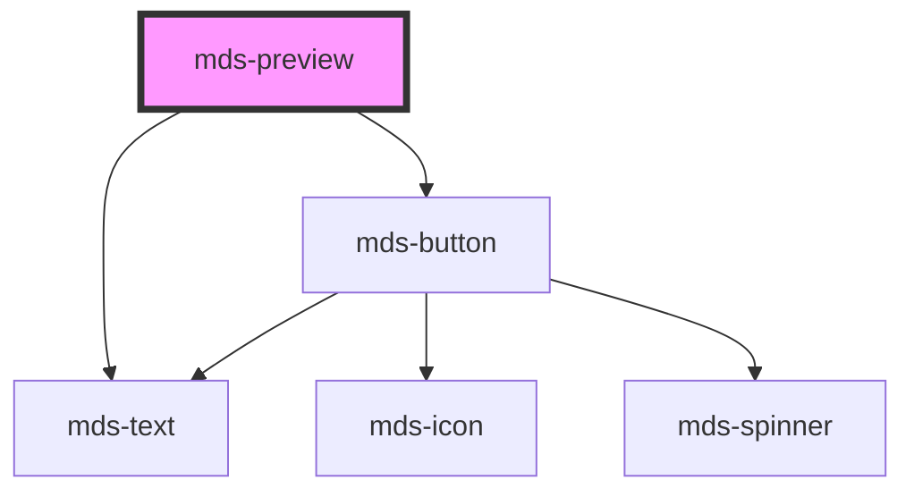

# mds-preview


<!-- Auto Generated Below -->


## Overview

The result of an editor, drawn at a width of its own and fitted to its box, so the person
judges it while changing the controls beside it. From the desktop breakpoint it sits in the
flow of the page; under it, it docks small in a corner of the window, always in view, and its
lens zooms it without leaving the controls.

## Usage

### 1. Description

The `<mds-preview>` web component shows the result of an editor beside the controls that change it, drawn at a width of its own and fitted to its box: a page of the product in an `<iframe>`, or the components of a part written as they will be. It is the result of the pattern `edit-with-preview` (`agents/patterns/edit-with-preview.md`); no HTML primitive does it.

#### Semantic Behavior

- **A region named by `label`**: the host is `role="region"` and `label` is its name. It is not a live region, so a screen reader is not interrupted at every change.
- **The title of the iframe**: an `<iframe>` in the default slot takes `label` as its `title`, and follows it when `label` changes. The component never loads the document: the product fills the iframe (`src`, `srcdoc` or its `contentDocument`) and applies the conditions to it.
- **Drawn at a width of its own**: the result is laid out at the width of its box or at `width`, whichever is wider, and scaled down to the box, never enlarged. A page drawn at 1024px keeps its desktop layout in a narrower panel; in a wider one it is drawn at the width of the panel. The scale is computed in CSS: no script measures the box.
- **The height**: the frame takes the height the host is given (a cell as tall as the window) or, when the host has none, the ratio of a screen.
- **Docked under the desktop breakpoint**: under 1024px the result leaves the flow and docks small in a corner of the window, over the page and always in view. It is not a dialog: the page behind stays usable and keeps the focus where it is.
- **The lens**: docked, a toggle button (`aria-pressed`), a target of 48px, zooms the result to the width of the window and shrinks it back. Escape inside the zoomed result shrinks it and gives the focus back to the lens. The lens is named in the language of the page.
- **The focus never hides under it**: when the focus moves from the zoomed result to a control of the page, the result shrinks back, so the control is not covered. The small docked result still covers the bottom of the window: the page leaves room for it under its last control.
- **The head while docked small**: `headline` stays at the start of the head, the lens at its end; without a headline there is no head, and the lens sits on the image. The `conditions` slot is hidden while small and back when zoomed.
- **A heading of the page**: `headline` is a heading in the outline of the page (`h2` unless `tag` says another level), so a screen reader reaches the result by its headings; the region keeps `label` as its name.
- **Reduced motion**: the docked card zooms and shrinks without a transition.

#### Properties & Visual Configurations

- **`label`**: what the result shows and under which conditions, in the language of the page ("The theme Warm on a page of a product, dark mode"). Keep it current as the conditions change: it is what a screen reader hears of the result.
- **`headline`**: the short title of the result, in the language of the page ("Preview", "The email as it arrives"); leave it out when the page around already titles the result, and the docked result shows only the image and the lens.
- **`tag`**: the level of `headline` in the outline of the page: `h2` under the title of the page, a deeper level when the editor is itself a section.
- **`width`**: the narrowest width the result is drawn at: the desktop of the product (the default, 1024) or the width of a wide desktop (1440). In a wider box the result is drawn at the width of the box, so the components of a part are drawn at their own width only in a box no wider than the part; the pattern `edit-with-preview` keeps a part in a region of the page instead.
- **`dock`**: where the result goes under the desktop breakpoint.
  - `bottom-right` (the default): the end corner of the window, clear of the controls that start at the other edge.
  - `bottom-left`: when the bottom-right corner already holds something that floats (a help or chat button).
  - `none`: the result stays in the flow, under the controls, scaled to its width, with no lens.
- **`zoomed`**: the lens sets it and emits `mdsPreviewZoom`; set it from code to open the docked result zoomed. It changes nothing from the desktop breakpoint up.


### 2. Examples

Correct and idiomatic ways to use the `<mds-preview>` component, ordered from most common to most specialized. The examples assume a working knowledge of the shared component rules in [`docs/agents/conventions.md`](../../../../../../docs/agents/conventions.md) and of the pattern `edit-with-preview`, which says where the controls and the result go.

#### A Page of the Product in a Document of Its Own

The canonical form, for a change that reaches the whole page (a theme, a mode, a language): the page in an `<iframe>`, the title in `headline`, the conditions in the `conditions` slot. The product fills the iframe and keeps `label` current.

```html
<mds-preview label="The theme Magma on a page of a product, light mode" headline="Preview">
  <mds-tab slot="conditions" size="sm">
    <mds-tab-item label="Light" value="light" selected></mds-tab-item>
    <mds-tab-item label="Dark" value="dark"></mds-tab-item>
  </mds-tab>
  <iframe src="/preview/theme"></iframe>
</mds-preview>
```

#### Conditions That Switch the Document, Not the Element

Use this when the person judges the result under a condition: change the document in the iframe and say the condition in `label`, which also titles the iframe.

```js
const preview = document.querySelector('mds-preview');
const frame = preview.querySelector('iframe');

preview.querySelector('mds-tab').addEventListener('mdsTabChange', (event) => {
  const mode = event.detail.value;
  frame.contentDocument.documentElement.classList.remove('pref-mode-light', 'pref-mode-dark');
  frame.contentDocument.documentElement.classList.add(`pref-mode-${mode}`);
  preview.label = `The theme Magma on a page of a product, ${mode} mode`;
});
```

#### A Page Drawn at the Width of a Wide Desktop

Use this when the product is judged at a desktop wider than 1024px: the result keeps that layout and is scaled down to the panel.

```html
<mds-preview label="The theme Magma on the dashboard, light mode" width="1440" headline="Preview">
  <iframe src="/preview/dashboard"></iframe>
</mds-preview>
```

#### Docked in the Bottom-Left Corner

Use this when the bottom-right corner of the window already holds something that floats.

```html
<mds-preview label="The theme Magma on a page of a product, light mode" dock="bottom-left" headline="Preview">
  <iframe src="/preview/theme"></iframe>
</mds-preview>
```

#### In the Flow on a Narrow Window

Use `dock="none"` when the result can follow the controls on a phone or a tablet instead of floating over them: it stays under them, scaled to its width, with no lens.

```html
<mds-preview label="The theme Magma on a page of a product, light mode" headline="Preview" dock="none">
  <iframe src="/preview/theme"></iframe>
</mds-preview>
```

#### Following the Zoom

Use this when the page around reacts to the docked result zoomed, for instance to keep a control in view above it.

```js
document.querySelector('mds-preview').addEventListener('mdsPreviewZoom', (event) => {
  document.body.classList.toggle('preview-zoomed', event.detail.zoomed);
});
```

#### Styling the Docked Result

The width of the docked result and its stacking are the public custom properties: a wider card on a large tablet, a stacking under a bar of the product.

```css
mds-preview {
  --mds-preview-docked-width: var(--container-xs);
  --mds-preview-z-index: var(--magma-header-z-index);
}
```


### 3. Mistakes

Common incorrect uses of `<mds-preview>`. Each entry pairs the wrong form with the right one and a one-line reason. System-wide rules (boolean-as-string, shadow piercing, Tailwind color utilities, raw native event listening) live in [`docs/agents/mistakes.md`](../../../../../../docs/agents/mistakes.md) - they apply here too but are not repeated.

#### Do Not Title the Iframe by Hand

`label` names the region and titles the iframe in the default slot, and the component writes it over any `title` set by hand: say what the result shows in `label`, and keep it current.

```html
<!-- INCORRECT -->
<mds-preview>
  <iframe title="Preview of the theme" src="/preview/theme"></iframe>
</mds-preview>

<!-- CORRECT -->
<mds-preview label="The theme Warm on a page of a product, dark mode">
  <iframe src="/preview/theme"></iframe>
</mds-preview>
```

#### Do Not Put It in a Dialog to Dock It

The component docks itself under the desktop breakpoint and leaves the page usable; moving the iframe into a dialog reloads its document, and a dialog takes the focus away from the controls.

```html
<!-- INCORRECT -->
<mds-modal opened hide-backdrop position="bottom-right">
  <mds-preview slot="window" label="The theme Magma on a page of a product, light mode">
    <iframe src="/preview/theme"></iframe>
  </mds-preview>
</mds-modal>

<!-- CORRECT -->
<mds-preview label="The theme Magma on a page of a product, light mode" dock="bottom-right">
  <iframe src="/preview/theme"></iframe>
</mds-preview>
```

#### Do Not Load the Page Again to Apply a Condition

Changing the `src` of the iframe for each condition reloads the page: it flashes empty and loses what the person typed in it. Change the document already loaded, and say the condition in `label`.

```js
// INCORRECT
tab.addEventListener('mdsTabChange', (event) => {
  frame.src = `/preview/theme?mode=${event.detail.value}`;
});

// CORRECT
tab.addEventListener('mdsTabChange', (event) => {
  frame.contentDocument.documentElement.classList.replace(
    event.detail.value === 'dark' ? 'pref-mode-light' : 'pref-mode-dark',
    `pref-mode-${event.detail.value}`,
  );
  preview.label = `The theme Magma on a page of a product, ${event.detail.value} mode`;
});
```

#### Do Not Put the Conditions in the Default Slot

The default slot is the result: what is in it is drawn at `width` and scaled down, so a tab there shrinks with the page and is hidden by nothing while docked. The conditions go in the `conditions` slot.

```html
<!-- INCORRECT -->
<mds-preview label="The theme Magma on a page of a product, light mode">
  <mds-tab size="sm">
    <mds-tab-item label="Light" value="light" selected></mds-tab-item>
  </mds-tab>
  <iframe src="/preview/theme"></iframe>
</mds-preview>

<!-- CORRECT -->
<mds-preview label="The theme Magma on a page of a product, light mode">
  <mds-tab slot="conditions" size="sm">
    <mds-tab-item label="Light" value="light" selected></mds-tab-item>
    <mds-tab-item label="Dark" value="dark"></mds-tab-item>
  </mds-tab>
  <iframe src="/preview/theme"></iframe>
</mds-preview>
```

#### Do Not Set `width` to the Width of the Panel

`width` is the width the result is drawn at, the desktop of the product, not the size of the box: the box comes from the layout around the host. Set to the panel, the page would be drawn at a narrow width and lose its desktop layout.

```html
<!-- INCORRECT -->
<mds-preview label="The theme Magma on a page of a product, light mode" width="634">
  <iframe src="/preview/theme"></iframe>
</mds-preview>

<!-- CORRECT -->
<mds-preview label="The theme Magma on a page of a product, light mode" width="1024">
  <iframe src="/preview/theme"></iframe>
</mds-preview>
```

#### Do Not Let the Docked Result Cover the Last Control

Under the desktop breakpoint the docked result sits over the bottom of the window: a column of controls that ends at the bottom edge hides its last fields under it, and a field that takes the focus there is not seen. Leave room under the last control, as tall as the docked result.

```html
<!-- INCORRECT -->
<div class="grid gap-between-fields">
  <mds-input-field label="Title of the page"><mds-input></mds-input></mds-input-field>
  <mds-input-field label="Main action"><mds-input></mds-input></mds-input-field>
</div>
<mds-preview label="The theme Magma on a page of a product, light mode" headline="Preview">
  <iframe src="/preview/theme"></iframe>
</mds-preview>

<!-- CORRECT -->
<div class="grid gap-between-fields max-desktop:pb-7000">
  <mds-input-field label="Title of the page"><mds-input></mds-input></mds-input-field>
  <mds-input-field label="Main action"><mds-input></mds-input></mds-input-field>
</div>
<mds-preview label="The theme Magma on a page of a product, light mode" headline="Preview">
  <iframe src="/preview/theme"></iframe>
</mds-preview>
```


## Properties

| Property             | Attribute  | Description                                                                                                                                                                                                                             | Type                                                        | Default          |
| -------------------- | ---------- | --------------------------------------------------------------------------------------------------------------------------------------------------------------------------------------------------------------------------------------- | ----------------------------------------------------------- | ---------------- |
| `dock`               | `dock`     | Where the result goes under the desktop breakpoint: docked small in a corner of the window, over the page (`bottom-right`, `bottom-left`, as the positions of `mds-modal`), or `none`, in the flow of the page at the width it is given | `"bottom-left" \| "bottom-right" \| "none" \| undefined`    | `'bottom-right'` |
| `headline`           | `headline` | The title of the result, shown in its head as a heading of the page ("Preview"). Docked small it stays at the start of the head, the lens at its end; without it the docked result has no head, and the lens sits on the image          | `string \| undefined`                                       | `undefined`      |
| `label` _(required)_ | `label`    | What the result shows and under which conditions ("The theme Warm on a page of a product, dark mode"): it names the region, and is the `title` of an `<iframe>` in the default slot, kept current as it changes                         | `string`                                                    | `undefined`      |
| `tag`                | `tag`      | The level of the heading of `headline` in the outline of the page                                                                                                                                                                       | `"h1" \| "h2" \| "h3" \| "h4" \| "h5" \| "h6" \| undefined` | `'h2'`           |
| `width`              | `width`    | The narrowest width in px the result is drawn at: it is drawn at the width of its box or at this one, whichever is wider, and scaled down to fit the box, never enlarged                                                                | `number \| undefined`                                       | `1024`           |
| `zoomed`             | `zoomed`   | Whether the docked result is zoomed to the width of the window, with its title and its conditions; its lens flips it. It changes nothing from the desktop breakpoint up                                                                 | `boolean \| undefined`                                      | `false`          |


## Events

| Event            | Description                                                                                                                      | Type                                     |
| ---------------- | -------------------------------------------------------------------------------------------------------------------------------- | ---------------------------------------- |
| `mdsPreviewZoom` | Emits when the person zooms the docked result or shrinks it back, with the lens or with Escape; not when `zoomed` is set by code | `CustomEvent<MdsPreviewZoomEventDetail>` |


## Slots

| Slot           | Description                                                                                                                                                                    |
| -------------- | ------------------------------------------------------------------------------------------------------------------------------------------------------------------------------ |
|                | The result: an `<iframe>`, a document of its own (for a change that reaches the whole page: a theme, a mode, a language), or the components of a part, written as they will be |
| `"conditions"` | The conditions the result is judged under, an `mds-tab size="sm"`; hidden while docked small, back when zoomed                                                                 |


## Shadow Parts

| Part      | Description                                                             |
| --------- | ----------------------------------------------------------------------- |
| `"frame"` | The box the result is drawn in, at its own width and scaled down to fit |
| `"head"`  | The row of the headline, the conditions and the lens                    |
| `"lens"`  | The button that zooms the docked result and shrinks it back             |


## CSS Custom Properties

| Name                                       | Description                                                                                                         |
| ------------------------------------------ | ------------------------------------------------------------------------------------------------------------------- |
| `--mds-preview-docked-background`          | The background of the card the docked result sits in, and of the lens on the image                                  |
| `--mds-preview-docked-padding`             | The padding of the card the docked result sits in, around its head and its frame                                    |
| `--mds-preview-docked-radius`              | The radius of the card the docked result sits in                                                                    |
| `--mds-preview-docked-shadow`              | The shadow of the card the docked result sits in, over its tray                                                     |
| `--mds-preview-docked-width`               | Public. The width of the result docked small under the desktop breakpoint                                           |
| `--mds-preview-frame-background`           | The background of the frame the result is drawn in                                                                  |
| `--mds-preview-frame-border-color`         | The colour of the border of the frame                                                                               |
| `--mds-preview-frame-radius`               | The radius of the frame, and of the lens on the image                                                               |
| `--mds-preview-gap`                        | The space between the head of the result and its frame                                                              |
| `--mds-preview-head-gap`                   | The space between the title, the conditions and the lens in the head                                                |
| `--mds-preview-lens-inset`                 | The inset of the lens on the image from the corner of the frame                                                     |
| `--mds-preview-transition-duration`        | The duration of the change of the docked tray, zoomed and shrunk back                                               |
| `--mds-preview-transition-timing-function` | The easing of the change of the docked tray, zoomed and shrunk back                                                 |
| `--mds-preview-tray-backdrop-filter`       | The filter of what the tray covers, a blur                                                                          |
| `--mds-preview-tray-background`            | The tray the docked card sits in, a translucent wash of the text ink at the corner of the window, as mds-status-bar |
| `--mds-preview-tray-radius`                | The radius of the two corners of the tray towards the page                                                          |
| `--mds-preview-z-index`                    | Public. The stacking of the docked result over the page                                                             |


## Dependencies

### Depends on

- [mds-text](../mds-text)
- [mds-button](../mds-button)

### Graph


----------------------------------------------

Built with love @ [Gruppo Maggioli](https://www.maggioli.com) from [R&D Department](https://www.maggioli.com/it-it/chi-siamo/ricerca-sviluppo)
