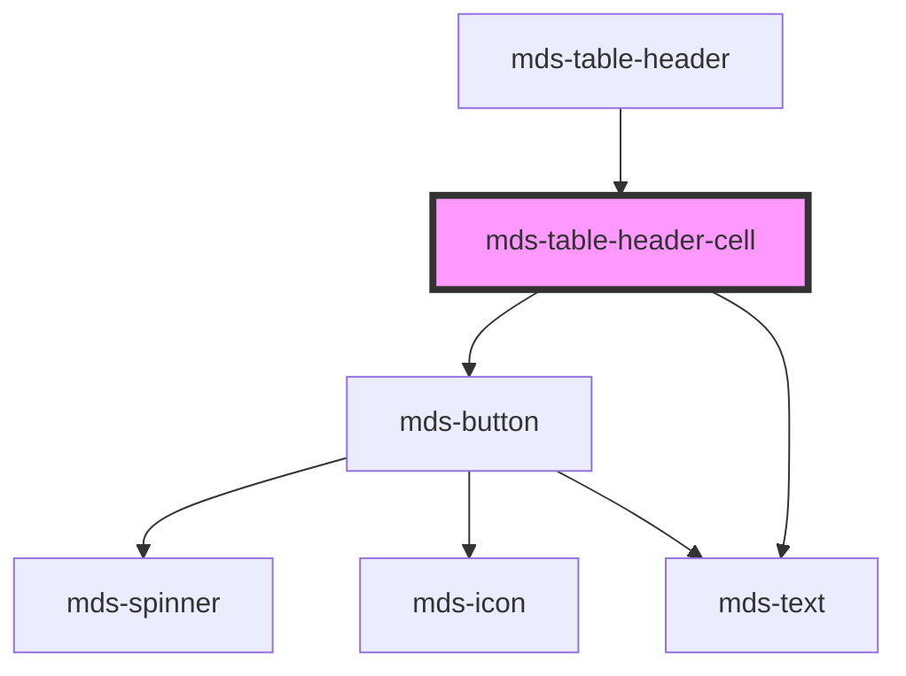

# mds-table-header-cell


<!-- Auto Generated Below -->


## Usage

### 1. Description

The `<mds-table-header-cell>` web component is the column-header cell of a Magma data table. It is a compound child of [`<mds-table-header>`](../../mds-table-header) and plays the role of a native `<th>` (`columnheader`), rendering the column label and, when enabled, acting as the interactive sort control for its column.

#### Semantic Behavior

- **Compound child only**: Must be placed as a direct slot child of `<mds-table-header>`; it is not used standalone, and its sorting acts on the body rows within the enclosing `mds-table`.
- **Header role and ARIA sort**: Reflects its current sort state through `aria-sort`, mirroring the `direction` prop (`none` / `ascending` / `descending`).
- **Position-based sorting**: The cell sorts the matching `mds-table-cell` of every body row by column position; values come from each cell's `value` (falling back to trimmed text), with numeric values compared numerically and others compared alphabetically. With `sorting="external"` on the table it moves no row: the application renders them in the order asked.
- **Tri-state sort cycle**: Each activation advances the column through `none` -> `ascending` -> `descending` and back to `none`; the `none` state restores the order the rows had before any column sorted them (rows removed in the meantime stay out, rows added go last).
- **Sort event**: Every click emits `mdsTableHeaderCellSort`, which bubbles to the table, with `{ direction, index, sortKey }`: the new direction, the position of the column and its `sort-key`. A `direction` set by the application emits nothing, the application already knows it.
- **Single active sort column**: Sorting a column resets every sibling header cell to `none`, so only one column drives the order at a time.
- **Conditional rendering**: When `sortable` is set the cell renders a clickable sorter (with an up / down / unfold-more icon reflecting `direction`); otherwise it renders a plain label with no interaction.

#### Properties & Visual Configurations

- **`sortable`**: Opt a column into interactive sorting. Leave it unset for purely descriptive columns (label only); set it when the column's values should be reorderable by the user.
- **`direction`**: The reflected sort state of the column (`none`, `ascending`, `descending`), which drives the sort icon and `aria-sort`. Set from outside (or in the markup) it acts like the clicks that lead there: it sorts the rows, or only shows the order with `sorting="external"`, resets the other columns to `none`, and the next click goes on from it.
- **`sortKey`** (`sort-key`): Names the column in `mdsTableHeaderCellSort`, typically the field the back end sorts by, so the application does not depend on the position of the column.


### 2. Pattern

Correct and idiomatic ways to use the `<mds-table-header-cell>` component, ordered from most common to most specialized. Patterns assume a working knowledge of the shared component rules in [`docs/agents/conventions.md`](../../../../../../docs/agents/conventions.md).

#### Plain Header Cell

The simplest form: a non-sortable column header that renders a styled label. Omit `sortable` for columns whose values should not be reordered.

```html
<mds-table>
  <mds-table-header>
    <mds-table-header-cell label="Nome"></mds-table-header-cell>
    <mds-table-header-cell label="Ruolo"></mds-table-header-cell>
    <mds-table-header-cell label="Stato"></mds-table-header-cell>
  </mds-table-header>
  <mds-table-body>
    <mds-table-row>
      <mds-table-cell>Mario Rossi</mds-table-cell>
      <mds-table-cell>Amministratore</mds-table-cell>
      <mds-table-cell>Attivo</mds-table-cell>
    </mds-table-row>
  </mds-table-body>
</mds-table>
```

#### Sortable Column Header

Add the `sortable` boolean attribute to enable the tri-state click cycle (`none` -> `ascending` -> `descending` -> `none`). The component manages sorting internally - no JavaScript wiring is required.

```html
<mds-table>
  <mds-table-header>
    <mds-table-header-cell label="Cognome" sortable></mds-table-header-cell>
    <mds-table-header-cell label="Dipartimento" sortable></mds-table-header-cell>
    <mds-table-header-cell label="Note"></mds-table-header-cell>
  </mds-table-header>
  <mds-table-body>
    <mds-table-row>
      <mds-table-cell>Bianchi</mds-table-cell>
      <mds-table-cell>Risorse Umane</mds-table-cell>
      <mds-table-cell>-</mds-table-cell>
    </mds-table-row>
    <mds-table-row>
      <mds-table-cell>Amendola</mds-table-cell>
      <mds-table-cell>Informatica</mds-table-cell>
      <mds-table-cell>-</mds-table-cell>
    </mds-table-row>
  </mds-table-body>
</mds-table>
```

#### Mixing Sortable and Non-Sortable Columns

Place `sortable` only on columns whose values are meaningfully orderable. Action columns or complex-content columns should remain non-sortable.

```html
<mds-table>
  <mds-table-header>
    <mds-table-header-cell label="ID" sortable></mds-table-header-cell>
    <mds-table-header-cell label="Descrizione" sortable></mds-table-header-cell>
    <mds-table-header-cell label="Importo" sortable></mds-table-header-cell>
    <mds-table-header-cell label="Azioni"></mds-table-header-cell>
  </mds-table-header>
  <mds-table-body>
    <mds-table-row>
      <mds-table-cell value="1">1</mds-table-cell>
      <mds-table-cell>Abbonamento annuale</mds-table-cell>
      <mds-table-cell value="120">120,00 EUR</mds-table-cell>
      <mds-table-cell><mds-button label="Modifica" tone="text" variant="primary"></mds-button></mds-table-cell>
    </mds-table-row>
    <mds-table-row>
      <mds-table-cell value="2">2</mds-table-cell>
      <mds-table-cell>Licenza mensile</mds-table-cell>
      <mds-table-cell value="15">15,00 EUR</mds-table-cell>
      <mds-table-cell><mds-button label="Modifica" tone="text" variant="primary"></mds-button></mds-table-cell>
    </mds-table-row>
  </mds-table-body>
</mds-table>
```

#### Providing Numeric Values for Correct Sort Order

When a column displays formatted text (currency, percentages) but should sort numerically, set the `value` prop on each `<mds-table-cell>` to the raw numeric string. The header cell reads `value` first and falls back to text content.

```html
<mds-table>
  <mds-table-header>
    <mds-table-header-cell label="Prodotto"></mds-table-header-cell>
    <mds-table-header-cell label="Punteggio" sortable></mds-table-header-cell>
  </mds-table-header>
  <mds-table-body>
    <mds-table-row>
      <mds-table-cell>Prodotto A</mds-table-cell>
      <mds-table-cell value="8.5">8,5 / 10</mds-table-cell>
    </mds-table-row>
    <mds-table-row>
      <mds-table-cell>Prodotto B</mds-table-cell>
      <mds-table-cell value="10">10 / 10</mds-table-cell>
    </mds-table-row>
    <mds-table-row>
      <mds-table-cell>Prodotto C</mds-table-cell>
      <mds-table-cell value="2.3">2,3 / 10</mds-table-cell>
    </mds-table-row>
  </mds-table-body>
</mds-table>
```

#### Setting the Direction from Outside

Set `direction` to sort by a column without a click - for example from a sort order kept in the address. It sorts the rows as the clicks that lead there would, resets the other columns to `none`, and the next click goes on with the cycle from it. `none` brings back the original order. No `mdsTableHeaderCellSort` is emitted: the application set it.

```html
<mds-table>
  <mds-table-header>
    <mds-table-header-cell label="Data" sortable direction="descending"></mds-table-header-cell>
    <mds-table-header-cell label="Categoria" sortable></mds-table-header-cell>
  </mds-table-header>
  <mds-table-body>
    <!-- rows -->
  </mds-table-body>
</mds-table>
```

```js
document.querySelector('mds-table-header-cell').direction = 'none';
```

#### Sorting by the Back End

When the table shows one page of a larger set, give the table `sorting="external"` and each sortable column a `sort-key`. A click then moves no row: listen to `mdsTableHeaderCellSort` and load the rows in the order asked. See the pattern with `mds-paginator` in [`mds-table`](../../mds-table).

```html
<mds-table sorting="external">
  <mds-table-header>
    <mds-table-header-cell label="Numero" sortable sort-key="number"></mds-table-header-cell>
    <mds-table-header-cell label="Ricevuta il" sortable sort-key="received"></mds-table-header-cell>
  </mds-table-header>
  <mds-table-body>
    <!-- the rows of the current page -->
  </mds-table-body>
</mds-table>
```

```js
document.querySelector('mds-table').addEventListener('mdsTableHeaderCellSort', (event) => {
  const { sortKey, direction } = event.detail; // 'received', 'descending'
  loadFirstPage(direction === 'none' ? undefined : { sortKey, direction });
});
```

#### Styling Customization

Target the `label` or `action` shadow parts for glyph-level overrides. Set them on the host or a parent selector.

```css
mds-table-header-cell::part(label) {
  font-weight: var(--font-weight-semibold);
}
```


### 3. Antipattern

Common incorrect uses of `<mds-table-header-cell>`. Each entry pairs the wrong form with the right one and a one-line reason. System-wide rules (boolean-as-string, shadow piercing, Tailwind color utilities, raw native event listening) live in [`docs/agents/anti-patterns.md`](../../../../../../docs/agents/anti-patterns.md) - they apply here too but are not repeated.

#### Do Not Use Outside `mds-table-header`

`<mds-table-header-cell>` is a compound child component and relies on traversing the DOM to locate its sibling cells and the `<mds-table-body>` for sorting. Using it outside `<mds-table-header>` breaks both the layout and the sort logic.

```html
<!-- INCORRECT -->
<div class="table-head">
  <mds-table-header-cell label="Nome" sortable></mds-table-header-cell>
</div>

<!-- CORRECT -->
<mds-table>
  <mds-table-header>
    <mds-table-header-cell label="Nome" sortable></mds-table-header-cell>
  </mds-table-header>
  <mds-table-body><!-- rows --></mds-table-body>
</mds-table>
```

#### Do Not Let the Cells Sort a Table with Pages

By default a sortable header cell reorders the rows in the DOM. On a table that shows one page of a larger set that sorts the page on screen, not the data: the first row is not the first of the set.

```html
<!-- INCORRECT -->
<mds-table>
  <mds-table-header>
    <mds-table-header-cell label="Numero" sortable></mds-table-header-cell>
  </mds-table-header>
  <mds-table-body><!-- one page of rows --></mds-table-body>
</mds-table>
<mds-paginator pages="12"></mds-paginator>

<!-- CORRECT - the back end sorts, after mdsTableHeaderCellSort -->
<mds-table sorting="external">
  <mds-table-header>
    <mds-table-header-cell label="Numero" sortable sort-key="number"></mds-table-header-cell>
  </mds-table-header>
  <mds-table-body><!-- one page of rows --></mds-table-body>
</mds-table>
<mds-paginator pages="12"></mds-paginator>
```

#### Do Not Use `sortable="false"` to Disable Sorting

`sortable` is a boolean attribute. Stencil reads the exact string `"false"` as `false`, but the attribute stays on the element, where attribute selectors and any code that tests for its presence still read it as set. Remove the attribute entirely to produce a non-sortable header cell.

```html
<!-- INCORRECT -->
<mds-table-header-cell label="Stato" sortable="false"></mds-table-header-cell>

<!-- CORRECT -->
<mds-table-header-cell label="Stato"></mds-table-header-cell>
```

#### Do Not Slot Content Instead of Using the `label` Prop

The component renders its label through the `label` prop; there is no documented slot. Placing text or elements as children of the host puts them in an unsupported slot and they will not appear.

```html
<!-- INCORRECT -->
<mds-table-header-cell sortable>
  <span>Cognome</span>
</mds-table-header-cell>

<!-- CORRECT -->
<mds-table-header-cell label="Cognome" sortable></mds-table-header-cell>
```

#### Do Not Pierce Shadow DOM to Style the Sort Button

The sort button is an internal `<mds-button>` inside the shadow root. Use the documented `::part(action)` instead of undocumented selectors.

```css
/* INCORRECT */
mds-table-header-cell >>> .action {
  background-color: red;
}

/* CORRECT */
mds-table-header-cell::part(action) {
  /* use only documented part-level overrides */
}
```

#### Do Not Wrap the Cell in a Native `<th>`

`<mds-table-header-cell>` already carries `role="columnheader"` and manages `aria-sort`. Wrapping it inside a native `<th>` doubles the ARIA semantics and produces invalid table structure.

```html
<!-- INCORRECT -->
<thead>
  <tr>
    <th><mds-table-header-cell label="Nome"></mds-table-header-cell></th>
  </tr>
</thead>

<!-- CORRECT -->
<mds-table>
  <mds-table-header>
    <mds-table-header-cell label="Nome"></mds-table-header-cell>
  </mds-table-header>
</mds-table>
```


## Properties

| Property    | Attribute   | Description                                                                                                                                                            | Type                                    | Default     |
| ----------- | ----------- | ---------------------------------------------------------------------------------------------------------------------------------------------------------------------- | --------------------------------------- | ----------- |
| `direction` | `direction` | Specifies the current sort direction of the column. Set from outside, it sorts the rows like a click, or only shows the order when the table has `sorting="external"`. | `"ascending" \| "descending" \| "none"` | `'none'`    |
| `label`     | `label`     | Sets a label for the cell                                                                                                                                              | `string \| undefined`                   | `undefined` |
| `sortKey`   | `sort-key`  | Names the column in the `mdsTableHeaderCellSort` event, for example the field the back end sorts by                                                                    | `string \| undefined`                   | `undefined` |
| `sortable`  | `sortable`  | Tells the component to make the cell able to sort the table columns items                                                                                              | `boolean \| undefined`                  | `undefined` |


## Events

| Event                    | Description                                                                                                                                                                                               | Type                                             |
| ------------------------ | --------------------------------------------------------------------------------------------------------------------------------------------------------------------------------------------------------- | ------------------------------------------------ |
| `mdsTableHeaderCellSort` | Emits when the user changes the sort direction of the column, at every step of the cycle. With `sorting="external"` on the table the rows are not moved: the application renders them in the order asked. | `CustomEvent<MdsTableHeaderCellSortEventDetail>` |


## Shadow Parts

| Part       | Description |
| ---------- | ----------- |
| `"action"` |             |
| `"label"`  |             |


## Dependencies

### Used by

 - [mds-table-header](../mds-table-header)

### Depends on

- [mds-button](../mds-button)
- [mds-text](../mds-text)

### Graph


----------------------------------------------

Built with love @ [Gruppo Maggioli](https://www.maggioli.com) from [R&D Department](https://www.maggioli.com/it-it/chi-siamo/ricerca-sviluppo)
