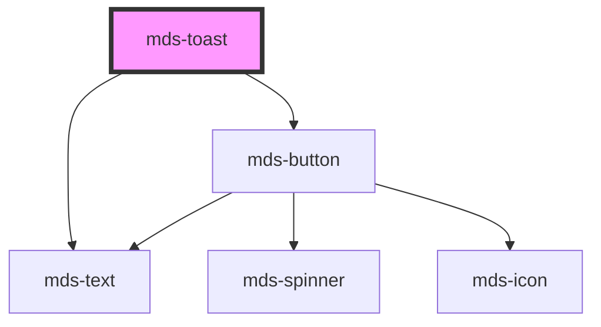

# mds-toast

This is a web-component from Maggioli Design System [Magma](https://magma.maggiolicloud.it), built with StencilJS, TypeScript, Storybook. It's based on the web-component standard and it's designed to be agnostic from the JavaScript framework you are using.

<!-- Auto Generated Below -->


## Usage

### 1. Description

The `<mds-toast>` web component is the transient notification surface of the Magma Design System, used to surface brief, non-blocking feedback messages that appear over the viewport and auto-dismiss after a timeout. It has no native HTML equivalent and orchestrates its own visibility, positioning, and auto-close lifecycle.

#### Semantic Behavior

- **Announced**: The host is a status region (`role="status"`): the message is read out when the toast shows it, without moving the focus. While not visible, the message is hidden from assistive technologies too, not only moved out of the viewport. Inside an `<mds-toast-region>` the region is the status region and the toast has no role of its own.
- **Inside a region**: In an `<mds-toast-region>` the toast is laid out by the region, in a column with the other toasts visible at the same time, instead of being fixed at its edge on its own; the region gives it its `position`. A hidden toast in a region takes no room once its exit is over, and its entrance and exit are a short fade towards the edge.
- **Auto-dismiss timer**: When `visible` is true and `duration` is a positive number, an internal timer counts down and then sets `visible` back to `false`; setting `duration` to `0` (or falsy) keeps the toast on screen until it is closed intentionally.
- **The timer waits for the person**: The countdown stops while the pointer is over the toast or the focus is inside it (on its action, on its hide button), and goes on with the time that was left once both have left: the toast does not take its action away while the person is reading it or reaching the action.
- **Hide button**: With `dismissible`, the toast shows at its end a button with an arrow towards the edge it leaves by (down at the bottom, up at the top), named in the current language and reachable with the keyboard; it hides the toast. It is an arrow and not a cross because the action next to it may itself be a cancel ("Annulla"): the arrow only sends the message away.
- **Close event**: Whenever the toast hides, the component emits `mdsToastClose` once, after the outro animation - consumers should listen for this to remove the toast from the DOM or update queue state. The `reason` of its detail says who hid it: `timeout` (the `duration` ran out), `close` (the person, with the hide button) or `hide` (your code removed `visible`). A toast shown again before the outro is over emits nothing for that hiding.
- **Reactive timer**: Showing the toast again (`visible` back to true) or changing `duration` at runtime restarts the countdown; hiding it stops the countdown, so a toast hidden by your code closes once, as `hide`, and never again as `timeout`.
- **Conditional regions**: The text region renders only when the host has inner content, and the action region is shown only while a `[slot="action"]` child is present, following the children added or removed later - empty slots produce no layout.
- **Default-slot is text**: The default slot is intended for a plain text string only; icons go in the `icon` slot and interactive controls in the `action` slot.

#### Properties & Visual Configurations

The shared `variant` / `tone` ladders are defined in [`docs/agents/variants.md`](../../../../../../docs/agents/variants.md); `<mds-toast>` consumes the theme variant set and the minimal tone set (`'strong'` / `'weak'`) without adding component-specific values.

#### Other behavioral props

- **`position`** anchors the toast to one of the six viewport corners/edges (top or bottom, left/center/right), driving both placement and the direction of the entry/exit animation; pick the edge that matches where users expect ephemeral feedback to surface.
- **`visible`** is the controlled on/off switch for the toast; toggling it drives the show/hide animation and the auto-dismiss timer rather than mounting or unmounting the element.
- **`duration`** is the visibility window in milliseconds before auto-dismiss; use a longer value for messages that carry an action the user must reach, and `0` for toasts that must stay until explicitly closed.
- **`dismissible`** shows the hide button; give it to a toast that stays (`duration="0"`) when its action is not what every person wants ("Riprova"), so the person can send the message away without using it.
- **`deletable`** is the old name of `dismissible`, deprecated: the button dismisses the message, it deletes nothing. It still works, and goes in the next major.

#### Slots

- **`icon`** holds a leading glyph (recommended `mds-icon`); **`action`** holds interactive follow-ups (recommended `mds-button`) and, when present, renders inside a dedicated actions container.


### 2. Pattern

Correct and idiomatic ways to use the `<mds-toast>` component, ordered from most common to most specialized. Patterns assume a working knowledge of the variant / tone ladders documented in [`docs/agents/variants.md`](../../../../../../docs/agents/variants.md) and the shared component rules in [`docs/agents/conventions.md`](../../../../../../docs/agents/conventions.md).

#### Basic Text Toast

The simplest form. Set `visible` to show the toast; the default slot holds the message text only. The component auto-dismisses after the default 5000 ms.

```html
<mds-toast visible>
  Operazione completata con successo
</mds-toast>
```

#### Status Variants

Use `variant` to communicate the meaning of the feedback. The status family (`error`, `warning`, `info`, `success`) maps directly to the nature of the event. Do not pick a variant for its color alone.

```html
<!-- Conferma positiva -->
<mds-toast visible variant="success">
  Documento salvato correttamente
</mds-toast>

<!-- Errore bloccante -->
<mds-toast visible variant="error">
  Errore durante il salvataggio. Riprova.
</mds-toast>

<!-- Avviso non bloccante -->
<mds-toast visible variant="warning">
  La sessione scade tra 5 minuti
</mds-toast>

<!-- Informazione neutrale -->
<mds-toast visible variant="info">
  Aggiornamento disponibile
</mds-toast>
```

#### Tone for Emphasis

Pair `variant` with `tone` to adjust visual weight. `strong` (default) uses the stronger tint of the variant and a larger shadow; `weak` uses a softer tint and a smaller shadow for lower emphasis.

```html
<!-- Forte enfasi: errore urgente -->
<mds-toast visible variant="error" tone="strong">
  Connessione persa
</mds-toast>

<!-- Enfasi ridotta: info secondaria -->
<mds-toast visible variant="info" tone="weak">
  Sincronizzazione in background
</mds-toast>
```

#### Toast with Icon

Use the `icon` slot with an `<mds-icon>` to add a leading glyph. The icon color is tuned per variant.

```html
<mds-toast visible variant="success">
  <mds-icon slot="icon" name="mi/baseline/check-circle"></mds-icon>
  File caricato con successo
</mds-toast>
```

#### Toast with Action

Use the `action` slot with an `<mds-button>` to offer a follow-up. The action region appears only while a `[slot="action"]` child is present, also when it is added after the first render - no empty layout is produced otherwise.

```html
<mds-toast visible variant="error">
  <mds-icon slot="icon" name="mi/baseline/error-outline"></mds-icon>
  Invio non riuscito
  <mds-button slot="action" size="sm" variant="error" tone="weak">
    Riprova
  </mds-button>
</mds-toast>
```

#### Persistent Toast (No Auto-Dismiss)

Set `duration="0"` to keep the toast visible until the user explicitly acts. Use this when the message carries an action the user must not miss. Hide it from your action handler by removing `visible`, and add `dismissible` so the person can send the message away without using the action.

```html
<mds-toast visible variant="warning" duration="0" dismissible>
  <mds-icon slot="icon" name="mi/baseline/warning"></mds-icon>
  Sessione in scadenza
  <mds-button slot="action" size="sm" variant="warning" tone="weak">
    Rinnova
  </mds-button>
</mds-toast>
```

#### Custom Auto-Dismiss Duration

Override the 5000 ms default when the message needs more reading time (e.g. it carries an action) or can disappear faster (e.g. a trivial confirmation). Duration is in milliseconds.

```html
<!-- Messaggio breve: 2 secondi -->
<mds-toast visible variant="success" duration="2000">
  Copiato negli appunti
</mds-toast>

<!-- Con azione: 8 secondi -->
<mds-toast visible variant="info" duration="8000">
  Importazione completata con 3 avvisi
  <mds-button slot="action" size="sm" variant="info" tone="weak">
    Vedi report
  </mds-button>
</mds-toast>
```

#### Several Toasts at Once

Two toasts visible at the same time with the same `position` are drawn at the same place, one over the other. Append the toasts of the application to one `<mds-toast-region>`, placed once in its shell: it lines them up at its edge, announces them, and makes room when too many show at once.

```html
<mds-toast-region position="bottom-center">
  <mds-toast visible variant="success">Documento salvato</mds-toast>
  <mds-toast visible variant="success">Link copiato negli appunti</mds-toast>
</mds-toast-region>
```

#### Positioning

Use `position` to anchor the toast to one of the six viewport edges. Pick the edge that matches the application's layout convention - bottom-center is the default and works for most surfaces.

```html
<!-- Predefinito: centro in basso -->
<mds-toast visible variant="info" position="bottom-center">
  Messaggio salvato
</mds-toast>

<!-- Angolo in alto a destra (toolbar / panel) -->
<mds-toast visible variant="success" position="top-right">
  Impostazioni aggiornate
</mds-toast>
```

#### Listening for the Close Event

Listen for `mdsToastClose` to remove the toast from the DOM or update queue state after the outro animation completes. It is emitted once for every hiding, whoever hid the toast, and `event.detail.reason` says who: `timeout`, `close` (the hide button) or `hide` (your code). Do not react to `visible` becoming `false` directly - the animation is still running at that point.

```javascript
document.querySelector('mds-toast').addEventListener('mdsToastClose', (event) => {
  // rimuovi il toast dalla coda o aggiorna lo stato dell'applicazione
  toastQueue.shift();
  if (event.detail.reason === 'close') {
    // la persona ha mandato via il messaggio senza usare l'azione
  }
});
```

#### Styling Customization

Style the toast only through its public `--mds-toast-*` CSS custom properties: the background, the text colour, the width and the shadow. Set them on the host element or a parent selector; use the semantic color roles via `rgb(var(--magma-<role>))` so dark mode and high-contrast modes keep working.

```css
.app-notifications mds-toast {
  --mds-toast-background: rgb(var(--magma-surface-inverse));
  --mds-toast-color: rgb(var(--magma-on-inverse));
  --mds-toast-width: 480px;
  --mds-toast-shadow: var(--shadow-xl);
}
```


### 3. Antipattern

Common incorrect uses of `<mds-toast>`. Each entry pairs the wrong form with the right one and a one-line reason. System-wide rules (boolean-as-string, shadow piercing, Tailwind color utilities, raw native event listening) live in [`docs/agents/anti-patterns.md`](../../../../../../docs/agents/anti-patterns.md) - they apply here too but are not repeated.

#### Do Not Put HTML in the Default Slot

The default slot accepts plain text only; nested elements are rendered inside the caption text and break the layout. Use the `icon` slot for an icon and the `action` slot for buttons.

```html
<!-- INCORRECT -->
<mds-toast visible variant="error">
  <strong>Errore:</strong> salvataggio fallito
  <mds-button>Riprova</mds-button>
</mds-toast>

<!-- CORRECT -->
<mds-toast visible variant="error">
  <mds-icon slot="icon" name="mi/baseline/error-outline"></mds-icon>
  Salvataggio fallito
  <mds-button slot="action" size="sm" variant="error" tone="weak">Riprova</mds-button>
</mds-toast>
```

#### Do Not Leave a Persistent Toast Without a Way to Send It Away

A toast with `duration="0"` stays until something hides it. When its action is not what the person wants, nothing makes it go away: it covers the page until your code removes it. Add `dismissible`.

```html
<!-- INCORRECT - only "Riprova" makes it go away -->
<mds-toast visible variant="error" duration="0">
  Invio non riuscito
  <mds-button slot="action" size="sm" variant="error" tone="weak">Riprova</mds-button>
</mds-toast>

<!-- CORRECT - the arrow sends the message away -->
<mds-toast visible variant="error" duration="0" dismissible>
  Invio non riuscito
  <mds-button slot="action" size="sm" variant="error" tone="weak">Riprova</mds-button>
</mds-toast>
```

#### Do Not Set `duration="0"` to Mean "Use the Default"

Setting `duration="0"` explicitly disables auto-dismiss and keeps the toast on screen until the user closes it. To use the 5000 ms default, omit the attribute entirely.

```html
<!-- INCORRECT - disables auto-dismiss unintentionally -->
<mds-toast visible variant="success" duration="0">
  Documento salvato
</mds-toast>

<!-- CORRECT - default 5000 ms applies -->
<mds-toast visible variant="success">
  Documento salvato
</mds-toast>
```

#### Do Not Use `visible="false"` to Hide the Toast

Setting a boolean attribute to the string `"false"` leaves the attribute on the element. The toast itself reads it as hidden, but every presence check (`[visible]`, `hasAttribute('visible')`, as in the cleanup code below) still reads it as visible. Remove the attribute entirely (or set the prop to `undefined`) to hide the toast.

```html
<!-- INCORRECT - presence checks still read the toast as visible -->
<mds-toast visible="false" variant="info">
  Sincronizzazione in corso
</mds-toast>

<!-- CORRECT - attribute absent means hidden -->
<mds-toast variant="info">
  Sincronizzazione in corso
</mds-toast>
```

#### Do Not React to `visible` Becoming `false` to Clean Up

When the timer fires it sets `visible` to `false`, but the outro animation is still running. Listening to that attribute change too early removes the element mid-animation. Wait for `mdsToastClose`, which fires after the animation completes.

```javascript
// INCORRECT - element may still be animating
const toast = document.querySelector('mds-toast');
const observer = new MutationObserver(() => {
  if (!toast.hasAttribute('visible')) {
    toast.remove();
  }
});
observer.observe(toast, { attributes: true });

// CORRECT - fires after the outro animation
toast.addEventListener('mdsToastClose', () => {
  toast.remove();
});
```

#### Do Not Use a Variant Without Checking Its Acceptance

`<mds-toast>` accepts `variant` values from `ThemeVariantType` but ships CSS overrides only for `light`, `dark`, `error`, `warning`, `info`, and `success`. Using `variant="primary"` or `variant="ai"` is valid by type but produces no themed color overrides - the toast falls back to its base inverse colors, the same as `dark`. Stick to the six variants above.

```html
<!-- INCORRECT - no color override; looks identical to variant="dark" -->
<mds-toast visible variant="primary">
  Azione confermata
</mds-toast>

<!-- CORRECT - uses a variant with full CSS support -->
<mds-toast visible variant="success">
  Azione confermata
</mds-toast>
```

#### Do Not Use `tone="outline"` or `tone="text"`

`<mds-toast>` uses `ToneMinimalVariantType`, which accepts only `strong` and `weak`. Passing `tone="outline"` or `tone="text"` silently falls back to the default and produces no visual difference.

```html
<!-- INCORRECT - value not in ToneMinimalVariantType -->
<mds-toast visible variant="info" tone="outline">
  Aggiornamento disponibile
</mds-toast>

<!-- CORRECT -->
<mds-toast visible variant="info" tone="weak">
  Aggiornamento disponibile
</mds-toast>
```

#### Do Not Customize via Undocumented Shadow Parts or Internal Selectors

The supported surface is the public `--mds-toast-*` CSS custom properties. There are no documented `::part()` targets for `<mds-toast>`; targeting internal class names with `::part()`, `>>>`, or attribute-selector hacks couples your code to the shadow DOM implementation and will break on minor releases.

```css
/* INCORRECT */
mds-toast >>> .dialog {
  border-radius: 0;
}

/* CORRECT - use the public custom properties */
mds-toast {
  --mds-toast-background: rgb(var(--magma-surface-inverse));
  --mds-toast-color: rgb(var(--magma-on-inverse));
  --mds-toast-width: 360px;
}
```


## Properties

| Property      | Attribute     | Description                                                                                                                                                                                                                                                                                                                                                          | Type                                                                                                 | Default           |
| ------------- | ------------- | -------------------------------------------------------------------------------------------------------------------------------------------------------------------------------------------------------------------------------------------------------------------------------------------------------------------------------------------------------------------- | ---------------------------------------------------------------------------------------------------- | ----------------- |
| `deletable`   | `deletable`   | <span style="color:red">**[DEPRECATED]**</span> Use `dismissible`: the button dismisses the message, it deletes nothing. Goes in the next major.<br/><br/>Shows the hide button, as `dismissible` does.                                                                                                                                                              | `boolean \| undefined`                                                                               | `undefined`       |
| `dismissible` | `dismissible` | Shows a button that hides the toast, an arrow towards the edge the toast leaves by                                                                                                                                                                                                                                                                                   | `boolean \| undefined`                                                                               | `undefined`       |
| `duration`    | `duration`    | If set, specifies the visibility duration in milliseconds of the element inside the viewport, when the time is up the visible property will be set to false. The countdown waits while the pointer is over the toast or the focus is inside it. If the duration is set to 0 the toast stays until it is hidden: give it `dismissible` so the person can hide it too. | `number \| undefined`                                                                                | `5000`            |
| `position`    | `position`    | Sets position of toast                                                                                                                                                                                                                                                                                                                                               | `"bottom-center" \| "bottom-left" \| "bottom-right" \| "top-center" \| "top-left" \| "top-right"`    | `'bottom-center'` |
| `tone`        | `tone`        | Sets the tone of the color variant                                                                                                                                                                                                                                                                                                                                   | `"strong" \| "weak" \| undefined`                                                                    | `'strong'`        |
| `variant`     | `variant`     | Sets the theme variant colours                                                                                                                                                                                                                                                                                                                                       | `"ai" \| "dark" \| "error" \| "info" \| "light" \| "primary" \| "success" \| "warning" \| undefined` | `'light'`         |
| `visible`     | `visible`     | Specifies if toast is visible at the bottom or not                                                                                                                                                                                                                                                                                                                   | `boolean \| undefined`                                                                               | `undefined`       |


## Events

| Event           | Description                                                                                                                                                                                           | Type                                    |
| --------------- | ----------------------------------------------------------------------------------------------------------------------------------------------------------------------------------------------------- | --------------------------------------- |
| `mdsToastClose` | Emits once the toast is hidden and its exit animation is over, whoever hid it: the `reason` of the detail says who, `timeout`, `close` (the person, with the hide button) or `hide` (the application) | `CustomEvent<MdsToastCloseEventDetail>` |


## Slots

| Slot       | Description                                                                                                       |
| ---------- | ----------------------------------------------------------------------------------------------------------------- |
|            | Add `text string` to this slot, **avoid** to add `HTML elements` or `components` here.                            |
| `"action"` | Add `HTML elements` or `components`, it is **recommended** to use `mds-button` element.                           |
| `"icon"`   | Insert an icon image, it can be `HTML elements` or `components`, it is **recommended** to add `mds-icon` element. |


## CSS Custom Properties

| Name                     | Description                                                                                                                                                                 |
| ------------------------ | --------------------------------------------------------------------------------------------------------------------------------------------------------------------------- |
| `--mds-toast-background` | Public. Background color of the toast component.                                                                                                                            |
| `--mds-toast-color`      | Public. Text color inside the toast.                                                                                                                                        |
| `--mds-toast-duration`   | Duration of the transition that shows and hides the toast; `mdsToastClose` is emitted when the hiding one is over. How long the toast stays visible is the `duration` prop. |
| `--mds-toast-icon-color` | Color of the icon inside the toast.                                                                                                                                         |
| `--mds-toast-shadow`     | Public. Shadow applied to the toast container.                                                                                                                              |
| `--mds-toast-width`      | Public. Width of the toast component.                                                                                                                                       |


## Dependencies

### Depends on

- [mds-text](../mds-text)
- [mds-button](../mds-button)

### Graph


----------------------------------------------

Built with love @ [Gruppo Maggioli](https://www.maggioli.com) from [R&D Department](https://www.maggioli.com/it-it/chi-siamo/ricerca-sviluppo)
