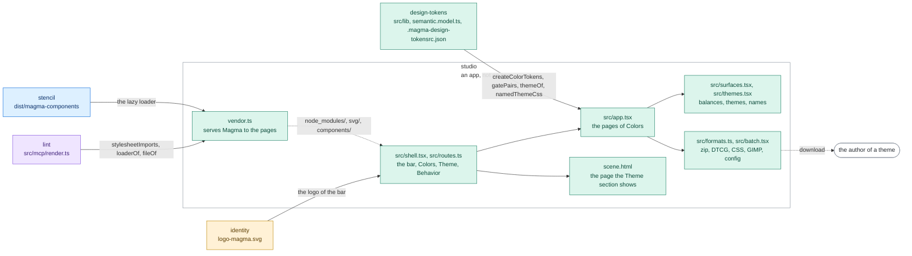

# studio

The studio of Magma: whoever installs Magma defines a theme from a UI, honest about contrast and
aware of every axis Magma has (epic #693). It is an app of this repository, not a package: it is
not published on npm.

```bash
nx run studio:serve    # the dev server, on http://localhost:5177 (builds the components first)
nx run studio:build    # the static app, in dist/
nx run studio:test     # Vitest, jsdom
```

The port is pinned (`strictPort`): when 5177 is busy the studio is already running, so the server
stops instead of opening a second instance on another port.

## The shell

The bar of the studio follows the app-shell block of Magma (the logo, "Magma Studio" and under it
the version of the Magma it runs on, which `vendor.ts` writes into the page) and holds three
sections, in the order of the work (#693, decided 2026-11-05):

| Section | Pages | What it is |
| --- | --- | --- |
| **Colors** (a menu) | Palette, Contrast scales, Semantic surface, Themes, Groups, then Diffs | the tokens playground that used to live in `design-tokens` (#695), one page per view; the menu opens with the verdict of the contrast gate on the configuration being edited |
| **Theme** | one page | the theme full screen, on a scene of a product in an iframe, with its controls floating over it: the theme to show, then one button per axis (typography, shape, density, depth, the preferences of the person, dimension) |
| **Behavior** (a menu) | Design language, Patterns, Blocks | what Magma decided and the layer of a product, read-only; placeholders until their turn (#693, "The plan") |

Every page is a link with an address in the hash (`#/colors/palette`, `#/theme`,
`#/behavior/patterns`, `src/routes.ts`), so the studio works from whatever folder serves it. The
Colors pages stay mounted under the other sections, so their work is not lost; each opens with the
head of the page-header block, the first thing of the region that scrolls (it scrolls with the
page, and beside the list of the Palette it heads the larger column): the title, one line, then the actions (a menu with Reset and Load
config, Copy JSON or Save, and last Download all tokens, a split button whose menu holds the
other downloads).

The Theme section shows the scene (`scene.html`) in an iframe, a document of its own: the theme is
set on its `<html>` (`data-theme-name`), and the preferences of the person live in its own
`mds-pref` panel, which writes on its own document. Both move the scene and leave the studio alone
(#695, "The dogfooding constraint"). Today the select offers the themes Magma ships and only the
preferences have a panel; the panels of the other axes come with #696, the scenes with #697.

The **Themes** page names each theme apart from the family it is drawn from: `editorial` is drawn
from `bisque`. The names of the themes Magma ships (`semantic.config.ts`, `themes`) are reserved,
the deprecated ones included, so a theme of a product never takes one, and a name is lowercase
words joined by hyphens (`THEME_NAME` of `semantic.model.ts`).

## The pages in Magma

Every page is written with the components of Magma (#695): the controls of a form go through the
bridges of `src/magma.tsx` (`Field`, `TextInput`, `Select`, `Check`, `Range`), which hand back
the next value as a native control of Preact does and never the echo of a value the page set (the
change events of `mds-input`, `mds-input-select` and `mds-input-range` leave on that too). A value
the page parses or sorts (a name, a stop of a scale, a list of export groups) takes
`commit="leave"`: it is handed back on Enter or on leaving the field, as the change of a native
input, not at every key. Dialogs are an `mds-modal` with an `mds-banner` window, the main action
last; destructive actions sit in the menu of their item.

Each page keeps its rules in the sheet beside its module (`palette.css`, `scales.css`, ...),
from the tokens only: spaces from the rhythm, widths from the widths, colours from the semantic
roles, a length with no relation a step of `--spacing`. `style.css` holds the frame: the shell,
the Theme section and the frame of the pages of Colors; the document is the one of Magma.

Four pieces Magma does not have yet stay native, painted with the tokens, each marked in the code
with its issue until the component lands:

| Piece | Where | Issue |
| --- | --- | --- |
| a colour field | the base colour of a family, New color | #1260 |
| a range of several values | the axis of a contrast scale | #1261 |
| a list and its detail | the families of the Palette | #1262 |
| a chip with a colour swatch | the families of Semantic surface (the usage of a scale draws the swatch as the icon of an `mds-chip`, `swatchIcon`) | #1263 |

## Magma from the installed one

The studio never bundles the Magma components nor their stylesheets: its pages load them from the
Magma installed where the studio runs ([`ARCHITECTURE.md`](../../docs/ARCHITECTURE.md), "Magma as
an external vendor"), as a render of the MCP server does. `vendor.ts` uses the code of the render
(`projects/lint/src/mcp/render.ts`; "The page a render loads" in
[`CONTRACTS.md`](../../docs/CONTRACTS.md)):

- each page imports the stylesheets of `agents/assets.md` in their layers (`stylesheetImports`),
  sets the folder of the icons for `mds-icon` and loads the lazy loader of the installed magma
  (`loaderOf`), with paths relative to the page: `node_modules/`, `svg/`, `components/`;
- the dev server and `vite preview` serve those three paths from the installed packages (`fileOf`);
- the tags are written after Vite has processed the page, so the build leaves them as they are:
  whoever hosts the built studio serves the same three paths beside it.

In this repository the installed magma is the build of `stencil`, so `serve` and `build` build it
first (an implicit dependency). A test holds the bundle to the rule: no component and no runtime
of Stencil in `dist/assets`.

## Architecture

The studio runs the engine of `design-tokens` in the browser: it imports its sources (Vite turns
the `.mjs` specifiers of the `.mts` files into the sources, and replaces `chalk` with a stub) and
generates the palette, the surfaces and the themes on every edit. Nothing it shows is computed by
a copy: the default balances are the `theme` block of `.magma-design-tokensrc.json`, the floors
of the text roles those of the contrast gate, the verdict of the Colors menu the pairs of
`gatePairs` judged against the baseline of design-tokens, and the export of a theme is printed by
the code that writes `themes.css`.



Rectangles: this repository; rounded boxes: outside it. Solid arrows: inside the repository;
dashed: where the package is installed. Labels: the file, export or command that crosses.
Colours: purple ai, amber assets, teal visual, blue components, grey tooling, white outside
([convention](../../docs/ARCHITECTURE.md#diagrams-of-the-projects)).

The engine, `semantic.config.ts` and the theme files stay in `design-tokens`: the builds of
`design-tokens` and `styles` read them, and moving them here would make `design-tokens` depend on
the studio.

## The pages of Colors

The studio loads `.magma-design-tokensrc.json` of `design-tokens` and runs the real token
generator in the browser, so every preview matches the build output exactly. Colors has six
pages: **Palette** (the two-column editor: color list on the left, editing and live light/dark
scale previews with achieved contrast on the right; `neutral` is selected by default when
present), **Contrast scales**, **Semantic surface** (opt families into the surface engine, tune
the surface/border/text levels), **Themes** (each opted family as a named theme, with its accent
assignment and contrast checks), **Groups** and **Diffs**. Selecting a color from the sidebar while in contrast scales
keeps you there, since the scale samples follow the selected color.

The **diff** view compares the current palette against the one generated from the committed
configuration (the bundled `.magma-design-tokensrc.json`): it lists the colors whose steps
changed - outlining each changed step and badging the color with the largest perceptual distance
(deltaE) - plus any colors added or removed. The generated token files under
`design-tokens/tokens/color/generated/` are build artifacts and not committed, so the committed
config is the baseline.

The studio works with any configuration, not just the repo one: **Load config** (in the menu of
the head of the page) opens a `.magma-design-tokensrc.json` from disk and **Copy JSON** copies the
edited configuration to the clipboard. **Download all tokens (zip)** is the main action of the
page, a split button (`mds-button-dropdown`) whose menu offers the other downloads:

- **All tokens (zip)**, the main action - the configuration, the generated JSON tokens (whole palette + one file
  per export group) and the CSS and GIMP renders, mirroring the `dist` layout of `design-tokens`;
- **Figma tokens (DTCG)** - the color palette in the W3C DTCG format, one file per theme mode,
  zipped together (the "Figma export" of the `design-tokens` README);
- **Config (json)** - just the `.magma-design-tokensrc.json`;
- **CSS tokens** - `colors-hex.css` / `colors-rgb.css` for the whole palette plus one pair per
  export group;
- **GIMP palette** - `colors.gpl` for the whole palette plus one `.gpl` per export group.

CSS and GIMP respect export diversification: they emit the whole palette and one file per export
group. When that yields more than one file the download is a zip (`magma-css.zip`,
`magma-gimp.zip`); a single file downloads directly. The outputs are produced in the browser from
the same Handlebars templates the build uses, so they match the CLI output. Editing is in-memory
only: nothing touches the repo files.

The **Themes** page exports the CSS of every theme it shows: the `data-theme-name` block of each
theme, under its name, drawn from its family, with its reassigned accents and its own contrast
blocks, printed by `namedThemeCss` of `design-tokens/semantic.model.ts`, the function that writes
`themes.css`: the block of `editorial` is the one `themes.css` ships.

A reload keeps the work: the studio mirrors it to the browser's localStorage as a draft, stamped
with the configuration it was made on (the bundled one, or the file a server serves). When that
configuration changed after the draft was saved (edited, removed, or another file), a draft with
no edits of its own gives way to it, and a draft with edits shows why and asks: **Use the file on
disk** (or **Use the bundled config**) or **Keep the draft**. Saving stays off until you pick, so
the draft cannot overwrite the newer file by mistake.

Served by a command that answers `GET` / `PUT /api/config` and `POST /api/build` (the `ui` command
of `design-tokens` did it until version 16; the command of the studio comes with #695), the
studio loads the configuration on disk, swaps **Copy JSON** for **Save** and adds **Build tokens on
disk** to the Download menu. Run on its own, the API is absent and editing stays in memory.

New colors are created from a dialog: pick the value and the name auto-completes underneath from
the "Name That Color" vocabulary (via [color-namer](https://github.com/colorjs/color-namer), ~1500
names, kebab-cased: e.g. `persian-green`); choose the token group, confirm, and the studio lands
on the new color already selected. Names are made unique with a numeric suffix when needed.
Auto-naming keeps following the picker in the editor too, but only for names assigned by the
studio itself: a name typed by the user, or any name coming from a loaded configuration, is never
touched. Picking a value already used by another color raises a warning.

The **groups** view manages `ratios`, `formula` and `export` per token group (writing the
`groups` section of the configuration), with a compact preview of every member color; colors
overriding the group individually are flagged. The per-color fields in the editor default to
inheriting from the group.

A *group selected* toggle lifts the ticked colors into a dedicated **Selected** section at the
top, lining their scales up next to each other for quick comparison; the rest stay in their group
cards below. Nothing is hidden, only reorganized.

It also supports batch export editing across groups: tick colors (or pick an existing export from
*select by export* to load every color that uses it) and open **batch export**. The dialog
previews the picked colors, lets you untick any to drop them, and then either saves an export
value onto the selection or downloads a zip of just that selection's tokens.

The **contrast scales** view manages the ratio scales of the configuration: add, duplicate,
rename or delete custom scales (the built-in ones, `default` first of all, are always available)
and inspect the distribution of the stops on a horizontal axis. A usage panel at the top picks a
scale and lists every color resolving to it, ordered by group; clicking a color makes it the
sample for all the scale previews. Each scale has a distribution mode: pick an easing (`linear`,
`ease-in`, `ease-out`, `ease-in-out`) and the stops regenerate live from steps/min/max, or go
`manual` by dragging a marker or editing a stop directly. Scale values are contrast against the
theme background (0 = on the background, max = strongest contrast), so the same scale yields
dark-on-light in light mode and light-on-dark in dark mode. Every color picks its scale with the
`ratios` field in the editor.
