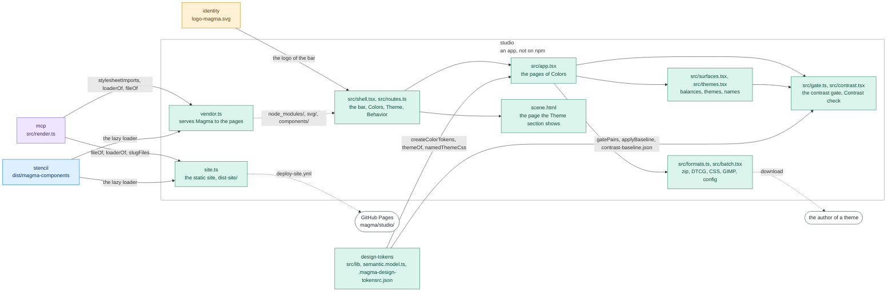

# studio

The studio of Magma: whoever installs Magma defines a theme from a UI, honest about contrast and
aware of every axis Magma has (epic #693). It is an app of this repository, not a package: it is
not published on npm.

```bash
nx run studio:serve       # the dev server, on http://localhost:5177 (builds the components first)
nx run studio:build       # the static app, in dist/
nx run studio:build.site  # the site for a static host, in dist-site/: the app and the Magma it loads
nx run studio:test        # Vitest, jsdom; the static site in the Playwright Chromium
```

The port is pinned (`strictPort`): when 5177 is busy the studio is already running, so the server
stops instead of opening a second instance on another port.

## The shell

The bar of the studio follows the app-shell block of Magma (the logo, "Magma Studio" and under it
the version of the Magma it runs on, which `vendor.ts` writes into the page) and holds three
sections, in the order of the work (#693, decided 2026-11-05):

| Section | Pages | What it is |
| --- | --- | --- |
| **Colors** (a menu) | Palette, Contrast scales, Semantic surface, Themes, Groups, then Contrast check and Diffs | the tokens playground that used to live in `design-tokens` (#695), one page per view; the menu opens with the verdict of the contrast gate on the configuration being edited, and the button of the section counts the pairs that fail it (#698) |
| **Theme** | one page | the theme on a scene of a product in an iframe, the whole section, and a bar at the bottom: the theme to show, one button per axis (typography, shape, density, depth, the preferences of the person, dimension), then the ruler of the preview (the view and the width of the frame) |
| **Behavior** (a menu) | Design language, Patterns, Blocks | what Magma decided and the layer of a product, read-only; placeholders until their turn (#693, "The plan") |

Every page is a link with an address in the hash (`#/colors/palette`, `#/theme`,
`#/behavior/patterns`, `src/routes.ts`), so the studio works from whatever folder serves it. The
Colors pages stay mounted under the other sections, so their work is not lost; each opens with the
head of the page-header block, the first thing of the region that scrolls (it scrolls with the
page, and beside the list of the Palette it heads the larger column): the title with the verdict
of the contrast gate beside it, one line, then the actions (a menu with Reset and Load config,
Copy JSON or Save, and last Download all tokens, a split button whose menu holds the other
downloads).

The Theme section shows the scene (`scene.html`) in an iframe, a document of its own: the theme is
set on its `<html>` (`data-theme-name`), and the preferences of the person on its own `mds-pref-*`,
which apply them on that document. Both move the scene and leave the studio alone (#695, "The
dogfooding constraint"). An axis of the bar opens its controls in an `mds-dropdown` from its
button, and the bar shows only the axes with controls: today the preferences, the others come back
with theirs (#696).
Their dropdown holds controls of the studio, not the `mds-pref-*` themselves, which would write on
the document of the studio: the mode and the contrast are written on the `<html>` of every frame,
the other choices are set on its hidden `mds-pref-*` (`src/scene-prefs.tsx`); their modes, English
words and defaults are those of the components (`test/scene-prefs.test.mts` holds them to the
sources).

The select offers the themes of the configuration being edited, the ones the Themes page lists
(each tint with a surface, the base first), and the frame paints them: the studio writes into it,
over the stylesheets of the installed Magma, the palette of the configuration and the block of
each theme, printed by the code that writes the files Magma ships (`colors-rgb.css` and
`themes.css`, `src/scene-css.ts`). So `porcelain` is a theme of the bundled configuration though
Magma ships none by that name. The choices made on the Themes page, the name of a theme, the
accents it repoints and the colour modes it is used in, are the studio's (`src/theme-choices.ts`):
the frame paints the themes as that page exports them, and a theme of one mode is seen in that
mode only, the other modes of the preferences off and `pref-theme-scheme-<mode>` on the frame, as
mds-pref-theme writes it. They are kept in the storage of the studio beside the draft, so a reload
keeps them, until the configuration keeps the themes itself (#694).

What the theme is checked under, not what is edited (#697), opens from the same bar, so the frame
takes the whole section (2026-11-06): the mode (light, dark, or both side by side, two frames that
scroll together) and the contrast head the dropdown of the preferences of the person; the ruler
opens the preview, the view (Scenes or Groups, below) and the width of the frame (the room of the
section, or a breakpoint of Magma, `--breakpoint-desktop`, `-tablet`, `-mobile`, where its layouts
change). The mode and the contrast are not exported: the studio writes them on the `<html>` of
each frame as the preferences of Magma do (`applyFrame`), and the panel of the scene has neither,
since a mode stored in the origin would bring the two frames to the same one.

The scene is a demo of the components, as the one of the daisyUI theme generator (#697, Scenes):
the desk of an office of a back office, one card per task side by side in columns, so a theme is
judged on most of Magma at once: a hue on a themed surface, text at every prominence, borders, a
disabled state, the solid fills of the main actions, the colours of the states. The steps of the
request in hand take the width of the page above the columns: `mds-stepper-bar` centres the
current step and would push the first out of a column.

The Groups view (`groups.html`) shows the components by their role in the composition, the
vocabulary of the dimension axis, so the preview explains the controls beside it: `container`
(card, banner, accordion, table, dropdown, tooltip, the window of a dialog), `control` (button,
input, select, textarea, tab) and `marker` (checkbox, switch, badge, chip, label, avatar, dot).
The groups and their members are those of the draft of the axis (#691,
`projects/styles/draft/theme-dimension-design.md`, section 3, on `691-dimension-axis-draft`) until
the axis lands. Each component is shown at every variant, tone and state it publishes
(`magma.api.txt`), the brand buttons aside, with the surfaces, the text at every prominence and the
borders at every level. Two things it does not draw on load: the focus ring, since a frame that
took the focus would take it from the studio (Tab into the frame to see it), and an open modal,
which would cover the frame (its window stands for it). The avatars carry an icon: initials pick
the colour of the person and override the variant.

The **Themes** page shows each theme on the canvas of Semantic surface (`SurfaceCanvas`), the light
mode over the dark one, each with the accents of the theme, and names each theme apart from the
family it is drawn from: `editorial` is drawn
from `bisque`. A theme can be drawn from a family of any group, one created in the studio
included, except `status` (`RESERVED_GROUPS` of `src/surfaces.tsx`): its families always generate
surfaces, so that banners, toasts and badges get a text role legible on their own tint, but a theme
in a status colour would mix with the messages that colour carries; Semantic surface lists them in
a row of their own, under the others, and says so. The names of the themes Magma ships (`semantic.config.ts`, `themes`) are reserved,
the deprecated ones included, so a theme of a product never takes one, and a name is lowercase
words joined by hyphens (`THEME_NAME` of `semantic.model.ts`). Under its accents a theme says the
colour modes it can be used in, the `color.modes` of a theme file (#1274): light and dark, the
default, light only or dark only; the mode it does not offer stays in view, dimmed.

## The pages in Magma

Every page is written with the components of Magma (#695): the controls of a form go through the
bridges of `src/magma.tsx` (`Field`, `TextInput`, `Select`, `Check`, `Range`), which hand back
the next value as a native control of Preact does and never the echo of a value the page set (the
change events of `mds-input`, `mds-input-select` and `mds-input-range` leave on that too). A value
the page parses or sorts (a name, a stop of a scale, a list of export groups) takes
`commit="leave"`: it is handed back on Enter or on leaving the field, as the change of a native
input, not at every key. Dialogs are an `mds-modal` with an `mds-banner` window, the main action
last; destructive actions sit in the menu of their item.

Each page keeps its rules in the sheet beside its module (`palette.css`, `scales.css`, ...),
from the tokens only: spaces from the rhythm, widths from the widths, colours from the semantic
roles, a length with no relation a step of `--spacing`. `style.css` holds the frame: the shell,
the Theme section and the frame of the pages of Colors; the document is the one of Magma.

Four pieces Magma does not have yet stay native, painted with the tokens, each marked in the code
with its issue until the component lands:

| Piece | Where | Issue |
| --- | --- | --- |
| a colour field | the base colour of a family, New color | #1260 |
| a range of several values | the axis of a contrast scale | #1261 |
| a list and its detail | the families of the Palette (each an `mds-button`, its swatch the icon `mdi/circle` painted through `::part(icon)`) | #1262 |
| a chip with a colour swatch | the families of Semantic surface (the usage of a scale draws the swatch as the icon of an `mds-chip`, `swatchIcon`) | #1263 |

## Magma from the installed one

The studio never bundles the Magma components nor their stylesheets: its pages load them from the
Magma installed where the studio runs ([`ARCHITECTURE.md`](../../docs/ARCHITECTURE.md), "Magma as
an external vendor"), as a render of the MCP server does. `vendor.ts` uses the code of the render
(`projects/mcp/src/render.ts`; "The page a render loads" in
[`CONTRACTS.md`](../../docs/CONTRACTS.md)):

- each page imports the stylesheets of `agents/assets.md` in their layers (`stylesheetImports`),
  sets the folder of the icons for `mds-icon` and loads the lazy loader of the installed magma
  (`loaderOf`), with paths relative to the page: `node_modules/`, `svg/`, `components/`;
- the dev server and `vite preview` serve those three paths from the installed packages (`fileOf`);
- the tags are written after Vite has processed the page, so the build leaves them as they are:
  whoever hosts the built studio serves the same three paths beside it;
- for a host that serves files only, `build.site` writes them as files (`site.ts`, below).

In this repository the installed magma is the build of `stencil`, so `serve` and `build` build it
first (an implicit dependency). A test holds the bundle to the rule: no component and no runtime
of Stencil in `dist/assets`.

## On GitHub Pages

The studio of `main` is published at <https://magma-design-system.github.io/magma/studio/>,
beside the Storybook (`magma/storybook/`), by the `deploy site` workflow
(`.github/workflows/deploy-site.yml`): a repository has one Pages site, so both are built in the
same run. The docs site links to it; a page links to a page of the studio by its hash, such as
`studio/#/colors/palette` or `studio/#/theme`. Mounting the studio inside a page of the docs site
(#693 "On the site", #695 "Two hosts, one app") is a later step.

GitHub Pages serves files only, so `nx run studio:build.site` (`site.ts`) writes into
`dist-site/` the build with, beside its pages, the files `fileOf` serves to the dev server:

- `node_modules/`: the stylesheets each page imports and what they load in turn, the fonts of
  `@fontsource` among them, followed from the pages of the build;
- `components/`: the folder of the lazy loader of the installed magma, whole, since the loader
  imports the chunk of each component as it first renders;
- `svg/`: every icon slug of the installed sets (`slugFiles` of `projects/mcp/src/icons.ts`):
  the files of `mdi` and `mgg` as they are, the Material folders under the slugs of their
  variants (`mi/outline/auto-awesome` is `auto_awesome/outline.svg`).

A path a page asks for that the installed packages do not hold stops the site instead of
publishing a 404, and so does an icon set that is not installed. `test/site.test.mts` serves the
site as Pages does, files only and under `magma/studio/`, and opens the studio, the Theme section,
the scene and the groups in Chromium: each loads its icons and fonts, and nothing it asks for is
missing.

There is no API beside the pages on Pages: the site writes `<meta name="magma-studio-api"
content="none">` into them and the studio does not ask `/api/config`. Editing stays in memory, the
draft in the localStorage of the browser, and the work leaves by its downloads (the zip of the
tokens, the config, the CSS of the themes), as when the studio runs without its command.

## The contrast gate

The studio runs the APCA contrast gate of design-tokens in the browser, on the configuration being
edited, at every edit (#698, `src/gate.ts`): the pairs `nx run design-tokens:contrast` measures,
with its targets and its baseline, through its own engine (`contrast-gate.ts`, driven by
`semantic.config.ts`), so the studio and the CI judge a pair the same way: every text role on every
surface (Lc 75 / 75 / 45 / 30), the on-emphasis text of each hue on its fill and the states of the
fill (Lc 75 in light, 70 in dark), the text of the hues and of the neutral band on their washes,
and the pairs the gate only reports (coloured text on the surfaces, the borders).

What differs is which themes. The CI judges the themes Magma ships (`semantic.themes`); the studio
judges the themes of the configuration it edits, as the Themes page defines and exports them
(`configThemes` of `src/scene-css.ts`, the list the select of the Theme section offers): the base
theme is the base layer of the gate, every other one a theme of the gate with its family, its ramp
and the accents it repoints, keyed `<theme>:<pair>` as the CLI keys it, so the baseline accepts
the same offenders. An accent the base theme repoints reaches the themes that leave it alone, as
`:root` does in the CSS the page exports. On the configuration Magma builds with the studio
measures the base and `editorial` exactly as the CLI does (`test/gate.test.mts` holds it).

Every pair is measured in both modes, and judged in the modes its theme is used in: a theme of one
mode (#1274) is never painted in the other, since `mds-pref-theme` locks it, so its pairs there say
"not offered" and fail nothing.

The verdict is in view while the configuration is edited: beside the title of every page of
Colors (the status of the page-header block), as a count on the Colors button of the bar, which
stays in view wherever the page scrolls (`mds-notification`), at the head of the Colors menu, and
per mode on each card of the Themes page. The **Contrast check** page lists every pair of every
theme, the two modes side by side with the sample of the two colours, the measure and its badge,
one table per category of the gate; a switch keeps only the pairs below their target. The badges
read as the previews of Semantic surface: `error` fails the build, `warning` is under a target the
gate only reports, `info` is accepted by the baseline, a decorative border has no floor.

A configuration that fails the gate is handed out only by choice, never by default: while it
fails, every way out of the studio (the downloads, Build tokens on disk, Save, Copy JSON, Copy
CSS of the Themes page, Export selection of a batch) opens a dialog first. Its question counts the
pairs below target, its text names the action and the consequence and lists the first pairs, with
a link to the Contrast check page; Cancel and Esc never export, and the action repeats its verb
("Download anyway"), as `confirm-action` (`ask-first-many`) asks. The draft the studio keeps in the
browser is no export: it is saved whatever the verdict.

## Architecture

The studio runs the engine of `design-tokens` in the browser: it imports its sources (Vite turns
the `.mjs` specifiers of the `.mts` files into the sources, and replaces `chalk` with a stub) and
generates the palette, the surfaces and the themes on every edit. Nothing it shows is computed by
a copy: the default balances are the `theme` block of `.magma-design-tokensrc.json`, the floors
of the text roles those of the contrast gate, its verdict the pairs of `gatePairs` on the themes of
the configuration judged against the baseline of design-tokens, and the export of a theme is
printed by the code that writes `themes.css`.



Rectangles: this repository; rounded boxes: outside it. Solid arrows: inside the repository;
dashed: where the package is installed. Labels: the file, export or command that crosses.
Colours: purple ai, amber assets, teal visual, blue components, grey tooling, white outside
([convention](../../docs/ARCHITECTURE.md#diagrams-of-the-projects)).

The engine, `semantic.config.ts` and the theme files stay in `design-tokens`: the builds of
`design-tokens` and `styles` read them, and moving them here would make `design-tokens` depend on
the studio.

## The pages of Colors

The studio loads `.magma-design-tokensrc.json` of `design-tokens` and runs the real token
generator in the browser, so every preview matches the build output exactly. Colors has seven
pages: **Palette** (the two-column editor: color list on the left, editing and live light/dark
scale previews with achieved contrast on the right; `neutral` is selected by default when
present; where the detail has the room, the ramps stand upright beside the family and the global
settings, held in view while they scroll, and Ramps / Theme swaps them for the theme the family
backs on the scene, small as a phone, light or dark, painted with the configuration at every
change, `src/palette-side.tsx`), **Contrast scales**, **Semantic surface** (opt families into the surface engine, tune
the surface/border/text levels), **Themes** (each opted family, status aside, as a named theme, with its accent
assignment, its colour modes and the verdict of the contrast gate per mode), **Groups**, **Contrast check** (every pair of the contrast gate, above) and **Diffs**. Selecting a color from the sidebar while in contrast scales
keeps you there, since the scale samples follow the selected color.

The **diff** view compares the current palette against the one generated from the committed
configuration (the bundled `.magma-design-tokensrc.json`): it lists the colors whose steps
changed - outlining each changed step and badging the color with the largest perceptual distance
(deltaE) - plus any colors added or removed. The generated token files under
`design-tokens/tokens/color/generated/` are build artifacts and not committed, so the committed
config is the baseline.

The studio works with any configuration, not just the repo one: **Load config** (in the menu of
the head of the page) opens a `.magma-design-tokensrc.json` from disk and **Copy JSON** copies the
edited configuration to the clipboard. **Download all tokens (zip)** is the main action of the
page, a split button (`mds-button-dropdown`) whose menu offers the other downloads:

- **All tokens (zip)**, the main action - the configuration, the generated JSON tokens (whole palette + one file
  per export group) and the CSS and GIMP renders, mirroring the `dist` layout of `design-tokens`;
- **Figma tokens (DTCG)** - the color palette in the W3C DTCG format, one file per theme mode,
  zipped together (the "Figma export" of the `design-tokens` README);
- **Config (json)** - just the `.magma-design-tokensrc.json`;
- **CSS tokens** - `colors-hex.css` / `colors-rgb.css` for the whole palette plus one pair per
  export group;
- **GIMP palette** - `colors.gpl` for the whole palette plus one `.gpl` per export group.

CSS and GIMP respect export diversification: they emit the whole palette and one file per export
group. When that yields more than one file the download is a zip (`magma-css.zip`,
`magma-gimp.zip`); a single file downloads directly. The outputs are produced in the browser from
the same Handlebars templates the build uses, so they match the CLI output. Editing is in-memory
only: nothing touches the repo files.

The **Themes** page exports the CSS of every theme it shows: the `data-theme-name` block of each
theme, under its name, drawn from its family, with its reassigned accents and its own contrast
blocks, printed by `namedThemeCss` of `design-tokens/semantic.model.ts`, the function that writes
`themes.css`: the block of `editorial` is the one `themes.css` ships. A theme of one mode
declares it first in its block (`--magma-color-modes`, read by `mds-pref-theme`); the base theme
declares it under its own name too, since a lock in `:root` would reach every theme.

A reload keeps the work: the studio mirrors it to the browser's localStorage as a draft, stamped
with the configuration it was made on (the bundled one, or the file a server serves). When that
configuration changed after the draft was saved (edited, removed, or another file), a draft with
no edits of its own gives way to it, and a draft with edits shows why and asks: **Use the file on
disk** (or **Use the bundled config**) or **Keep the draft**. Saving stays off until you pick, so
the draft cannot overwrite the newer file by mistake.

Served by a command that answers `GET` / `PUT /api/config` and `POST /api/build` (the `ui` command
of `design-tokens` did it until version 16; the command of the studio comes with #695), the
studio loads the configuration on disk, swaps **Copy JSON** for **Save** and adds **Build tokens on
disk** to the Download menu. Run on its own, the API is absent and editing stays in memory.

New colors are created from a dialog: pick the value and the name auto-completes underneath from
the "Name That Color" vocabulary (via [color-namer](https://github.com/colorjs/color-namer), ~1500
names, kebab-cased: e.g. `persian-green`); choose the token group, confirm, and the studio lands
on the new color already selected. Names are made unique with a numeric suffix when needed.
Auto-naming keeps following the picker in the editor too, but only for names assigned by the
studio itself: a name typed by the user, or any name coming from a loaded configuration, is never
touched. Picking a value already used by another color raises a warning.

The **groups** view manages `ratios`, `formula` and `export` per token group (writing the
`groups` section of the configuration), with a compact preview of every member color; colors
overriding the group individually are flagged. The per-color fields in the editor default to
inheriting from the group.

A *group selected* toggle lifts the ticked colors into a dedicated **Selected** section at the
top, lining their scales up next to each other for quick comparison; the rest stay in their group
cards below. Nothing is hidden, only reorganized.

It also supports batch export editing across groups: tick colors (or pick an existing export from
*select by export* to load every color that uses it) and open **batch export**. The dialog
previews the picked colors, lets you untick any to drop them, and then either saves an export
value onto the selection or downloads a zip of just that selection's tokens.

The **contrast scales** view manages the ratio scales of the configuration: add, duplicate,
rename or delete custom scales (the built-in ones, `default` first of all, are always available)
and inspect the distribution of the stops on a horizontal axis. A usage panel at the top picks a
scale and lists every color resolving to it, ordered by group; clicking a color makes it the
sample for all the scale previews. Each scale has a distribution mode: pick an easing (`linear`,
or a family from `sine` to `circ` as `-in`, `-out` or `-in-out`: the named easings of the engine,
`easing.mts`, which the hue shift ramps with too) and the stops regenerate live from steps/min/max, or go
`manual` by dragging a marker or editing a stop directly. Scale values are contrast against the
theme background (0 = on the background, max = strongest contrast), so the same scale yields
dark-on-light in light mode and light-on-dark in dark mode. Every color picks its scale with the
`ratios` field in the editor.
