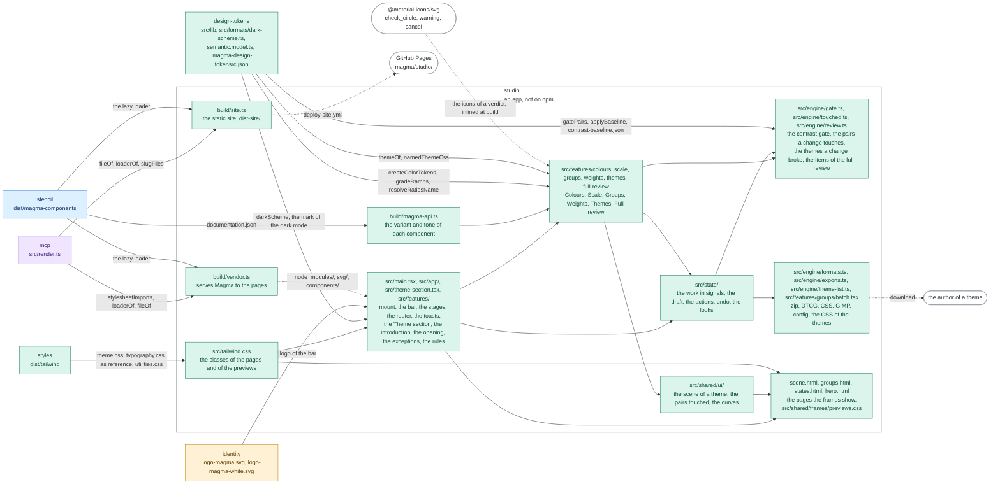

# studio

The studio of Magma: whoever installs Magma defines a theme from a UI, honest about contrast and
aware of every axis Magma has (epic #693). It is an app of this repository, not a package: it is
not published on npm.

```bash
nx run studio:serve       # the dev server, on http://localhost:5177 (builds the components first)
nx run studio:build       # the static app, in dist/
nx run studio:build.site  # the site for a static host, in dist-site/: the app and the Magma it loads
nx run studio:test        # Vitest: node, jsdom, and the Playwright Chromium (*.e2e.mts, the static site)
nx run studio:check.types # after a build: tsc on the sources, the tests and the build tools, as the CI types job
nx run studio:check.lint  # after a build: the lint of Magma (strict) on the pages and the sheets, as the CI magma-lint job
```

The port is pinned (`strictPort`): when 5177 is busy the studio is already running, so the server
stops instead of opening a second instance on another port.

## The views

The studio loads `.magma-design-tokensrc.json` of `design-tokens` and runs the real token
generator in the browser, so every preview matches the build output exactly. Its views are those of
[`studio.object-model.md`](studio.object-model.md) (sections 4 and 5, the decisions dated there),
one page each in `docs/`: #1403 and #1404 replaced the pages of the Colors section with them, and
the old addresses open the view that took their place ([The shell](docs/shell.md)). The side of a
view (the scene, the states of a sample) stands beside its fields from 60rem of the view
(`--container-side` of `src/tailwind.css`); narrower, Colours shows the ramps alone, Scale its
states under the fields, Weights, Themes and the full review no scene: a page as tall as a phone
would push the work down.

| View | Address | What it is for | Page |
| --- | --- | --- | --- |
| The shell | every page | the bar, the stages in order, the changes, the exit, the toasts and the notices | [shell.md](docs/shell.md) |
| Introduction | `#/introduction` (`#/start`) | what the studio is for and how the work goes | [introduction.md](docs/introduction.md) |
| Opening | `#/opening` | the preset to work on, from four starts; where a new theme is born | [opening.md](docs/opening.md) |
| 1. Colours | `#/colours` | a family at the centre, to adjust a colour and see what it paints | [colours.md](docs/colours.md) |
| Scale | `#/colours/scale/<formula>/<name>` | a contrast scale at the centre, beside Colours | [scale.md](docs/scale.md) |
| Groups | `#/groups` | what the families inherit, and the export groups; outside the stages | [groups.md](docs/groups.md) |
| 2. Weights | `#/weights` | the weights of the preset, one mode at a time | [weights.md](docs/weights.md) |
| 3. Themes | `#/themes`, `#/themes/<name>` | the tint, the accents and the modes of a theme, on the scene | [themes.md](docs/themes.md) |
| 4. Exceptions | `#/exceptions` | a page that says the stage comes after Magma 3 | [exceptions.md](docs/exceptions.md) |
| Full review | `#/full-review`, `#/full-review/<theme>/<mode>` | every theme in every mode, looked at before the exit | [full-review.md](docs/full-review.md) |
| Theme section | `#/theme`, `#/theme/<theme>/<mode>` | the theme on a scene, the whole section, its axes and the preview; outside the stages | [theme-section.md](docs/theme-section.md) |
| Rules | `#/behavior/design-language`, `/patterns`, `/blocks` | the design language, the patterns and the blocks of Magma, read only; each page says what it will hold | `src/features/rules/` |
| The preset in and out | the opening, the exit of the bar | importing, saving and downloading a preset, the draft, the command | [preset.md](docs/preset.md) |
| Languages | the menu of the person | English and Italian, and how a text of the studio is written | [languages.md](docs/languages.md) |

## The pages in Magma

Every page is written with the components of Magma (#695): the controls of a form go through the
bridges of `src/shared/magma/magma.tsx` (`Field`, `TextInput`, `ColorInput`, `Select`, `Check`,
`Range`), which hand back the next value as a native control of Preact does and never the echo of a
value the page set (the change events of `mds-input`, `mds-input-select` and `mds-input-range` leave
on that too). A value the page parses or sorts (a name, a stop of a scale, a list of export groups)
takes `commit="leave"`: it is handed back on Enter or on leaving the field, as the change of a
native input, not at every key. A `Range` whose bounds change with what the page shows (the sliders
of the surfaces of Weights, whose span depends on the mode) is keyed by what sets the bounds:
`mds-input-range` kept across them takes the new value under the old bounds, clamps it and hands the
clamped value back as a change, which the page writes (every surface at 50%, seen in #1403). Dialogs
are an `mds-modal` with an `mds-banner` window, the main action last; destructive actions sit in the
menu of their item.

The `mds-*` tags are typed by the magma installed beside the studio:
`src/shared/magma/elements.d.ts` imports the `JSX.IntrinsicElements` its build publishes
(`dist/types/components.d.ts`) as a type, renames the handlers of the events `onMds*` -> `onmds*`
(the names Preact listens to) and adds the attributes Preact takes on any element. A prop renamed or
removed in Magma fails `check.types`; nothing of Magma reaches the bundle.

The bridges are tried against the real components: `src/shared/magma/magma.e2e.mts` runs in the
`browser` project of Vitest (`vite.config.ts`), whose page loads the installed magma through
`build/vendor.ts` as every page of the studio does, and the person types, chooses and moves the
slider through Playwright. The pages are tried in jsdom (the `jsdom` project), where the tags never
upgrade; the engine and the checks of the build in Node (the `node` project).

Each page keeps its rules in the sheet beside its module (`colours.css`, `scale.css`, ...),
from the tokens only: spaces from the rhythm, widths from the widths, colours from the semantic
roles, a length with no relation a step of `--spacing`. `style.css` holds the frame: the shell
and the Theme section; the document is the one of Magma.

The pieces Magma does not have yet stay native, painted with the tokens, each marked in the code
with its issue until the component lands:

| Piece | Where | Issue |
| --- | --- | --- |
| a range of several values | the axis of a contrast scale | #1261 |
| a list and its detail | the families of Colours and the themes of Themes (each an `mds-button`, its swatch the icon `mdi/circle` painted through `::part(icon)`) | #1262 |
| a checklist to review | the items of the full review (each an `mds-button`, how it stands in its icon and its name) | #1490 |

## Magma from the installed one

The studio never bundles the Magma components nor their stylesheets: its pages load them from the
Magma installed where the studio runs ([`ARCHITECTURE.md`](../../docs/ARCHITECTURE.md), "Magma as
an external vendor"), as a render of the MCP server does. `build/vendor.ts` uses the code of the
render (`projects/mcp/src/render.ts`; "The page a render loads" in
[`CONTRACTS.md`](../../docs/CONTRACTS.md)):

- each page imports the stylesheets of `agents/assets.md` in their layers (`stylesheetImports`),
  sets the folder of the icons for `mds-icon` and loads the lazy loader of the installed magma
  (`loaderOf`), with paths relative to the page: `node_modules/`, `svg/`, `components/`;
- the dev server and `vite preview` serve those three paths from the installed packages (`fileOf`);
- the tags are written after Vite has processed the page, so the build leaves them as they are:
  whoever hosts the built studio serves the same three paths beside it;
- for a host that serves files only, `build.site` writes them as files (`build/site.ts`, below).

In this repository the installed magma is the build of `stencil`, so `serve` and `build` build it
first (an implicit dependency). A test holds the bundle to the rule: no component and no runtime
of Stencil in `dist/assets`.

What the studio reads of the API of that magma, it reads at build time: `build/magma-api.ts` takes
the `variant` and the `tone` of each component from its `documentation.json` (as the lint and the
MCP server read it, `readData`) and hands the pages these two props alone, as the virtual module
`virtual:magma-api`, not the megabytes of the documentation. A magma with no documentation gives no
component, and the previews of a colour say that it paints none.

## On GitHub Pages

The studio of `main` is published at <https://magma-design-system.github.io/magma/studio/>,
beside the Storybook (`magma/storybook/`), by the `deploy site` workflow
(`.github/workflows/deploy-site.yml`): a repository has one Pages site, so both are built in the
same run. The docs site links to it; a page links to a page of the studio by its hash, such as
`studio/#/colours` or `studio/#/theme`. The page of Pages is a host like the others, which mounts
the studio with `mount` ("Architecture", below); mounting it inside a page of the docs site
(#693 "On the site", #695 "Two hosts, one app") comes with #1364.

Magma says this address to whoever installs it: `studio` at the top of its `documentation.json`
(`STUDIO_URL` of `projects/stencil/scripts/story-titles-lib.ts`, #1294), for the docs site and the
agents of the products; the agent guide of theming links it too. Moving the studio moves the folder of `deploy-site.yml`, the
`og:url` of `index.html` and that constant together: `story-titles-lib.spec.ts` fails on the
first two out of step with the third.

GitHub Pages serves files only, so `nx run studio:build.site` (`build/site.ts`) writes into
`dist-site/` the build with, beside its pages, the files `fileOf` serves to the dev server:

- `node_modules/`: the stylesheets each page imports and what they load in turn, the fonts of
  `@fontsource` among them, followed from the pages of the build;
- `components/`: the folder of the lazy loader of the installed magma, whole, since the loader
  imports the chunk of each component as it first renders;
- `svg/`: every icon slug of the installed sets (`slugFiles` of `projects/mcp/src/icons.ts`):
  the files of `mdi` and `mgg` as they are, the Material folders under the slugs of their
  variants (`mi/outline/auto-awesome` is `auto_awesome/outline.svg`).

A path a page asks for that the installed packages do not hold stops the site instead of
publishing a 404, and so does an icon set that is not installed. `test/site.test.mts` serves the
site as Pages does, files only and under `magma/studio/`, and opens the studio, the Theme section,
the scene and the groups in Chromium: each loads its icons and fonts, and nothing it asks for is
missing.

There is no API beside the pages on Pages: the site writes `<meta name="magma-studio-api"
content="none">` into them and the studio does not ask `/api/config`. Editing stays in memory, the
draft in the localStorage of the browser, and the work leaves by its downloads (the zip of the
tokens, the config, the CSS of the themes), as when the studio runs without its command.

### Covers

How the studio shows in a tab and on other sites, as the docs site does for itself
(magma-design-system/docs, `agents/architecture.md`, "Covers"):

- **Favicons.** `build/favicons.ts`, a plugin of Vite, draws them with `sharp` from the Magma mark
  of `identity`, the one of the bar: the SVG for the tabs (white on a dark scheme), the ICO for the
  browsers without SVG favicons, the touch icon of iOS on white, the icons and the manifest of
  Android. It serves them under `favicons/` to the dev server, writes them there into the build
  and links them from the studio, relative to the page; the pages of the frames have none.
- **The preview of a link.** `index.html` holds the Open Graph tags LinkedIn, chats and Twitter
  read: the title, the description (the same as the `description` of the page), the address of
  the studio on Pages and its cover, both absolute, as those sites ask.
- **The cover.** `public/covers/og-1200x630.png`, the `og:image`, copied by the build as it is,
  so its address never changes: `<use>-<width>x<height>.png`, as the covers of the docs site.
  `nx run studio:cover` (`build/cover.ts`) takes it again from the built studio in the Playwright
  Chromium, at 1200 by 630 with the motion reduced: Colours on the primary colour by default (the
  recipe `palette`, through the alias `#/colors/palette`), or another recipe
  (`npx tsx build/cover.ts theme-light /tmp/cover.png` in `projects/studio`). Take it again when
  the studio changes the way it looks, before a link to it is shared.

A site caches the preview of an address the first time it reads it: after a new cover, ask it to
read the page again (LinkedIn: the Post Inspector) before sharing. `test/share.test.mts` holds the
favicons to the sizes each host asks for and the tags to the cover the build holds.

## The contrast gate

The studio runs the APCA contrast gate of design-tokens in the browser, on the configuration being
edited, at every edit (#698, `src/engine/gate.ts`): the pairs `nx run design-tokens:contrast`
measures, with its targets and its baseline, through its own engine (`contrast-gate.ts`, driven by
`semantic.config.ts`), so the studio and the CI judge a pair the same way: every text role on every
surface (Lc 75 / 75 / 45 / 30), the on-emphasis text of each hue on its fill and the states of the
fill (Lc 75 in light, 70 in dark), the text of the hues and of the neutral band on their washes,
and the pairs the gate only reports (coloured text on the surfaces, the borders).

What differs is which themes. The CI judges the themes Magma ships (`semantic.themes`); the studio
judges the themes of the configuration it edits, as the stage Themes defines them and the CSS of
the themes exports them (`configThemes` of `src/engine/scene-css.ts`, the list the select of the Theme section offers): the
base theme is the base layer of the gate, every other one a theme of the gate with its family, its
ramp and the accents it repoints, keyed `<theme>:<pair>` as the CLI keys it, so the baseline accepts
the same offenders. An accent the base theme repoints reaches the themes that leave it alone, as
`:root` does in the CSS of the themes. On the configuration Magma builds with the studio
measures the base and `editorial` exactly as the CLI does (`src/engine/gate.test.mts` holds it).

Every pair is measured in both modes, and judged in the modes its theme is used in: a theme of one
mode (#1274) is never painted in the other, since `mds-pref-theme` locks it, so its pairs there say
"not offered" and fail nothing.

The verdict is in view while the configuration is edited: beside the title of every view of the
work (the status of the page-header block), per mode beside each theme of Themes, and item by item
on the [full review](docs/full-review.md), which judges every theme in every mode before the exit
(the count on the Colors button of the bar went with that menu, #1402: the exit asks while the
gate fails). A theme that passed at the last exit and fails now says so in a toast that stays
([The shell](docs/shell.md)). Beside what is edited stand the pairs it touches
(#1403, `src/engine/touched.ts`): the family on Colours, the scale on Scale, the weights of the
mode of the tab on Weights. They are measured, not mapped: the check runs again with that thing
moved far (the key colour of the family turned away in hue and lightness, the targets of the
scale pulled toward the background, the levels and the targets of the mode moved), and every pair
whose measure moves is one it touches. They stand under the name in a closed `mds-details`
(`src/shared/ui/touched-pairs.tsx`), their count and their verdict in its title; on Themes the
same detail holds every pair of the theme at the centre (`cellsOfTheme`). On Weights,
beside each text target stands the floor the gate holds the role to, marked when the target is
under it: the engine keeps a text over its floor on the washes of its family (#1414), so a slider
moved under the floor does not make the text weaker. The **full review** lists the pairs of each
theme in each mode it is used in, in three groups, those that block, the reported ones and the
debt the baseline accepts, each pair with the sample of the two colours, the measure and its
badge (`pairs.tsx` of `src/features/full-review/`): `error`
fails the build, `warning` is under a target the gate only reports, `info` is accepted by the
baseline, a decorative border has no floor.

A configuration that fails the gate is handed out only by choice, never by default: while it
fails, every way out of the studio (the downloads, the CSS of the themes among them, Build tokens
on disk, Save, Copy JSON, Export selection of a batch, the exit at the foot of the full review)
opens a dialog first (`src/features/full-review/gate-dialog.tsx`). Its question counts the
pairs below target, its text names the action and the consequence and lists the first pairs, with
a link to the full review; Cancel and Esc never export, and the action repeats its verb
("Download anyway"), as `confirm-action` (`ask-first-many`) asks. The draft the studio keeps in the
browser is no export: it is saved whatever the verdict.

## Architecture

The studio runs the engine of `design-tokens` in the browser: it imports its sources (Vite turns
the `.mjs` specifiers of the `.mts` files into the sources, and replaces `chalk` with a stub) and
generates the palette, the surfaces and the themes on every edit. Nothing it shows is computed by
a copy: the default weights are the `theme` block of `.magma-design-tokensrc.json`, the floors
of the text roles those of the contrast gate, its verdict the pairs of `gatePairs` on the themes of
the configuration judged against the baseline of design-tokens, and the export of a theme is
printed by the code that writes `themes.css`.



Rectangles: this repository; rounded boxes: outside it. Solid arrows: inside the repository;
dashed: where the package is installed. Labels: the file, export or command that crosses.
Colours: purple ai, amber assets, teal visual, blue components, grey tooling, white outside
([convention](../../docs/ARCHITECTURE.md#diagrams-of-the-projects)).

The folders of the studio (#1397; #1399 moved the files into them, #1400 added `state/` and
`app/`, #1404 the one entry, `src/main.tsx`):

- `build/`: what runs in Node, never in a page: the plugins of Vite (`vendor.ts`, `magma-api.ts`,
  `favicons.ts`) and the commands (`site.ts`, `cover.ts`).
- `src/engine/`: what computes and paints, with no Preact and no state: `generator`, `gate`,
  `paints`, `scene-css`, `formats`, `hue-ends`, `color-names`, the changes of the preset
  (`changes`), what the opening opens (`opening`), the model of the themes
  (`themes.ts`), of the theme choices (`theme-choices.ts`), the groups kept for the status
  colours and those with no surfaces (`groups.ts`), and since #1403 a family as Colours and Groups
  read it (`families`), the chromatic order (`colour-order`), the pairs a change touches
  (`touched`), the weights and the order of the surfaces (`weights`), the verdict of a colorspace
  (`colorspace-verdict`), and since #1404 the themes as Themes lists them and the CSS of the themes
  (`theme-list`), the items of the full review and the print of a look (`review`), the themes a
  change broke (`brokenSince` of `gate`); `chalk-stub`; `modules.d.ts`, the types of `apca-w3`
  and `color-namer`, which ship none.
- `src/shared/`: what several pages use: `magma/` (the bridges to the components and the types of
  their tags), `frames/` (the previews in a frame, `states`, their texts, and `previews.css`, the
  short sheet of the pages the frames show), `i18n/` (the languages;
  `text.ts` is the part with no Preact), `routes/` (the table of the pages and their addresses),
  `ui/` (`verdict.tsx`, and since #1403 what two views
  share: the pairs touched, the editors of the hue shifting and of the saturation; since #1404 the
  scene of a theme, `theme-scene.tsx`, which Themes and the full review show, and the purposes of
  the roles Weights names, `role-purposes.ts`: the canvas of the surfaces went with the Themes
  page).
- `src/state/`: the work in Preact Signals, one state per studio mounted (`studio.ts`,
  `createStudio`, read through `StudioContext`): the configuration, the scales last loaded, the
  family selected, the theme choices, the looks of the full review, where the work comes from and
  where it was (`workPlace`) as
  signals; the gate, its verdict, the themes a change broke (`broken`), the CSS of the scene and
  the ramps as computed values; the draft
  written by an effect, checked against its source (`draft.ts`, `work.ts`). The actions are named
  functions, one file per area (`palette`, `scales`, `surfaces`, `groups`, `theme-choices`,
  `themes`, `review`, `exports`, `work`, `opening`, `undo`), each tested in Node.
- `src/app/`: the shell and its bar (`shell.tsx`, since #1402, with the notices, the toasts and
  the dialog of the gate), the router (`router.ts`:
  `navigate(route, { replace })`, a location in the hash or in memory, an alias written over by
  the address of its page, a hash that does not start with `#/` left alone), the stages in order
  (`stages.tsx`), the changes (`changes.tsx`) and the menu of the exit (`config-menu.tsx`).
- `src/tailwind.css`: the entry of Tailwind (#1401), the Tailwind layer of Magma as
  `docs/agents/assets.md` writes it, with the theme of Magma imported as `reference`, so the
  bundle declares none of its variables and each utility reads the one of the Magma the page
  loads, the value of the theme only as the fallback of its `var()`. `test/tailwind.test.mts`
  holds that every name of the theme the installed sheets do not define falls back on one they
  define (all but two literals, each with its reason), that the bundle declares none, and that
  every class a page of `features/` writes reaches the bundle: written whole in a string, never
  glued to an expression (`gap-200${...}`), which the scanner of Tailwind does not read. It names
  the pages the frames show (`@source`), which sit at the root of the studio and are written in
  its classes too.
- `src/features/`: one folder per page: `rules`, the pages of Behavior
  (#1401); `introduction`, `opening` and `exceptions` (#1402); `colours`, `scale`, `groups` and
  `weights` (#1403); `themes` and `full-review` (#1404; the Contrast check page of #1401 was
  `contrast-check`). A page is written in the classes of
  Magma; its short sheet keeps what classes do not write, the data its previews paint (the steps of
  a ramp, the sample of a pair); its Italian catalogue (`i18n-it.ts`) goes to the translator
  (`useT(IT_...)`), which looks there before the catalogue of `shared/`; its tests sit beside it.
- `src/main.tsx`: the one entry every host calls (#1404), `mount(element, options)`, which puts a
  studio on an element of its page and returns `{ unmount }`, taking off its page, its router and
  the effects of its state. The options are what the host owns: `location`, `'hash'` (the hash of
  the window, the default) or `'memory'` for a host that owns the address of its page, with
  `address`, where it opens in memory (the introduction else); and the `StudioOptions` of
  `src/state/studio.ts`, `storage` (where the work is kept, the storage of the browser by
  default), `api` (whether a command may stand beside the page) and `download` (how a file reaches
  the person). In memory a click on a link of the studio (`#/...`, read through the shadow roots,
  since the link may be the `<a>` of an `mds-button`) opens its page in memory, the hash of the
  window left to the host. `index.html` is a host like the others and mounts it; the docs site and
  the command of #695 come with #1364.
- the rest of `src/`: the Theme section (`theme-section.tsx`) and the preferences of its frames
  (`scene-prefs.tsx`), not moved into `features/` yet; the mark of the bar in the dark mode
  (`dark-mode.ts`); the frame of the shell and of the Theme section (`style.css`).
- the root of the studio: `index.html`, and the pages the frames show, `scene.html`, `groups.html`,
  `states.html` and `hero.html`, written in the classes of Magma (`src/tailwind.css`) with a short
  sheet, `src/shared/frames/previews.css`, for what classes do not write (the order the scene takes
  when the studio puts first what a family paints).

Imports go one way, and ESLint holds it (`no-restricted-imports` in `eslint.config.mjs`): a file
of `engine` imports no other file of the studio but `shared/i18n/text.ts`, and types alone from
`build/`; a file of `shared` imports nothing of the pages; a file of `state` imports the engine,
`shared/i18n/text.ts` and the table of the pages (`shared/routes/routes.ts`), never a page,
`app/` or another part of `shared`; a page of `features/` imports the engine, the state and
`shared`, never `app/`, the shell, a page not moved yet or another page: its links go through the
table of the pages, its data through the state. A test sits beside its module and may import what
it is tested with. The tests (`*.mts`) keep a style of their own, with no semicolons, which prettier
does not write: lint-staged formats the `.ts` and `.tsx` only, so never run prettier on a folder.
The test of the translations (`test/i18n.test.mts`) reads every source as TSX, a `.ts` too: a
generic arrow, `const take = <V>(x: V) =>`, reads as JSX there and its text as a text of the
interface, so a generic is written as a `function`. `test/` keeps the checks of the build, of the site and of the translations, and the
tests of what has no folder of its own: the shell, the gate on every stage, the draft, the Theme
section and its preferences. Vitest runs `src/engine/`, `src/state/`, the table of
the pages, the router and the checks of the build in Node, every other `*.test.mts` in jsdom,
every `*.e2e.mts` in Chromium.

The sources are checked with `strict` on (`tsconfig.json`, #1404), by `check.types` and in the CI
types job, the sources of design-tokens the studio imports included: `src/engine/modules.d.ts`
declares what the studio and those sources call of `apca-w3` and `color-namer`, which ship no
types, and chroma-js takes its own from `@types/chroma-js`.

The lint of Magma reads the studio as it reads a product (#1401, `docs/agents/lint.md`, preset
`strict`): `magma/eslint` the markup of the pages, `class` included (`eslint.magma.config.mjs`),
`magma/stylelint` their sheets (`stylelint.config.mjs`). Its rules read the Magma that is built,
so they run in `nx run studio:check.lint` after a build, and in the `magma-lint` job of the
studio workflow on the build artifact, not in `nx run studio:lint`, which the lint workflow runs
with nothing built.

The engine, `semantic.config.ts` and the theme files stay in `design-tokens`: the builds of
`design-tokens` and `styles` read them, and moving them here would make `design-tokens` depend on
the studio.
