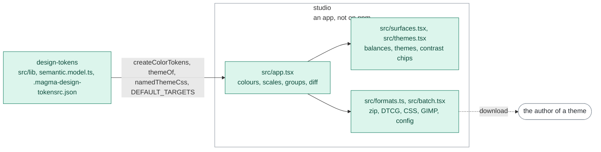

# studio

The studio of Magma: whoever installs Magma defines a theme from a UI, honest about contrast and
aware of every axis Magma has (epic #693). It is an app of this repository, not a package: it is
not published on npm.

Today it is the tokens playground that used to live in `design-tokens` (#695): the colours, the
contrast scales, the surfaces and the themes of a configuration, generated in the browser by the
engine of `design-tokens`. Its interface is rebuilt with Magma components next (#696, #697), and
it grows the sections of a product's definition (Foundation, Patterns, Blocks) after the theme.

```bash
nx run studio:serve    # the dev server, on http://localhost:5177
nx run studio:build    # the static app, in dist/
nx run studio:test     # Vitest, jsdom
```

The port is pinned (`strictPort`): when 5177 is busy the studio is already running, so the server
stops instead of opening a second instance on another port.

## Architecture

The studio runs the engine of `design-tokens` in the browser: it imports its sources (Vite turns
the `.mjs` specifiers of the `.mts` files into the sources, and replaces `chalk` with a stub) and
generates the palette, the surfaces and the themes on every edit. Nothing it shows is computed by
a copy: the default balances are the `theme` block of `.magma-design-tokensrc.json`, the floors
of the text roles those of the contrast gate, and the export of a theme is printed by the code
that writes `themes.css`.



Rectangles: this repository; rounded boxes: outside it. Solid arrows: inside the repository;
dashed: where the package is installed. Labels: the file, export or command that crosses.
Colours: purple ai, amber assets, teal visual, blue components, grey tooling, white outside
([convention](../../docs/ARCHITECTURE.md#diagrams-of-the-projects)).

The engine, `semantic.config.ts` and the theme files stay in `design-tokens`: the builds of
`design-tokens` and `styles` read them, and moving them here would make `design-tokens` depend on
the studio. The studio never bundles the Magma components nor their stylesheets: it takes them
from the Magma installed where it runs ([`ARCHITECTURE.md`](../../docs/ARCHITECTURE.md), "Magma as
an external vendor").

## Views

The studio loads `.magma-design-tokensrc.json` of `design-tokens` and runs the real token
generator in the browser, so every preview matches the build output exactly. It has five views:
**colors** (the two-column editor: color list on the left, editing and live light/dark scale
previews with achieved contrast on the right; `neutral` is selected by default when present),
**contrast scales**, **themes** (opt families into the surface engine, tune the surface/border/text
levels, and preview each opted family as a named theme with its accent assignment and contrast
checks), **groups** and **diff**. Selecting a color from the sidebar while in contrast scales
keeps you there, since the scale samples follow the selected color.

The **diff** view compares the current palette against the one generated from the committed
configuration (the bundled `.magma-design-tokensrc.json`): it lists the colors whose steps
changed - outlining each changed step and badging the color with the largest perceptual distance
(deltaE) - plus any colors added or removed. The generated token files under
`design-tokens/tokens/color/generated/` are build artifacts and not committed, so the committed
config is the baseline.

The studio works with any configuration, not just the repo one: **load config** opens a
`.magma-design-tokensrc.json` from disk and **copy JSON** copies the edited configuration to the
clipboard. The **download** menu offers:

- **All tokens (zip)** - the configuration, the generated JSON tokens (whole palette + one file
  per export group) and the CSS and GIMP renders, mirroring the `dist` layout of `design-tokens`;
- **Figma tokens (DTCG)** - the color palette in the W3C DTCG format, one file per theme mode,
  zipped together (the "Figma export" of the `design-tokens` README);
- **Config (json)** - just the `.magma-design-tokensrc.json`;
- **CSS tokens** - `colors-hex.css` / `colors-rgb.css` for the whole palette plus one pair per
  export group;
- **GIMP palette** - `colors.gpl` for the whole palette plus one `.gpl` per export group.

CSS and GIMP respect export diversification: they emit the whole palette and one file per export
group. When that yields more than one file the download is a zip (`magma-css.zip`,
`magma-gimp.zip`); a single file downloads directly. The outputs are produced in the browser from
the same Handlebars templates the build uses, so they match the CLI output. Editing is in-memory
only: nothing touches the repo files.

The **themes** view exports the CSS of every theme it shows: the `data-theme-name` block of each
family opted into a surface, its reassigned accents and its own contrast blocks, printed by
`namedThemeCss` of `design-tokens/semantic.model.ts`, the function that writes `themes.css`.

A reload keeps the work: the studio mirrors it to the browser's localStorage as a draft, stamped
with the configuration it was made on (the bundled one, or the file a server serves). When that
configuration changed after the draft was saved (edited, removed, or another file), a draft with
no edits of its own gives way to it, and a draft with edits shows why and asks: **use the file on
disk** (or **use the bundled config**) or **keep the draft**. Saving stays off until you pick, so
the draft cannot overwrite the newer file by mistake.

Served by a command that answers `GET` / `PUT /api/config` and `POST /api/build` (the `ui` command
of `design-tokens` did it until version 16; the command of the studio comes with #695), the
studio loads the configuration on disk, swaps **copy JSON** for **save** and adds **Build tokens on
disk** to the download menu. Run on its own, the API is absent and editing stays in memory.

New colors are created from a dialog: pick the value and the name auto-completes underneath from
the "Name That Color" vocabulary (via [color-namer](https://github.com/colorjs/color-namer), ~1500
names, kebab-cased: e.g. `persian-green`); choose the token group, confirm, and the studio lands
on the new color already selected. Names are made unique with a numeric suffix when needed.
Auto-naming keeps following the picker in the editor too, but only for names assigned by the
studio itself: a name typed by the user, or any name coming from a loaded configuration, is never
touched. Picking a value already used by another color raises a warning.

The **groups** view manages `ratios`, `formula` and `export` per token group (writing the
`groups` section of the configuration), with a compact preview of every member color; colors
overriding the group individually are flagged. The per-color fields in the editor default to
inheriting from the group.

A *group selected* toggle lifts the ticked colors into a dedicated **Selected** section at the
top, lining their scales up next to each other for quick comparison; the rest stay in their group
cards below. Nothing is hidden, only reorganized.

It also supports batch export editing across groups: tick colors (or pick an existing export from
*select by export* to load every color that uses it) and open **batch export**. The dialog
previews the picked colors, lets you untick any to drop them, and then either saves an export
value onto the selection or downloads a zip of just that selection's tokens.

The **contrast scales** view manages the ratio scales of the configuration: add, duplicate,
rename or delete custom scales (the built-in ones, `default` first of all, are always available)
and inspect the distribution of the stops on a horizontal axis. A usage panel at the top picks a
scale and lists every color resolving to it, ordered by group; clicking a color makes it the
sample for all the scale previews. Each scale has a distribution mode: pick an easing (`linear`,
`ease-in`, `ease-out`, `ease-in-out`) and the stops regenerate live from steps/min/max, or go
`manual` by dragging a marker or editing a stop directly. Scale values are contrast against the
theme background (0 = on the background, max = strongest contrast), so the same scale yields
dark-on-light in light mode and light-on-dark in dark mode. Every color picks its scale with the
`ratios` field in the editor.
