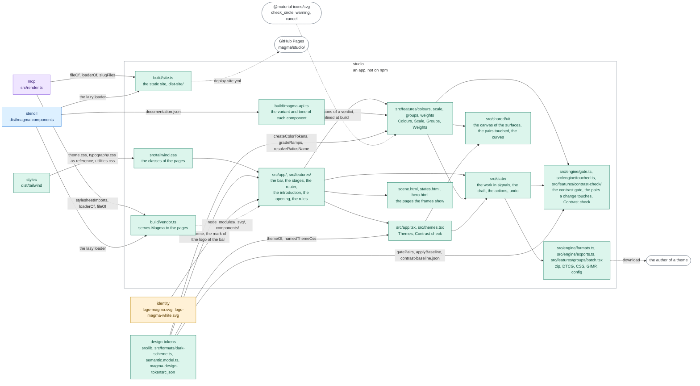

# studio

The studio of Magma: whoever installs Magma defines a theme from a UI, honest about contrast and
aware of every axis Magma has (epic #693). It is an app of this repository, not a package: it is
not published on npm.

```bash
nx run studio:serve       # the dev server, on http://localhost:5177 (builds the components first)
nx run studio:build       # the static app, in dist/
nx run studio:build.site  # the site for a static host, in dist-site/: the app and the Magma it loads
nx run studio:test        # Vitest: node, jsdom, and the Playwright Chromium (*.e2e.mts, the static site)
nx run studio:check.types # after a build: tsc on the sources, the tests and the build tools, as the CI types job
nx run studio:check.lint  # after a build: the lint of Magma (strict) on the pages and the sheets, as the CI magma-lint job
```

The port is pinned (`strictPort`): when 5177 is busy the studio is already running, so the server
stops instead of opening a second instance on another port.

## The shell

The bar of the studio follows the app-shell block of Magma (the logo, "Magma Studio" and under it
the version of the Magma it runs on, which `build/vendor.ts` writes into the page). The logo is the
Magma mark of `identity`, blue, and its white version in the dark mode, as the favicon and the docs
site show it: the sheets of the studio have no `dark:`, so `src/dark-mode.ts` matches the `<html>`
of the studio against `darkScheme` of design-tokens, the list the dark palette of Magma is printed
from, and the mark flips with the roles (the mode in the menu, light, dark or system, and the scheme
a theme is locked to).

The studio is one flow, the views of [`studio.object-model.md`](studio.object-model.md) (section
5), in order (#1402): the **introduction** (`#/introduction`), the **opening** (`#/opening`), then
the stages, **Colours**, **Weights**, **Themes**, **Exceptions**, and the **full review**, then the
exit. A start with no address opens the introduction, and so does `#/start`, the address of the
Start page it was (the router writes `#/introduction` in its place); the name of the studio at the
start of the bar links to it.

| Where | What it holds (`src/app/`) |
| --- | --- |
| **The bar** (`shell.tsx`, option A of its renders, 2026-11-27) | the product; what stands outside the stages, **Groups** (#1403), the **Theme** section and the **rules** (Behavior, a menu); then the work, always in view: the **changes** since the last exit, a button with their count that opens them by stage (`changes.tsx`), and the **exit**, a split button that saves the preset where a command takes saves and downloads it otherwise, through the contrast gate, the other formats in its menu (`config-menu.tsx`); the menu of the person at the end |
| **The stages** (`stages.tsx`) | under the bar, on a stage and on a page beside one, the stages in order in an `mds-stepper-bar`, the current one marked, the ones before it done and opened from it; at the end of a stage, the way back and the way forward named after where they lead, the last stage ending with the exit |

The stages are the pattern of the studio in its layer,
[`magma/patterns/stages-in-order.md`](magma/patterns/stages-in-order.md): Magma has no pattern for
stages in order (object model, section 8), so the studio writes its own, which the MCP server of
Magma reads (`get_pattern`) and checks (`layerErrors`). Each stage opens its view (`STAGES` of
`src/shared/routes/routes.ts`): Colours `#/colours` and Weights `#/weights`, the views #1403
built, with Scale beside Colours at the address of any scale (`placeOf`); Themes the Themes page,
`#/colors/themes`, until #1404 builds its view; the full review Contrast check,
`#/colors/contrast-check`; Exceptions has a page that says what it will hold
(`src/features/exceptions/`). Groups (`#/groups`) stands outside the stages, as the Theme section
and the rules (object model, section 5). Diffs went: the changes of the bar take its place.

The changes count every value of the preset that differs from the preset at the last exit
(`src/engine/changes.ts`, chosen 2026-11-27): a save or a download brings the count back to none,
and opening a preset starts it from that preset. The state keeps that preset in the draft
(`baseline`, `src/state/studio.ts`), so a reload keeps the count.

Every page is a link with an address in the hash (`#/colours`, `#/theme`, `#/behavior/patterns`,
`src/shared/routes/routes.ts`), so the studio works from whatever folder serves it. The addresses
of the pages #1403 replaced open the view that took their place, the router writing its address
over them (`ALIASES`): `#/colors/palette` Colours, `#/colors/contrast-scales` the scale `default`
of `wcag3`, `#/colors/groups` Groups, `#/colors/semantic-surface` Weights. The Theme section may
name the theme and the mode it opens on, `#/theme/editorial/dark`, and its address follows the
choices made there, replaced in place, so a reload or a link shows the same theme in the same
mode. A hash that does not start with `#/` is left alone: the anchor of a heading of a page that
hosts the studio. The work is the state's, not a page's (`src/state/`, #1400): a view is mounted
only while it is shown, and the bar, the Theme section, the introduction and the opening read the
same state, which keeps where the work was too (`workPlace`, the last stage or page beside one, in
the draft), so the opening resumes it there. Each view opens with the head of the page-header
block, the first thing of the region that scrolls: the title with the verdict of the contrast gate
beside it, then one line of what it holds. No view has a Save or a Reset of its own (they went
with the Palette, vittorio, 2026-11-27): what takes a preset out is the exit of the bar, what
brings one in the opening, and the actions are the state's (`src/state/work.ts`,
`src/state/exports.ts`, `src/state/opening.ts`), so they work from any page. What keeps the preset
from loading or saving shows over every page (`WorkNotices` of `src/app/shell.tsx`), and what
takes work away asks nothing and is undone from a toast (`UndoToasts`, confirm-action
`act-then-undo`): a preset opened over work with changes, a family or a scale deleted, a scale
taken back to its built-in steps (`src/state/undo.ts`); an edit after it closes the toast.

The Theme section shows the scene (`scene.html`) in an iframe, a document of its own: the theme is
set on its `<html>` (`data-theme-name`), and so are the preferences of the person, as the
`mds-pref-*` of Magma write them. Both move the scene and leave the studio alone (#695, "The
dogfooding constraint"). An axis of the bar opens its controls in an `mds-dropdown` from its
button, and the bar shows only the axes with controls: today the preferences, the others come back
with theirs (#696).
Their dropdown holds controls of the studio, not the `mds-pref-*` themselves, which would write on
the document of the studio: every choice is written on the `<html>` of every frame, the mode and
the contrast by `applyFrame`, the animations and the consumption by `applyPrefs`
(`src/scene-prefs.tsx`), as the components write them. The scene holds no `mds-pref-*` of its own:
it would keep its choice in the storage of the origin, which the frames share with the studio's own
preferences (#1336, "Languages" below). Their modes, words and defaults are those of the components
(`test/scene-prefs.test.mts` holds them to the sources).

The select offers the themes of the configuration being edited, the ones the Themes page lists
(each tint with a surface, the base first), and the frame paints them: the studio writes into it,
over the stylesheets of the installed Magma, the palette of the configuration and the block of
each theme, printed by the code that writes the files Magma ships (`colors-rgb.css` and
`themes.css`, `src/engine/scene-css.ts`). So `porcelain` is a theme of the bundled configuration
though Magma ships none by that name. The choices made on the Themes page, the name of a theme, the
accents it repoints and the colour modes it is used in, are the studio's
(`src/state/theme-choices.ts`): the frame paints the themes as that page exports them, and a
theme of one mode is seen in that mode only, the other modes of the preferences off and
`pref-theme-scheme-<mode>` on the frame, as mds-pref-theme writes it. They are kept in the
storage of the studio beside the draft, so a reload keeps them, until the configuration keeps the
themes itself (#694).

What the theme is checked under, not what is edited (#697), opens from the same bar, so the frame
takes the whole section (2026-11-06): the mode (light, dark, or both side by side, two frames that
scroll together) and the contrast head the dropdown of the preferences of the person; the ruler
opens the preview, the view (Scenes or Groups, below) and the width of the frame (the room of the
section, or a breakpoint of Magma, `--breakpoint-desktop`, `-tablet`, `-mobile`, where its layouts
change). The mode and the contrast are not exported: the studio writes them on the `<html>` of
each frame as the preferences of Magma do (`applyFrame`), and the panel of the scene has neither,
since a mode stored in the origin would bring the two frames to the same one.

The scene is a demo of the components, as the one of the daisyUI theme generator (#697, Scenes):
the desk of an office of a back office, one card per task side by side in columns, so a theme is
judged on most of Magma at once: a hue on a themed surface, text at every prominence, borders, a
disabled state, the solid fills of the main actions, the colours of the states. The steps of the
request in hand take the width of the page above the columns: `mds-stepper-bar` centres the
current step and would push the first out of a column. Its bar is the `inline` appearance of
`mds-header`, a box of the page under the bar of the studio, so the two never read as one; its
words are written in English and shown in the language of the studio ("Languages" below).

The Groups view (`groups.html`) shows the components by their role in the composition, the
vocabulary of the dimension axis, so the preview explains the controls beside it: `container`
(card, banner, accordion, table, dropdown, tooltip, the window of a dialog), `control` (button,
input, select, textarea, tab) and `marker` (checkbox, switch, badge, chip, label, avatar, dot).
The groups and their members are those of the draft of the axis (#691,
`projects/styles/draft/theme-dimension-design.md`, section 3, on `691-dimension-axis-draft`) until
the axis lands. Each component is shown at every variant, tone and state it publishes
(`magma.api.txt`), the brand buttons aside, with the surfaces, the text at every prominence and the
borders at every level. Two things it does not draw on load: the focus ring, since a frame that
took the focus would take it from the studio (Tab into the frame to see it), and an open modal,
which would cover the frame (its window stands for it). The avatars carry an icon: initials pick
the colour of the person and override the variant.

The **Themes** page shows each theme on the canvas of the surfaces (`SurfaceCanvas` of
`src/shared/ui/surface-canvas.tsx`, whose purposes of the roles Weights names beside its sliders),
the light mode over the dark one, each with the accents of the theme, and names each theme apart
from the family it is drawn from: `editorial` is drawn from `bisque`. A theme can be drawn from a
family of any group, one created in the studio included, except `status` (`RESERVED_GROUPS` of
`src/engine/groups.ts`): its families always generate surfaces, so that banners, toasts and badges
get a text role legible on their own tint, but a theme in a status colour would mix with the
messages that colour carries; the switch Generate surfaces of a status colour (Colours) and of its
group (Groups) is on and locked, and says so. The names of the themes Magma ships
(`semantic.config.ts`, `themes`) are reserved, the deprecated ones included, so a theme of a
product never takes one, and a name is lowercase words joined by hyphens (`THEME_NAME` of
`semantic.model.ts`). Under its accents a theme says the
colour modes it can be used in, the `color.modes` of a theme file (#1274): light and dark, the
default, light only or dark only; the mode it does not offer stays in view, dimmed.

## Languages

The studio speaks English and Italian (#1336). The menu at the end of the bar, at every width,
holds the preferences of the person: the language first, the one people asked for, then the mode,
the contrast and the animations, the `mds-pref-*` of Magma in an `mds-pref` with `live-language`.
On a window narrower than the `tablet` breakpoint, where the bar hides the rest, the menu holds
it above the preferences (`src/style.css`, held to `screen.tablet.min` by `test/shell.test.mts`).
No theme (the studio edits themes, it does not wear one) and no consumption.

- **Where the language lives**: `<html lang>`, which `mds-pref-language` writes and every Magma
  component follows. The studio follows it at once (`useLang` of `src/shared/i18n/i18n.ts`), so a
  change of language needs no reload, and `live-language` tells `mds-pref` so. The first language is
  the one the person chose, else Italian on a browser in Italian, else English (`startLanguage`):
  the page ships `lang="en"`, which `mds-pref-language` reads before the browser. A stored language
  the studio has no texts for is dropped: the Storybook, on the same origin, may have stored `es`.
- **How a text is written**: in English where it is used, in `t('...')`; the Italian catalogue
  (`src/shared/i18n/i18n-it.ts`) maps the English, and a page of `src/features/` keeps the Italian
  of its own texts beside it (`i18n-it.ts`), handed to `useT` and looked up first. A text kept in data is marked `msg('...')` and
  translated where it is drawn, a count takes `plural()`, and a sentence with a link inside it takes
  `rich()`, translated whole so Italian orders its own words. `test/i18n.test.mts` reads the sources
  and fails on a text with no Italian, an Italian text no source uses, placeholders that differ and
  a text of the interface written outside `t()`, and on a text of a page of `features/` found in
  another page's catalogue. The tests of the pages run in English, and each page of `features/`
  in Italian once. The test reads every source as TSX, so a generic arrow, `const f = <T>(x: T) =>`,
  reads as markup there: write it as a `function`.
- **Components that read their text once**: `mds-button` and `mds-badge` copy the text of their
  slot into their `label` once, so the studio writes their text in `label`; `mds-input-switch` and
  `mds-input-range` read theirs once into the name of their control, so one that holds a translated
  text is keyed by the language and mounts again when it changes (the same test checks both).
- **The previews**: `hero.html`, `scene.html` and `groups.html` are sample pages written in English.
  `applyFrame` writes the language of the studio on their `<html>`, which their Magma components
  follow, puts the Italian of their texts in place of the English and follows a change of language
  at once (`src/shared/frames/i18n-previews.ts`, `src/shared/frames/i18n-it-previews.ts`, held to
  the pages by `test/i18n-previews.test.mts`). The names of the components and the values of their
  API (a variant, a tone, a role) stay as Magma writes them, and so do proper names.
- **The words**: the studio speaks to the person with "tu", as the Italian of Magma does. The words
  that come back on every page keep one form, in English and in Italian: the taxonomy register
  of [`GLOSSARY.md`](GLOSSARY.md) (agreed with vittorio on 2026-11-10, renamed on 2026-11-20 for
  the redesign of [`studio.object-model.md`](studio.object-model.md); until it lands the pages
  keep the names the register lists as the interface of today).

## The introduction and the opening

The first page of the studio (`src/features/introduction/`, the Start page until #1402) is an
introduction, not a tool: it says what the studio is for, with no control of the work, in two
parts, chosen on their renders (2026-11-27):

- **the hero**: what the studio is for and what it offers (`FEATURES`, each line with its source
  in the code, an `mds-list`), on a band of the accent, beside a short play. A banner of a product
  (`hero.html`, an `mds-banner` of a back office with its text, its icon and its actions) in an
  iframe its own size is painted with the configuration Magma builds with, drawn pale at two
  levels: its text (`theme.text`, the text targets of Weights) pinned to pale steps of its
  ramp under every floor of the contrast gate (`POOR_STEPS`, steps 6, 7, 8 and 9: Lc 48.5, 36.2,
  25.0 and 15.2 on the banner against the floors 75, 75, 45 and 30; a pin and not a lowered target,
  since the engine holds a target to its floor on the washes of its family, #1414), and the ramp of
  its accent family faded (`PALE_RAMP`, its contrast ratios at 0.6 of
  themselves, a scale of the configuration). Three trays on the default surface come out from
  behind the banner, one at a time, with a light elastic movement: over it, the problem; under it,
  the fix, while the pins move a step at a time to the steps the engine picks for Magma
  (`magmaSteps`) and the ramp comes back to its own, the targets of Magma at the eighth step; then a
  smaller tray that says the issues are fixed, with **Replay**. The fix shows three indicators,
  Texts, Icons and Actions, each the pair of the gate that holds what the banner paints (`CHECKS`,
  the source of each beside it), and an `mds-progress` of the pairs brought back over their floor
  (`solved`), red while every indicator is under its floor, yellow once one meets it, green when
  the gate passes (`tone`). Each step runs what an edit in the stages runs
  (`demo.ts`), so nothing the play shows is drawn by hand; the last step is the
  committed configuration, untouched. The play runs once, in under five seconds (`PLAY_MS`), so
  it needs no pause (WCAG 2.2.2); Replay plays it again and gets the focus back at the end. The
  banner stays where it is, the room of its trays kept, so the band never changes height. Its
  figures are hidden from assistive technologies, the trays back behind the banner are `inert`,
  and a caption hidden from the eye says what the play shows. With less motion asked
  (`prefers-reduced-motion`) the play does not run by itself and the trays do not move. The
  elastic is a `linear()` curve of `introduction.css`, a light bounce beside it to compare
  (`--intro-ease-tray`); the banner is a document of its own (`applyFrame`), its height read by
  the hero, which CSS cannot give an iframe. Under the text, **Get started**, the one way out of
  the introduction, leads to the opening;
- **how the work goes**: the views in order, from the opening to the full review (`FLOW`), a row
  each with its icon, its place, what it does and the link that opens it, in the primary weak
  tone, so it reads as an action without competing with Get started; then the line of what is
  outside the stages, the Theme section and the rules. The list is written in the classes of
  Magma; the sheet keeps the frame of the page and the hero.

The **opening** (`src/features/opening/`) opens the preset to work on, its starts as cards, all in
line: the draft first when the work has changes, resumed on the stage it was on as the main
action of the page; Magma's preset, or the preset of a project from its file (Import a preset);
a ready theme, with its look and its modes; a brand colour. A ready theme makes a theme of the
product, a copy of the family of its tint in the `tone` group with its accents and its modes
(`my-editorial`, renamed on the Themes page); a brand colour becomes a family of `brand`, a
`variant` that points at it and a theme of the product with its accent on it (`my-brand`,
`src/engine/opening.ts`). Every start leads on to Colours. The short name of the copy is its own,
with no hyphen: the themes and their surfaces are keyed by the short name of a family. Opening
over work with changes keeps it: a toast in the region of the toasts says what opened, with
**Undo** (confirm-action, `act-then-undo`, `src/state/opening.ts`). The candidates of a brand
colour, alternatives generated and measured, are new work of the engine, not built here.

## The pages in Magma

Every page is written with the components of Magma (#695): the controls of a form go through the
bridges of `src/shared/magma/magma.tsx` (`Field`, `TextInput`, `ColorInput`, `Select`, `Check`,
`Range`), which hand back the next value as a native control of Preact does and never the echo of a
value the page set (the change events of `mds-input`, `mds-input-select` and `mds-input-range` leave
on that too). A value the page parses or sorts (a name, a stop of a scale, a list of export groups)
takes `commit="leave"`: it is handed back on Enter or on leaving the field, as the change of a
native input, not at every key. A `Range` whose bounds change with what the page shows (the sliders
of the surfaces of Weights, whose span depends on the mode) is keyed by what sets the bounds:
`mds-input-range` kept across them takes the new value under the old bounds, clamps it and hands the
clamped value back as a change, which the page writes (every surface at 50%, seen in #1403). Dialogs
are an `mds-modal` with an `mds-banner` window, the main action last; destructive actions sit in the
menu of their item.

The `mds-*` tags are typed by the magma installed beside the studio:
`src/shared/magma/elements.d.ts` imports the `JSX.IntrinsicElements` its build publishes
(`dist/types/components.d.ts`) as a type, renames the handlers of the events `onMds*` -> `onmds*`
(the names Preact listens to) and adds the attributes Preact takes on any element. A prop renamed or
removed in Magma fails `check.types`; nothing of Magma reaches the bundle.

The bridges are tried against the real components: `src/shared/magma/magma.e2e.mts` runs in the
`browser` project of Vitest (`vite.config.ts`), whose page loads the installed magma through
`build/vendor.ts` as every page of the studio does, and the person types, chooses and moves the
slider through Playwright. The pages are tried in jsdom (the `jsdom` project), where the tags never
upgrade; the engine and the checks of the build in Node (the `node` project).

Each page keeps its rules in the sheet beside its module (`colours.css`, `scale.css`, ...),
from the tokens only: spaces from the rhythm, widths from the widths, colours from the semantic
roles, a length with no relation a step of `--spacing`. `style.css` holds the frame: the shell,
the Theme section and the frame of the pages `src/app.tsx` holds; the document is the one of Magma.

The pieces Magma does not have yet stay native, painted with the tokens, each marked in the code
with its issue until the component lands:

| Piece | Where | Issue |
| --- | --- | --- |
| a range of several values | the axis of a contrast scale | #1261 |
| a list and its detail | the families of Colours (each an `mds-button`, its swatch the icon `mdi/circle` painted through `::part(icon)`) | #1262 |

## Magma from the installed one

The studio never bundles the Magma components nor their stylesheets: its pages load them from the
Magma installed where the studio runs ([`ARCHITECTURE.md`](../../docs/ARCHITECTURE.md), "Magma as
an external vendor"), as a render of the MCP server does. `build/vendor.ts` uses the code of the
render (`projects/mcp/src/render.ts`; "The page a render loads" in
[`CONTRACTS.md`](../../docs/CONTRACTS.md)):

- each page imports the stylesheets of `agents/assets.md` in their layers (`stylesheetImports`),
  sets the folder of the icons for `mds-icon` and loads the lazy loader of the installed magma
  (`loaderOf`), with paths relative to the page: `node_modules/`, `svg/`, `components/`;
- the dev server and `vite preview` serve those three paths from the installed packages (`fileOf`);
- the tags are written after Vite has processed the page, so the build leaves them as they are:
  whoever hosts the built studio serves the same three paths beside it;
- for a host that serves files only, `build.site` writes them as files (`build/site.ts`, below).

In this repository the installed magma is the build of `stencil`, so `serve` and `build` build it
first (an implicit dependency). A test holds the bundle to the rule: no component and no runtime
of Stencil in `dist/assets`.

What the studio reads of the API of that magma, it reads at build time: `build/magma-api.ts` takes
the `variant` and the `tone` of each component from its `documentation.json` (as the lint and the
MCP server read it, `readData`) and hands the pages these two props alone, as the virtual module
`virtual:magma-api`, not the megabytes of the documentation. A magma with no documentation gives no
component, and the previews of a colour say that it paints none.

## On GitHub Pages

The studio of `main` is published at <https://magma-design-system.github.io/magma/studio/>,
beside the Storybook (`magma/storybook/`), by the `deploy site` workflow
(`.github/workflows/deploy-site.yml`): a repository has one Pages site, so both are built in the
same run. The docs site links to it; a page links to a page of the studio by its hash, such as
`studio/#/colours` or `studio/#/theme`. Mounting the studio inside a page of the docs site
(#693 "On the site", #695 "Two hosts, one app") is a later step.

Magma says this address to whoever installs it: `studio` at the top of its `documentation.json`
(`STUDIO_URL` of `projects/stencil/scripts/story-titles-lib.ts`, #1294), for the docs site and the
agents of the products; the agent guide of theming links it too. Moving the studio moves the folder of `deploy-site.yml`, the
`og:url` of `index.html` and that constant together: `story-titles-lib.spec.ts` fails on the
first two out of step with the third.

GitHub Pages serves files only, so `nx run studio:build.site` (`build/site.ts`) writes into
`dist-site/` the build with, beside its pages, the files `fileOf` serves to the dev server:

- `node_modules/`: the stylesheets each page imports and what they load in turn, the fonts of
  `@fontsource` among them, followed from the pages of the build;
- `components/`: the folder of the lazy loader of the installed magma, whole, since the loader
  imports the chunk of each component as it first renders;
- `svg/`: every icon slug of the installed sets (`slugFiles` of `projects/mcp/src/icons.ts`):
  the files of `mdi` and `mgg` as they are, the Material folders under the slugs of their
  variants (`mi/outline/auto-awesome` is `auto_awesome/outline.svg`).

A path a page asks for that the installed packages do not hold stops the site instead of
publishing a 404, and so does an icon set that is not installed. `test/site.test.mts` serves the
site as Pages does, files only and under `magma/studio/`, and opens the studio, the Theme section,
the scene and the groups in Chromium: each loads its icons and fonts, and nothing it asks for is
missing.

There is no API beside the pages on Pages: the site writes `<meta name="magma-studio-api"
content="none">` into them and the studio does not ask `/api/config`. Editing stays in memory, the
draft in the localStorage of the browser, and the work leaves by its downloads (the zip of the
tokens, the config, the CSS of the themes), as when the studio runs without its command.

### Covers

How the studio shows in a tab and on other sites, as the docs site does for itself
(magma-design-system/docs, `agents/architecture.md`, "Covers"):

- **Favicons.** `build/favicons.ts`, a plugin of Vite, draws them with `sharp` from the Magma mark
  of `identity`, the one of the bar: the SVG for the tabs (white on a dark scheme), the ICO for the
  browsers without SVG favicons, the touch icon of iOS on white, the icons and the manifest of
  Android. It serves them under `favicons/` to the dev server, writes them there into the build
  and links them from the studio, relative to the page; the pages of the frames have none.
- **The preview of a link.** `index.html` holds the Open Graph tags LinkedIn, chats and Twitter
  read: the title, the description (the same as the `description` of the page), the address of
  the studio on Pages and its cover, both absolute, as those sites ask.
- **The cover.** `public/covers/og-1200x630.png`, the `og:image`, copied by the build as it is,
  so its address never changes: `<use>-<width>x<height>.png`, as the covers of the docs site.
  `nx run studio:cover` (`build/cover.ts`) takes it again from the built studio in the Playwright
  Chromium, at 1200 by 630 with the motion reduced: Colours on the primary colour by default (the
  recipe `palette`, through the alias `#/colors/palette`), or another recipe
  (`npx tsx build/cover.ts theme-light /tmp/cover.png` in `projects/studio`). Take it again when
  the studio changes the way it looks, before a link to it is shared.

A site caches the preview of an address the first time it reads it: after a new cover, ask it to
read the page again (LinkedIn: the Post Inspector) before sharing. `test/share.test.mts` holds the
favicons to the sizes each host asks for and the tags to the cover the build holds.

## The contrast gate

The studio runs the APCA contrast gate of design-tokens in the browser, on the configuration being
edited, at every edit (#698, `src/engine/gate.ts`): the pairs `nx run design-tokens:contrast`
measures, with its targets and its baseline, through its own engine (`contrast-gate.ts`, driven by
`semantic.config.ts`), so the studio and the CI judge a pair the same way: every text role on every
surface (Lc 75 / 75 / 45 / 30), the on-emphasis text of each hue on its fill and the states of the
fill (Lc 75 in light, 70 in dark), the text of the hues and of the neutral band on their washes,
and the pairs the gate only reports (coloured text on the surfaces, the borders).

What differs is which themes. The CI judges the themes Magma ships (`semantic.themes`); the studio
judges the themes of the configuration it edits, as the Themes page defines and exports them
(`configThemes` of `src/engine/scene-css.ts`, the list the select of the Theme section offers): the
base theme is the base layer of the gate, every other one a theme of the gate with its family, its
ramp and the accents it repoints, keyed `<theme>:<pair>` as the CLI keys it, so the baseline accepts
the same offenders. An accent the base theme repoints reaches the themes that leave it alone, as
`:root` does in the CSS the page exports. On the configuration Magma builds with the studio
measures the base and `editorial` exactly as the CLI does (`src/engine/gate.test.mts` holds it).

Every pair is measured in both modes, and judged in the modes its theme is used in: a theme of one
mode (#1274) is never painted in the other, since `mds-pref-theme` locks it, so its pairs there say
"not offered" and fail nothing.

The verdict is in view while the configuration is edited: beside the title of every view of the
work (the status of the page-header block), per mode on each card of the Themes page, and on the
full review, Contrast check (the count on the Colors button of the bar went with that menu,
#1402: the exit asks while the gate fails). Beside what is edited stand the pairs it touches
(#1403, `src/engine/touched.ts`): the family on Colours, the scale on Scale, the weights of the
mode of the tab on Weights. They are measured, not mapped: the check runs again with that thing
moved far (the key colour of the family turned away in hue and lightness, the targets of the
scale pulled toward the background, the levels and the targets of the mode moved), and every pair
whose measure moves is one it touches. They stand under the name in a closed `mds-details`
(`src/shared/ui/touched-pairs.tsx`), their count and their verdict in its title. On Weights,
beside each text target stands the floor the gate holds the role to, marked when the target is
under it: the engine keeps a text over its floor on the washes of its family (#1414), so a slider
moved under the floor does not make the text weaker. The **Contrast check** page lists every pair
of every theme, the two modes side by side with the sample of the two colours, the measure and its
badge, one table per category of the gate; a switch keeps only the pairs below their target. The
badges read as those of the canvas of the surfaces (`src/shared/ui/surface-canvas.tsx`): `error`
fails the build, `warning` is under a target the gate only reports, `info` is accepted by the
baseline, a decorative border has no floor.

A configuration that fails the gate is handed out only by choice, never by default: while it
fails, every way out of the studio (the downloads, Build tokens on disk, Save, Copy JSON, Copy
CSS of the Themes page, Export selection of a batch) opens a dialog first. Its question counts the
pairs below target, its text names the action and the consequence and lists the first pairs, with
a link to the Contrast check page; Cancel and Esc never export, and the action repeats its verb
("Download anyway"), as `confirm-action` (`ask-first-many`) asks. The draft the studio keeps in the
browser is no export: it is saved whatever the verdict.

## Architecture

The studio runs the engine of `design-tokens` in the browser: it imports its sources (Vite turns
the `.mjs` specifiers of the `.mts` files into the sources, and replaces `chalk` with a stub) and
generates the palette, the surfaces and the themes on every edit. Nothing it shows is computed by
a copy: the default weights are the `theme` block of `.magma-design-tokensrc.json`, the floors
of the text roles those of the contrast gate, its verdict the pairs of `gatePairs` on the themes of
the configuration judged against the baseline of design-tokens, and the export of a theme is
printed by the code that writes `themes.css`.



Rectangles: this repository; rounded boxes: outside it. Solid arrows: inside the repository;
dashed: where the package is installed. Labels: the file, export or command that crosses.
Colours: purple ai, amber assets, teal visual, blue components, grey tooling, white outside
([convention](../../docs/ARCHITECTURE.md#diagrams-of-the-projects)).

The folders of the studio (#1397; #1399 moved the files into them, #1400 added `state/` and
`app/`):

- `build/`: what runs in Node, never in a page: the plugins of Vite (`vendor.ts`, `magma-api.ts`,
  `favicons.ts`) and the commands (`site.ts`, `cover.ts`).
- `src/engine/`: what computes and paints, with no Preact and no state: `generator`, `gate`,
  `paints`, `scene-css`, `formats`, `hue-ends`, `color-names`, the changes of the preset
  (`changes`), what the opening opens (`opening`), the model of the themes
  (`themes.ts`), of the theme choices (`theme-choices.ts`), the groups kept for the status
  colours and those with no surfaces (`groups.ts`), and since #1403 a family as Colours and Groups
  read it (`families`), the chromatic order (`colour-order`), the pairs a change touches
  (`touched`), the weights and the order of the surfaces (`weights`), the verdict of a colorspace
  (`colorspace-verdict`); `chalk-stub`.
- `src/shared/`: what several pages use: `magma/` (the bridges to the components and the types of
  their tags), `frames/` (the previews in a frame, `states`, their texts), `i18n/` (the languages;
  `text.ts` is the part with no Preact), `ui/` (`verdict.tsx`, and since #1403 what two views
  share: the canvas of the surfaces, the pairs touched, the editors of the hue shifting and of the
  saturation).
- `src/state/`: the work in Preact Signals, one state per studio mounted (`studio.ts`,
  `createStudio`, read through `StudioContext`): the configuration, the scales last loaded, the
  family selected, the theme choices, where the work comes from and where it was (`workPlace`) as
  signals; the gate, its verdict, the CSS of the scene and the ramps as computed values; the draft
  written by an effect, checked against its source (`draft.ts`, `work.ts`). The actions are named
  functions, one file per area (`palette`, `scales`, `surfaces`, `groups`, `theme-choices`,
  `exports`, `work`, `opening`, `undo`), each tested in Node.
- `src/app/`: the shell and its bar (`shell.tsx`, since #1402), the router (`router.ts`:
  `navigate(route, { replace })`, a location in the hash or in memory, an alias written over by
  the address of its page, a hash that does not start with `#/` left alone), the stages in order
  (`stages.tsx`), the changes (`changes.tsx`) and the menu of the exit (`config-menu.tsx`).
- `src/tailwind.css`: the entry of Tailwind (#1401), the Tailwind layer of Magma as
  `docs/agents/assets.md` writes it, with the theme of Magma imported as `reference`, so the
  bundle declares none of its variables and each utility reads the one of the Magma the page
  loads, the value of the theme only as the fallback of its `var()`. `test/tailwind.test.mts`
  holds that every name of the theme the installed sheets do not define falls back on one they
  define (all but two literals, each with its reason), that the bundle declares none, and that
  every class a page of `features/` writes reaches the bundle: written whole in a string, never
  glued to an expression (`gap-200${...}`), which the scanner of Tailwind does not read.
- `src/features/`: one folder per page: `contrast-check` and `rules`, the pages of Behavior
  (#1401); `introduction`, `opening` and `exceptions` (#1402); `colours`, `scale`, `groups` and
  `weights` (#1403), the shape the Themes page takes in #1404. A page is written in the classes of
  Magma; its short sheet keeps what classes do not write, the data its previews paint (the steps of
  a ramp, the sample of a pair); its Italian catalogue (`i18n-it.ts`) goes to the translator
  (`useT(IT_...)`), which looks there before the catalogue of `shared/`; its tests sit beside it.
- the rest of `src/`: the pages not moved yet, the Theme section (`theme-section.tsx`) and the two
  pages of the Colors section `app.tsx` holds, Themes (`themes.tsx`) and Contrast check, until
  #1404 builds the view of the themes.

Imports go one way, and ESLint holds it (`no-restricted-imports` in `eslint.config.mjs`): a file
of `engine` imports no other file of the studio but `shared/i18n/text.ts`, and types alone from
`build/`; a file of `shared` imports nothing of the pages; a file of `state` imports the engine,
`shared/i18n/text.ts` and the table of the pages (`shared/routes/routes.ts`), never a page,
`app/` or another part of `shared`; a page of `features/` imports the engine, the state and
`shared`, never `app/`, the shell, a page not moved yet or another page: its links go through the
table of the pages, its data through the state. A test sits beside its module and may import what
it is tested with. The tests (`*.mts`) keep a style of their own, with no semicolons, which prettier
does not write: lint-staged formats the `.ts` and `.tsx` only, so never run prettier on a folder. `test/` keeps the checks of the build, of the site and of the translations, and the
tests of the pages until the pages move. Vitest runs `src/engine/`, `src/state/`, the table of
the pages, the router and the checks of the build in Node, every other `*.test.mts` in jsdom,
every `*.e2e.mts` in Chromium.

The lint of Magma reads the studio as it reads a product (#1401, `docs/agents/lint.md`, preset
`strict`): `magma/eslint` the markup of the pages, `class` included (`eslint.magma.config.mjs`),
`magma/stylelint` their sheets (`stylelint.config.mjs`). Its rules read the Magma that is built,
so they run in `nx run studio:check.lint` after a build, and in the `magma-lint` job of the
studio workflow on the build artifact, not in `nx run studio:lint`, which the lint workflow runs
with nothing built.

The engine, `semantic.config.ts` and the theme files stay in `design-tokens`: the builds of
`design-tokens` and `styles` read them, and moving them here would make `design-tokens` depend on
the studio.

## The views of the colours

The studio loads `.magma-design-tokensrc.json` of `design-tokens` and runs the real token
generator in the browser, so every preview matches the build output exactly. #1403 replaced four
pages of the Colors section with views of the object model (sections 4 and 5 of
[`studio.object-model.md`](studio.object-model.md), the decisions dated there): **Colours** with
**Scale** beside it, **Weights**, and **Groups**. Their side (the scene, the states of a sample)
stands beside their fields from 60rem of the view (`--container-side` of `src/tailwind.css`);
narrower, Colours shows the ramps alone, Scale its states under the fields, Weights no scene.

### Colours

**Colours** (`src/features/colours/`, `#/colours`; the Palette until #1403) holds a family at the
centre, to adjust a colour and see what it paints; `neutral` is selected first when present. The
list beside holds the families by group, the variants first, in chromatic order inside each group,
as everywhere a family shows or goes out (`src/engine/colour-order.ts`, the criterion chosen on
its render, vittorio, 2026-11-27, option B). Under **Add color**, **New group** opens the same
dialog with a new group to name, and an icon beside each group opens Groups. The list stands
beside the page while the page keeps the room of the row of actions of its head (41.75rem of the
layout, `--container-colours-list`); narrower, on a phone, it goes above the page, folded into a
bar with the family selected and an arrow, which opens the list in place of the page (#1311).

Under the name of the family, what it paints and the themes that use it, each a link to Themes (a
family that paints nothing of Magma says it is a case outside Magma, which goes out as tokens
alone), then the pairs it touches ("The contrast gate" above), then its fields
(`family-fields.tsx`). A value the family does not set says from whom it comes on a line under its
field, a link to where it is decided, its group or the preset, both in Groups (`inheritedFrom` of
`src/engine/families.ts`, vittorio, 2026-11-27, option A). The contrast scale carries its badge,
Magma-compatible or not, and a link to Scale: a family that paints Magma takes a Magma-compatible
scale alone (question 10 of the model). The switch **Generate surfaces** says whether the family
generates surfaces, and with them a theme: it inherits from its group until the family decides; a
status colour has it on and locked, saying why; a reference has none (`NO_SURFACE_GROUPS` of
`src/engine/groups.ts`). Beside the fields the ramps of the family stand upright, and Ramps /
Theme swaps them for the scene, small as a phone, light or dark, painted with the preset at every
change (`scene-side.tsx`, "What a colour paints" below).

A reference (a variant: `variant.primary` points at `brand.maggioli`) edits only its name, its
source, its export groups and Disabled. An info banner at the top of its fields says that its ramp
is the one of the source and what the source sets (base colour, colorspace, Smooth, hue shifting,
saturation, ratios, formula), and its action, **Edit** with the name of the source, opens the
source with its title focused: a variant has no Smooth nor hue shifting of its own to look for
(vittorio, 2026-11-18).

The **Colorspace** field of a family says in its message how its ramp holds the seed (#1454,
`src/engine/colorspace-verdict.ts`, measured by `ramp-grade.mts` of design-tokens): success,
warning or error, and why. The ramp is the one of the family in light and dark, with its
colorspace and its smooth, own or inherited, and its saturation curve, without its hue shift (a
turn set on purpose). It fails when its hue turns into another family (more than 25 degrees; up to
12 passes) or its steps go grey (under 30% of the saturation of the seed; from 60% it passes), and
then names the colorspace that holds this colour best. The right colorspace depends on the colour,
so there is no fixed ranking: OKLCH holds violet and turns yellow by 39 degrees. The verdict is
also seen before reading it (vittorio, 2026-11-18): the icon of the grade before the label (the
`icon` of `mds-input-field`, the tick, warning and cancel icons mds-usage pairs with do, warn and
dont, inlined at build time from `@material-icons/svg`, so no request delays it), and a mark before
each option of the select, the grade of the ramp of this colour in that colorspace, the inherited
one named (`inherit (HSL)`): a tick, a warning sign, a no-entry sign, emoji since an option holds
text only. The select mounts again when its marks change: mds-input-select reads its options once.
The colorspaces the engine never built (CAM02, CAM02p, HSLuv) are no longer offered.

Under the hue shifting, of the family in Colours and of the preset in Groups (the two editors of
`src/shared/ui/`), the **Saturation** group edits the saturation curve of the engine
(`saturation`, #1439, the README of `design-tokens`): the mode (inherit, custom, off), the curve,
and the two ends from -100 to 100, linked at first. A custom curve starts flat, both ends at 0, the
ramp as the engine makes it (vittorio, 2026-11-18); the Off of a family writes the two ends at 0
with no curve, which takes it out of a global curve, while a custom curve keeps its `curve`, so
each reads back. Under the ends, the change of each step (accent bars up toward the most vivid
colour, grey bars down toward grey, around the line of no change, from the darkest step to the
lightest), then the relative saturation of each light step of the family in view, a ring before
the curve and a dot in the colour of the step with it, as the reference of the issue draws it; the
global group draws the family in view too. The list badges a family with a curve `sat`, one of its
own over a global one `sat+`, beside `hs`/`hs+` (`badgeOf` of `src/engine/families.ts`).

New colors are created from a dialog: a colour of its own or a reference, pick the value and the
name auto-completes underneath from the "Name That Color" vocabulary (via
[color-namer](https://github.com/colorjs/color-namer), ~1500 names, kebab-cased: e.g.
`persian-green`); choose the group, or name a new one, confirm, and the studio lands on the new
color already selected. Names are made unique with a numeric suffix when needed. Auto-naming keeps
following the colour in the editor too, typed or picked in its colour field (`ColorInput`,
`mds-input` with `type="color"`), but only for names assigned by the studio itself: a name typed
by the user, or any name coming from a loaded configuration, is never touched. Picking a value
already used by another color raises a warning. A family is deleted from its menu, and undone from
a toast.

### Scale

**Scale** (`src/features/scale/`, `#/colours/scale/<formula>/<name>`, then `/from/<group>` when
reached from a group; the Contrast scales page until #1403) is a page beside Colours with one
contrast scale at the centre (chosen on its renders, vittorio, 2026-11-27). Its head holds the way
back, named after where the person came from, the name with its badges (built-in, Magma-compatible
or not) and its menu (Duplicate, Rename, Delete, undone from a toast), the line that says why it
holds the roles of Magma or serves only the families outside Magma, and the formula and the scale
as two selects that open any scale, one no family uses included. Then the pairs it touches,
**Used by**, its families by group, the one chosen the sample, and its distribution. A built-in
scale (`default` first of all) keeps its number of steps, and a line says to duplicate it; one a
preset redefined with another number, used by families that paint Magma, is an error with the
action **Back to the N built-in steps** (question 10 of the model).

The distribution is drawn on a horizontal axis (native until Magma has a range of several values,
#1261): pick an easing (`linear`, or a family from `sine` to `circ` as `-in`, `-out` or `-in-out`:
the named easings of the engine, `easing.mts`, which the hue shift ramps with too) and the stops
regenerate live from steps/min/max, or go `manual` by dragging a marker or editing a stop
directly; picked from `manual`, an easing starts from the stops on screen. **Reset**, beside the
distribution, takes a scale back to the steps of the configuration last loaded, on `manual`: the
one the studio opened with (the bundled one, or the file a command serves) or the one the opening
opened; a save loads nothing. It is off when the scale holds those steps already, and on a scale
that configuration did not have; the draft keeps what was loaded over a reload (#1330). Scale
values are contrast against the theme background (0 = on the background, max = strongest
contrast), so the same scale yields dark-on-light in light mode and light-on-dark in dark mode.

Beside, the sample colour solved on the scale paints the components it paints in a page of their
own (`states.html`, `src/shared/frames/states.ts`): the action and the message of its variant,
`mds-button` at every tone and in every state (at rest, hovered, pressed with `active`, selected
with `current`, disabled) and `mds-banner` at every tone; a variant neither takes, a label, shows
`mds-badge` and `mds-label`. The tones are those the documentation gives each component, in the
order of `docs/agents/variants.md`. No prop gives the hover: the page copies the `:hover` rules of
the component's own shadow sheet under an attribute (`forceHover`), so the hover is the
component's. One mode at a time, chosen over the states. A reference takes the ramp of its source
whatever its scale, so it shows none and names its source.

### Groups

**Groups** (`src/features/groups/`, `#/groups`; the Groups page, which stays, vittorio,
2026-11-27) stands outside the stages, the first link of the bar: what the families inherit,
written into the global settings and the `groups` section of the configuration. First the preset,
the settings every family inherits (question 13 of the model): the colorspace, Smooth, the global
hue shifting and the global saturation. Then each group, its families in chromatic order with
their light ramp, each a link to Colours, the ones that override the group flagged; its formula,
its contrast scale with its badge and a link to Scale, its export, and the switch **Generate
surfaces**, on and locked for the status colours, absent for the references.

Families ticked across groups, the theme's included, become an export group (`batch.tsx`): the
place of the cases outside Magma (decision 14 of [`GLOSSARY.md`](GLOSSARY.md)). Tick colors, or
pick an existing export from *select by export*, and open **Batch export**: the dialog previews
the picked colors, lets you untick any, and either saves an export value onto the selection or
downloads a zip of just its tokens. *Group selected* lifts the ticked colors into a **Selected
colors** section at the top, their ramps side by side; the rest stay in their group cards.

### Weights

**Weights** (`src/features/weights/`, `#/weights`; Semantic surface until #1403) is the second
stage: the weights of the preset, the `theme` block of the configuration (`src/engine/weights.ts`),
balanced with the product in view (chosen on its render, vittorio, 2026-11-27). Its head holds the
tabs Light and Dark, one mode at a time; then the pairs the weights of that mode touch
(`touchedCellsOfWeights`); then the surfaces and the borders, a slider per role in the mode of the
tab, each role named with what it is for, and the texts, one APCA target for both modes as the
engine holds them, each with the floor of the gate beside it. Beside, the scene of the product:
the base theme of the preset, whose surfaces are the whole page, in the mode of the tab. Which
families generate surfaces is not here: it is the switch of a family (Colours) and of a group
(Groups). It is built as Magma says today, without `mds-preview`, until epic #1487 lands.

In each mode the surfaces keep their order of depth, sunken <= muted <= default <= raised <=
overlay, equal levels allowed (vittorio, 2026-11-27): a slider moved past its neighbour pushes it
along, up or down (`pushSurfaces` of `src/engine/weights.ts`, `setSurfaceLevel` of
`src/state/surfaces.ts`), so the stage never writes a preset out of order, and a preset loaded out
of order shows a warning banner that names the surfaces out of place (`surfaceOrderProblems`).

### Themes and Contrast check

The two pages left in the Colors section, under `#/colors/`, are held by `src/app.tsx`: the
**Contrast check**, the full review ("The contrast gate" above), and **Themes** (`src/themes.tsx`,
"The shell" above), the third stage until #1404 builds its view. It exports the CSS of every theme
it shows: the `data-theme-name` block of each theme, under its name, drawn from its family, with
its reassigned accents and its own contrast blocks, printed by `namedThemeCss` of
`design-tokens/semantic.model.ts`, the function that writes `themes.css`: the block of
`editorial` is the one `themes.css` ships. A theme of one mode
declares it first in its block (`--magma-color-modes`, read by `mds-pref-theme`); the base theme
declares it under its own name too, since a lock in `:root` would reach every theme. The page
lists the themes one under the other, each a row of three columns where the page has room (its
settings, its light mode, its dark mode), a single column on a phone. Under each mode, **Test in
light** and **Test in dark** open the Theme section on that theme in that mode; a mode the theme
does not offer, or a name the Theme section refuses, has none. The CSS of the export stays closed
under its header until it is opened, and **Copy CSS** takes it closed too.

### The preset in and out

The studio works with any configuration, not just the repo one. The opening brings one in
(**Import a preset**, a `.magma-design-tokensrc.json` from disk; an error shows on the opening),
and the exit of the bar takes it out, from any page, with its families in their order: the split
button saves or downloads the preset, and its menu holds the other formats, the badge of each
naming it:

- **Copy JSON** - copies the edited configuration to the clipboard (the menu stays open to say
  Copied!);
- **Download all tokens** (misc) - the configuration, the generated JSON tokens (whole palette +
  one file per export group) and the CSS and GIMP renders, mirroring the `dist` layout of
  `design-tokens`;
- **Download the preset** (json) - just the `.magma-design-tokensrc.json`, in the menu when the
  split button saves;
- **Download Figma tokens** (DTCG) - the color palette in the W3C DTCG format, one file per theme
  mode, zipped together (the "Figma export" of the `design-tokens` README);
- **Download CSS tokens** (css) - `colors-hex.css` / `colors-rgb.css` for the whole palette plus
  one pair per export group;
- **Download GIMP palette** (gpl) - `colors.gpl` for the whole palette plus one `.gpl` per export
  group.

CSS and GIMP respect export diversification: they emit the whole palette and one file per export
group. When that yields more than one file the download is a zip (`magma-css.zip`,
`magma-gimp.zip`); a single file downloads directly. The outputs are produced in the browser from
the same Handlebars templates the build uses, so they match the CLI output. Editing is in-memory
only: nothing touches the repo files.

A reload keeps the work: the studio mirrors it to the browser's localStorage as a draft, stamped
with the configuration it was made on (the bundled one, or the file a server serves). When that
configuration changed after the draft was saved (edited, removed, or another file), a draft with
no edits of its own gives way to it, and a draft with edits shows why over every page and asks:
**Use the file on disk** (or **Use the bundled config**) or **Keep the draft**. The exit stays
off until you pick, so the draft cannot overwrite the newer file by mistake.

Served by a command that answers `GET` / `PUT /api/config` and `POST /api/build` (the `ui` command
of `design-tokens` did it until version 16; the command of the studio comes with #695), the
studio loads the configuration on disk, the exit of the bar saves it there and its menu adds
**Build tokens on disk**. Run on its own, the API is absent and editing stays in memory.

### What a colour paints

The previews of a colour, the scene beside Colours and the states beside Scale, show the
components a change of the family moves (#1308, `src/engine/paints.ts`), each link read where it
is decided:

| Link | Source |
| --- | --- |
| a component paints with a colour through its `variant`, the values it takes and its default | `documentation.json` of the installed magma (`build/magma-api.ts`) |
| which values of a `variant` are colours, and of which kind: accent, status, neutral, label, identity; a `variant` that takes anything else is no colour (`mds-text` has one of typography) | the tables of the section Variants of `docs/agents/variants.md` |
| a status and a label paint with their own family: `status.error` is the `error` variant, `label.red` the `red` one | "Paints with" of the same guide, the mapping of `docs/agents/color.md` |
| `primary` and `secondary` paint with the family the theme points the accent role at, `ai` with the one of the `ai` role; secondary renders exactly like primary | the same guide; `accents` of `semantic.config.ts`, repointed by a theme file or on the Themes page (`accentOfTheme`) |
| the family a theme is drawn from paints its neutral scaffolding, the surfaces of the whole page and the `dark` and `light` variants | `docs/agents/color.md`, `data-theme-name` retints the neutral scaffolding |
| an alias paints what its source paints: `variant.primary` is `brand.maggioli`, `variant.ai` is `label.violet` | the alias re-exports the resolved ramp of its source (`color.mts`) |

The theme a family is seen in is the one drawn from it, else the first whose accents point at it
(`variant.secondary` is seen in `editorial`), else the base. The scene puts first, at full
colour, the cards that hold an element of the family and, in each card, the row that holds it,
the element staying where it is in its row (`markPainted` of `src/shared/frames/frame.ts`, the rules
under `data-studio-paints` in `scene.html`); the surfaces of a theme are the whole page, and nothing
moves. A line over the scene says what the family paints. A family that reaches none of these
(`brand.rnd`) says so where the scene or the states would be, instead of a page that would not
move. The scene carries every label colour, so each label family has an element to show.

What this does not see: a component that paints with the accent with no `variant` of its own
(the switch, the tab, the stepper) is not counted, its colour being no choice of the product.
