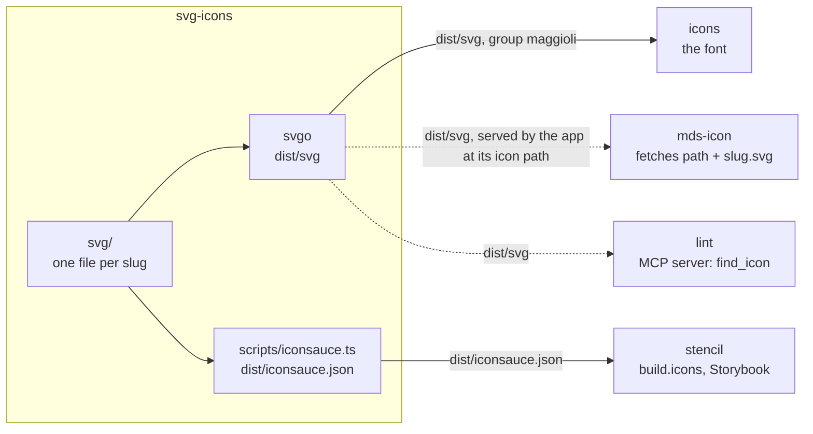

# Maggioli Design System

#### svg-icons

The SVG artwork of the Maggioli Design System. Consumed by
`@maggioli-design-system/magma` (the `mds-icon` web component reads these files at runtime) and by
`@maggioli-design-system/icons`, which turns a curated subset of them into an icon font.

##### Architecture

The file name of each SVG is its slug. The build optimises the files and lists the slugs; the
font, the components and the MCP server read them, and a consumer app serves the files to
`mds-icon`.



Rectangles: this repository; rounded boxes: outside it. Solid arrows: inside the repository;
dashed: where the package is installed. Labels: the file, export or command that crosses
([convention](../../docs/ARCHITECTURE.md#diagrams-of-the-projects)).

##### Installation

```
npm install @maggioli-design-system/svg-icons@latest
```

##### Adding an icon

Drop the optimised file into [`svg/`](svg). The filename is the public slug and must match
`^[a-z0-9-]+\.svg$` — the build fails otherwise.

An icon added here is **not** automatically part of the icon font: it also needs an entry in
`projects/icons/dictionary.json`. See [`projects/icons/SPEC.md`](../icons/SPEC.md) for the full
flow, and run `nx run icons:check.dictionary` to verify the two stay in sync.

##### Build

```
nx run svg-icons:build
```

Outputs optimised SVGs in `dist/svg/` and the slug dictionary `dist/iconsauce.json`.
